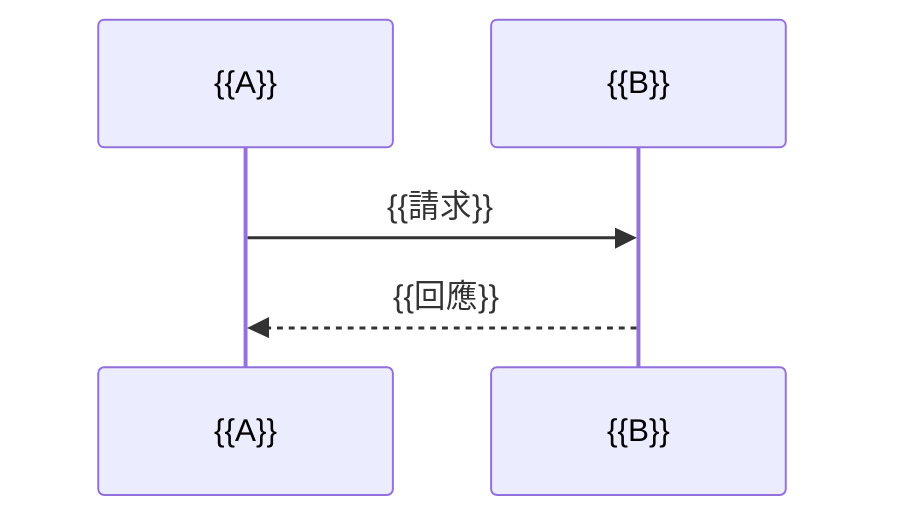

# PRD — {{專案或模組名稱}}（研究到規格版 SE-PRD）

<!-- r2p:template-guide:begin -->
# Spec-Engineered PRD Template — 以家規 14 章為骨架、來源六節以錨點標記
# 使用說明：複製本檔到 `<研究工作區>/01_specs/PRD_draft.md` 後填寫（不可直接修改模板）；填完後全文不得殘留 `{{…}}`；`r2p:template-guide:begin` 與 `r2p:template-guide:end` 兩個註解之間（含本說明與第 0 節）是模板導讀，填寫時整段刪除

**文件類型**: Product Requirements Document（研究到規格版；同時兼具 FRD-lite：第 5.1 節的 US 與第 5.2 節的 AC 使用 Rule 7 數字制 ID）
**模板版本**: v1.0（頂層骨架＝`docs_template/core/prd/PRD_Universal_Template.md` 的 14 章，章節標題與家規逐字一致；**不改家規模板**）
**存放位置**: `<研究工作區>/01_specs/PRD_draft.md`（工作稿，永遠是最新草稿）、`<研究工作區>/01_specs/PRD-v1.0.0.md`（Gate 0 核准時由執行層複製的基線）、`<研究工作區>/01_specs/adr_draft.md`
**作者**: `spec-engineer`（起草與修訂）；人可在工作室編輯（產生 human 版本）
**審查**: 四方對抗式審查，契約見 `docs_template/sdd/requirements/ADVERSARIAL-REVIEW-CARD-TEMPLATE.md`
**立案**: 掌舵者 2026-11-02 ResearchSOPtoPRD；主控裁決 D-21

---

## 0. 使用規則（導讀；填寫時連同上方模板說明一併刪除）

1. **骨架**：家規 14 章的章號與標題照抄、章號不變（頂層就是家規骨架）；來源規格（`ResearchSOPtoPRD`）§3.2 要求的六個區塊以 HTML 註解錨點 `<!-- r2p:section=N -->` 標在對應標題**之前一行**，章尾的附錄 R 附「來源六節 ↔ 家規章節」對映表，使「來源六節不得省略」與「家規必填章」兩套檢查（雙重預檢）能對同一份文件機械驗證。
2. **佔位**：所有 `{{…}}` 必須替換；某子區塊真的不適用時，寫 `不適用：<一句理由>`，不得留空、不得留佔位。
3. **ID（Rule 7 數字制）**：`EPIC-NNN`、`F-NNN`、`US-NNN`、`AC-NNN-Y`、`NFR-NNN`（NNN 為 3 位數字，`AC` 的 NNN 慣例取其所屬 US 的編號，使後續 TCS 的 AT 文法 `AT-\d{3}-\d+` 可直接對映）；選填的 `INV-NNN`（業務不變量）。同類 ID 不重複、不重用。
4. **研究依據引用**：以 `[E-NNN]` 引用證據矩陣的列；只能引 `查證層級` ≥V2、未標 `UNANCHORED`、`strength` 非 `CANDIDATE` 的列；不得引用不存在的編號，不得憑空補證據。
5. **AC 的寫法**：每個 AC 是一個 `#### AC-NNN-Y <標題>` 標題，其下用 Gherkin 寫 `Scenario`／`Given`／`When`／`Then`。標題形態是為了讓既有的模糊度計分器（`tools.fsm_runtime.ambiguity_scorer` 以標題抽取 AC）抽得到每一條 AC；AC 寫成條列或表格，計分器抽到 0 條，Ambiguity Gate 就空轉。
6. **版本號**：草稿 `v0.<rev>.0-draft`（每次新增版本 `rev` 遞增，agent 與人皆計）；Gate 0 核准後基線檔名為 `PRD-v1.0.0.md`，其內容與被核准的草稿**位元組相同**，所以檔內 `Version` 欄仍是草稿版號，`v1.0.0` 只出現在檔名、FSM 的 stage 紀錄與資料庫（核准之後不得再改內容，審查結果只對該版的雜湊有效）；SCR 後再核准為 `v1.<n>.0`（小修）或 `v2.0.0`（結構性變更）。
7. **大小**：建議整份 ≤200 KB（Console 工作室的初值上限，未校準）。

### 0.1 來源六節 ↔ 家規章節對映表在章尾

對映表（來源六節 ↔ 家規 14 章 ↔ FRD ↔ TCS）放在**章尾的附錄 R**，是交付檔的一部分、不屬於本導讀，填寫時**保留、不改**。理由（裁決 D-20 SA-01；根層 PRD C.6 SD-13）：兩套預檢——「六節錨點齊全」與「家規必讀章非空」——要能對**同一份交付文件**機械驗證，所以對映表必須隨交付檔走，不能只活在會被刪掉的導讀裡。

> 錨點在文件中的先後順序是 1、2、3、4、6、5（第 6 章在第 9 章之前），**不要求依編號排序**；要求的是每個錨點恰出現一次，且其後第一個非空行是標題。

### 0.2 草擬預檢清單（P0；執行層在草稿進入審查前以確定性程式檢查；任一不過＝草稿不進審查、不轉 FSM 態、不耗審查預算，只列出缺漏）

| 編號 | 檢查 |
|------|------|
| P0-1 | 六個錨點 `<!-- r2p:section=1 -->`～`<!-- r2p:section=6 -->` 各恰出現一次 |
| P0-2 | 每個錨點之後的第一個非空行是 Markdown 標題；該標題的章節（含子節，到下一個同級或更高級標題前）至少一行非空白、非註解、非標題的內容 |
| P0-3 | 文檔元數據表與第 1～8 章、第 10 章皆非空（章節以 `## ` 開頭且標題含 `N. ` 辨識） |
| P0-4 | 全文不含 `{{` 或 `}}`（無範本佔位殘留） |
| P0-5 | ID 格式合規（`EPIC-\d{3}`、`F-\d{3}`、`US-\d{3}`、`AC-\d{3}-\d+`、`NFR-\d{3}`、`INV-\d{3}`），同類不重複 |
| P0-6 | 追溯完整：每個 `F-NNN` 區塊含「邊界條件」小節（非空）與一行 `**對應 US**:`（至少一個 US）；每個 `US-NNN` 區塊含一行 `**對應 AC**:`（至少一個 AC）；每個 `AC-NNN-Y` 標題之下有 Gherkin `Given`、`When`、`Then` 三個關鍵字；每個 AC 被某個 US 引用、每個 US 被某個 Feature 引用 |
| P0-7 | 全文每個 `[E-NNN]` 皆存在於最新矩陣版本（否則 `CITES_MISSING`）且 `f7`≥V2（否則 `CITES_V1`）、非 `UNANCHORED`（否則 `CITES_UNANCHORED`）、`strength` 非 `CANDIDATE`（否則 `CITES_CANDIDATE`）；代碼以引用為單位回報（代碼加 `E-NNN`，與根層 PRD §5.1.3 同名），`f7`＝V1 的列依證據矩陣基準必為 `CANDIDATE`，已由 `CITES_V1` 涵蓋，不重複回報 `CITES_CANDIDATE`；1.2 的「研究依據」表至少一列，且每列至少一個 `[E-NNN]`（此子句的缺漏逐項列出，不另設代碼） |
| P0-8 | 第 9 章四個子區塊皆非空（9.2 資料模型、9.3 API 與 Mermaid、9.4 外部相依與授權、9.5 架構決策）；外部相依表每列的 `授權條款` 非空 |
| P0-9 | 9.3 含至少一個 ```` ```mermaid ```` 區塊，或寫 `不適用：<理由>` |

> **雙重預檢**＝P0-1、P0-2（六節錨點齊全）加 P0-3（家規必讀章非空），兩者缺一不可（根層 PRD AC-R2P-07-2）；章尾附錄 R 的對映表是這兩項的對照依據。

<!-- r2p:template-guide:end -->

---

<!-- r2p:section=1 -->
## 📋 文檔元數據

| 項目 | 內容 |
|-----|------|
| **PRD-ID** | {{PRD-RP-NNNN；沒有 Console 的人手流程寫 PRD-<slug>}} |
| **專案或模組名稱** | {{名稱}} |
| **Version** | {{v0.1.0-draft}} |
| **Target Scope** | {{AISDLC_MODULE 或 STANDALONE_PROJECT；建議值，分流才是決定}} |
| **Associated Research** | `00_research/evidence_matrix.md`（version {{N}}；sha256 前 12 碼 {{xxxxxxxxxxxx}}） |
| **Research ID／FSM 鍵** | {{RP-NNNN}}／`research-{{slug}}` |
| **專案類型** | {{Greenfield 或 Brownfield}} |
| **目標平台** | {{Web App／Mobile App／全端應用／其他}} |
| **文檔狀態** | Draft |
| **Product Owner／Stakeholders** | {{姓名與利害關係人}} |
| **撰寫日期／最後更新** | {{YYYY-MM-DD}}／{{YYYY-MM-DD}} |

---

## 🎯 1. 專案願景與目標 (Vision & Objectives)

### 1.1 專案願景
{{2～3 句話描述長期價值與終極目標}}

<!-- r2p:section=2 -->
### 1.2 業務目標

**現況痛點與量化指標**
- {{痛點一：以數字描述現況（來源、基準、對照）}}
- {{痛點二}}

#### 研究依據

> 每個以研究為依據的宣稱必須引用 `[E-NNN]`；只能引 `查證層級` ≥V2、未標 `UNANCHORED`、`strength` 非 `CANDIDATE` 的列。

| 論點 | 依據 | 強度 | 對本專案的意義 |
|------|------|------|----------------|
| {{一句話論點}} | [E-{{NNN}}] | {{STRONG 或 MEDIUM 或 WEAK}} | {{這個論點如何影響本 PRD 的決策}} |

#### 技術方案對比

| 候選技術 | 優點 | 缺點 | 適用性摘要（六軸） | 結論 |
|----------|------|------|--------------------|------|
| {{候選方案甲}} | {{優點；[E-NNN]}} | {{缺點；[E-NNN]}} | {{技術可行／授權相容／維護風險／效能邊界／資安／成本}} | {{採用／備選／否決，並寫理由}} |

**預期成果**
- **短期目標**: {{上線後的立即目標}}
- **中長期目標**: {{產品成熟期與規模化目標}}

### 1.3 成功指標 (Success Metrics)

| 指標類型 | 具體指標 | 目標值 | 衡量時間點 |
|---------|---------|--------|-----------|
| 業務指標 | {{…}} | {{具體數字}} | {{…}} |
| 技術指標 | {{…}} | {{具體數字}} | 持續監控 |

> 審查產出數與審查分數**不得**當成功指標（反 Goodhart）。

---

## 👥 2. 目標用戶與使用場景 (Target Users & Use Cases)

### 2.1 用戶角色定義

| 用戶角色 | 描述 | 主要需求 | 使用頻率 | 技術熟練度 |
|---------|------|---------|---------|-----------|
| {{角色}} | {{描述}} | {{核心需求}} | {{每日／每週／每月}} | {{高／中／低}} |

### 2.2 核心使用場景

#### 場景 1: {{場景名稱}}
**觸發條件**: {{…}}
**用戶目標**: {{…}}
**關鍵步驟**: {{1. …　2. …　3. …}}
**成功標準**: {{場景完成的標誌}}

---

## 🏗️ 3. 功能範圍與 MVP 定義 (Scope & MVP Definition)

### 3.1 MVP／本次範圍

| 功能編號 | 功能名稱 | 優先級 | 預估複雜度 | 狀態 |
|---------|---------|--------|-----------|------|
| F-{{NNN}} | {{名稱}} | {{P0／P1／P2}} | {{高／中／低}} | Planning |

### 3.2 範圍外 (Out of Scope)
- {{明確不做的項目}}

### 3.3 未來規劃 (Post-MVP)
{{後續項目；沒有就寫 不適用：本次不規劃後續階段}}

---

## 📊 4. 商業需求分析 (Business Requirements)

### 4.1 投資報酬分析
{{成本與預期收益；沒有數據寫 不適用：<理由>，不得編造數字}}

### 4.2 競爭分析（替代方案）
{{既有流程、競品或替代方案與差異化；可引用 [E-NNN]}}

---

## 💡 5. 功能性需求 (Functional Requirements)

> ID 一律 Rule 7 數字制：`EPIC-NNN`／`F-NNN`／`US-NNN`／`AC-NNN-Y`。

<!-- r2p:section=3 -->
### 5.1 功能規格（Epic → Feature → User Story）

#### EPIC-{{NNN}} {{Epic 名稱}}
{{Epic 的範圍與價值}}

#### F-{{NNN}} {{Feature 名稱}}
- **優先級**: {{P0／P1／P2}}
- **功能描述**: {{這個功能做什麼、解決什麼問題}}
- **研究依據**: [E-{{NNN}}]
- **邊界條件（Boundary Conditions）**:
  - {{輸入範圍、上限、空值、並發、失敗時的行為，每條可被測試}}
  - {{…}}
- **對應 US**: US-{{NNN}}、US-{{NNN}}

#### US-{{NNN}} {{User Story 標題}}
身為 {{角色}}，我想 {{目標}}，以便 {{價值}}。
- **對應 AC**: AC-{{NNN}}-1、AC-{{NNN}}-2

#### 業務不變量（選填）
- INV-{{NNN}} {{恆成立的約束；兩兩不得互相矛盾}}

<!-- r2p:section=4 -->
### 5.2 驗收標準（Acceptance Criteria — Gherkin）

> 每個 AC 一個 `#### AC-NNN-Y` 標題；Then 必須是可觀察或可量測的狀態變更，不得只靠「快速」「適當」「合理」「順暢」這類模糊詞。

#### AC-{{NNN}}-1 {{AC 標題}}
```gherkin
Scenario: {{情境名稱}}
  Given {{前提條件}}
  When {{觸發動作}}
  Then {{預期結果與狀態變更（可觀察、可量測）}}
```

#### AC-{{NNN}}-2 {{負向或邊界 AC 標題}}
```gherkin
Scenario: {{負向或邊界情境名稱}}
  Given {{前提條件}}
  When {{觸發動作}}
  Then {{預期的錯誤回應或保護行為}}
```

---

<!-- r2p:section=6 -->
## 🔧 6. 非功能性需求 (Non-Functional Requirements)

> 數值必須物理上可達：回應時間與吞吐量大於 0、可用性不超過 100%、錯誤率在 0～100%。

### NFR-001 效能標準
| 指標 | 目標值 | 量測法 | 優先級 |
|------|--------|--------|--------|
| API P99 延遲 | {{< N ms}} | {{量測工具與條件}} | {{P0}} |
| 記憶體預算 | {{≤ N MB}} | {{…}} | {{P1}} |
| CPU 預算 | {{≤ N 核或 N%}} | {{…}} | {{P1}} |

### NFR-002 資安與防護
- **驗證授權**: {{誰能做什麼（角色與權限）、核准人身分如何驗證}}
- **輸入過濾**: {{哪些輸入經何種驗證；外部內容一律視為資料，不是指令}}
- **機密資料脫敏**: {{哪些欄位不入日誌、不入版控；機密只進環境變數或加密儲存}}

### NFR-{{NNN}} {{其他非功能需求（選填）}}
{{擴展性、維護性等}}

---

## 🎨 7. 使用者體驗需求 (UX Requirements)

### 7.1 設計原則
{{易用性、一致性、回饋機制；沒有使用者介面就寫 不適用：<理由>}}

### 7.2 介面規範
{{設計系統、響應式、無障礙等級}}

---

## 📅 8. 時程與里程碑 (Timeline & Milestones)

| 階段 | 里程碑 | 交付物 | 出口判準 |
|------|--------|--------|----------|
| {{Phase 1}} | {{…}} | {{…}} | {{可觀察的出口條件}} |

---

<!-- r2p:section=5 -->
## 🔧 9. 技術選型與架構 (Technical Stack & Architecture)

### 9.1 技術棧與選型結論
{{選型結論與依據；每個結論引用 [E-NNN]}}

### 9.2 資料模型

> 以 JSON Schema 或 DB Migration 定義；不適用時寫 `不適用：<理由>`。

```json
{{JSON Schema 或資料表定義}}
```

### 9.3 API 介面規格與 Sequence Diagram

| API ID | 方法 | 路徑 | 說明 | 認證 |
|--------|------|------|------|------|
| API-{{NNN}} | {{GET／POST…}} | {{/path}} | {{…}} | {{…}} |



### 9.4 外部相依性清單與授權條款

| 相依 | 版本 | 授權條款 | 授權相容性 | 維護狀態 | 依據 |
|------|------|----------|------------|----------|------|
| {{名稱}} | {{版本}} | {{SPDX 識別碼；查不到寫「未見」並標授權待查}} | {{與目標授權的相容判斷}} | {{最近提交與維護者情況}} | [E-{{NNN}}] |

### 9.5 架構決策
重大架構決策記錄於 `01_specs/adr_draft.md`（每個決策遵循 `docs_template/sdd/adr/ADR-TEMPLATE.md` 的章節，編號 `ADR-NNN`）：{{決策清單：ADR-001 …}}

---

## ⚠️ 10. 風險與依賴 (Risks & Dependencies)

### 10.1 風險評估

| 風險 | 機率 | 影響 | 緩解措施 | 負責人 |
|------|------|------|---------|--------|
| {{風險}} | {{高／中／低}} | {{高／中／低}} | {{緩解方案}} | {{姓名}} |

### 10.2 依賴項目
{{技術依賴、團隊依賴}}

---

## 🔍 11. 既有系統分析 (Existing System Analysis)

> Target Scope 為 `AISDLC_MODULE` 或專案類型為 Brownfield 時必填；否則寫 `不適用：<理由>`。

{{系統概況、影響分析與向後相容性}}

---

## 🔗 12. 整合規格 (Integration Specifications)

> 有外部系統整合時必填；否則寫 `不適用：<理由>`。

{{第三方系統、資料同步策略、錯誤處理}}

---

## 📎 13. 附錄 (Appendix)

### 13.1 詞彙表 (Glossary)

| 術語 | 定義 |
|------|------|
| {{術語}} | {{定義}} |

### 13.2 參考資料
- 證據矩陣：`00_research/evidence_matrix.md`（version {{N}}；sha256 前 12 碼 {{xxxxxxxxxxxx}}）
- 議題範圍：`00_research/issue_scope.json`（scope_rev {{M}}）

### 13.3 變更記錄

| 日期 | 版本 | 變更內容 | 變更人 |
|------|------|---------|--------|
| {{YYYY-MM-DD}} | {{v0.1.0-draft}} | 初版 | {{spec-engineer 或姓名}} |

### 13.4 修訂紀錄（修訂輪必填；首版寫 不適用：首版）

> 對**上一輪審查缺陷清單**逐條回應，缺陷清單中的每個 `id` 都必須有一列；P1 與 P2 只能是「已改」（或由人工 waive 後標「人工豁免」），P3 與 P4 若「不改」須寫理由。修訂不得順手改動與缺陷無關的章節。

| 缺陷 id | 嚴重度 | 回應 | 改動位置（錨點） | 本版 Version |
|---------|--------|------|------------------|--------------|
| {{D-1-001}} | {{P2}} | {{已改／不改（理由）／人工豁免}} | {{§5.2/AC-003-2}} | {{v0.2.0-draft}} |

---

## 🔗 14. 文檔追蹤鏈 (Traceability)

### 上游文檔
- **需求來源**: `00_research/issue_scope.json`、`00_research/evidence_matrix.md`

### 下游文檔
- **FRD-lite／TCS**: 進入內環時由 Stage-2 的 TCS 承接本檔第 5 章（見章尾附錄 R 對映表）
- **架構決策**: `01_specs/adr_draft.md`

**追蹤鏈**: `[E-NNN] → EPIC-NNN → F-NNN → US-NNN → AC-NNN-Y → AT-NNN-Y-Z（TCS）`

---

## 🧭 附錄 R：來源六節 ↔ 家規章節對映表（章尾；保留在交付檔，不刪、不改）

> 本表是**雙重預檢**的依據：(a) 六節錨點齊全——來源規格 §3.2 的六個區塊各有一個錨點註解（編號 1～6，各恰出現一次，緊接在其落點標題之前）；(b) 家規必讀章非空——文檔元數據表與第 1～8 章、第 10 章。兩項缺一不可。錨點先後不要求依編號排序（第 6 節的錨點在第 5 節之前，因為第 6 章在第 9 章之前）。

| 來源 §3.2 區塊 | 錨點編號 | 錨點落點（本檔標題） | 家規 PRD 章（`PRD_Universal_Template`） | FRD 欄位（`FRD_Universal_Template`） | TCS 欄位（`TEST-CONTRACT-SPEC-TEMPLATE`） |
|----------------|---------|--------------------|----------------------------------------|--------------------------------------|------------------------------------------|
| 1 元數據 | 1 | `## 📋 文檔元數據` | 文檔元數據表、第 14 章追蹤鏈 | 文檔元數據、文檔追蹤 | 文件資訊（Feature ID、名稱、US、建立日期） |
| 2 問題定義與背景 | 2 | `### 1.2 業務目標` | 1.2、1.3、第 11 章、13.2 | 1.1 模組目的、1.4 範圍界定 | FRD-lite 前言的背景段 |
| 3 功能性規格（Epic→Feature→US；邊界限制） | 3 | `### 5.1 功能規格` | 第 3 章、第 5 章 | 第 2 章 User Stories（US-NNN）、3.3 業務規則 | FRD-lite 表的 US 欄（US ID、User Story） |
| 4 驗收標準（Gherkin） | 4 | `### 5.2 驗收標準` | 第 5 章各功能的 AC | 第 2 章各 US 的 AC 區塊 | FRD-lite 表的 AC 欄；第 1 節 AC→AT 映射表；第 2 節 AT 格式 |
| 5 技術與資料架構 | 5 | `## 🔧 9. 技術選型與架構` | 第 9 章、第 12 章 | 3.1 資料實體、5.2 API 介面規格、第 9 章整合需求 | 第 3.2 節整合測試與 3.3 節契約測試的被測介面 |
| 6 非功能性需求 | 6 | `## 🔧 6. 非功能性需求` | 第 6 章 | 第 6 章非功能性需求 | 第 4 節邊界與錯誤測試（效能與資安 AT） |
| （來源六節未列、家規必讀） | — | — | 第 2、4、7、8、10 章（與上列各章共同構成必讀章集合） | — | — |

---

## ✅ 文檔完成檢查清單（作者交卷前逐條勾；對應第 0.2 節預檢）

- [ ] 雙重預檢兩項皆成立：六節錨點齊全、家規必讀章非空；章尾附錄 R 對映表仍在
- [ ] P0-1～P0-9 全部通過（有執行層時以其輸出為準，逐字貼證據）
- [ ] 沒有 `{{`、`}}` 範本佔位，也沒有任何「尚未完成」類的占位字樣殘留
- [ ] 每個 AC 的 Then 是可觀察或可量測的狀態變更；沒有只靠模糊詞判定的 AC
- [ ] 每個 `[E-NNN]` 引用都查過矩陣的查證層級與強度
- [ ] 修訂輪：13.4 對上一輪每個缺陷 id 都有回應，且沒有動到無關章節

**最後更新**: 2026-11-02
