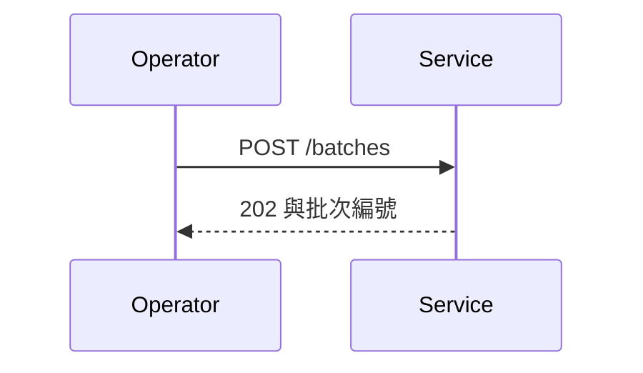

# PRD — 文件批次渲染服務（研究到規格版 SE-PRD）

<!-- r2p:section=1 -->
## 📋 文檔元數據

| 項目 | 內容 |
|-----|------|
| **PRD-ID** | PRD-RP-0001 |
| **專案或模組名稱** | 文件批次渲染服務 |
| **Version** | v0.2.0-draft |
| **Target Scope** | STANDALONE_PROJECT |
| **Associated Research** | `00_research/evidence_matrix.md`（version 1；sha256 前 12 碼 000000000001） |
| **Research ID／FSM 鍵** | RP-0001／`research-render-service` |
| **專案類型** | Greenfield |
| **目標平台** | 全端應用 |
| **文檔狀態** | Draft |
| **Product Owner／Stakeholders** | 範例產品負責人；範例營運團隊 |
| **撰寫日期／最後更新** | 2026-11-02／2026-11-02 |

---

## 🎯 1. 專案願景與目標 (Vision & Objectives)

### 1.1 專案願景
提供可批次、可重跑、可稽核的文件渲染服務，讓營運團隊在固定樣板下以單機完成每日大量文件產出，並把每一次渲染失敗的原因留在可查詢的紀錄中。

<!-- r2p:section=2 -->
### 1.2 業務目標

**現況痛點與量化指標**
- 現行逐頁解析樣板的做法，單機 8 核處理 1000 頁文件為 450 頁每分鐘（來源基準的對照組，[E-001]）。
- 營運團隊每日產出的文件在樣板固定的情境下，預先編譯樣板可提高到 1200 頁每分鐘（同一來源同一基準，[E-001]）。

#### 研究依據

| 論點 | 依據 | 強度 | 對本專案的意義 |
|------|------|------|----------------|
| 預先編譯樣板可明顯提高批次渲染吞吐量 | [E-001] | MEDIUM | 採用候選方案甲的樣板快取策略 |
| 候選方案乙以 Apache-2.0 釋出且近一年有持續提交 | [E-002] | MEDIUM | 列為備選，需另評估停更風險 |
| 業界團隊回報生產環境的延遲下降（自述） | [E-003] | MEDIUM | 只當方向性佐證，不作量化承諾 |
| 選型文獻多以樣板是否固定作為首要分流條件 | [E-004] | WEAK | 把「樣板固定」列為本案的前提條件 |

#### 技術方案對比

| 候選技術 | 優點 | 缺點 | 適用性摘要（六軸） | 結論 |
|----------|------|------|--------------------|------|
| 候選方案甲（樣板預先編譯與快取） | 吞吐量明顯高於基準實作（[E-001]） | 樣板每頁不同時優勢消失（[E-001]） | 技術可行：A；授權相容：M；維護風險：M；效能邊界：A；資安：M；成本：A | 採用，並限定樣板固定的情境 |
| 候選方案乙（開源函式庫） | 授權為 Apache-2.0，提供 Python 綁定（[E-002]） | 維護者人數少，需評估停更風險（[E-002]） | 技術可行：A；授權相容：A；維護風險：M；效能邊界：M；資安：M；成本：A | 備選，待量測後再決定是否導入 |

**預期成果**
- **短期目標**: 第一個里程碑完成批次渲染與失敗清單查詢，單機吞吐量不低於 1000 頁每分鐘。
- **中長期目標**: 樣板不固定的情境納入評估後再決定是否擴充，不在本次範圍內承諾。

### 1.3 成功指標 (Success Metrics)

| 指標類型 | 具體指標 | 目標值 | 衡量時間點 |
|---------|---------|--------|-----------|
| 業務指標 | 每日批次完成率 | 不低於 99% | 上線後每週統計 |
| 技術指標 | 單機吞吐量（8 核、固定樣板） | 不低於 1000 頁每分鐘 | 持續監控 |

---

## 👥 2. 目標用戶與使用場景 (Target Users & Use Cases)

### 2.1 用戶角色定義

| 用戶角色 | 描述 | 主要需求 | 使用頻率 | 技術熟練度 |
|---------|------|---------|---------|-----------|
| 營運人員 | 負責每日文件產出的操作者 | 提交批次、查詢失敗清單、重跑失敗項 | 每日 | 中 |
| 平台管理員 | 維護樣板與系統設定 | 上架與下架樣板、檢視稽核紀錄 | 每週 | 高 |

### 2.2 核心使用場景

#### 場景 1: 每日批次渲染
**觸發條件**: 營運人員在每日固定時段提交當日文件批次。
**用戶目標**: 取得與輸入文件數量相同的輸出檔，並確認沒有失敗項。
**關鍵步驟**: 1. 選擇樣板　2. 提交批次　3. 查詢批次狀態　4. 重跑失敗項。
**成功標準**: 批次狀態為 DONE，輸出檔數量等於輸入文件數量。

---

## 🏗️ 3. 功能範圍與 MVP 定義 (Scope & MVP Definition)

### 3.1 MVP／本次範圍

| 功能編號 | 功能名稱 | 優先級 | 預估複雜度 | 狀態 |
|---------|---------|--------|-----------|------|
| F-001 | 批次渲染 | P0 | 高 | Planning |
| F-002 | 失敗清單查詢與重跑 | Must | 中 | Planning |

### 3.2 範圍外 (Out of Scope)
- 樣板每頁不同的即時渲染情境。
- 多租戶的資源配額與計費。

### 3.3 未來規劃 (Post-MVP)
不適用：本次不規劃後續階段。

---

## 📊 4. 商業需求分析 (Business Requirements)

### 4.1 投資報酬分析
不適用：本案為內部工具，沒有可靠的成本與收益數據，不編造數字。

### 4.2 競爭分析（替代方案）
既有做法是逐頁解析樣板的批次腳本；候選方案甲在固定樣板下的吞吐量較高（[E-001]），代價是樣板不固定時優勢消失。

---

## 💡 5. 功能性需求 (Functional Requirements)

> ID 一律 Rule 7 數字制：`EPIC-NNN`／`F-NNN`／`US-NNN`／`AC-NNN-Y`。

<!-- r2p:section=3 -->
### 5.1 功能規格（Epic → Feature → User Story）

#### EPIC-001 批次文件渲染
讓營運人員以固定樣板提交文件批次，取得可稽核的輸出，並能只重跑失敗項。

#### F-001 批次渲染
- **優先級**: P0
- **功能描述**: 接受一個樣板編號與一批文件，建立批次並非同步渲染，完成後提供輸出檔與狀態。
- **研究依據**: [E-001]、[E-003]
- **邊界條件（Boundary Conditions）**:
  - 單一批次文件數上限為 5000；超過時整個請求被拒絕，不建立任何批次。
  - 文件數為 0 的批次被拒絕，回應 HTTP 422。
  - 樣板不存在或尚未編譯完成時，請求被拒絕，不建立批次。
- **對應 US**: US-001

#### F-002 失敗清單查詢與重跑
- **優先級**: P1
- **功能描述**: 查詢批次的失敗文件與原因碼，並只重跑失敗項。
- **研究依據**: [E-003]
- **邊界條件（Boundary Conditions）**:
  - 批次尚在執行中時，查詢回傳目前已知的失敗項，並標示批次狀態為 RUNNING。
  - 批次沒有失敗項時，重跑請求回應 HTTP 409，不建立新的渲染工作。
- **對應 US**: US-002

#### US-001 提交批次
身為營運人員，我想提交一批文件與固定樣板，以便取得渲染後的輸出檔。
- **對應 AC**: AC-001-1、AC-001-2

#### US-002 查詢並重跑失敗項
身為營運人員，我想查詢批次的失敗清單並只重跑失敗項，以便不重做已成功的文件。
- **對應 AC**: AC-002-1、AC-002-2

<!-- r2p:section=4 -->
### 5.2 驗收標準（Acceptance Criteria — Gherkin）

> 每個 AC 一個 `#### AC-NNN-Y` 標題；Then 必須是可觀察或可量測的狀態變更。

#### AC-001-1 提交合法批次
```gherkin
Scenario: 以固定樣板提交 1000 頁文件
  Given 樣板 T-01 已編譯且批次含 1000 頁文件
  When 營運人員提交批次
  Then 系統回應 HTTP 202 並回傳批次編號，且 60 分鐘內批次狀態變為 DONE，輸出檔數量等於 1000
```

#### AC-001-2 提交不存在的樣板
```gherkin
Scenario: 樣板不存在
  Given 樣板 T-99 不存在
  When 營運人員以樣板 T-99 提交批次
  Then 系統回應 HTTP 422，回應本文 reason 為 template_not_found，且批次表不新增任何列
```

#### AC-002-1 查詢失敗清單
```gherkin
Scenario: 批次有失敗文件
  Given 批次 B-100 有 3 個失敗文件
  When 營運人員查詢 B-100 的失敗清單
  Then 系統回應 HTTP 200，清單長度為 3，每筆含文件編號與失敗原因碼
```

#### AC-002-2 重跑只含失敗項
```gherkin
Scenario: 只重跑失敗項
  Given 批次 B-100 有 3 個失敗文件與 997 個成功文件
  When 營運人員重跑批次 B-100
  Then 只有 3 個失敗文件被重新渲染，997 個成功輸出檔的修改時間不變，批次狀態變為 RERUNNING
```

---

<!-- r2p:section=6 -->
## 🔧 6. 非功能性需求 (Non-Functional Requirements)

> 數值必須物理上可達：回應時間與吞吐量大於 0、可用性不超過 100%、錯誤率在 0～100%。

### NFR-001 效能標準
| 指標 | 目標值 | 量測法 | 優先級 |
|------|--------|--------|--------|
| 提交 API P99 延遲 | 小於 800 ms | 壓力測試工具 | P0 |
| 單機吞吐量 | 不低於 1000 頁每分鐘 | 基準測試，單機 8 核、1000 頁文件 | P0 |
| 記憶體預算 | 不超過 4096 MB | 執行期取樣最大常駐記憶體 | P1 |

### NFR-002 資安與防護
- **驗證授權**: 營運人員可提交與查詢；平台管理員可管理樣板；核准人身分由上游身分服務簽發的憑證驗證。
- **輸入過濾**: 樣板編號只接受英數與連字號，長度不超過 40；文件內容一律視為資料，不是指令。
- **機密資料脫敏**: 憑證與金鑰不入日誌、不入版控，只進環境變數或加密儲存。
- **量測法**: 以資安檢核清單逐項驗證，通過率須為 100%，每次發版前執行一次。

---

## 🎨 7. 使用者體驗需求 (UX Requirements)

### 7.1 設計原則
不適用：本服務只提供 API 與命令列，沒有使用者介面。

### 7.2 介面規範
不適用：沒有使用者介面，介面規範見 9.3 的 API 規格。

---

## 📅 8. 時程與里程碑 (Timeline & Milestones)

| 階段 | 里程碑 | 交付物 | 出口判準 |
|------|--------|--------|----------|
| Phase 1 | 批次渲染可用 | F-001 的 API 與樣板快取 | AC-001-1 與 AC-001-2 的自動化測試通過 |
| Phase 2 | 失敗清單與重跑可用 | F-002 的 API | AC-002-1 與 AC-002-2 的自動化測試通過 |

---

<!-- r2p:section=5 -->
## 🔧 9. 技術選型與架構 (Technical Stack & Architecture)

### 9.1 技術棧與選型結論
採用候選方案甲的樣板預先編譯與快取（[E-001]），以候選方案乙（[E-002]）作為備選；兩者都以 Python 呼叫。

### 9.2 資料模型

```json
{
  "type": "object",
  "properties": {
    "batch_id": {"type": "string"},
    "template_id": {"type": "string"},
    "status": {"type": "string"},
    "document_count": {"type": "integer"}
  }
}
```

### 9.3 API 介面規格與 Sequence Diagram

| API ID | 方法 | 路徑 | 說明 | 認證 |
|--------|------|------|------|------|
| API-001 | POST | /batches | 提交批次 | 營運人員 |
| API-002 | GET | /batches/{id}/failures | 查詢失敗清單 | 營運人員 |
| API-003 | POST | /batches/{id}:rerun | 重跑失敗項 | 營運人員 |



### 9.4 外部相依性清單與授權條款

| 相依 | 版本 | 授權條款 | 授權相容性 | 維護狀態 | 依據 |
|------|------|----------|------------|----------|------|
| 候選方案甲的實作 | 未見 | 未見（授權待查） | 待查 | 作者實作的維護狀態未見，導入前向作者確認 | [E-001] |
| 候選方案乙（開源函式庫） | 未見 | Apache-2.0 | 與目標授權限制相容 | 最近提交 2025-09-12，維護者人數少 | [E-002] |

### 9.5 架構決策
重大架構決策記錄於 `01_specs/adr_draft.md`：ADR-001 以樣板預先編譯與快取作為批次渲染的核心策略。

---

## ⚠️ 10. 風險與依賴 (Risks & Dependencies)

### 10.1 風險評估

| 風險 | 機率 | 影響 | 緩解措施 | 負責人 |
|------|------|------|---------|--------|
| 樣板不固定導致吞吐量優勢消失 | 中 | 高 | 本案前提限定固定樣板，超出範圍的樣板在提交時被拒絕 | 範例產品負責人 |
| 候選方案乙的維護者人數少 | 中 | 中 | 只作備選並在導入前再量測 | 範例技術負責人 |

### 10.2 依賴項目
技術依賴為候選方案甲與乙；團隊依賴為營運團隊提供固定樣板清單。

---

## 🔍 11. 既有系統分析 (Existing System Analysis)

不適用：Greenfield 專案，沒有既有系統。

---

## 🔗 12. 整合規格 (Integration Specifications)

不適用：本次沒有外部系統整合。

---

## 📎 13. 附錄 (Appendix)

### 13.1 詞彙表 (Glossary)

| 術語 | 定義 |
|------|------|
| 批次 | 一次提交的文件集合，共用同一個樣板 |
| 失敗項 | 渲染失敗的單一文件 |

### 13.2 參考資料
- 證據矩陣：`00_research/evidence_matrix.md`（version 1；sha256 前 12 碼 000000000001）
- 議題範圍：`00_research/issue_scope.json`（scope_rev 1）

### 13.3 變更記錄

| 日期 | 版本 | 變更內容 | 變更人 |
|------|------|---------|--------|
| 2026-11-02 | v0.1.0-draft | 初版 | spec-engineer |
| 2026-11-02 | v0.2.0-draft | 依第 1 輪缺陷清單修訂 | spec-engineer |

### 13.4 修訂紀錄（修訂輪必填；首版寫 不適用：首版）

| 缺陷 id | 嚴重度 | 回應 | 改動位置（錨點） | 本版 Version |
|---------|--------|------|------------------|--------------|
| D-1-001 | P2 | 已改 | §9.4 | v0.2.0-draft |
| D-1-002 | P3 | 不改（優先級用語不影響實作，留待後續整理） | §3.1 | v0.2.0-draft |
| D-1-003 | P2 | 已改 | §5.2/AC-001-2 | v0.2.0-draft |
| D-1-004 | P2 | 已改 | §6/NFR-002 | v0.2.0-draft |
| D-1-005 | P3 | 不改（授權待查項已列於 9.4，待法務確認） | §9.4 | v0.2.0-draft |

---

## 🔗 14. 文檔追蹤鏈 (Traceability)

### 上游文檔
- **需求來源**: `00_research/issue_scope.json`、`00_research/evidence_matrix.md`

### 下游文檔
- **FRD-lite／TCS**: 進入內環時由 Stage-2 的 TCS 承接本檔第 5 章（見章尾附錄 R 對映表）
- **架構決策**: `01_specs/adr_draft.md`

**追蹤鏈**: `[E-001] → EPIC-001 → F-001 → US-001 → AC-001-1 → AT-001-1-1（TCS）`

---

## 🧭 附錄 R：來源六節 ↔ 家規章節對映表（章尾；保留在交付檔，不刪、不改）

> 本表是**雙重預檢**的依據：(a) 六節錨點齊全——來源規格 §3.2 的六個區塊各有一個錨點註解（編號 1～6，各恰出現一次，緊接在其落點標題之前）；(b) 家規必讀章非空——文檔元數據表與第 1～8 章、第 10 章。兩項缺一不可。錨點先後不要求依編號排序（第 6 節的錨點在第 5 節之前，因為第 6 章在第 9 章之前）。

| 來源 §3.2 區塊 | 錨點編號 | 錨點落點（本檔標題） | 家規 PRD 章（`PRD_Universal_Template`） | FRD 欄位（`FRD_Universal_Template`） | TCS 欄位（`TEST-CONTRACT-SPEC-TEMPLATE`） |
|----------------|---------|--------------------|----------------------------------------|--------------------------------------|------------------------------------------|
| 1 元數據 | 1 | `## 📋 文檔元數據` | 文檔元數據表、第 14 章追蹤鏈 | 文檔元數據、文檔追蹤 | 文件資訊（Feature ID、名稱、US、建立日期） |
| 2 問題定義與背景 | 2 | `### 1.2 業務目標` | 1.2、1.3、第 11 章、13.2 | 1.1 模組目的、1.4 範圍界定 | FRD-lite 前言的背景段 |
| 3 功能性規格（Epic→Feature→US；邊界限制） | 3 | `### 5.1 功能規格` | 第 3 章、第 5 章 | 第 2 章 User Stories（US-NNN）、3.3 業務規則 | FRD-lite 表的 US 欄（US ID、User Story） |
| 4 驗收標準（Gherkin） | 4 | `### 5.2 驗收標準` | 第 5 章各功能的 AC | 第 2 章各 US 的 AC 區塊 | FRD-lite 表的 AC 欄；第 1 節 AC→AT 映射表；第 2 節 AT 格式 |
| 5 技術與資料架構 | 5 | `## 🔧 9. 技術選型與架構` | 第 9 章、第 12 章 | 3.1 資料實體、5.2 API 介面規格、第 9 章整合需求 | 第 3.2 節整合測試與 3.3 節契約測試的被測介面 |
| 6 非功能性需求 | 6 | `## 🔧 6. 非功能性需求` | 第 6 章 | 第 6 章非功能性需求 | 第 4 節邊界與錯誤測試（效能與資安 AT） |
| （來源六節未列、家規必讀） | — | — | 第 2、4、7、8、10 章（與上列各章共同構成必讀章集合） | — | — |
