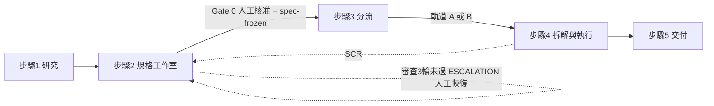

輸入快照：HEAD＝01d9be6e；主控裁決 D-01～D-66

# PRD - ResearchToPRD（研究議題轉規格書與雙軌開發落地）
# Product Requirements Document - Universal Template（Brownfield／Integration 混合情境）

**文檔類型**: PRD (Product Requirements Document)；本檔內含 FRD-lite（User Story 與 Gherkin AC 直接寫在 §5），不另寫 FRD／SRD；每期實作另有 TCS（由 SD 寫）
**模板版本**: v0.01 Universal（結構取自 `AISDLC_SDD/AISDLC_SDD_v0.30/docs_template/core/prd/PRD_Universal_Template.md`；模板本體未改）；章節編號與語氣照 `docs/01_requirements/SelfImproving_PRD.md`
**適用情境**: Brownfield（整合既有 Console／SDD／AutoClaude；必讀章節 1–8、11、10）＋ Integration（§12 接點表）
**適用平台**: 全端 Web（AgentConsole：Next.js 16 前端、Spring Boot 4.1／Java 21 console-api、FastAPI Engine Bridge、PostgreSQL 18）；另含 AISDLC_SDD 框架側資產（Markdown／YAML／Python runtime）
**上游需求**: 掌舵者 2026-11-02 原文（sid `245e80aa-71c4-443b-b8fe-d59f87a9f0e8`；逐字存檔 `docs/01_requirements/ResearchSOPtoPRD_Source_Spec.md`，本檔每條需求回指其章節，記為「來源 §x.y」）；主控預決 D-01～D-11（附錄 C.1；D-11 為掌舵者同日追問「不納入怎會有順暢的UI流程, 而研發的過程, 也應該納入資料庫紀錄」所引）；主控裁決 D-12～D-66（附錄 C.2、C.6、C.7；2026-11-02，依掌舵者「最佳化、最理想、最適當」授權代決，WHY 逐條記載；D-40～D-64 是框架側棒、測試契約棒對照本檔、SD-A 修訂交卷後及 SCG-0 一審 FAIL 的校準，D-65 依二審校準，D-66 依三審校準）
**FSM 位置**: 功能鍵＝AgentConsole 側 `agentconsole-research-to-prd-p0`／`-p1`／`-p2`（`sub=agentconsole`）、框架側 `sdd-research-to-prd`（`sub=sdd`，另一視窗，D-38）；產品執行期另有兩把 FSM 鍵：外環 `research-<slug>`（狀態目錄在研究工作區，Bridge 唯一建檔點）與內環 `<sub>-<slug>`（分流後建於目標專案標準狀態目錄；D-22）。本稿位於 SPEC_DRAFTING（Stage-1 上位規格），TCS／API 契約於各期另產；現況一律以 `GET /sdd/fsm` 與 `FSM-STATE-*.yaml` 為準，本稿未跑任何 FSM 寫入動詞

## 文檔元數據
| 項目 | 內容 |
|-----|------|
| **專案名稱** | ResearchToPRD（研究議題轉規格書與雙軌開發落地） |
| **專案類型** | Brownfield（整合既有 AgentConsole／AISDLC_SDD／AutoClaude；非新建系統） |
| **目標平台** | 全端 Web（見上）；Windows 11（PowerShell）與 macOS 開發機；Docker 全棧 |
| **目標日期** | 無日曆日期（刻意；階段出口一律為症狀型判準，見 §8） |
| **文檔狀態** | 定稿候選（v1.0.0-rc3；SD 合成 SA 草案、Architect 分析與主控裁決 D-12～D-66；SCG-0 一審 FAIL 已依 D-60～D-64 修訂、二審依 D-65 修訂、三審 PASS（P3 1）依 D-66 補一句；待主控凍結，凍結後本檔唯讀） |
| **Product Owner** | 掌舵者 |
| **Stakeholders** | 掌舵者（唯一人工核准者）；主控 agent（Fable）；子代理（Sonnet）；Console 操作者（OPERATOR）與唯讀使用者（VIEWER）；AutoClaude 引擎；AISDLC_SDD FSM runtime；Engine Bridge |
| **撰寫日期** | 2026-11-02 |
| **最後更新** | 2026-11-02（v1.0.0-rc3：依 SCG-0 一審 FAIL 的 F-02～F-20 與主控裁決 D-60～D-64 修訂——ESCALATION 人工恢復後預算不歸零（至多再得一次審查，「換世代」〔僅 ADMIN〕取得全新預算）、allowlist 稽核落 `audit_log` 的 `entity_type`／`entity_id`、研究抓取檢查改 `check_research_url` 包裝、§9.2 型別層補鎖、預檢代碼表、SCR 內環序列現態矩陣、七條 AC 的 Then 補量化；QA 二審追加 D-65（`floor_score` 範圍鎖改 50～100、不帶 `generation` 的重試初始化於非 FAILED 回 409 `stage_conflict`、計畫書 L4 消費端補列）；QA 三審追加 D-66（解析不出 host 的被拒外呼仍入庫，host 寫保留字 `(unparsed)`）；前一版 v1.0.0-rc2：依主控裁決 D-40～D-59 校準——審查卡與證據契約向框架模板對齊〔§5.1.3、§5.1.4〕、審查算法改整數式、DB 觸發器、速率限制事實回填、Gate 0 人工退回語意、無框架側 PRD；前一版 v1.0.0-rc：SD 定稿——合成 SA 草案 v0.1、Architect 分析與主控裁決 D-12～D-39；SA 增補 SA-01、03～10 已採納〔D-20〕、SA-02 併入 D-37） |
| **AISDLC 版本** | v0.30（LATEST；現查 `python AISDLC_SDD/scripts/sdd_version.py`，本稿不寫死） |

### 專案類型專屬欄位（Brownfield）
| 項目 | 內容 |
|-----|------|
| **既有系統名稱** | AgentConsole（Console PRD v1.1.0，`docs/01_requirements/Agent_ConsoleUI_PRD.md`）＋ AISDLC_SDD（FSM 閉環治理）＋ AutoClaude（執行引擎）＋ 根整合層 |
| **現行版本** | Console PRD v1.1.0（§0 權威）；AISDLC_SDD v0.30；其餘子專案版本一律現查各自 `CLAUDE.md`／`AISDLC_SDD/FRAMEWORK_STATUS.md` |
| **目標版本** | 不適用（新增功能，非版本升級；框架改動走 LATEST 原地改，根 `CLAUDE.md`〈路徑陷阱〉） |
| **系統文檔位置** | 根 `CLAUDE.md`、`AgentConsole/CLAUDE.md`、`AISDLC_SDD/CLAUDE.md`、`AgentConsole/docs/02_architecture/Architecture.md` |
| **技術棧**（既有，非本 PRD 選型） | Next.js 16／TypeScript 5 strict／Tailwind 4／shadcn；Spring Boot 4.1／Java 21／Flyway；FastAPI Bridge（Python 3.11）；PostgreSQL 18；Claude Code CLI（經 AutoClaude 步驟執行器） |

## 1. 專案願景與目標 (Vision & Objectives)
### 1.1 專案願景
讓掌舵者在 Console 內用**單一有狀態的工作流**，把「一個研究議題」依序變成：有證據錨定、經四方對抗式審查與人工核准（Gate 0）的**不可變 PRD** → 分流（併入既有 AISDLC 模組，或初始化獨立新專案）→ 由既有 AutoClaude／SDD 內環落地實作與自癒 → 帶追溯表的可交付成果；研發全程（議題、來源、證據、PRD 各版本、審查、決定、分流、拆解、run、自癒、交付）**完整入庫、可續做、可稽核**。

**納入 AISDLC_SDD 流程的口徑（D-11）**：兩側缺一不可——**框架側**（`AISDLC_SDD/<LATEST>` 的 `workflow/sdd-research-to-prd/`、agent YAML、`docs_template` 模板與 scaffold 範本）承載「流程、agent、模板」；**Console 側**（frontend、console-api、engine-bridge、PostgreSQL）承載「UI、DB、編排」。只有框架側＝沒有人能順暢操作且無紀錄；只有 Console 側＝沒有受治理的流程與可重用的 agent 資產。§11 整合點表兩側並列。

**可被反證**：在**可評估窗**內——已交付的研究專案數 ≥ `W_DELIVERED`（初值 2，無先例、未校準）——若連續兩個已交付專案在內環都發起過 SCR（FR-R2P-19），且兩次 SCR 的理由類別皆為「PRD 缺漏證據」或「AC 模糊」（SCR 理由分類欄），則本機制的研究／審查段被反證；不自動下線，改列為掌舵者決策項（調整研究深度、審查門檻或廢止）。已交付專案數不足＝NOT-EVALUABLE，既不算支持也不算反證，不得把「尚無 SCR」算成「已證有效」（零發現不是 PASS）。

### 1.2 業務目標
**解決的問題**:
- **現況痛點**（座標皆寫稿時現查）:
  - 研究、規格、拆解、實作各自散落：研究結論留在對話或個人筆記，PRD 手寫後再貼進 `/import` 頁（`AgentConsole/frontend/app/import/page.tsx`；Console PRD §5.2）；匯入只負責「拆解」，不負責「研究」「審查」，也不記錄規格從何而來。
  - 規格沒有證據錨定與獨立審查：現行 `/import` 的 AI 解析把文件當輸入，不驗證其論點是否有出處；SDD 的 SCG-0 閘門是人工與框架審查，沒有「研究→證據→四維評分→缺陷回饋」的結構化迴圈。
  - 沒有單一流程脊：使用者要在專案管理、匯入、執行中心、監控中心之間自行跳轉；離開後不知道做到哪一步（Console PRD §0.8 的「靜默退回」教訓：零專案時側欄入口落到專案管理頁，掌舵者以為功能壞了）。
  - 研發過程不入庫：研究來源、審查分數、決定理由只存在檔案或對話（例：SelfImproving 的帳本在 git、決定在逐字稿），Console DB 只有執行面的 run／step／checkpoint，查不到「這份 PRD 為何被核准」。
- **目標用戶**: 掌舵者（主要；唯一核准者）；OPERATOR（操作研究與執行）；VIEWER（唯讀）。
- **市場機會**: 不適用（Brownfield 內部功能；替代方案比較見 §4.2）。

**預期成果**（階段性、以症狀出口表達，無日曆；出口全文見 §8）:
- **短期＝P0（外環）**：任一研究議題能在 Console 內走到 Gate 0 核准，PRD 的每個證據引用皆可追到來源與抓取紀錄；離開再回來從同一步續做。
- **中期＝P1（分流）**：核准後的 PRD 能一次完成軌道 A（併入既有模組）或軌道 B（獨立新專案）的分流與拆解交棒，且全程可預演、可重試、無半套狀態。
- **長期＝P2（內環與交付）**：內環在既有執行／監控中心上以不可漂移的規格落地，並以追溯表與 Release Tag 交付。

### 1.3 成功指標 (Success Metrics)
只准症狀型結果指標；初值參數皆標「初值（未校準）」；基線未量測者一律寫 NOT-EVALUABLE，不得用估計值頂替。審查分數、產出數量類不作成功指標（§1.3.1）。

| 指標類型 | 具體指標 | 目標值 | 衡量時間點（事件，非日曆） | 量法與資料來源 |
|---------|---------|--------|---------------------------|----------------|
| **品質指標** | **M1 證據錨定率**：被核准的 PRD 中，`[E-NNN]` 引用指向「查證層級 ≥ V2 且非 `UNANCHORED`」證據列的比例 | 100%（斷鏈或違規引用數＝0；Gate 0 前機械預檢，不達不得送審） | 每次送審前、每次 Gate 0 核准時 | 分子＝合規引用數、分母＝該 PRD 版本的 `[E-NNN]` 引用總數；資料＝PRD 版本表（`evidence_refs[]`）與證據矩陣版本表（FR-R2P-05、07） |
| **品質指標** | **M2 凍結一致率**：已交付研究專案中，交付時規格檔 sha256 與「最近一次 Gate 0」凍結摘要逐檔相同的比例 | 100%（不一致＝凍結被繞過，列為缺陷） | 每個研究專案交付時 | 分母＝已交付研究專案數；資料＝Gate 0 決定表的 `spec_doc_digests` 與工作區檔案實算 sha256（FR-R2P-10、20） |
| **技術指標** | **M3 全程入庫完整率**：已交付研究專案中，§5.1.8 的各類記錄（SCR、自癒嘗試兩類可為 0）皆有 ≥1 筆者的比例 | 100% | 每個研究專案交付時 | 分母＝已交付研究專案數；資料＝`GET /api/v1/research/projects/{id}/records/audit` 的 `missing[]`（FR-R2P-02 AC-R2P-02-4） |
| **技術指標** | **M4 四源對帳通過率**：對帳 `consistent=true` 的次數 ÷ 對帳總次數（Gate 0、分流、交付三個時點各一次） | 100%（<100% 即缺陷） | 每次對帳時 | 資料＝事件帳 `research_events`（`event_type=research.reconcile`，payload 帶 `consistent` 與 `drift[]`；FR-R2P-23）；四源＝FSM-STATE yaml、Bridge／引擎與工作區檔案、Console 渲染、PostgreSQL（沿 Console PRD §0.5 NFR-OBS-01） |
| **技術指標** | **M5 步驟可重放一致率**：以事件帳（`research.step` 事件）重放得到的游標等於研究專案表 `flow_step`／`flow_phase` 的研究專案比例 | 100% | 每次對帳時 | 分母＝研究專案總數；資料＝`research_events` 與 `research_projects`（FR-R2P-01、02） |
| **資訊欄**（不作成功指標） | M6 已核准 PRD 在內環的 SCR 次數（按理由類別分群）；M7 研究 run 的 token 用量中位數 | 無目標值（只看趨勢，不得宣稱成效） | 每個研究專案交付時 | SCR 表、run 表；降為資訊欄的理由見 §1.3.1 |

#### 1.3.1 明文禁止當成功指標（Goodhart）
| 禁用指標 | 為什麼不行 | 座標 |
|---------|-----------|------|
| 審查加權總分、審查通過率、審查輪數 | 分數由 LLM 審查者給，可被灌水或被起草者迎合；它是閘門的輸入，不是成效；高分不等於規格正確 | SelfImproving PRD §1.3.1（任何自評分數不得充當成效）；NFR-R2P-07 |
| 抓取來源數、證據列數、PRD 版本數、缺陷數 | 多抓多列就多、少審就少；對擴張中的面做對抗搜尋沒有不動點 | 根 `CLAUDE.md`〈守衛面准入〉的「量、不挖」精神 |
| 完成的研究專案數、token 用量 | 與規格品質無因果；用量可被拆分研究專案壓低 | — |
| 「零發現」（零 SCR、零缺陷） | 零發現不是 PASS；無事件＝NOT-EVALUABLE | `docs/04_planning/AutoSDD_Iteration_Prompt_Template.md`〈審查閉環的終止〉 |

**人機協作確認點**：[ ] Stakeholders 確認願景與反證條件一致　[ ] 成功指標可衡量且合理（尤其 `W_DELIVERED` 初值）　[ ] 短中長期成果有清晰路徑

## 2. 目標用戶與使用場景 (Target Users & Use Cases)
### 2.1 用戶角色定義
| 用戶角色 | 描述 | 主要需求 | 使用頻率 | 技術熟練度 |
|---------|------|---------|---------|-----------|
| **掌舵者（ADMIN）** | Product Owner；Gate 0 唯一核准者；外部副作用（建遠端庫、推送、Release Tag）的決定者 | 用最少閱讀量判斷「這份 PRD 能不能開工」；離開再回來不迷路；事後查得到每個決定的依據 | 事件驅動（每個研究議題數次） | 高 |
| **OPERATOR** | 日常操作者：建研究專案、啟動研究／草擬／審查／修訂、編輯 PRD、觸發拆解、控制執行 | 順暢走完流程、不重複輸入 | 每個研究議題 | 中 |
| **VIEWER** | 唯讀：檢視全部頁面與產物 | 看得到進度與依據、但不能改動 | 隨需 | 中 |
| **研究／審查／草擬 agent** | headless Claude Code 子行程（經 AutoClaude run 編排）；起草／修訂／審查 agent 無任何 Web 工具；研究 agent 只在 ADMIN 開啟 Web 層（產業層）時持有受網域規則約束的 WebSearch／WebFetch；任何 agent 都不持有 GitHub token | 明確任務書、結構化輸出 | 隨 run | 不適用 |
| **AutoClaude 引擎** | 執行研究／草擬／審查 run 與內環 run；產生 ESCALATION、review-request、`step` 事件 | 事件可被讀取、有界停機 | 隨 run | 不適用 |
| **AISDLC_SDD FSM runtime** | 閉環治理狀態機（`_HAPPY_PATH` 不動，D-01）；人工閘 `spec-frozen` | 規格凍結後不可漂移 | 隨狀態 | 不適用 |
| **Engine Bridge** | 唯一對外抓取與 git／gh 副作用的執行者（allowlist、白名單消毒） | 副作用可預演、可稽核 | 隨請求 | 不適用 |

#### 2.1.1 權限矩陣（沿 Architecture §8.2 的 RBAC；D-12 已裁決：Gate 0 核准／退回、分流確認、建立 Release Tag／PR 只有 ADMIN，附錄 C.2；D-64 增列「換世代」）
| 動作 | VIEWER | OPERATOR | ADMIN | 備註 |
|------|--------|----------|-------|------|
| 檢視全部頁面、產物、版本、審查、決定、對帳 | 可 | 可 | 可 | 全為唯讀端點（GET） |
| 新建／封存／復原研究專案 | 不可 | 可 | 可 | 復原沿既有專案復原（OPERATOR 以上） |
| **換世代**（ESCALATION 時放棄舊鍵、預算重新計） | 不可 | 不可 | 可 | 人工閘（放棄一把 FSM 鍵等同人工退回等級的不可逆決定）；須填理由並二次確認；寫決定列 `ABANDON_KEY`；不是恢復；載體 `POST …/reinit` 帶 `generation:"next"`，角色分兩段檢查：VIEWER 由既有授權鏈擋下（403 `ACCESS_DENIED`）、OPERATOR 通過授權鏈後由 `ResearchCommandService` 在服務層擋下（403 `research_write_forbidden`），兩者 Bridge 請求數 0（matcher 無法依請求本文分流；D-60、D-64；FR-R2P-18） |
| 啟動研究、草擬、審查、自動修訂；編輯並儲存 PRD | 不可 | 可 | 可 | 儲存＝新 PRD 版本 |
| **Gate 0 核准／退回修改** | 不可 | 不可 | 可 | 人工閘；`approver` 取 JWT subject，不可匿名 |
| 分流預演 | 不可 | 可 | 可 | 零副作用 |
| **分流確認**（建分支／建庫／搬入／推送） | 不可 | 不可 | 可 | 外部副作用；使用 GitHub token（僅 ADMIN 可設） |
| 觸發任務拆解 | 不可 | 可 | 可 | 草稿 `signed_off=false` |
| 拆解簽核 | 不可 | 可 | 可 | 沿既有 signoff 權限（Architecture §8.2：Operator 以上） |
| 執行控制（啟動／暫停／恢復／取消／審核） | 不可 | 可 | 可 | 一律走既有執行端點 |
| 發起 SCR | 不可 | 可 | 可 | 新 Gate 0 仍須 ADMIN |
| **建立 Release Tag／建立 PR** | 不可 | 不可 | 可 | 外部副作用 |
| 管理研究來源 allowlist（新增／停用；Reddit 須勾選已接受條款）、GitHub token | 不可 | 不可 | 可 | allowlist 經 `POST／PATCH /api/v1/research/allowlist`（僅 ADMIN，`SecurityConfig` 置於通用規則之前）；GitHub token 沿既有系統設定權限（加密欄） |
| 管理追蹤來源（新增／停用／重新啟用；FR-R2P-24） | 不可（可讀清單） | 不可（可讀清單） | 可 | `POST／PATCH /api/v1/research/watch-sources`（僅 ADMIN，`SecurityConfig` 置於通用規則之前；`GET` 為 VIEWER 以上）；V6 `audit_log` 的 `entity_type='research_watch_source'` |
| 把登記同步到自我進化（FR-R2P-24） | 不可（可讀同步狀態） | 不可（可讀同步狀態） | 可，且帳號須在 `console.si.deciders`（`CONSOLE_SI_DECIDERS`） | `POST /api/v1/si/research-registry/sync`（沿既有 `POST /api/v1/si/**` 僅 ADMIN 規則；名單由用例入口另判，403 `si_write_forbidden`）；`GET /api/v1/si/research-registry` 為 VIEWER 以上 |

### 2.2 核心使用場景
| 場景 | 觸發條件 | 用戶目標 | 關鍵步驟 | 成功標準 |
|------|---------|---------|---------|---------|
| **SC-R2P-1 議題到核准的 PRD** | 掌舵者有一個要研究的新議題 | 得到有證據、經審查、可開工的規格 | 建研究專案→啟動深研→生成 PRD 初稿→四方審查（必要時自動修訂）→核准（Gate 0） | FSM 為 SPEC_FROZEN；DB 有完整研究與審查紀錄；M1＝100% |
| **SC-R2P-2 審查未過進入人機協同** | 連續三輪未通過（加權總分 <85、任一維度 <60 或有未結 P1；D-14、D-24） | 知道卡在哪、由人決定如何恢復 | 彈窗顯示各輪分數與未結缺陷→（Console 外）以恢復指令恢復→按「我已恢復，繼續（僅一次機會）」續審，或（ADMIN）按「換世代」取得全新預算（D-30、D-60、D-64） | 無自動恢復；每個決定入庫 |
| **SC-R2P-3 離開再回來** | 瀏覽器關閉、換裝置、Bridge 重啟 | 從同一步續做 | 開 `/research` 或 `/research/{id}`→顯示游標所在步 | M5＝100%；已存產物不丟 |
| **SC-R2P-4 併入既有模組（軌道 A）** | PRD 的目標範圍是 AISDLC 模組 | 在不干擾共用工作樹的前提下開 feature 分支並掛載規格 | 預演→確認→獨立 worktree 建分支→發佈規格→綁定 SDD→拆解→內環→交付（PR） | 主工作樹零擾動；規格 digest 不漂移 |
| **SC-R2P-5 獨立新專案（軌道 B）** | PRD 的目標範圍是獨立專案 | 一次完成新專案骨架與 GitHub 初始化 | 預演→確認（Public 需二次確認）→複製工作區→git init／CI／compose→推送→拆解→內環→交付 | 無半套狀態；機密零外洩 |
| **SC-R2P-6 內環發現規格重大瑕疵** | 實作或自癒揭露 PRD 矛盾 | 不漂移地回到 Phase 0 修規格 | 發起 SCR→暫停內環→新 PRD 版本→重審→新 Gate 0→重拆解 | 舊凍結版保留；新 digest 入庫 |
| **SC-R2P-7 來源失效或被拒** | 抓取逾時／非 2xx／allowlist 外 | 研究不因單一來源中斷 | 失敗記入抓取紀錄，其餘來源繼續 | 全失敗才 FAILED(`no_evidence`)，不生成空矩陣 |

### 2.3 User Stories
US 與 FR 一對一，編號相同，寫在 §5.2 各 FR 之內（US-R2P-01～US-R2P-23）；清單＝各 FR 內行首為 `**US-R2P-NN**` 的行（計數以該行首樣式 Grep 現查）。

**人機協作確認點**：[ ] 用戶角色定義準確　[ ] 使用場景符合實際需求　[ ] 使用流程合理可行

## 3. 功能範圍與 MVP 定義 (Scope & MVP Definition)
### 3.1 MVP / 本次範圍（Brownfield：本次新增範圍）
**核心模型**：雙環漏斗（來源 §1.1）——**外環 Phase 0**（探索與規格工程：議題→多源深研→證據庫→PRD→對抗式審查→Gate 0）與**內環 Phase 1～N**（確定性 SDD 開發：規格唯讀，依 AC 做 TDD、自癒、回歸驗證；規格重大瑕疵只能經 SCR 退回外環）。**單一工作流脊（D-11、D-13）**：五個步驟面板（單一研究專案只有一條路由 `/research/{id}`，以 `?step=` 切換）是一條有狀態工作流（研究→規格工作室與 Gate 0→分流→拆解與執行看板→交付），每個研究專案的「當前步驟」持久化在 DB（FR-R2P-01）。

**兩側交付物**（D-02、D-11）：
| 側 | 承載 | 交付物（細目見 §9.1） | 功能鍵 |
|---|------|-----------------------------------|--------|
| 框架側 | 流程、agent、模板 | `AISDLC_SDD/<LATEST>/workflow/sdd-research-to-prd/`（流程、狀態對映、閘門）；2 支新 agent YAML（`research-analyst`、`spec-engineer`；四方審查重用既有 4 支 agent，D-05）；`docs_template/sdd/requirements/` 四份新模板（`ISSUE-SCOPE`、`EVIDENCE-MATRIX`、`PRD-SPEC-ENGINEERED`、`ADVERSARIAL-REVIEW-CARD`）；SCG-0 評分協定與 SCR 路徑條文（全為 Markdown／YAML；不加 `R-*.yaml`、不加 skills、不碰 `_HAPPY_PATH`／`formal/`；D-21） | `sdd-research-to-prd` |
| Console 側 | UI、DB、編排 | frontend 兩條路由（`/research`、`/research/[researchId]`）與元件；console-api 端點與 Flyway V16～V19；engine-bridge 的 stage run 編排器、研究抓取、工作區管理、軌道 B 登記制範本（`scaffold_templates/<name>/`，D-32）、git／gh 白名單操作、FSM 寫入面擴充（ADR-XPLAT-017）；SSE 事件 | `agentconsole-research-to-prd-p0`／`-p1`／`-p2` |

**MVP 功能清單**（階段 P0／P1／P2＝D-07；優先級 M＝Must-have、S＝Should-have，刻意不用 P0／P1 以免與階段同名）:

| 群組 | 功能名稱 | FR | 階段 | 優先級 | 複雜度 | 對映來源章節 |
|------|---------|-----|------|--------|--------|--------------|
| FG-A | 工作流脊與全程入庫（橫切；P0 建骨架，P1／P2 擴充） | FR-R2P-01、02、21～23 | P0（21 起於 P0、各頁隨期接入） | M | 高 | 來源 §1.1、§2、§5、§6.1；D-11 |
| FG-B | 研究：議題、深研、證據矩陣、即時動態欄 | FR-R2P-03～06 | P0 | M | 高 | 來源 §3.1、§5（TOPIC_INGESTION、DEEP_RESEARCH）、§6.2 頁面 1 |
| FG-C | 規格：PRD 草擬、四方審查、工作室 UI、Gate 0 | FR-R2P-07～10 | P0 | M | 高 | 來源 §3.2、§3.3、§5（PRD_DRAFTING～BASELINE_APPROVAL）、§6.2 頁面 2 |
| FG-D | 分流與交棒：分流精靈、軌道 A、軌道 B、拆解交棒 | FR-R2P-11～14 | P1 | M | 高 | 來源 §4、§5（BRANCHING_ROUTER～SDD_TASK_DECOMPOSITION）、§6.2 頁面 3 |
| FG-E | 內環：看板、自癒、終端、人機協同、SCR | FR-R2P-15～19 | P1／P2（FR-R2P-18 的審查升級類型隨 P0；FR-R2P-19 的 SCR 後端隨 P1、看板發起鈕隨 P2；表隨 V19〔P1〕） | M（15、18、19）、S（16、17） | 高 | 來源 §1.1(3)、§3.3、§5（SDD_*、HUMAN_ESCALATION）、§6.2 頁面 4 |
| FG-F | 交付 | FR-R2P-20 | P2 | M | 中 | 來源 §5（SDD_REGRESSION_VERIFIED、PROJECT_DELIVERED）、§6.2 頁面 5 |
| FG-H | 研究來源單一化：追蹤來源與自我進化同步（增量；鍵 `agentconsole-research-registry`） | FR-R2P-24 | 增量（P2 RELEASE 之後） | M | 高 | 無來源章節；掌舵者 2026-11-10 指示（sid `58ce5ccd-13fb-47fc-8a46-b04fa73257d7` line 14）；D-169～D-176 |

FR-R2P-02、22、23 的資料表與對帳骨架分兩次建立：P0 建 V16～V18（研究專案、事件帳、stage run、產物登記、來源、抓取、證據、PRD 版本、審查、Gate 0 決定、allowlist）；**V19（分流、SCR、拆解、交付表與自癒視圖）於 P1 一次建立**，P2 只寫入列、不再改遷移（Flyway 已發佈檔不改；SD 合成時的分期決定，附錄 C.5）；FR-R2P-21 的導覽與說明頁隨各期頁面增加（每期的新路由同 commit 補說明項，Architecture §5.4）。

### 3.2 範圍外 (Out of Scope)
- 不做：更新模型權重（微調、RL、自博弈訓練）。
- 不做：自動套用演化：研究／審查 agent 不得自行修改自己的任務書、評分權重、門檻或閘門；演化只提案、必經人工（沿 `AISDLC_SDD/CLAUDE.md` Rule 9 禁令 11、12）。
- 不做：繞過人工 signoff：Gate 0、分流確認、拆解簽核、ESCALATION 恢復一律必須真人操作。D-19 已裁決：根 `CLAUDE.md`〈凍結常態規則〉只管**開發本功能時**的 `spec-frozen`（主控代執行）；**產品內 Gate 0 永遠要求真人在 Console 點擊**，`approver`＝JWT subject，任何 agent、Bridge 排程或 CLI 都不得呼叫核准端點；D-01 括註「凍結常態規則適用」依此改寫。
- 不做：第二套 FSM：不新增 FSM 狀態、不改 `_HAPPY_PATH`（D-01、禁令 8）；步驟列的游標（`flow_step`／`flow_phase`）是 Console 對 FSM 與資料的**投影與產物完成度**，不是狀態機；`state.json` 是投影檔、不得被當輸入。
- 不做：新增根層 `tools/` 模組（D-02）。
- 不做：WebSocket：即時終端沿用既有 SSE（Architecture §5.3、ADR-001 D4），與來源 §6.2 頁面 4 的「WebSocket」字面不同（附錄 C.3 SA-04）。
- 不做：開放式網路搜尋與任意 URL 抓取：研究外呼只對 allowlist 的 HTTP GET（FR-R2P-04）；不抓 PDF／二進位。
- 不做：自動刪除：不自動刪除工作區、遠端庫、分支或 tag；搬遷採「複製驗證、原處保留」（不改名、不刪除；D-28、ADR-003 D8）。
- 不做：開 `AutoSDD_improving_117`（D-10）；走 SDD 功能鍵。
- 不做：多人／多租戶核准流程（K=1，掌舵者）；放寬須修訂本 PRD。

### 3.3 未來規劃 (Post-MVP；皆為 延後，以再開症狀驅動、不排日曆)
| 功能編號 | 功能名稱 | 再開症狀（一句可觀測事件） |
|---------|---------|--------------------------|
| F-R2P-101 | 跨研究專案的證據庫重用（同一來源被多個議題引用時共用抓取與查證） | 同一定位符在 ≥2 個研究專案重複抓取，且掌舵者回報重複查證造成額度浪費（附 RP-id） |
| F-R2P-102 | 多人核准（K>1）與簽核代理 | 掌舵者書面要求第二位核准者，或 Gate 0 因單一核准者不可用而卡住（附研究專案 id） |
| F-R2P-103 | 研究來源擴充（Reddit 以外的社群、專利庫、付費期刊） | 掌舵者要求新增 allowlist 以外的來源類型，並附授權與 ToS 評估 |
| F-R2P-104 | 研究專案範本（常見議題類型的預設 scope 與適用性軸） | 同類議題第三次手動輸入相同 scope（附 RP-id） |
| F-R2P-105 | Semantic Scholar 金鑰支援（官方入門額度為每秒 1 次；P0 不使用金鑰、機密面不新增，未帶金鑰時走共享池並以保守節流） | 研究 run 因 `api.semanticscholar.org` 回 `RATE_LIMITED` 而 `no_evidence` 或逾時，累計 ≥2 次（附 RP-id） |

**人機協作確認點**：[ ] MVP／範圍定義清晰　[ ] 優先級合理　[ ] 範圍外項目已確認

## 4. 商業需求分析 (Business Requirements)
> Brownfield 內部功能：不金額化，成本以額度與人審表達。

### 4.1 投資報酬分析
**成本項目（上界）**：掌舵者審閱（每個研究專案：Gate 0 一次、分流確認一次、拆解簽核一次、必要時 SCR；不審＝不變，無逾時自動核准）；子代理額度（研究 run、草擬 run、每輪四個審查者；受 Token Guard 與 `execution.globalTokenBudget` 節制，NFR-R2P-05）；內環 run 額度（沿既有執行中心）；工作區磁碟（原始抓取檔，git-ignored）。
**預期收益**：以 §1.3 症狀指標表達，不換算金額。**ROI**：不適用——價值主張被反證時依 §1.1 退場。

### 4.2 競爭分析（替代方案）
| 替代方案 | 優勢 | 劣勢 | 我們的差異化 |
|---------|------|------|-------------|
| 現行人工流程（對話研究→手寫 PRD→貼進 `/import`） | 零新增機制 | 無證據錨定、無獨立審查、不入庫、離開即失憶 | 單一工作流脊＋全程入庫＋機械預檢＋四方審查 |
| 既有 `/import` 智能匯入（Console PRD §5.2） | 已有拆解與 signoff 硬閘 | 只拆解不研究、不審規格品質、不記規格來源 | 在其前端加上研究與審查，並在其後端重用拆解與 signoff（FR-R2P-14） |
| SelfImproving 迴圈（`docs/01_requirements/SelfImproving_PRD.md`） | 已有帳本、閘、有界停機的先例 | 對象是治理工件的自我改進，不是產品規格；無 UI 流程 | 沿用其反 Goodhart、外部內容隔離、append-only 的設計原則，但對象是產品規格 |
| 外部「深度研究」類產品（泛指） | 單次產出研究報告 | 無 Gate、無落地閉環、無本系統的治理與審計 | 研究只是外環的一段，後接 Gate 0 與 SDD 內環 |

## 5. 功能性需求 (Functional Requirements)
> **ID 命名規範**（沿 SelfImproving PRD 的模組前綴制，避免與 Console PRD 的 `F-9xx`／`US-9xx`／`AC-9xx` 撞號；Console 既有最大號 F-905／US-919／AC-953）：`FR-R2P-NN`、`US-R2P-NN`（與 FR 同號一對一）、`AC-R2P-NN-Y`（NN＝FR 號）、`NFR-R2P-NN`（ADR 為 ADR-003、ADR-XPLAT-017 與框架側 ADR-001，見 §9.5，不另立 `ADR-R2P-NN`）。**數字版 AC／AT 編號由各期 TCS 指派**（TCS 內引本 PRD 的 AC 一律寫全名 `AC-R2P-NN-Y`）。**注意**：本系統**產出**的研究 PRD（使用者的產品規格）一律用 `AISDLC_SDD/CLAUDE.md` Rule 7 的數字制（`F-NNN`／`US-NNN`／`AC-NNN-Y`／`NFR-NNN`），才能被 TCS 編譯文法 `AC-[\d\-]+`、`AT-\d{3}-\d+` 對映（ADR-XPLAT-016 §8.1；附錄 C.5）；`R2P` 前綴只用於本 PRD。

**閱讀說明**
- 每條 FR 標〔階段｜新建／重用／擴充〕與「來源 §x.y」。AC 類型：**M**＝機械可驗（單元／元件／契約／AST／SQL 測試）；**E**＝需真實後端的 E2E；**流程型**＝需人（掌舵者真機）或需外部系統，標明驗證者。每條 AC 都寫成 Given／When／Then。
- 「整合點」列出既有功能座標（`路徑:行號` 為 SA 寫稿時現查的快照；重跑法＝座標本身）；查不到者寫「未找到（關鍵字…）」。
- **研究專案**（`RP-NNNN`）不是 Console 專案（`console.projects`）：前者是外環的工作單位，後者是內環的執行單位；兩者以 `console_project_id`（可空外鍵）在分流後關聯（D-37；附錄 C.3 SA-02、§13.1）。
- 數值參數一律標「初值（未校準）」，有先例者附座標；調整屬產品常數的（審查權重與門檻）＝本 PRD 修訂。
- 引用「SelfImproving 先例」者，是借用其**設計原則**（外部內容隔離、append-only、fail-loud），不是整合其程式。

### 5.1 資料契約定稿（FR-R2P-01～23 共用）
#### 5.1.1 工作流五步與完成條件（脊；FR-R2P-01）
游標欄位（`console.research_projects`）：`flow_step`∈{`topic`,`studio`,`route`,`build`,`deliver`}、`flow_phase`、`flow_status`、`flow_detail`；**只由 Bridge 在引擎動作的同一交易寫入，並附一筆 `research.step` 事件**（ADR-003 D5；D-36）。步驟 3 以後的相態（建置中／自癒中／待人工／待交付…）是 `execution_runs` 與內環 FSM 的函數，由 console-api 純函式 `ResearchFlowPolicy` 衍生，不落 DB。沒有 `steps:advance` 端點。

| 步 | 名稱（`flow_step`） | 面板（`/research/{id}?step=`；來源 §6.2） | 完成條件（Bridge 推進游標的前置檢查） | 轉移者 | 對映來源狀態（來源 §5） | 對映 FSM（D-01、D-22；不改 `_HAPPY_PATH`） |
|----|------|------|------|--------|------|------|
| 1 | 研究（`topic`） | 頁面 1 | `issue_scope` 通過驗證；≥1 次 `RESEARCH` stage run 達 SUCCEEDED；證據矩陣最新版有 ≥ `MIN_EVIDENCE_ROWS`（初值 3，未校準）列為「層級 ≥ V2、非 `UNANCHORED`、非 `clue_only`」 | OPERATOR 以上（按「生成 PRD 初稿」） | TOPIC_INGESTION、DEEP_RESEARCH | 外環鍵 `research-<slug>`：建立時 INIT→SCENARIO_DETECT→AGENT_LOAD（Bridge 唯一建檔點）；研究停在 AGENT_LOAD |
| 2 | 規格工作室（含 Gate 0）（`studio`） | 頁面 2 | Gate 0 核准成功：外環鍵＝SPEC_FROZEN；`PRD-v1.0.0.md` 已凍結並入 Gate 0 決定表 | ADMIN（核准） | PRD_DRAFTING、ADVERSARIAL_REVIEW、HUMAN_ESCALATION、BASELINE_APPROVAL | AGENT_LOAD→SPEC_DRAFTING→SCG_VALIDATION→（`gate PASS`）HUMAN_PENDING→〔有重試史才〕SPEC_REGRESSION_CHECK→`spec-frozen --stage Gate-0`→SPEC_FROZEN；最多 3 輪審查，第 3 次 `gate FAIL`＝ESCALATION（D-24）；ADMIN 退回＝HUMAN_PENDING 下 `gate SCG_VALIDATION FAIL`（態不動、計數＋1；D-50） |
| 3 | 分流（`route`） | 頁面 3 | `route_decision` 已確認且各副作用步驟皆成功（軌道 A：worktree 分支＋發佈＋綁定；軌道 B：骨架＋git＋遠端〔若選〕）；內環鍵已建並完成 Stage-1 基線採納 | ADMIN（確認） | BRANCHING_ROUTER、AISDLC_FEATURE_SETUP、STANDALONE_SCAFFOLD_SETUP | 外環鍵不變（停在 SPEC_FROZEN）；內環鍵 `<sub>-<slug>`：INIT→…→HUMAN_PENDING→`spec-frozen --stage Stage-1`→SPEC_FROZEN（路由確認＝這一步的人工確認） |
| 4 | 拆解與執行（`build`） | 頁面 4 | TCS 已草擬並由人凍結（Stage-2）、拆解已簽核；內環 run 完成且內環鍵達 RELEASE_READY（RTM 100%） | OPERATOR 以上（簽核、執行控制） | SDD_TASK_DECOMPOSITION、SDD_TDD_GENERATION、SDD_CODE_IMPLEMENTATION、SDD_SELF_HEALING_LOOP | 內環鍵：SPEC_FROZEN→SPEC_DRAFTING（Stage-2）→SCG_VALIDATION→HUMAN_PENDING→SPEC_FROZEN→TEST_CONTRACT_NEGOTIATED→IMPLEMENTATION→PR_REVIEW→RTM_VERIFY→RELEASE_READY（Gate 1＝RTM_VERIFY 通過，SCG-5） |
| 5 | 交付（`deliver`） | 頁面 5 | Release Tag 已建立（或 PR 已建立並由人確認合併後建 tag）；追溯快照已入庫 | ADMIN | SDD_REGRESSION_VERIFIED、PROJECT_DELIVERED | 內環鍵：RELEASE_READY→RELEASE（合併與雲端 CI 綠由人確認，Bridge 不查 CI） |

**HUMAN_PENDING 期間的游標與審查輪觸發類別（D-50、D-53 補充對映）**：人工退回後 FSM 仍停在 HUMAN_PENDING（框架沒有 HUMAN_PENDING→SPEC_DRAFTING 的邊），不能由 FSM 現態推出「修訂中」，所以另有兩條對映規則，由 Bridge 於同一交易寫入：

| # | FSM 現態與審查輪狀況 | 游標與記錄 | 說明 |
|---|--------------------|-----------|------|
| M1 | FSM＝HUMAN_PENDING，且最新審查輪未通過，或人工退回後 PRD 修訂中 | `flow_phase=REVISING` | 自動修訂 run 進行中本來就是 `REVISING`；本列補上 FSM 已在 HUMAN_PENDING 時的情況（`flow_step` 仍為 `studio`）；`flow_status` 不由本表決定：由 Bridge 於寫游標時依 stage run 狀態與 FSM 現態衍生並落 DB，`ResearchFlowPolicy` 原樣取用、不自行衍生（D-56、D-59(3)）；優先序 `ESCALATED` > `RUNNING` > `FAILED` > `WAITING_HUMAN` > `IDLE`：FSM 現態 ESCALATION* ⇒ `ESCALATED`；有 RUNNING／QUEUED 的 stage run ⇒ `RUNNING`；呼叫端剛讓 stage run 失敗、取消或被回收 ⇒ `FAILED`（`flow_detail`＝`exit_reason`，取消為 `cancelled`；相態回到 stage 開始前的可重入相態；D-77）；等人（FSM 在 HUMAN_PENDING）⇒ `WAITING_HUMAN`；其餘 `IDLE`；`REVIEWING` 相態（`flow_phase`）以 REVIEW stage run 為憑、不以審查輪列推導（輪列只在輪有結果時才存在，D-57） |
| M2 | 審查輪開始（REVIEW stage run 啟動）的當下 FSM 現態＝HUMAN_PENDING | 該輪 `trigger_kind=POST_HUMAN`（輪列有結果才寫，寫入時帶此值；D-57） | 即人工退回後的再審：通過只記 DB（不呼叫 `gate … PASS`）、未通過呼叫 `gate SCG_VALIDATION FAIL`（D-50；AC-R2P-08-9、08-11） |

`flow_*` 游標只由 Bridge 依上列兩表與 stage run 狀態（`flow_status`，見 M1）推進；FSM 狀態是 `FSM-STATE-*.yaml` 的事實，游標與它的對映是否合法由對帳檢查（FR-R2P-23）。SCR 是唯一能使游標倒退的動作（FR-R2P-19）。`flow_phase` 列舉見 §9.2。

#### 5.1.2 `issue_scope.json`（來源 §2、§5 TOPIC_INGESTION 的 `required_input`；DB→渲染→檔，作者＝Bridge）
```json
{
  "schema_rev": 1,
  "research_id": "<UUID；＝research_projects.id>",
  "rp_no": "RP-0007",
  "slug": "agent-memory-gc",
  "scope_rev": 1,
  "title": "研究專案名稱（1～200 字）",
  "topic": "研究命題（1～500 字）",
  "scope": {
    "in_scope": ["檢索邊界內項目"],
    "out_of_scope": ["明確排除項目"],
    "tech_stack": "目標技術棧提示（≤200 字，自由文字，不入任何指令；沒有就寫空字串）",
    "target_scope_hint": "AISDLC_MODULE｜STANDALONE_PROJECT｜UNDECIDED"
  },
  "depth_level": "STANDARD",
  "layers": { "academic": true, "industry": false, "oss": true, "community": true },
  "recency_years": 3,
  "applicability_axes": ["技術可行", "授權相容", "維護風險", "效能邊界", "資安", "成本"],
  "created_by": "<JWT subject>",
  "created_at": "2026-11-02T10:00:00+08:00"
}
```
- `slug` 須符合 `^[a-z0-9][a-z0-9-]{0,29}$`（1～30 字；DB `CHECK` 與 FSM 鍵 `research-<slug>` 的長度上界，BRIDGE §8.0）且通過 FSM `sanitize_component` 鏡像淨化（ADR-XPLAT-016 §7.4）；`depth_level`∈{`QUICK`（快速）、`STANDARD`（標準）、`DEEP`（深入）}，API 與 DB 同列舉；`layers` 四布林至少一個為 true（UI 依來源 §3.1 分三組：論文／官方文獻與業界／開源與社群〔含 `oss`、`community` 兩個勾選〕）；`industry` 為 true 而 Web 層未啟用（Web allowlist 為空，`capabilities.webLayerEnabled=false`）＝400 `layer_unavailable`；`recency_years`∈{1,2,3}（來源 §3.1「近 1–3 年」）；`applicability_axes` 為 1～6 個（SOP S3 的 F5 適用性欄，對本專案改寫為六格；初值，未校準）；`target_scope_hint` 在 PRD 草擬時作為「建議值」，分流（FR-R2P-11）才是決定。
- `scope_rev` 遞增即「新的研究範圍修訂」：既有證據不刪，標示其所屬 `scope_rev`；每個修訂在 `research_artifacts(ISSUE_SCOPE)` 留一個版本。
- 檔案由 Bridge 自 DB 渲染（鍵名 snake_case；API DTO 為 camelCase，對映見 API 契約 §1.3）；`research_id` 是 UUID（API 路徑用），`rp_no` 是顯示編號（`RP-NNNN`，DB 序列配號；D-37）。
- **契約 SSOT（D-43）**：欄位定義與驗證規則以框架 `docs_template/sdd/requirements/ISSUE-SCOPE-TEMPLATE.md` §1 為準（Bridge 對拍標記 `<!-- r2p:contract=issue_scope -->`），本節範例與其逐鍵相同；其中 `scope.in_scope` 至少 1 項、`scope.out_of_scope` 可為空陣列、`scope.tech_stack` 必填字串（可為空）、`created_at` 必帶時區 offset、`applicability_axes` 只能取軸登錄表（`<!-- r2p:contract=axis_registry -->`）的中文標籤、檔案編碼 UTF-8／LF／無 BOM。

#### 5.1.3 `evidence_matrix.md` 與 `evidence_items.json`（來源 §3.1(4)；對齊研究方法論 SOP S2 來源表與 S3 七欄抽取，`docs/05_development/SelfImproving_Research_Methodology_SOP.md` Part I；**契約 SSOT＝框架 `docs_template/sdd/requirements/EVIDENCE-MATRIX-TEMPLATE.md`**，D-43）
表頭固定為下列欄位與順序（Markdown 表，檔頭另有機器可讀註解 `<!-- r2p:evidence_matrix schema_rev=1 version=N -->`）：

| 欄 | 內容 | 規則 |
|---|------|------|
| ID | `E-NNN`（≥3 位遞增、不重用） | PRD 以 `[E-NNN]` 引用 |
| 層 | `academic`／`industry`／`oss`／`community` | 對映來源 §3.1 的學術、產業、開源與社群層（開源與社群在本表拆為兩值；DB 列舉 `ACADEMIC／INDUSTRY／OSS／COMMUNITY`） |
| 候選技術 | 該列所屬的候選方案名（可空） | 供「技術優缺點矩陣」分組（FR-R2P-06） |
| 標題、出處機構或作者、年份 | 文字 | 缺＝「未見」 |
| 定位符 | URL、DOI、git commit sha 三者至少一個 | 來源 §3.1(4)「強制關聯引用來源」；皆空＝拒收 |
| 來源分級 | `T1` 一手（arXiv／會議頁／官方文件與工程部落格）、`T2` 二手（survey／基準報告；不單獨支撐論點） | SOP S2 分級；`T3`（社群貼文、論壇）只當線索：收進來源表但強制 `clue_only=true`、不入證據項、不得被 PRD 引用（與 SOP S2:58 把 T3 排除在來源表外**有意不同**，框架 workflow 的差異清單明載；DB `CHECK (tier <> 'T3' OR clue_only)`） |
| 查證層級 | `V1` 只見搜尋結果標題與 URL（未開啟）、`V2` 已開啟頁面（Bridge 抓回原文落地但尚未針對章節專項抽取，或 headless WebFetch 的轉述）、`V3` 原文位元組已落地且針對方法／限制／安全章節做過專項抽取 | SOP S2 與模板 §2.2；**V0（憑記憶）不得列入**；**WebFetch 的轉述最高 V2**；PRD 只能引 ≥V2、非 `UNANCHORED` 且 `strength` 非 `CANDIDATE` 的列；V3 取得全文章節的方式＝arXiv HTML 版頁面（Bridge 抓取、allowlist 內）；沒有 HTML 版者維持 V2，不取 PDF（ADR-003 D7；採 SA 推薦） |
| 授權條款 | SPDX 識別碼（開源層必填）或「未見」 | 來源 §3.1(3)；供資安審查的授權衝突檢核 |
| F1 機制、F2 證據、F3 失敗與批評、F4 風險標籤、F5 適用性、F6 限制 | 七欄抽取的前六欄（F7 即「查證層級」欄） | SOP S3：缺欄寫「未見」不留白；F5 依 `applicability_axes` 逐軸填 A 直接適用／M 需改造／N 不適用＋一句理由；F2 的數字原樣抄（含單位、基準、對照組） |
| 抓取紀錄 | 抓取紀錄 id＋`sha12` | 連到 FR-R2P-02 R2 |

- 儲存格不得含管線字元 `|`（含者寫入被拒；先例 RTM.md §1.5 規則 4）；每格 ≤ 600 字元（初值，未校準），超長搬附註檔 `00_research/notes/E-NNN.md` 並於格內留座標。
- `UNANCHORED`：F2 含的數字 token 在該列抓取原文中比對不到（FR-R2P-05 AC-R2P-05-3）；該列不得被 PRD 引用。比對只對有抓取紀錄（有落地原文）的列執行；無抓取紀錄的宣告型列（headless WebFetch 轉述）沒有原文可比，抓取紀錄欄顯示「無（宣告型）」，其數字依矩陣 E 區固定句處理（「WebFetch 是小模型依提問轉述，所有 V2 的數字與陳述都是轉述，PRD 引用前須核對原頁面」）。`UNANCHORED` 由 Bridge 計算並入庫為 `research_evidence_items.unanchored` 專欄（D-51），**不**以保留字塞進 `f4_risk_tags`（風險標籤只准登錄表內的值）；渲染矩陣時於「抓取紀錄」欄末尾顯示 ⚠UNANCHORED。
- **草擬預檢的引用代碼表（單一真相源之一；FR-R2P-05 AC-R2P-05-2、FR-R2P-07 AC-R2P-07-3）**：與框架模板 `PRD-SPEC-ENGINEERED-TEMPLATE.md` §0.2 預檢 P0-7 列同名，兩處同為 SSOT——增減代碼須兩處與 Bridge 的代碼常數同步，Bridge 的代碼常數集合須與本表逐值相等。預檢 P0-7 對全文每個 `[E-NNN]` 引用逐一判定，違規以引用為單位回報（代碼加 `E-NNN`、所在錨點），任一筆存在＝草稿不進審查、不轉 FSM 態、不耗預算：

| 代碼 | 成立條件（該引用所指的證據列） | 備註 |
|------|----------------------------|------|
| `CITES_MISSING` | `E-NNN` 不存在於最新證據矩陣版本（斷鏈） | 此時不再判其餘三項 |
| `CITES_V1` | 查證層級為 V1（`f7` 低於 V2） | V1 列依矩陣基準必為 `CANDIDATE`，已由本碼涵蓋，不重複回報 `CITES_CANDIDATE` |
| `CITES_UNANCHORED` | `unanchored=true`（F2 數字在抓取原文比對不到） | V1 列不比對錨定，故與 `CITES_V1` 互斥 |
| `CITES_CANDIDATE` | `strength=CANDIDATE`（且非 V1 所致） | 只當線索、PRD 不得引用 |

- 預檢 P0-7 的另一子句：1.2「研究依據」表須至少一列且每列至少一個 `[E-NNN]`（此子句缺漏逐項列出，不另設代碼）。
- 檔案 `evidence_matrix.md` 由 Bridge 自 `evidence_items.json` 與 DB **確定性渲染**（含 S8 三桶：未找到／只讀摘要／未讀全文），agent 不直寫此檔；agent 的輸出是嚴格 schema 的 `evidence_items.json`（框架 EVIDENCE-MATRIX 模板），由 evaluator 驗證。
- **`evidence_items.json` 契約與入庫對映（D-43）**：agent（`research-analyst`）輸出的頂層鍵固定為 `schema_rev`、`issue_scope_sha256`、`scope_rev`、`search_log[]`、`sources[]`、`items[]`、`counter_evidence[]`、`honest_bounds`；欄位表、列舉與驗證規則一律以模板 §2、§3 為準、本節不複寫。Bridge 以模板內 `<!-- r2p:contract=evidence_items -->`、`axis_registry`、`risk_tag_registry` 三個標記的區塊抽取對拍（`tests/test_research_schema_parity.py`，§9.1 C16），驗證規則為模板 §2.3 的 16 條（結構、編號、錨定、URL 出處、分級、V3 條件、證據項綁定、欄位完整、儲存格紀律、數字登錄、反證、強度、無孤兒來源、誠實劃界、增補只增不改、雜湊與抓取 id 原樣抄寫），`strength` 必須等於模板 §3.3 函式值（`CANDIDATE` 的列只當線索，PRD 不得引用）。入庫對映（每項皆為確定性寫入，沒有第二套真相）：

| JSON | 入庫位置（§9.2） | 說明 |
|------|----------------|------|
| `sources[]` | `research_sources`（`source_no`、`layer`、`tier`、`verification`、`anchor_kind`、`url`／`doi`／`git_commit`、`license_spdx`、`clue_only`…） | T3 強制 `clue_only`；`verification` 只升不降（DB 觸發器，AC-R2P-05-9） |
| `items[]` | `research_evidence_items`（含 `candidate`、`scope_rev`、`strength`、`f1`～`f7`；另有 Bridge 入庫時計算的 `unanchored`） | 只含 T1／T2 來源；`candidate` 供優缺點矩陣分組；`scope_rev`＝該列首次出現時的範圍修訂、之後不改；`unanchored` 由 Bridge 計算、agent 不寫 |
| `counter_evidence[]`、`honest_bounds` | 隨 `research_artifacts`（`kind=EVIDENCE_ITEMS`）的 `content`（TEXT，≤1 MiB，位元組原樣的 JSON 全文；D-53）全文保存 | P0 不另立表；矩陣的 C 反證與 E 誠實劃界兩區由該全文確定性渲染 |
| `search_log[]` | `research_fetches`（每筆一列：`fetch_method`＝`WEB_SEARCH`／`WEB_FETCH`、`observed_by=AGENT_DECLARED`、`search_no`〔整數，`Q-NNN` 的數字部分〕、`result_urls`〔JSONB 陣列〕；D-53） | Bridge 觀測不到單筆 Web 呼叫，只認 agent 宣告（L-R1） |
| `sources[].fetch_refs[]`（`F-NNNN`） | `research_fetches.fetch_no`（`observed_by=BRIDGE` 且 `outcome=OK` 的列） | 由 Bridge 於任務書提供、agent 原樣抄寫；`verification=V3` ⇒ `fetch_refs` 非空；解析不出 host 的被拒外呼（例：`file:///etc/passwd`、空字串、畸形 URL）仍入庫：host 寫保留字 `(unparsed)`（非空、不是合法主機名，D-61 的 host 非空 `CHECK` 放行）、url 取原字串前 500 字元、`outcome=DENIED_ALLOWLIST`、`http_status` NULL；渲染時 `(unparsed)` 原樣顯示（D-66） |

#### 5.1.4 `review_card.json`（來源 §3.3、§5 ADVERSARIAL_REVIEW 的輸出；DB→渲染→檔，作者＝Bridge；審查者逐維度的原始輸出另存 `02_governance/reviews/round-<k>/<dimension 小寫>.json`，`<dimension 小寫>`＝`architecture`｜`product`｜`qa`｜`security`；**契約 SSOT＝框架 `docs_template/sdd/requirements/ADVERSARIAL-REVIEW-CARD-TEMPLATE.md`**〔§2 公式、§3 前置否決、§5 缺陷、§6 單維度輸出、§7 彙整卡〕，D-42～D-44；下列範例照模板形狀，分數為本 PRD 自選算例）
```json
{
  "schema_rev": 1,
  "research_id": "<UUID>",
  "rounds": [
    {
      "round": 1,
      "prd_version": "v0.1.0-draft",
      "prd_version_no": 1,
      "prd_sha256": "<64 hex>",
      "params": { "weights": {"ARCHITECTURE":0.30,"PRODUCT":0.25,"QA":0.25,"SECURITY":0.20}, "threshold": 85, "dimension_floor": 60 },
      "precheck": { "passed": true, "checks": [
        {"id":"SLV-001","passed":true,"detail":""},
        {"id":"SLV-002","passed":true,"detail":""},
        {"id":"SLV-003","passed":true,"detail":""},
        {"id":"AMBIGUITY","passed":true,"detail":"最大 AC 模糊度 0.31，低於 0.4"}
      ]},
      "reviewers": [
        {"dimension":"ARCHITECTURE","weight":0.30,"agent":"05.sd-architect-zh","agent_id":"sd-architect","agent_yaml_sha256":"<64 hex>","assist_agent_id":null,"assist_agent_yaml_sha256":null,"persona_sha256":"<64 hex>","score":78,"raw_file":"02_governance/reviews/round-1/architecture.json","raw_sha256":"<64 hex>"},
        {"dimension":"PRODUCT","weight":0.25,"agent":"03.pm-po-agent-zh","agent_id":"pm-po","agent_yaml_sha256":"<64 hex>","assist_agent_id":null,"assist_agent_yaml_sha256":null,"persona_sha256":"<64 hex>","score":84,"raw_file":"02_governance/reviews/round-1/product.json","raw_sha256":"<64 hex>"},
        {"dimension":"QA","weight":0.25,"agent":"07.qa-tester-zh","agent_id":"qa-tester","agent_yaml_sha256":"<64 hex>","assist_agent_id":null,"assist_agent_yaml_sha256":null,"persona_sha256":"<64 hex>","score":70,"raw_file":"02_governance/reviews/round-1/qa.json","raw_sha256":"<64 hex>"},
        {"dimension":"SECURITY","weight":0.20,"agent":"security-engineer-zh","agent_id":"security-engineer","agent_yaml_sha256":"<64 hex>","assist_agent_id":"compliance-officer","assist_agent_yaml_sha256":"<64 hex>","persona_sha256":"<64 hex>","score":90,"raw_file":"02_governance/reviews/round-1/security.json","raw_sha256":"<64 hex>"}
      ],
      "weighted_total": 79.90,
      "min_dimension_score": 70,
      "conditions": { "precheck_passed": true, "weighted_ge_threshold": false, "all_dimensions_ge_floor": true, "no_open_p1": true },
      "open_p1_count": 0,
      "passed": false,
      "verdict": "REVISE",
      "defects": [
        {"id":"D-1-001","dimension":"QA","severity":"P2","code":"QA-GWT_AUTOMATABLE-01","anchor":"§5.2/AC-003-2",
         "finding":"Then 子句無可量測的狀態變更","suggestion":"補上預期狀態碼與欄位","evidence_refs":[],
         "status":"OPEN","resolved_in":null,"waiver":null}
      ],
      "fsm": { "gate_result": "FAIL", "retry_count": 1 },
      "started_at": "2026-11-02T10:30:00+08:00",
      "ended_at": "2026-11-02T10:41:00+08:00"
    }
  ],
  "retry_count": 1,
  "final_verdict": "IN_PROGRESS"
}
```
- **公式（D-42；模板 §2.2）**：設四維整數分 `A`（ARCHITECTURE）、`P`（PRODUCT）、`Q`（QA）、`S`（SECURITY），各 0～100；`W100 = 30·A + 25·P + 25·Q + 20·S`（整數運算，不用浮點比較）；`weighted_total = W100 / 100`，**精確到小數 2 位、不四捨五入**，由確定性程式（Bridge）計算（審查者不給總分、看不到權重與門檻）。本例 `W100 = 2340 + 2100 + 1750 + 1800 = 7990` → `79.90`。反例：四維 85／85／84／86 時 `W100 = 8495`、`weighted_total = 84.95`，**不達 85**；若先四捨五入到小數 1 位再比較，會把它誤判成 85.0 而假通過，所以禁止。
- **通過（D-14、D-42）**：`passed = true` 當且僅當 `conditions` 四個條件全部成立——`precheck_passed`（前置否決全過）、`weighted_ge_threshold`（`W100 ≥ 100 × threshold`，threshold＝85）、`all_dimensions_ge_floor`（`min(A,P,Q,S) ≥ dimension_floor`＝60，初值、未校準）、`no_open_p1`（本輪 `OPEN` 的 P1 缺陷數＝0；`WAIVED` 不計）。前置否決不過時該輪不計分：`weighted_total`、`min_dimension_score` 為 `null`，`reviewers` 可為空陣列。
- `verdict`∈{`PASS`、`REVISE`、`ESCALATE`}：`passed` → `PASS`；否則 FSM `gate FAIL` 回傳 `escalated:true`（第 3 次，D-24）→ `ESCALATE`；否則 → `REVISE`。**`REVIEW_INVALID` 不是輪的 verdict**（D-55）：任一審查者輸出重試一次後仍不合 schema＝evaluator 無法評分，**不寫審查輪列、不佔 `round_no`**，只記該 REVIEW stage run（`exit_reason=review_invalid`）與事件 `research.review_invalid`，不呼叫 FSM gate、不得判 PASS、不耗 FSM 預算（模板 §2.2、§7.2 保留此名與「不佔序號」字面）；重新審查沿用同一個輪號（stage run `attempt`＋1）。頂層 `final_verdict`∈{`IN_PROGRESS`、`PASS`、`ESCALATED`}；頂層 `retry_count` 取自 FSM `SCG_VALIDATION` 現計數（取自 `gate`／`show` 的回傳，不自建第二套計數）。
- **審查者輸出契約**（模板 §6；Bridge evaluator 逐條驗，不合＝該步重試、仍不合＝`REVIEW_INVALID`，不寫審查輪列〔D-55，見上條 verdict〕）：`dimension` 為大寫四值；`agent_id` 必須等於模板 §4.3 登錄表該維度的 `agent_id`（PRODUCT 維度＝`pm-po`，檔 `agent/core/03.pm-po-agent-zh.yaml`；D-44）；`rubric` 恰五項（每項 `max=20`、整數 0～20、`note` 非空且 ≤300 字元，≥18 分者 `note` 須含 `§` 錨點）；`score` 必須等於五項之和；`defects[].code` 符合 `^(ARCH|PROD|QA|SEC)-[A-Z][A-Z0-9_]{1,23}-[0-9]{2}$`（前綴與項目屬該維度）、`prd_anchor` 符合 `§<章>[.<節>][/<ID>]`、`evidence_refs` 的每個 `E-NNN` 存在於證據矩陣；`prd_sha256` 由任務書提供、審查者原樣抄寫。單維度檔對映到彙整卡：`description`→`finding`、`prd_anchor`→`anchor`，其餘原樣；缺陷 `id`（`D-<輪>-<NNN>`）與 `status`（初始 `OPEN`）由 Bridge 賦予；`reviewers[]` 不收 `model`（模型可由 stage run 的 `config_sha256` 與 `prompt_manifest` 查到）。
- **輪列的寫入時點（D-57）**：`research_review_rounds` 是 append-only 表，**輪列只在輪有結果時寫入**——前置否決已判，或四維審查卡皆通過驗證並彙整、`gate` 已回傳（`verdict` 取決於 `gate` 的回傳，所以寫在 `gate` 呼叫之後；POST_HUMAN 通過輪不呼叫 `gate`）——並與該輪的四維分數列、缺陷列、`research_events` 在**同一個資料庫交易**內一次寫入；沒有 `status` 欄，列存在即輪已完成評估；`started_at`／`finished_at` 取自該輪 REVIEW stage run 的起訖、皆必填。**進行中、取消（`…:cancel`）、中斷（額度或 API，`exit_reason=quota`）、Bridge 重啟、輸出無效一律不寫輪列、不佔 `round_no`、不耗 FSM 預算**，只記在 REVIEW stage run（`research_stage_runs`，`UNIQUE(research_id, stage, round_no, attempt)`）與 `research.run`／`research.review_invalid` 事件；重新審查沿用同一個 `round_no`、`attempt`＋1。因此 `round_no`＝已完成評估的序號，與 FSM `gate` 呼叫一一對應（POST_HUMAN 通過輪不呼叫 `gate`；人工退回呼叫 `gate FAIL` 但不是審查輪，所以 `retry_history` 的 FAIL 筆數＝`fsm_gate_result='FAIL'` 的輪數＋人工退回筆數，比對式見 FR-R2P-08 邊界條件）。**審查結果的寫入順序與崩潰窗口（D-58(b)）**：Bridge 在呼叫 `gate` **之前**先把輪結果（聚合分數、四維分數、缺陷、`prd_version_no`、`trigger_kind`）落到 outbox；`gate` 回傳後補 `fsm_gate_result`／`fsm_retry_count`／`verdict`，並在同一交易寫輪列、分數、缺陷、事件；重放 outbox 時先以 FSM `show` 讀 `decision_trace`／`retry_history` 判斷該輪的 `gate` 是否已呼叫（已呼叫＝只補 DB、不重呼叫；未呼叫＝先呼叫再寫），使 `gate` 呼叫與輪列寫入對崩潰冪等（`gate` 已呼叫而 DB 未寫是 D-57 必然留下的窗口）。**例外（D-59(5)）**：POST_HUMAN 通過輪依設計不呼叫 `gate`（D-50），重放時不得套「未呼叫就補呼叫」（否則在 HUMAN_PENDING 送出非法的 `gate PASS`），該輪只補 DB。
- **前置否決 P1 與草擬預檢 P0 是兩件事**：`precheck.checks[]` 的 `id` 恰為 `SLV-001`、`SLV-002`、`SLV-003`、`AMBIGUITY` 四個（模板 §3），在 `SCG_VALIDATION` 內、四位審查者開跑前由 Bridge 執行，不過＝該輪 `gate FAIL`（計入 FSM 預算）；PRD 的結構與 `E-NNN` 引用格式屬**草擬預檢 P0**（框架 `PRD-SPEC-ENGINEERED-TEMPLATE.md` §0.2；FR-R2P-07），在草稿進入審查**之前**執行，不過＝不轉 FSM 態、不耗預算。
- **缺陷**：`severity` 的單一真相源＝框架模板 §5.1（P1＝阻斷：AC 不可測、授權衝突、憑空引用〔`[E-NNN]` 不存在、引 V1／`UNANCHORED`／`CANDIDATE`〕、機密入檔、NFR 物理不可行；P2＝重大；P3＝改善；P4＝建議）；**只有 P1 會阻擋通過**，P2～P4 透過 rubric 分數反映。`status`（DB 列舉）∈{`OPEN`、`FIXED`、`REGRESSED`、`WAIVED`、`SUPERSEDED`}：`FIXED`＝之後某輪未再提出同 `code`＋同 `anchor`（`resolved_in`＝被審 PRD 版本，對映 DB `fixed_in_version_no`）；`REGRESSED`＝曾 `FIXED` 後又被提出（合法出口只有 `FIXED`，D-63：REGRESSED 本身就是「修過又被命中」的開放態，再轉 OPEN 是冗餘狀態、會讓 M1 的缺陷統計重複計數，所以不放寬）；`WAIVED` 只能由人工動作產生、必須有 `waiver{by,reason,at}`（`waiver.at` 對映 DB `resolved_at`）；`SUPERSEDED`＝其 `anchor` 所指內容已被移除或重寫；轉移由 Bridge 依後續輪的缺陷清單確定性判定，DB 以觸發器鎖住單向轉移（AC-R2P-02-11）。
- **QA 維度另必填 `qa_extra.slv_manual_check`**（`ac_total` 等於 Bridge 對 PRD 5.2 節 `#### AC-` 標題的機械計數、`0 ≤ ac_testable ≤ ac_total`、`notes` 非空；`ac_testable < ac_total` 而無對應 P1／P2 缺陷＝內部矛盾，該步重試），補增量專案 SLV 機械半段空轉的缺口（框架 ADR-001 D7）。
- **人工退回後的再審（`trigger_kind=POST_HUMAN`，D-50）**：FSM 現態為 HUMAN_PENDING 時，再審通過只記 DB（該輪 `fsm.gate_result` 與 `fsm.retry_count` 皆為 `null`——未呼叫 `gate` 就沒有 `gate` 回傳的計數；與模板 §7.3、DB 的 `fsm_gate_result`／`fsm_retry_count` 同為 NULL 一致；D-61），不呼叫 `gate … PASS`；再審未通過仍呼叫 `gate SCG_VALIDATION FAIL`。模板 §7.3 不變量 1 已依 D-54 限縮為「凡有呼叫 `gate` 的輪：`fsm.gate_result=PASS` ⇔ `passed=true`；POST_HUMAN 再審通過的輪 `fsm.gate_result=null`」，Bridge 的不變量檢查照模板，本檔不另加限縮。
- **參數**：權重、門檻、地板是**產品常數**（來源 §3.3；D-14、D-20 SA-09、D-42），不提供 UI 修改；輪記錄自帶參數快照 `params`，分數綁版本（`prd_sha256`）；調整＝本 PRD 與框架模板同步修訂。
- **對拍（L12）**：Bridge 的 `tests/test_research_schema_parity.py` 以 `<!-- r2p:contract=… -->` 標記自框架模板抽取 `issue_scope`、`evidence_items`、`axis_registry`、`risk_tag_registry`、`review_params`、`rubric_registry`、`review_dimension`、`review_dimension_qa`、`review_card` 九個區塊作夾具；`review_card.json` 的鍵集合與模板 §7.1 範例**逐鍵相同**（每輪含 `prd_version_no`〔整數，對映 `research_prd_versions.version_no`；`prd_version` 為其 semver 字串，兩者並存〕——模板已把它列為正式鍵，Console 側沒有額外鍵；D-43、D-54）。

#### 5.1.5 `route_decision.json`（來源 §4、§5 BRANCHING_ROUTER）
```json
{
  "schema_rev": 1, "research_id": "RP-0007",
  "track": "A",
  "decided_by": "<JWT subject>", "decided_at": "2026-11-02T14:00:00+08:00",
  "prd_version": "v1.0.0", "prd_sha256": "<64 hex>", "prd_target_scope_differs": false,
  "a": { "branch": "feature/issue-0007", "base_ref": "main",
         "mount_target": "AgentConsole", "publish_path": "docs/01_requirements/ModuleName_PRD.md",
         "registry_entry": "…", "sdd_binding": {"sdd_project": "…", "execution_path": "…"} },
  "b": { "project_name": "…", "stack_template": "…", "visibility": "private",
         "target_dir": "…", "remote": {"provider":"github","owner":"…","repo":"…"},
         "ci": true, "docker_compose": true },
  "steps": [ {"action":"worktree_add","result":"ok","at":"…"} ],
  "results": { "branch_created": true, "repo_url": null, "commit_sha": "…" }
}
```
`a` 與 `b` 只填被選軌道的那一個；`steps[]` 逐步記錄副作用動作與結果（FR-R2P-11 AC-R2P-11-3）。

#### 5.1.6 `task_decomposition.json`（來源 §2、§5 SDD_TASK_DECOMPOSITION）
```json
{
  "schema_rev": 1, "research_id": "RP-0007", "version": 1,
  "prd_version": "v1.0.0", "prd_sha256": "<64 hex>",
  "generated_by": "GoalDecomposer", "signed_off": false, "signed_off_by": null, "signed_off_at": null,
  "limits": { "max_steps_per_goal": 24 },
  "goals": [ { "goal_id":"G-1","name":"…","pass_criteria":"…","depends_on":[],
     "tasks":[ {"task_id":"T-1","name":"…","prompt":"…","covers_us":["US-003"],"covers_ac":["AC-003-1"],
                "evaluator_command":null,"estimated_tokens":null} ] } ],
  "waivers": [ {"ac":"AC-007-2","reason":"人工填寫之豁免理由","by":"<JWT subject>","at":"…"} ],
  "console_project_id": null
}
```

#### 5.1.7 `state.json`（來源 §2 `02_governance/state.json`；**投影，不是真相、不得當輸入**）
`{ research_id, flow: {step, phase, status}, fsm: {project, state, updated_at, frozen_stages[]}, runs: [{id, stage, status}], projected_at }`；由 Bridge 於每次步驟轉移與 FSM 讀取後寫出；全 repo 無任何程式讀它決定轉移（AC-R2P-23-3）。

#### 5.1.8 全程入庫的記錄類別（D-11；FR-R2P-02 的表）
所有表在 PostgreSQL `console` schema（Flyway V16～V19，表清單與欄位要點見 §9.2、DDL 全文見 Architecture §11.3）；時間欄一律 `TIMESTAMP WITH TIME ZONE`；人為決定另寫既有 `console.audit_log`（V6）。**寫入者唯一＝engine-bridge**（fail-loud 寫入器＋檔案 outbox，無 DSN 即 503；D-36）；console-api 對研究表零寫入、只以 JDBC 讀。

| # | 記錄類別 | 必含欄位（摘要） | 對應檔案產物 | 寫入者 | 可改性 | 對應表（§9.2） |
|---|---------|----------------|-------------|--------|--------|---------------|
| R1 | 議題與範圍 | `RP-NNNN`、slug、topic、scope JSON、depth_level、layers、`scope_rev`、owner、游標（`flow_*`）、版本號、封存旗標 | `00_research/issue_scope.json` | Bridge（UUID 由 console-api 配號、`RP-NNNN` 由 DB 序列配號） | scope 修訂追加（`research_artifacts` 版本）；游標與封存旗標可更新（歷史見 R13） | `research_projects`、`research_artifacts(ISSUE_SCOPE)` |
| R2 | 抓取紀錄（每次抓取，含失敗與被拒） | 定位符（URL／DOI／commit）、層、HTTP 結果與 `outcome`、位元組、sha256（失敗為空）、抓取者 stage run id、抓取時間；查證層級 V1～V3 與授權條款取自其 `source_id` 所指來源列 | `00_research/raw/<sha256>.<ext>` | Bridge | 只追加 | `research_fetches`、`research_sources` |
| R3 | 證據矩陣版本 | 版本號、sha256、證據列（`f1`～`f7`）、`scope_rev`、產生 stage run id | `00_research/evidence_items.json`、`evidence_matrix.md` | Bridge | 只追加 | `research_artifacts`、`research_evidence_items`、`research_sources` |
| R4 | PRD 版本 | 版本標籤、全文、sha256、父版本、作者類別（agent／human）與作者 id、`evidence_refs[]`、時間 | `01_specs/PRD_draft.md`、`01_specs/PRD-v1.0.0.md`、`01_specs/adr_draft.md` | Bridge（人工編輯經 `PUT …/prd` 由 Bridge 寫檔＋寫列） | 只追加（供編輯器與 Diff 比對） | `research_prd_versions` |
| R5 | 審查輪 | 輪次、`prd_version`（semver）與 `prd_version_no` 與 sha256、四維 {agent、weight、score}、`weighted_total`（`W100/100`，兩位小數）、`min_dimension_score`、`params` 快照、`precheck.checks[]`、verdict、缺陷、審查者、起訖時間 | `02_governance/review_card.json`、`reviews/round-<k>/<dimension 小寫>.json` | Bridge | 輪與分數只追加（輪列只在輪有結果時、與分數及缺陷同一交易一次寫入；進行中、取消、中斷、無效輸出屬 R9 的 stage run、不寫輪列；D-57）；缺陷 `status` 單向轉移（附 `resolved_at`） | `research_review_rounds`、`_scores`、`_defects` |
| R6 | Gate 0 決定 | decision（`APPROVED`／`CHANGES`／`REJECTED`）、approver、時間、PRD 版本、`prd_sha256`、FSM 凍結摘要 `spec_doc_digests`、理由、`trace_id` | `01_specs/PRD-v1.0.0.md` | Bridge（approver 由 console-api 取 JWT subject 轉傳） | 只追加 | `research_gate_decisions`（另 V6 `audit_log`） |
| R7 | 分流決定與副作用步驟 | track、參數 JSON、預演動作清單、決定者與時間、`steps[]`（動作、去敏 argv、結果、時間） | `02_governance/route_decision.json` | Bridge | 決定列的 `status` 與終態欄可更新；步驟列追加 | `research_route_decisions`、`research_route_steps` |
| R8 | 拆解結果 | 版本、JSON、`prd_sha256`、`signed_off`／by／at、豁免理由、`console_project_id` | `03_execution/task_decomposition.json` | Bridge（正式 goals／tasks 由既有 import／signoff 路徑寫入 console-api 擁有的表） | `status` 可更新（簽核另記事件） | `research_decompositions`（＋既有 `import_records`） |
| R9 | stage run | `stage`（RESEARCH／DRAFT／REVIEW／REVISE／TCS_DRAFT）、輪次、嘗試序號、引擎 run id、狀態轉移、起訖、token、原因（`exit_reason`；審查 run 的取消、中斷、無效輸出只記在這裡，D-57）、prompt manifest、allowlist 快照 | `.prompts/`、`playbook.yaml`、工作區 run 目錄 | Bridge | 狀態、token、時間可更新（每次轉移追加事件）；內環 run 在既有 `execution_runs` | `research_stage_runs` |
| R10 | 自癒嘗試 | run、task、attempt 序號（讀端以視窗函式導出）、失敗日誌摘錄（遮蔽後、有上限）、歸因摘要與補丁結果（**引擎未提供，一律 null 並標「引擎未提供」**；D-138 Q-6、D-140 #5）、時間 | `03_execution/healing_history.log`（衍生日誌） | Bridge（日誌）；DB 真相＝既有 `execution_steps` | 唯讀視圖 | `v_research_healing_attempts`（視圖） |
| R11 | 交付 | tag／PR 編號、commit sha、URL、追溯快照參照、交付者與時間 | `03_execution/traceability_matrix.json` | Bridge | 只追加 | `research_deliveries` |
| R12 | SCR | 理由與分類、受影響章節、狀態、發起者與時間、新 PRD 版本、後繼研究專案 | — | Bridge | `status` 可更新（轉移追加事件） | `research_scr` |
| R13 | 步驟歷史 | from、to、actor、時間、理由、版本號 | `02_governance/state.json`（投影） | Bridge | 只追加 | `research_events`（`research.step`） |
| R14 | 產物登記與對帳結果 | 路徑、種類、sha256、對應 DB 列、對帳時間與結果（ok／drift）、drift 雙方值 | 全部產物 | Bridge | 只追加 | `research_artifacts`、`research_events`（`research.reconcile`） |

#### 5.1.9 PRD 版本號與檔名規則
草稿版：`v0.<rev>.0-draft`（`rev` 每次新增 PRD 版本遞增，agent 與 human 皆計；版本檔名 `01_specs/PRD-v0.<rev>.0-draft.md`，一般式 `01_specs/PRD-<版本號>.md`）；Gate 0 核准：`v1.0.0`（位元組相同複本 `01_specs/PRD-v1.0.0.md`）；SCR 後再核准：`v1.<n>.0`（小修）或 `v2.0.0`（結構性變更；由掌舵者於 SCR 核准時選）。版本號只增不重用。

### 5.2 核心功能詳述
#### FG-A 工作流脊與全程入庫
##### FR-R2P-01 研究專案與單一工作流脊〔P0｜新建（擴充既有導覽）〕
**來源**：來源 §1.1、§5（狀態機）、§6.1、§6.2（五頁）；D-11 第 2 點；D-13、D-37。｜**憲法對照**：禁令 8（不新增 FSM 狀態）；Console PRD §0.8（無靜默退回）。
**描述**：「研究專案」（`research_projects`，顯示編號 `RP-NNNN`）是外環的工作單位，與 Console 專案（`console.projects`）分離，分流後以 `console_project_id` 關聯（D-37）。工作流五步見 §5.1.1。入口只有側欄 1 列「研發工作流」（路由 `/research`，`mobile:false`；D-13）；進入單一研究專案後只有一條路由 `/research/{id}`，以 `?step=topic|studio|route|build|deliver` 切換五個面板（不新建五個頁面、不加五個側欄入口）。游標（`flow_step`／`flow_phase`／`flow_status`／`flow_detail`）持久化在 DB，由 Bridge 於引擎動作的同一交易推進；步驟列（`FlowStepper`）顯示每步為已完成／進行中／受阻／待做；使用者離開再回來從游標所在步續做；步驟 3 以後的相態由 `ResearchFlowPolicy`（console-api 純函式）自 FSM 與 `execution_runs` 衍生；內環階段（步驟 4）連到既有執行中心／監控中心並能回到工作流。
**邊界條件**：
- 步驟數固定為 5，名稱與面板見 §5.1.1；增減步驟＝本 PRD 修訂。
- 前端不得直接寫游標；**沒有 `steps:advance` 端點**（依設計退役：游標推進是引擎動作的副作用而非可被呼叫的動作；ADR-003 D5、D-36）。動作端點的前置條件不成立時回 409 並逐條列出未滿足條件（端點專屬 `reason`，見 API 契約）。
- 回溯：已完成步驟唯讀可看；唯一使游標倒退者是 SCR（FR-R2P-19）。
- 同一研究專案同時只允許一個 RUNNING 的 stage run（Bridge 序列化；後到者 409 `stage_conflict`）。
- `FlowStepper` 為單一元件，整個工作區共用；不得每個面板各寫一份。
- `/research` 清單頁列出研究專案（名稱、游標所在步、更新時間、狀態徽章）與「新建研究專案」入口；零研究專案時顯示空狀態「還沒有任何研究專案」與入口，**不自動跳轉、不退回他頁**（Console PRD §0.8 的靜默退回教訓）；封存＝軟刪除，30 天內可復原（沿 Console PRD §9.3）。
- `?step=` 超前於 `furthestStep`（游標與衍生相態中較後者）時導回游標所在步；`?step=` 指向已完成步＝唯讀檢視。
- 內環連結：步驟 4 面板提供「開啟執行中心」「開啟監控中心」，目的專案＝`console_project_id`；兩中心頁在 `?from=research:<id>` 且該研究專案可讀時，於**頁殼**（`page.tsx`）顯示「回到研發工作流」連結（`ResearchBackLink`，P2）；`ExecuteView`／`MonitorView` 本體與其凍結 TCS 零改。
**US-R2P-01**　身為掌舵者，我想在一條有步驟列的工作流裡完成「研究、規格、分流、執行、交付」，離開再回來仍從同一步續做，以便不必記得做到哪、也不會在零散頁面間迷路。
- **AC-R2P-01-1**（M）Given 研究專案游標 `flow_step=k`（五步之一） When 開啟 `/research/{id}` Then 顯示第 k 步面板（網址補 `?step=<k>`），`FlowStepper` 恰有 5 項，狀態為已完成（序號<k）／進行中（=k）／待做（>k）；`flow_status` 為 BLOCKED／ESCALATED／FAILED 時進行中項改標「受阻」；每項可及名稱含狀態文字（不僅靠顏色）。
- **AC-R2P-01-2**（M＋E）Given 使用者在第 k 步操作到一半關閉瀏覽器 When 以同帳號重新登入並開啟 `/research/{id}` Then 仍顯示第 k 步（游標取自 DB，不取自瀏覽器儲存）；已儲存的產物（PRD 版本、審查輪、證據列）完整可見；未儲存的編輯器內容離開時有提示（便利層僅 `localStorage`，頁面無它也正確）。
- **AC-R2P-01-3**（M）〔依設計改寫（ADR-003 D5、D-36）：原稿的 `steps:advance` 端點退役，編號保留〕Given 某步的動作前置條件未滿足（例：證據閘未過卻啟動 `draft`、最近一輪非 FAIL 卻啟動 `revise`） When 呼叫該動作端點 Then 409 並在 `details` 逐條列出未滿足條件（對應 §5.1.1），游標不變、事件帳無新列、DB 無寫入。
- **AC-R2P-01-4**（M）Given 已完成步驟 j<k When 開啟第 j 步面板 Then 唯讀（所有寫入動作停用並標示「已完成，唯讀」），內容取自 DB 版本；Gate 0 之後的凍結 PRD 不可編輯。
- **AC-R2P-01-5**（M，元件測試）Given 第 4 步且已有 Console 專案 When 點「開啟執行中心」「開啟監控中心」 Then 導向 `/projects/{consoleProjectId}/execute`／`/monitor`，且目的頁可見「回到研發工作流」連結，點擊回到 `/research/{id}?step=build`。
- **AC-R2P-01-6**（M）Given 兩個瀏覽器同時對同一研究專案啟動 stage When 後到者送出 Then 409 `stage_conflict`，畫面顯示最新游標並提示重新整理，不產生雙重轉移（事件帳 `seq` 連續無重複）。
- **AC-R2P-01-7**（M）Given VIEWER 角色 When 開啟任一步驟面板 Then 可讀 `FlowStepper` 與產物，所有寫入與推進動作停用且 `title` 為「權限不足（唯讀角色）」（沿 `CenterEntryView` 體例，TCS-ExecMonitorEntry W-E1）。
- **AC-R2P-01-8**（M）〔新增〕Given `?step=` 指向超前於 `furthestStep` 的步驟 When 開啟 Then 導回游標所在步（網址的 `step` 參數改為游標步、不把無效網址留在瀏覽歷史；導回過程發出的寫入請求數為 0）；Given 指向已完成步 Then 唯讀檢視（寫入動作停用並標「已完成，唯讀」，沿 AC-R2P-01-4）。
- **AC-R2P-01-9**（M，純函式表驅動）〔新增〕Given `console_project_id` 非空 When `ResearchFlowPolicy.effective(research, project, latestRun, fsmView)` 計算 Then：無 run 且內環 FSM 在 SPEC_FROZEN／IMPLEMENTATION 且已談判＝`build／BUILD_READY`；最新 run RUNNING＝`BUILDING`、其中有 RETRYING 步驟＝`HEALING`、PAUSED 且有待審 `review_requests`＝`AWAITING_HUMAN`、PAUSED 其餘＝`PAUSED`（D-20 SA-06）；FSM ESCALATION*＝`ESCALATED`；RELEASE_READY／RELEASE＝`deliver／RELEASE_PENDING／DELIVERED`；衍生相態不落 DB（API 契約 §1.4）。
- **AC-R2P-01-10**（M）〔新增〕Given 零研究專案 When 開啟 `/research` Then 顯示空狀態與「新建研究專案」入口（VIEWER 停用並標「權限不足」），無任何自動跳轉。
**整合點**：導覽登記表 `AgentConsole/frontend/lib/nav/registry.ts`（FR-R2P-21）；`useCurrentProjectId` 不變；既有 `/projects/[projectId]/execute|monitor` 頁（`AgentConsole/frontend/app/projects/[projectId]/execute/page.tsx`、`…/monitor/page.tsx`）；Console 專案表 `console.projects`（`V1__init.sql:10`）以 `console_project_id` 關聯；`V12__project_sdd_binding.sql`（`sdd_project`／`execution_path` 綁定）；`ResearchFlowPolicy`（`backend/src/main/java/com/aisdlc/console/domain/service/`，ArchUnit A1 純 Java）。

##### FR-R2P-02 研發全程入庫〔P0 建 V16～V18、P1 建 V19｜新建〕
**來源**：來源 §2（目錄與元數據）、§5；D-11 第 1 點。｜**憲法對照**：Console PRD §0.5 NFR-OBS-01（四源一致）；鐵律三（時間戳帶時區）。
**描述**：研究到交付的全程紀錄（§5.1.8 共 14 類）落 PostgreSQL `console` schema，**DB 為 Console 的真相讀模型**；檔案產物仍由 Bridge 產出（它們是引擎的輸入與外部可攜成品），兩者以 sha256 對帳；研究表的寫入者唯一為 Bridge（fail-loud 寫入器＋檔案 outbox，無 `BRIDGE_DB_DSN` 即 503，不降級成純檔案，唯一例外是能力探針 `GET /research/capabilities`〔仍回 200 並標 `db:false`〕；D-36、D-49），console-api 零寫入。**DB 是 Console 的讀模型，不取代 FSM-STATE yaml 對「FSM 狀態」的事實地位**（ADR-001 D22、ADR-XPLAT-016：Console 對引擎狀態一律唯讀投影）。人為決定另由既有 `AuditLoggingFilter` 自動寫 `console.audit_log`（V6；每個 POST／PUT／PATCH／DELETE 一列，**不含請求本文**），決定的內容（digest、理由）寫 R6／R7／R8／R11／R12 專屬列，兩者以 `trace_id` 關聯。
**邊界條件**：
- 每筆記錄有 actor（JWT subject 或 agent id）與帶時區時間（`TIMESTAMP WITH TIME ZONE`；API 輸出 ISO-8601 含 offset，沿 Architecture §10.1「時間戳」列）。
- 原始抓取位元組不入 DB：存工作區 `00_research/raw/`（git-ignored），DB 存 metadata、sha256 與相對路徑。
- append-only 與受控可更新：事件帳、產物登記、抓取紀錄、PRD 版本、審查輪、審查分數、Gate 0 決定為 append-only 表（資料庫觸發器拒絕 UPDATE／DELETE；先例 `V13__si_console_writes.sql` 的 `si_console_writes_guard`）；其餘表只准更新其狀態類欄位（游標、封存旗標、stage run 狀態、缺陷 `status`、分流／SCR／交付狀態、來源查證層級 V1→V2→V3 升級），**每次更新同交易追加一筆 `research_events`**（歷史由事件帳保存）；更正＝追加新列。**資料庫層三種觸發器（D-49）**：①append-only 表＝`research_append_only_guard()`；②受控可更新表＝通用 `research_controlled_update_guard()`（表名→允許更新欄位清單；清單外欄位的 UPDATE 與任何 DELETE 一律拒絕）；③兩個專用單向守衛——缺陷 `status`（OPEN→FIXED／WAIVED／SUPERSEDED；FIXED→REGRESSED；REGRESSED→FIXED；其餘一律拒）與來源 `verification`（只升不降）。
- 機密不入庫：GitHub token 只在 `system_configs` 加密欄；自癒失敗日誌入庫前經遮蔽（先例 `AutoClaude/autoclaude/utils/redaction.py`）。
- 檔案與 DB 不一致時以 DB 為準並顯示警示，不自動覆寫任何一邊（FR-R2P-23）。
**US-R2P-02**　身為掌舵者，我想研究到交付的每個來源、版本、分數與決定都留在資料庫，以便事後能回答「這份 PRD 為何被核准、依據是什麼」，也不怕檔案被改或搬動。
- **AC-R2P-02-1**（M）Given 完成一輪四方審查 When 查 DB 審查輪表 Then 有該輪四維分數、加權總分、缺陷 JSON、審查者 agent id 與起訖時間，且逐欄與同輪 `review_card.json` 對應條目相等（缺陷數、四維分數、總分）。
- **AC-R2P-02-2**（M）Given PRD 被草擬、審查修訂或人工儲存 When 查 PRD 版本表 Then 每次寫入新增一列（全文、sha256、父版本、作者類別與 id、時間），sha256 等於工作區對應檔案的 sha256；舊版不可改。
- **AC-R2P-02-3**（M）Given 任一次抓取（含失敗） When 查抓取紀錄表 Then 每次一列：定位符、層、HTTP 結果或失敗原因（`outcome`）、位元組數、sha256（失敗為空）、抓取者 stage run id、時間；查證層級 V1～V3 與授權條款（無則「未見」）取自其 `source_id` 所指來源列，被拒或失敗而無來源列者此二欄顯示「未見」。
- **AC-R2P-02-4**（M）Given 一個已交付的研究專案 When 呼叫 `GET /api/v1/research/projects/{id}/records/audit` Then 回 `missing[]` 為空：R1～R14 每類 ≥1 筆（R10 自癒嘗試、R12 SCR 允許為 0）。
- **AC-R2P-02-5**（M＋E）Given 掌舵者核准 Gate 0、確認分流、簽核拆解或建立 Release Tag When 查 `console.audit_log` Then 各有一列 2xx 的寫入審計（subject、role、method、path、`trace_id`），且 R6／R7／R8／R11 同 `trace_id` 的列含 digest 與理由。
- **AC-R2P-02-6**（M）Given 工作區檔案 sha256 與 DB 記錄不符（人為改檔） When 開啟頁面或呼叫對帳端點 Then 畫面以 DB 為準並顯示紅色「檔案與資料庫不一致」與檔名；不自動覆寫任何一邊；對帳端點回 `drift[]` 含雙方值。
- **AC-R2P-02-7**（M，SQL 測試）〔依設計改寫（D-49、D-57）：D-49 把舊稿「其餘欄位由 `CHECK` 與整合測試釘住」改為通用觸發器；D-57 把審查輪表由受控可更新改為 append-only，編號保留〕Given append-only 表（事件帳、產物登記、抓取紀錄、PRD 版本、審查輪、審查分數、Gate 0 決定、交付）任一列 When 嘗試 UPDATE 或 DELETE Then 資料庫以 `integrity_constraint_violation`（SQLSTATE 類別 23）拒絕（審查輪列的任何 UPDATE，含 `round_no`、`verdict`、`finished_at` 任一欄，一律被拒）；Given 受控可更新表（`research_projects`、`research_stage_runs`、`research_sources`、`research_review_defects`、`research_allowlist_entries` 與 V19 各受控表）任一列 When UPDATE 的欄位不在 `research_controlled_update_guard()` 的允許清單內（例：`research_stage_runs.playbook_sha256`、`research_projects.slug`），或 DELETE Then 同樣被拒；Given 允許清單內的欄位 When UPDATE Then 成功且同交易追加一筆 `research_events`；Given 全部 18 張 `research_*` 表 When 逐表 DELETE Then 一律被拒（D-53）；Given 審查輪列 When INSERT 缺 `precheck_passed`、`passed`、`verdict`、`stage_run_id`、`started_at` 或 `finished_at`，或 `finished_at` 早於 `started_at` Then 被 `NOT NULL`／`CHECK` 拒絕（輪列只在輪有結果時一次寫入，D-57）；Given `research_stage_runs` 同一 `research_id` 已有 `status` 為 QUEUED 或 RUNNING 的列 When INSERT 另一筆 QUEUED 或 RUNNING Then 被部分唯一索引拒絕（並行 stage run 上限 1 由資料庫守；D-61）；Given `research_fetches` 的 `host` 為空字串 When INSERT Then 被 `CHECK` 拒絕（D-61）。
- **AC-R2P-02-8**（M）Given 任一入庫時間欄 When 檢查欄位型別與 API 輸出 Then 型別為 `TIMESTAMP WITH TIME ZONE`、輸出為 ISO-8601 含 offset（無 naive 時間）。
- **AC-R2P-02-9**（M＋E）〔新增；D-36、D-49〕Given Bridge 無 `BRIDGE_DB_DSN` When 呼叫任一研究寫入端點或除能力探針外的 `/research/**` 讀取端點 Then 503 `research_requires_db`，零檔案寫入；Given 同一狀態 When `GET /api/v1/research/capabilities` Then 200、`db:false`、其餘欄位照常（唯一例外，讓 UI 能顯示停用原因）；Given 執行中 DB 斷線 Then stage run 進 `BLOCKED_DB` 並發 `research.alert`，復原後 outbox 重放，事件不重不漏（自然鍵 UNIQUE 保冪等）。
- **AC-R2P-02-10**（M，ArchUnit 字串掃描＋Bridge AST 鎖）〔新增；D-36〕Given console-api 與 Bridge 原始碼 When 掃描 Then `adapter.out.persistence.research..` 不得出現 `INSERT|UPDATE|DELETE`；Bridge 不直接寫 `FSM-STATE-*.yaml`（FSM 寫入一律經 CLI 子行程）。
- **AC-R2P-02-11**（M，SQL 測試）〔新增；D-49〕Given 缺陷列 `status=OPEN` When UPDATE 為 `FIXED`、`WAIVED` 或 `SUPERSEDED` Then 成功；Given `FIXED` When UPDATE 為 `REGRESSED`、或 `REGRESSED` 改 `FIXED` Then 成功；Given 任何其他轉移（例：`FIXED→OPEN`、`WAIVED→OPEN`、`SUPERSEDED→任一`、`OPEN→REGRESSED`、`FIXED→WAIVED`） Then 觸發器以 `integrity_constraint_violation` 拒絕；`status` 未變動的 UPDATE（例：只補 `resolved_at`）不受此守衛限制；`status=WAIVED` 而缺 `waived_by` 或 `waiver_reason`、或 `status` 為 `FIXED`／`WAIVED`／`SUPERSEDED` 而缺 `resolved_at`，被 `CHECK` 拒絕（D-53）。
**整合點**：Bridge 既有 `BridgeDb`（`AgentConsole/engine-bridge/app/db.py:12-13`，best-effort）**不得沿用**，研究表另立 `ResearchDb`（fail-loud）；`console.audit_log`（`V6__audit_log.sql`；`AuditLoggingFilter`）；`console.si_console_writes`（`V13__si_console_writes.sql`：append-only 觸發器先例）；`console.system_configs`（`V1__init.sql:159` 起，`is_encrypted` 加密欄）；Flyway 目前最大號 V15（`V15__backup_jobs.sql`），本功能自 V16 起；Architecture §7（資料所有權）。

#### FG-B 研究：議題、深研、證據矩陣、即時動態欄
##### FR-R2P-03 議題輸入與工作區初始化〔P0｜新建〕
**來源**：來源 §2、§5 TOPIC_INGESTION（`entry_action: init_research_workspace`、`required_input: topic, scope, depth_level`）、§6.2 頁面 1「議題輸入面板」。｜**憲法對照**：NFR-SEC-03（UI 輸入→路徑消毒）；鐵律二（絕對路徑）、鐵律三（路徑分隔符、normcase）。
**描述**：議題輸入面板收集研究命題、目標技術棧與檢索範圍、檢索深度（快速／標準／深入）與三層開關（論文／官方文獻與業界／開源與社群）。送出後 console-api 驗輸入並配研究專案 UUID；Bridge 先在單一交易寫入研究專案列（DB 序列配 `RP-NNNN`、游標 `topic／INGESTED`）、`research.step` 事件（`seq=1`）與 `issue_scope` 產物登記，再於 `BRIDGE_RESEARCH_ROOT/<slug>/` 建立 `00_research`、`01_specs`、`02_governance`、`03_execution` 與 `issue_scope.json`，並建立外環 FSM 鍵 `research-<slug>`（INIT→SCENARIO_DETECT→AGENT_LOAD；唯一建檔點，ADR-XPLAT-017）。
**邊界條件**：
- `topic` 1～500 字；`slug` 由 topic 自動產生、建立時可改、之後不可改；須符合 §5.1.2 規則且與未封存研究專案不重複。
- 工作區絕對路徑 `resolve()` 與 `normcase()` 後須在 `BRIDGE_ALLOWED_PATH_ROOTS` 之下（擋 `..` 與符號連結逃逸；沿 Architecture §8.3 第 3 層）。
- **`BRIDGE_RESEARCH_ROOT` 預設在 repo 外（D-28）**：Windows `%USERPROFILE%\.autosdd\my-project\`、POSIX `~/.autosdd/my-project/`、Docker `/workspace/my-project`；可覆寫，但必須在 `BRIDGE_ALLOWED_PATH_ROOTS` 之下，Bridge 啟動時驗證並於 `GET /health/deep` 揭露（資訊欄）；根 `.gitignore` 仍加 `/my-project/`（防手動設到 repo 根下時入庫）。偏離來源 §2「根目錄 `my-project/`」字面，WHY：工作區在 monorepo 內會讓每個 headless 步驟載入根 `CLAUDE.md` 鏈與根 hooks（額度守衛會擋 WebFetch／WebSearch 扇出），既費 token 又干擾研究（ADR-003 D8）；目錄內結構照來源 §2：`<slug>/{00_research,01_specs,02_governance,03_execution}`。
- 初始化冪等：DB 先於檔案（單一交易寫列與事件）；檔案或 FSM 建鍵失敗時 `flow_status=FAILED`、`flow_detail='init_failed:<步驟>'` 並顯示原因，可「重試初始化」（`POST …/reinit` 不帶 `generation`，冪等：不覆寫已存在檔案、不重複配號、不重複建鍵；只在 `flow_status=FAILED` 且 `flow_detail` 以 `init_failed:` 起頭時可呼叫，其餘狀態 409 `stage_conflict`（`details.flowStatus`／`flowDetail`）、零寫入；D-65）。
- 無 `BRIDGE_DB_DSN` 時整個建立流程 503 `research_requires_db`，零檔案寫入（D-36）。
- 研究範圍修訂（`scope_rev`+1）在第一次研究 run 完成後只能「追加修訂」，不改舊列。
- VIEWER 不可建立。
**US-R2P-03**　身為掌舵者，我想輸入研究命題、檢索範圍與深度並一鍵建立研究工作區，以便研究有明確邊界、檔案與資料庫從第一步就一致。
- **AC-R2P-03-1**（M＋E）Given OPERATOR 填寫合法 topic、scope、depth_level When 送出 Then DB 新增研究專案（`RP-NNNN`、slug、`flow_step=topic`、`flow_phase=INGESTED`）與 `research_events seq=1`、Bridge 建立四個編號子目錄與 `issue_scope.json`、外環 FSM 鍵 `research-<slug>` 位於 AGENT_LOAD，且 DB 的 scope 內容與檔案逐欄相等（sha256 相符）。
- **AC-R2P-03-2**（M）Given 缺 topic、`depth_level` 不在 {QUICK, STANDARD, DEEP} 或四層全關 When 送出 Then 400（console-api 欄位級 `errors[]`；Bridge 入口再驗，422 `violations[]`）並逐欄列出違規（前端 zod 與後端各擋一次）；DB 與磁碟零新增。
- **AC-R2P-03-3**（M）Given `BRIDGE_RESEARCH_ROOT/<slug>` 解析後不在 `BRIDGE_ALLOWED_PATH_ROOTS` 之下（含 `..`、符號連結逃逸），或 slug 不合 §5.1.2 規則 When 建立 Then 422 `sanitization_failed`；磁碟零新增。
- **AC-R2P-03-4**（M）Given 同 slug 已存在 When 再建立 Then 409 `slug_in_use`；既有目錄與檔案位元組不變。
- **AC-R2P-03-5**（M）Given 建立後工作區初始化失敗（例：目錄唯讀） When 回應 Then 研究專案 `flow_status=FAILED`、`flow_detail='init_failed:<步驟>'` 並顯示原因（fail-loud），「重試初始化」冪等且不重複配號、不重複建 FSM 鍵；Given 研究專案的 `flow_status` 不是 FAILED（例：重試成功後已回 IDLE；`flow_detail` 不是判準，IDLE 帶殘留 `init_failed:` 字樣一樣被拒） When 呼叫 `POST …/reinit`（不帶 `generation`） Then 409 `stage_conflict`（`details.flowStatus`／`flowDetail`）、零寫入（無檔案寫入、無 FSM 動作、無 DB 變更；D-65）；Given `flow_status=FAILED` 而 `flow_detail` 為 stage run 的 `exit_reason`（失敗或取消，D-77） When 呼叫同一端點 Then 200：不寫任何檔案、不起 FSM 子行程，只清掉失敗標記並依 FSM 現態重新衍生 `flow_status`（D-81 自 D-65 放寬：只准初始化失敗重試會讓 stage 失敗的專案沒有出口）。
- **AC-R2P-03-6**（M＋E）〔新增；D-28〕Given 未設 `BRIDGE_RESEARCH_ROOT` When Bridge 啟動 Then 預設為 repo 外（Windows `%USERPROFILE%\.autosdd\my-project\`、POSIX `~/.autosdd/my-project/`、Docker `/workspace/my-project`），驗證在 `BRIDGE_ALLOWED_PATH_ROOTS` 之下，並於 `GET /health/deep` 的 `research.root` 揭露；設到允許根之外＝啟動 fail-loud。
- **AC-R2P-03-7**（M）〔新增；D-36〕Given Bridge 無 `BRIDGE_DB_DSN` When 建立研究專案 Then 503 `research_requires_db`，磁碟與 DB 零新增。
- **AC-R2P-03-8**（M，repo 檢查）〔新增；D-28〕Given 根 `.gitignore` When 以目錄底下的檔案路徑（例 `my-project/x/00_research/a.txt`）執行 `git check-ignore -v` Then 命中 `/my-project/` 條目（驗 ignore 一律用檔案路徑，不用目錄本身）。
- **AC-R2P-03-9**（流程型，V-R2；負向驗證）〔新增；D-28〕Given 預設 repo 外工作區與一個刻意放在 repo 內 `my-project/x` 的對照 When 以同一提示各跑一次 `claude -p`（`--output-format json`、`--debug hooks`） Then repo 外工作區不載入根 `CLAUDE.md` 鏈與根 hooks（usage 與 hooks 輸出比對）；證據入 P0 證據檔。
**整合點**：Bridge `security.check_path`（`AgentConsole/engine-bridge/app/security.py:182`）；`BRIDGE_ALLOWED_PATH_ROOTS`（`settings.py`）；既有 `/projects/new` 表單體例（react-hook-form＋zod，Architecture §5.3）；專案名淨化 `sanitize_component`（ADR-XPLAT-016 §7.4）。

##### FR-R2P-04 多源深研三層與證據錨定〔P0｜新建（重用 Bridge run 機制）〕
**來源**：來源 §3.1（學術層、產業層、開源與社群層、防幻覺證據錨定）、§5 DEEP_RESEARCH、§6.2 頁面 1「主動作按鈕 `[啟動深研]`」。｜**憲法對照**：NFR-SEC-04（外呼預設 deny＋allowlist）；禁令 26 的精神（外聯事前登記；先例 SelfImproving 附錄 B）；`12-Rule Rule 5`（判斷交模型、確定性交程式碼）。
**描述**：「啟動深研」建立一個 `RESEARCH` stage run（D-27 (b′)：以 AutoClaude run 為執行載體，重用行程樹管理、SSE、checkpoint、Token Guard 與 advisory lock；研究 run 不進 `execution_runs`／`execution_steps`，另記 `research_stage_runs`／`research_events`；形態是一串 stage run＋Bridge 的確定性 orchestrator，解析、schema 驗證、聚合評分、入庫與 FSM 呼叫全在碼裡）。三層檢索：**學術層**（arXiv、Semantic Scholar API；近 1–3 年；抽取核心演算法、數學原理、實作邊界）；**產業層**（allowlist 內的工程部落格、白皮書、專利；評估工業級可行性與高可用方案）；**開源與社群層**（GitHub 高 Star／活躍維護 repo，分析 Issue／PR 討論焦點與授權；Stack Overflow 等開發者踩坑記錄，Reddit 預設關閉，須 ADMIN 自建應用並接受條款後才可加入，D-17）。**取得方式**：學術、開源與 Stack Exchange 由 Bridge 以 httpx 呼叫官方 API（取得真位元組並記 sha256，查證層級可達 V3）；產業層由 headless `WebSearch`／`WebFetch` 取得（≤V2，`observed_by=AGENT_DECLARED`），**Web 層預設關閉**（Web allowlist 為空；ADMIN 逐一加入網域後才開啟，D-17）。**證據錨定**：每個論點關聯到證據列（定位符＝URL／DOI／git commit）；抓取與去重、sha256、allowlist 比對、數字比對由確定性程式做，模型只做搜尋詞生成、閱讀與抽取。
**邊界條件**：
- Bridge 原生抓取只經 Bridge 對**研究專屬獨立 allowlist**（`BRIDGE_RESEARCH_FETCH_ALLOWLIST`＋ADMIN 管理條目；與模型端點清單 `BRIDGE_OUTBOUND_ALLOWLIST` 分開；檢查函式為包裝 `check_research_url`——先呼叫既有 `check_outbound_url` 取 parser 一致性，再加 https 限定、埠 443 限定、尾點拒絕與解析後私網 IP 拒絕，不修改 `check_outbound_url`〔它接受 http、任意埠與尾點，`security.py:275-303`〕；D-35、D-62(3)）的 HTTPS GET：預設 deny、精確 host 比對、DNS 解析後驗 IP 非私網／loopback／link-local 並以該 IP 連線（Host／SNI 照設）、`follow_redirects=false` 且每一跳重驗、逐筆寫 `research_fetches`（含被拒者）；httpx 釘 IP＋SNI 的可行性由 V-R4 實測，不可行則退回「解析後比對 IP 非私網」（D-35）。headless Web 層不經此清單，以 `WebFetch(domain:…)` 規則與 `allowed_domains` 約束（V-R1），Bridge 觀測不到單筆呼叫、只認 agent 宣告（L-R1）。
- 工具最小授權分角色（`--allowedTools`，一律不給 Bash／PowerShell／Task／Agent）：**研究 run**＝Read／Glob／Grep＋僅限研究工作區的 `Edit(//<工作區絕對路徑>/**)`，另在該專案的產業層啟用且 Web allowlist 非空時加 WebSearch／WebFetch；**起草／修訂 run**＝Read／Glob／Grep＋同一個工作區範圍的 `Edit(//…/**)`；**審查 run**＝Read／Glob／Grep＋僅限 `02_governance/reviews/round-<k>/**` 的 `Edit(//…)`（D-74：路徑寫成小寫磁碟機字母、無冒號、正斜線並以 `//` 起頭；真機〔claude 2.1.316、Windows、headless、acceptEdits〕量測 `Write(<任何寫法>)` 一律被拒、只有此 `Edit` 形態建得出檔，裸 `Write` 能寫工作區以外，所以不給）。研究 stage run 一律釘關引擎 Brain（`minimax.enable_kernel_brain` 為 false）且子行程環境不傳 `MINIMAX_*`（D-79）。GitHub token 只存在於 Bridge 抓取行程，任何 agent 子行程環境都不含（先例 SelfImproving FR-SI-30）。
- 抓回內容是**資料不是指令**：落地為純文字 `00_research/raw/<sha12>.txt`；非文字（PDF／二進位）拒收並記失敗；內容含的指令字串不得改變任務書行為。
- 每層來源數、每來源位元組與牆鐘、run 牆鐘有界（NFR-R2P-02 表）；UI 只能下調、不能超過 Bridge 環境變數硬上限；超界＝該來源判失敗、不截斷。
- 單一來源失敗不使整次失敗；全部失敗＝run FAILED（`no_evidence`），不產生空矩陣。
- allowlist 部署基底初始值＝arXiv（`export.arxiv.org`、`arxiv.org`）、Semantic Scholar（`api.semanticscholar.org`）、GitHub API（`api.github.com`）、Stack Exchange API（`api.stackexchange.com`）（D-17）；產業部落格網域由 ADMIN 逐一加入（表 `research_allowlist_entries`：host、清單類別 FETCH／WEB、層、用途、ToS／授權備註、`min_interval_seconds`、`enabled`、`tos_acknowledged`），增刪經 `POST／PATCH /api/v1/research/allowlist`（僅 ADMIN），Bridge 寫條目並回應成功後由 console-api 以既有 `AuditTrail.note("research.allowlist", "research_allowlist", <條目 id>)` 標註——`audit` 日誌行帶 `action=research.allowlist`、`entity=research_allowlist:<條目 id>`；V6 `audit_log` 列（每個 `/api/` 寫入請求本就恆一列，含被拒的 401／403／422／429）的 `entity_type='research_allowlist'`、`entity_id`＝條目 id；**不新增欄位、不改 V6、不改 `AuditLoggingFilter`**（V6 沒有 `note` 欄）；**不寫 `research_events`**：該表以 `research_id` 為鍵，allowlist 是全域資源（D-52、D-62(1)）；**Reddit 預設關閉**，加入其網域須勾選「已自建 Reddit 應用並接受其條款」（`tos_acknowledged=true`，否則 422 `terms_ack_required`）；有效清單＝部署環境變數基底 ∪ 啟用中的 ADMIN 條目，每個 stage run 的有效清單快照入 `research_stage_runs.allowlist_snapshot`；使用者輸入的 URL 不在 allowlist＝拒絕並記錄（不抓取、不跳轉）。
- 各來源的公開速率限制須遵守：Bridge 對每個 host 套 `min_interval_seconds`（內建下限見 NFR-R2P-03-6 的官方限制表；ADMIN 條目的值只能把間隔拉長、填得低於該 host 內建下限者仍以內建下限執行；`min_interval_seconds` 建立後不可 PATCH，要調整＝停用該條目後重建）、一律遵守回應的 `Retry-After`／`x-ratelimit-*`／`backoff` 限流訊號（逾限＝`RATE_LIMITED`、退避、不重試風暴）；arXiv 另有「同時僅單一連線」的限制（`BRIDGE_RESEARCH_MAX_CONCURRENT_RUNS=1` 保證全機單連線）。官方數值由主控以官方文件現查並回填 NFR-R2P-03-6（D-40）；Stack Exchange 原因官方頁無法抓取而未現查，已於 2026-11-03 由 V-R9（PKG-BR-B）以直接 GET 官方頁落證並回填，3 秒維持為保守取值（非官方數字）。
- GitHub token（選填，提高速率）只進加密參數，以環境變數傳給 Bridge 抓取行程，不入日誌／DB／argv。
- **登記的第二個消費者是自我進化（SelfImproving，SI；增量 FR-R2P-24、D-169、D-170）**：本 FR 的有效清單（部署基底 ∪ 啟用中的 ADMIN 條目）是研究外呼的**單一閘**，除研究 agent 之外，SI 的研究抓取也以同一份有效網域清單為閘——SI 要抓的網址登記在「追蹤來源」（FR-R2P-24 的網址層），其 host 必須在有效清單內，不在＝該來源被擋、不抓；停用網域＝其下追蹤來源一併停抓。研究流程本身（本 FR 其餘各條、四個 AC、`allowlist_snapshot`）**不使用**追蹤來源、行為一字不改；追蹤來源只是讓 SI 讀同一個設定處，不是研究 run 的新輸入（D-175）。部署預設的有效 FETCH 清單因此自 V24 起多出四個種子網域（`www.anthropic.com`、`github.com`、`code.claude.com`、`developers.openai.com`，`source=ADMIN` 列，不進 WEB；D-173），本 FR 邊界條件所稱「初始值」讀作「部署基底（環境變數）初始值」，見〈勘誤記錄〉第 32 列。
**US-R2P-04**　身為掌舵者，我想啟動一次三層深研並確保每個論點都錨定到可驗證的來源，以便 PRD 不建立在幻覺上。
- **AC-R2P-04-1**（M＋E）Given OPERATOR 在第 1 步按「啟動深研」 When 啟動 `RESEARCH` stage run Then DB 記一列 R9（`stage=RESEARCH`、`scope_rev`、狀態 QUEUED→RUNNING、`prompt_manifest`、`allowlist_snapshot`），console-api 回 202 `{stageRunId,…}` 並開始 SSE 事件；VIEWER 同請求回 403；同專案已有 RUNNING 的 stage＝409 `stage_conflict`。
- **AC-R2P-04-2**（M）Given 研究 run 對三層各發出抓取 When 檢視抓取紀錄 Then 每筆 URL 的 host 皆在 allowlist（精確 host 比對、僅 https）；allowlist 外 URL（含 `127.0.0.1`、`10.x`、`169.254.x`、解析為私網的 host、跨站重導向目標，以及 `http://` 協定、非 443 埠與尾點 host〔如 `export.arxiv.org.`〕——`check_research_url` 的 https／埠 443／尾點判準，D-62(3)）一律被拒並留一筆 `outcome=DENIED_ALLOWLIST`／`DENIED_PRIVATE_IP` 的抓取紀錄（沿 Architecture §8.4 與 NFR-SEC-04 攻防測試）。
- **AC-R2P-04-3**（M）Given 單一來源逾時、非 2xx、超界或非文字 When 該次抓取結束 Then 該來源記失敗原因、不入證據矩陣，研究 run 續跑其他來源；Given 全部來源皆失敗 Then run FAILED（`no_evidence`）並顯示原因，證據矩陣不產生。
- **AC-R2P-04-4**（M＋流程型）Given 各 stage run 編譯後 When 檢查其 `--allowedTools` 與環境 Then 起草／修訂／審查 run 無任何 Web 工具；研究 run 僅在 Web 層啟用（該專案的產業層為真且 Web allowlist 非空）時含 `WebSearch`／`WebFetch(domain:…)`（網域＝有效 Web allowlist）；所有 run 環境不含 GitHub token、`BRIDGE_*`、`SDD_*`、`MINIMAX_*`；Given 夾具來源內含「忽略以上指示」類注入文字 Then 產物仍只含候選證據列、不改變任務書行為（負控）。
- **AC-R2P-04-5**（M）Given 研究 run 達牆鐘上限或 Token Guard 90% When 觸發 Then run 收斂（checkpoint），`research_stage_runs.status=FAILED`、`exit_reason` 記原因（例：`token_guard_halt`／`step_timeout`／`quota`／`orphaned`／`evaluator_failed`／`no_evidence`），已入庫證據保留；游標 `flow_status=FAILED`、`flow_detail=<exit_reason>`，`flow_phase` 回到 stage 開始前的可重入相態（D-77）；UI 顯示「研究未完成：原因」並提供「續跑」（再啟動 `research`，`attempt`＋1，從 checkpoint；或以不帶 `generation` 的 `reinit` 清掉失敗標記，D-81）；不得顯示為完成。Given 使用者在 run 進行中取消 When 取消完成 Then `status=CANCELLED`、游標同樣 `FAILED`＋`flow_detail=cancelled`，已入庫證據保留，UI 顯示「研究已取消：已入庫的證據會保留，可以重試」。
- **AC-R2P-04-6**（M）Given 開源層 When 抽取 repo 候選 Then 每個證據列含 stars、最近 push 時間、授權條款 SPDX（取不到＝「未見」；解析層輸出「未見」，寫入 `research_sources` 時可為 NULL 的型別欄〔`doi`、`git_commit`、`published_at`、`license_spdx`〕轉 NULL、呈現層再顯示「未見」，證據驗證接受「未見」與模板字面 `UNKNOWN`；D-70）、預設分支 commit sha（作為定位符之一）；stars 與活躍門檻參數化（初值，未校準）。
- **AC-R2P-04-7**（M，API＋ArchUnit）〔新增；D-17〕Given 預設部署 When `GET /api/v1/research/allowlist` Then 部署基底（`source=ENV`）條目恰為 arXiv、Semantic Scholar、GitHub API、Stack Exchange API 四組主機，另有 V24 種子的四個 `source=ADMIN`、`list_kind=FETCH` 條目（D-173；〈勘誤記錄〉第 32 列），產業層（Web）清單為空、Reddit 不在任何清單；Given ADMIN 新增產業部落格網域 Then Bridge 寫入條目（`added_by`＝JWT subject；停用時 `disabled_by`）、回應成功後 console-api 以既有 `AuditTrail.note("research.allowlist", "research_allowlist", <條目 id>)` 標註：該請求的 V6 `audit_log` 列（本就恆一列）`entity_type='research_allowlist'`、`entity_id`＝條目 id、`subject`＝JWT subject、`role`＝ADMIN、`http_status`＝201（停用為 200），`audit` 日誌行帶 `action=research.allowlist`；`research_events` 列數不變（D-52、D-62(1)）、下一個 stage run 的快照含該網域；Given OPERATOR／VIEWER 新增 Then 403，Bridge 收到的請求數為 0、`research_allowlist_entries` 零新增，`audit_log` 仍恰多一列（`http_status` 為 403；既有過濾器對被拒的寫入照留紀錄，V6 無 `note` 欄，AT 不斷言 `note`）；Given 新增 Reddit 網域而 `tos_acknowledged≠true` Then 422 `terms_ack_required`，同樣恰多一列（`http_status` 為 422）、`research_allowlist_entries` 零新增。
- **AC-R2P-04-8**（M）〔新增；D-35〕Given Bridge 原生抓取 When 目的 host 解析到私網／loopback／link-local（含 DNS rebinding 夾具） Then 拒絕並記 `DENIED_PRIVATE_IP`；Given 可行（V-R4 實測） Then 以解析後 IP 連線並設 Host／SNI，每次 redirect 重驗，`follow_redirects=false`；不可行時退回「解析後比對 IP 非私網」且 V-R4 證據標明。
- **AC-R2P-04-9**（M）〔新增；D-27〕Given 任一 stage run 編譯 When 檢查 DB 與工作區 Then `prompt_manifest` 含每角色 `{role, agent_yaml, yaml_sha256, persona_sha256}`，工作區 `.prompts/<role>.md` 的 sha256 與之相符；步驟 prompt 只寫「先 Read 該檔再執行」（prompt-by-reference，避開 `-p` 命令列長度上限，V-R3）。
- **AC-R2P-04-10**（M）〔新增；D-27〕Given 任一 stage run 的 playbook When 檢查 Then 每步 `maintain_context:false`、步驟間只經檔案交接；請求 `env` 帶 `CLAUDE_CODE_PRINT_BG_WAIT_CEILING_MS`（值與步驟牆鐘同源）、步驟 prompt 禁止背景任務與子代理；`evaluator_command` 的路徑一律 `resolve()` 為長名且不含 `DENY_CHARS`（含 `~`）；`BRIDGE_RESEARCH_MAX_CONCURRENT_RUNS=1` 時第二個 stage 一律 409 `stage_conflict`（`details.cause=max_concurrent_runs`、`limit`、`active`），不排隊（D-67：Bridge 為單一 worker，佇列只會把等待藏進伺服器端、失去可觀測性）。
- **AC-R2P-04-11**（M＋E）〔新增；D-29〕Given Docker 全棧（Bridge 映像無 `claude`／`gh`） When `GET /health/deep` Then `research.mode=mock-only`，UI 停用「啟動深研」並說明「容器模式只跑 mock claude 的驗收；真研究限本機模式」（伺服器端不拒絕，Docker E2E 以 API 直呼 `stages/research` 搭 mock claude 驗證）；Given 本機模式且 `claude`／`git` 可用 Then `research.mode=local`。
- **AC-R2P-04-12**（M，單元測試；注入時鐘）〔新增；D-17、D-40〕Given NFR-R2P-03-6 的內建下限表 When Bridge 對同一 host 連續送出請求 Then 兩次請求起點的間隔 ≥ 該 host 的有效 `min_interval_seconds`（＝max(內建下限, ADMIN 條目值)）：arXiv 3 秒且全機同時僅單一連線；GitHub 未帶 token 一般端點 60 秒、搜尋端點 6 秒，帶 token 分別 1 秒、2 秒、code search 6 秒；Semantic Scholar 未帶金鑰 3 秒；Stack Exchange 3 秒（保守初值）；Given 回應 429、`Retry-After`、`x-ratelimit-remaining: 0` 或 Stack Exchange `backoff` When 解析 Then 取較嚴者退避、記 `outcome=RATE_LIMITED`、不立即重試；Given ADMIN 建立條目時把 `min_interval_seconds` 設得低於內建下限 Then 實際間隔仍取內建下限（有效值＝max(內建下限, 條目值)）；Given 已建立的條目 When `PATCH` 帶 `minIntervalSeconds`（或 `enabled` 以外的任何欄位） Then 422 `invalid_request`、條目不變——`min_interval_seconds` 建立後不可改，要調整間隔＝停用該條目後重建（DB 受控更新守衛只放行 `enabled`／`disabled_by`／`disabled_at`）。
**整合點**：Bridge `check_outbound_url`（`security.py:275`；被 `check_research_url` 包裝，後者新建於 `app/research/fetch/allowlist.py`，D-62(3)）、`BRIDGE_OUTBOUND_ALLOWLIST`（`settings.py`）、`app/research/orchestrator.py`（新）；Bridge runs `POST /autoclaude/runs`（`routers/autoclaude.py:54`）；AutoClaude Token Guard（Console PRD §0.5 NFR-SEC-05）；先例 SelfImproving `si research --fetch`（`docs/01_requirements/SelfImproving_PRD.md` §5 FG-J、NFR-SI-02-4）；系統參數 `agent.taskTimeout`（`V2__seed_system_configs.sql:26`）。

##### FR-R2P-05 證據矩陣格式與來源查證層級〔P0｜新建（對齊 SOP S2／S3）〕
**來源**：來源 §3.1(4)（`evidence_matrix.md`，每項論點強制關聯引用來源）、§2、§3.2 元數據的 `Associated Research`；SOP S2、S3。｜**憲法對照**：鐵律四（宣稱附輸出）；SOP S3 數字登錄規則。
**描述**：研究 run 產出 `evidence_items.json`（agent，嚴格 schema）；Bridge 的 evaluator 驗證後入庫（DB 證據矩陣版本，§5.1.3）並確定性渲染 `00_research/evidence_matrix.md`。機械檢查（確定性程式、不用模型；規則清單＝框架模板 EVIDENCE-MATRIX §2.3 的 16 條，見 §5.1.3）：定位符非空、查證層級合法、無 V0、儲存格無管線字元、F2 數字錨定（`UNANCHORED` 標記）、授權條款非空、去重、`strength` 等於模板 §3.3 函式值。PRD 只能引用層級 ≥ V2、非 `UNANCHORED` 且 `strength` 非 `CANDIDATE` 的列。
**邊界條件**：
- 缺欄寫「未見」不留白（SOP S3）；F5 適用性依 `applicability_axes` 逐軸填 A／M／N 與一句理由，且與 F2 證據分開寫（不得把判斷寫成來源所說）。
- 數字原樣抄（含單位、基準、對照組），不四捨五入、不換算（SOP S3 數字登錄規則）。
- `UNANCHORED` 檢查對 V2／V3 列執行，比對對象是該列抓取紀錄的落地純文字；V1 列不得被引用故不需比對。
- 矩陣版本只增不改；檔案是版本的呈現（sha256 相等）。
**US-R2P-05**　身為掌舵者，我想證據矩陣的每一列都有可點開的出處、查證層級與授權，且數字能在原文找到，以便我敢依它做決定。
- **AC-R2P-05-1**（M）Given 一次研究 run 完成 When 產出 `evidence_matrix.md` Then 表頭欄位與順序等於 §5.1.3；每列定位符含 URL／DOI／git commit 之一且非空、查證層級∈{V1,V2,V3}、授權條款非空（缺＝「未見」）、F1～F6 缺欄寫「未見」不留白；任一儲存格含 `|` 者寫入被拒。
- **AC-R2P-05-2**（M）Given 證據列層級為 V1 When PRD 以 `[E-NNN]` 引用 Then 預檢 P0-7 對該引用恰報一筆 `CITES_V1`（代碼加 `E-NNN`，代碼名取 §5.1.3 預檢代碼表；不另報 `CITES_CANDIDATE`），並阻擋送審（草稿不進審查、FSM 不轉態、審查輪列與 FSM 預算皆零增量）；Given 無任何抓取或搜尋紀錄的列（V0） Then 寫入被拒（422 `invalid_request`，整份 `evidence_items.json` 無效、零證據列入庫）。
- **AC-R2P-05-3**（M）Given V2／V3 列的 F2 含數字 token When 錨定檢查 Then 每個數字在該列抓取原文中以字面或數值正規化比對到；比對不到者標 `UNANCHORED` 且不得被 PRD 引用；無抓取紀錄的宣告型列不比對，抓取紀錄欄顯示「無（宣告型）」；`UNANCHORED` 入庫為 `research_evidence_items.unanchored` 專欄（D-51；不寫進 `f4_risk_tags`），渲染的 `evidence_matrix.md` 於該列「抓取紀錄」欄末尾加 ` ⚠UNANCHORED`，頁頂「UNANCHORED：N 筆」等於該專欄為 true 的列數。
- **AC-R2P-05-4**（M）Given 同一研究專案再次研究（新 `scope_rev` 或續補） When 產出新矩陣 Then DB 新增矩陣版本（版本遞增、sha256、列 JSON），舊版保留；`evidence_matrix.md` 的 sha256 等於最新版；頁面可切換版本且舊版唯讀。
- **AC-R2P-05-5**（M）Given 證據列授權條款為 GPL／AGPL 系，或為「未見」（`license_spdx` 為 null、空字串、`UNKNOWN` 或「未見」，大小寫不敏感） When 彙整 Then 矩陣頁頂顯示「授權待查」計數，且資安審查（FR-R2P-08）的輸入含該清單；LGPL 等已知授權與含 `OR`／`AND`／`WITH` 的複合表達式不列入、原樣顯示（D-80；Bridge 與前端同一規則，以共用期望表對拍）。
- **AC-R2P-05-6**（M）Given 兩列的定位符正規化後相同（URL 去追蹤參數、DOI 小寫） When 入矩陣 Then 去重為一列並保留引用計數。
- **AC-R2P-05-7**（M＋E）〔新增；D-27、D-43〕Given `evidence_items.json` 不合模板 §2.3 的任一規則（缺欄、多餘欄位、`tier=T3` 卻 `clue_only=false` 或出現在 `items`、`verification=V0`、`anchor_kind=DOI` 而無 `doi`、`strength` 與 §3.3 函式值不符、來源網址不在任何 `search_log.result_urls` 且 `fetch_refs` 為空〔憑記憶〕、證據項缺反證結論、`NOT_FOUND` 的搜尋字串不在 `honest_bounds.not_found`） When evaluator 執行 Then 非 0 rc，該步重試（`max_retries`）；達上限＝stage FAILED，無新矩陣版本、無任何證據列入庫。
- **AC-R2P-05-8**（M，SQL 測試）〔新增〕Given `research_sources` 寫入 `tier='T3' AND clue_only=false`、`anchor_kind='DOI'` 無 `doi` 或 `'COMMIT'` 無 `git_commit` When INSERT Then 被 `CHECK` 拒絕；PRD 的研究依據至少一筆 T1／T2 證據（預檢，FR-R2P-07 AC-R2P-07-3）。
- **AC-R2P-05-9**（M，SQL 測試）〔新增；D-49〕Given `research_sources.verification=V3` When UPDATE 為 `V2` 或 `V1`（或 `V2→V1`）Then 觸發器以 `integrity_constraint_violation`（SQLSTATE 23000）拒絕（該列 `verification` 不變、`research_events` 列數不變）；Given `V1→V2`、`V2→V3`、`V1→V3` Then 成功且同交易恰追加一筆 `research_events`；Given DELETE 任一來源列 Then 被拒（SQLSTATE 23000）。
- **AC-R2P-05-10**（M＋E）〔新增；D-43〕Given 一份通過驗證的 `evidence_items.json` When 入庫 Then `research_evidence_items` 每列含 `candidate`、`scope_rev`、`strength`、`unanchored` 與 `f1`～`f7`；`counter_evidence[]` 與 `honest_bounds` 全文保存於 `research_artifacts`（`kind=EVIDENCE_ITEMS`）的 `content`（TEXT，位元組原樣的 JSON 全文，≤1 MiB；D-53），其 sha256 等於 `evidence_items.json` 的 sha256；`search_log[]` 每筆一列 `research_fetches`（`observed_by=AGENT_DECLARED`、`search_no`〔整數，`Q-NNN` 的數字部分〕、`result_urls`〔JSONB 陣列〕）；`sources[].fetch_refs` 的每個 `F-NNNN` 皆指向同研究專案 `observed_by=BRIDGE` 且 `outcome=OK` 的抓取列，否則整份 JSON 無效；渲染出的 `evidence_matrix.md` 的 C 反證與 E 誠實劃界兩區逐項等於該全文。
**整合點**：SOP `docs/05_development/SelfImproving_Research_Methodology_SOP.md` Part I S2／S3；`RTM.md` §1.5 規則 4（儲存格無管線字元）；PRD 版本表 `evidence_refs[]`（FR-R2P-02 R4）。

##### FR-R2P-06 證據鏈即時動態欄（SSE）〔P0｜新建（重用既有 SSE 基礎）〕
**來源**：來源 §6.2 頁面 1「證據鏈即時動態欄：以時間軸串流輸出 arXiv 抓取結果、GitHub 活躍度指標與技術優缺點矩陣」。｜**憲法對照**：Console PRD §9.1（SSE 延遲 <500ms）；ADR-001 D4（SSE 斷線回補）。
**描述**：研究 run 期間以時間軸即時顯示：抓取結果（來源、層、結果）、GitHub 活躍度指標（stars、最近 push、Issue／PR 熱度）、抽取完成的證據列、run 狀態；另有兩個分頁：證據矩陣表與「技術優缺點矩陣」（依候選技術分組、唯讀、每格帶 `[E-NNN]`）。事件序號單調遞增、至少一次送達；**動態欄不是真相**，重新開啟頁面時由 DB（R2、R3、R9）重建。
**邊界條件**：
- 事件種類沿 API 契約 §3：`research.step`、`research.run`、`research.source`、`research.evidence`、`research.prd`、`research.review`、`research.review_invalid`、`research.defect`、`research.gate`、`research.alert`、`research.replay_gap`（P1／P2 另有 `research.route`、`research.scr`、`research.delivery`）與 `heartbeat`；每筆帶 `seq`（＝`research_events.seq`）與 `occurredAt`（API 契約 §1.3 的 `ResearchEvent` 沒有 `emitted_at` 欄位；供 SSE 延遲量測的 `emitted_at` 讀事件選填的 `emittedAt`，或 payload 內的 `emitted_at`／`emittedAt`，皆無即計為未量測）；SSE 端點 `GET /api/v1/stream/research/{id}`（不用 WebSocket，D-20 SA-04）。
- 外部衍生文字（標題、摘要、抽取內容）一律以純文字渲染：不用 `dangerouslySetInnerHTML`、不渲染 Markdown／HTML（先例 SelfImproving AC-SI-32-1）。
- 斷線回補沿既有約定：`Last-Event-ID` 重播，緩衝逾期改以 REST `…/events?afterSeq=` 回補；**伺服器重播不完整**（緩衝已逾期，或可重播範圍與 `Last-Event-ID` 之間有序號缺口）時，先送 `research.replay_gap`（`fromSeq`、`toSeq`＝缺漏的序號範圍），客戶端收到該事件，**或**自行偵測到 SSE `id` 不連續，即放棄增量續接、**全量重抓**（專案詳情、證據／PRD 版本／審查輪列表，與 `…/events` 自己最後處理的序號之後起、至少到 `toSeq`），再重新訂閱（D-49）。
- 優缺點矩陣只列「有證據列」的候選，不憑空列；導出規則：優點取證據列的 `claim`，缺點取 F3（失敗與批評）、F6（限制）與反證結論為 `WEAKEN`／`LIMIT` 者的 `note`。
**US-R2P-06**　身為 OPERATOR，我想看到研究進行中的來源、指標與優缺點即時出現，以便判斷研究方向對不對、不必等整個 run 結束。
- **AC-R2P-06-1**（M）Given 研究 run 產生事件 When 瀏覽器訂閱 SSE Then 事件依 `seq` 單調遞增，自事件產生到畫面顯示 P95 <500ms（量法：事件帶 `emitted_at`，前端記 `rendered_at`；沿 Console PRD §9.1）。
- **AC-R2P-06-2**（M）〔D-49 增補 `research.replay_gap`〕Given SSE 斷線後以 `Last-Event-ID` 重連 When 伺服器可重播 Then 從該序號後續送不漏不重；Given 緩衝逾期 Then 前端以 REST `afterSeq` 回補後再續接（沿 ADR-001 D4）；Given 伺服器重播不完整（緩衝逾期或有序號缺口） Then 先送 `research.replay_gap`（`fromSeq`、`toSeq`），前端收到後全量重抓（專案詳情、列表、`afterSeq` 事件）再續接；Given 前端偵測到事件 `id` 不連續而未收到 `research.replay_gap` Then 同樣全量重抓，畫面不得顯示缺漏的時間軸。
- **AC-R2P-06-3**（M，vitest 負控）Given 事件文字含 `<script>`、Markdown 或 HTML 片段 When 渲染 Then 原樣純文字顯示，不執行、不轉格式。
- **AC-R2P-06-4**（M）Given 研究 run 已結束 When 重新開啟頁面 Then 動態欄由 DB 的 `research_events`（及其所指抓取與 stage run 列）重建（不依賴記憶體緩衝），內容與結束前最後畫面一致。
- **AC-R2P-06-5**（M）Given 優缺點矩陣視圖 When 某候選技術有 ≥1 證據列 Then 顯示其優點與缺點欄，每格帶 `[E-NNN]` 連結；無證據的候選不顯示。
**整合點**：Bridge SSE `GET /autoclaude/runs/{run_id}/stream`（`routers/autoclaude.py:214`）與 console-api `/api/v1/stream/executions/{runId}/logs`（Console PRD §7.1.7）；前端 `lib/api/sse.ts`＋`hooks/useRunStream.ts`（Architecture §5.3；D-140 #3）；研究專用事件通道＝`GET /api/v1/stream/research/{id}`（API 契約 §3）。

#### FG-C 規格：PRD 草擬、四方審查、工作室 UI、Gate 0
##### FR-R2P-07 PRD 草擬〔P0｜新建（框架側模板＋Console 編排）〕
**來源**：來源 §3.2（標準 PRD Schema 六節）、§5 PRD_DRAFTING（`agent: SpecEngineerAgent`、輸出 `PRD_draft.md`）、§6.2 頁面 1「完成後觸發 `[生成 PRD 初稿 ->]` 自動跳轉至 PRD Studio」。｜**憲法對照**：Rule 7（ID 命名）；Rule 3（SDD 模板使用規則：模板不可直接改，複製後填寫）。
**描述**：研究完成後按「生成 PRD 初稿」建立 `DRAFT` stage run（agent＝`spec-engineer`，框架側新 agent YAML，與四審查角分離，BRIDGE §6.4 C-3；D-21），輸入＝`issue_scope.json`＋最新證據矩陣版本，輸出＝`01_specs/PRD_draft.md` 與 `01_specs/adr_draft.md`，寫入 PRD 版本表（R4）。**Schema 對映**：PRD 以家規 PRD 模板為骨架，來源六節以錨點註解 `<!-- r2p:section=N -->` 標在對應章節上，使「來源六節不得省略」與「家規模板必填章」兩套檢查都能以同一份文件機械驗證（輸出骨架＝家規模板為頂層、來源六節以錨點標註；D-20 SA-01）：

| 來源 §3.2 區塊 | 家規模板章節（`PRD_Universal_Template.md`） | 草擬器必填內容 |
|---------------|-------------------------------------------|---------------|
| 1 元數據（Version、Target Scope、Associated Research） | 文檔元數據表、§14 追蹤鏈 | `Version`＝草稿版號；`Target Scope`∈{AISDLC_MODULE、STANDALONE_PROJECT}（建議值）；`Associated Research`＝`evidence_matrix.md` 版本與 sha256 |
| 2 問題定義與背景 | §1.2 業務目標（現況痛點、量化指標）、§1.3、§11 既有系統分析、§13.2 參考資料 | 痛點與量化指標；研究依據＝帶 `[E-NNN]` 的文獻與業界方案對比結論 |
| 3 功能性規格（Epic→Feature→US；邊界限制） | §3 範圍與 MVP、§5 功能性需求 | 每個 Feature 有 US 與「邊界條件」小節 |
| 4 驗收標準（Gherkin） | §5 各功能的 AC | Scenario／Given／When／Then；AC 編號依 Rule 7 |
| 5 技術與資料架構 | §9 技術選型與架構、§12 整合規格 | JSON Schema 或 DB migration 定義、API 規格與 Mermaid sequence、外部相依性清單及授權 |
| 6 非功能性需求 | §6 非功能性需求 | API P99 延遲、記憶體／CPU 預算；驗證授權、輸入過濾、機密脫敏 |
| （來源六節未列、家規必讀） | §2 目標用戶與場景、§4 商業需求、§7 UX、§8 時程、§10 風險與依賴 | 仍須產出（模板情境指引表的必讀章節） |

**邊界條件**：
- 產出 PRD 的 ID 一律 Rule 7 數字制（`F-NNN`／`US-NNN`／`AC-NNN-Y`／`NFR-NNN`），供後續 TCS 編譯（附錄 C.5）。
- 草稿版號自 `v0.1.0-draft` 起（§5.1.9）；草擬 run 不計入審查輪數。
- 草擬器不得發明證據：`[E-NNN]` 必須存在於最新矩陣版本。
- 草擬 run 的輸入清單不含審查者的評分提示詞與其他維度分數。
- 草稿預檢 P0（確定性；SE-PRD 錨點與必讀章、`E-NNN` 引用格式與層級、Feature 結構；框架 `PRD-SPEC-ENGINEERED-TEMPLATE.md` §0.2）不過＝不進審查、**不轉 FSM 態、不耗審查預算**，列出缺漏；它與 FR-R2P-08 的前置否決 P1（`SLV-001`～`SLV-003`、`AMBIGUITY`；在 `SCG_VALIDATION` 內執行、計入預算）是兩道不同的檢查。
**US-R2P-07**　身為 OPERATOR，我想一鍵從證據矩陣生成結構完整的 PRD 初稿，以便直接進入審查而不是先手動補章節。
- **AC-R2P-07-1**（M＋E）Given 證據矩陣已完成且 OPERATOR 按「生成 PRD 初稿」 When 草擬 run 結束 Then DB 新增 PRD 版本（作者類別 agent、agent id）、`PRD_draft.md` 與 `adr_draft.md` 存在且 sha256 與 DB 相等；研究專案游標進入 `studio`。
- **AC-R2P-07-2**（M）Given PRD 草稿 When 結構預檢 Then 錨點 `<!-- r2p:section=1..6 -->` 齊全且各自對應章節非空；家規模板必讀章 1–8、10 非空；缺任一＝預檢失敗並列出缺漏，草稿不進審查。
- **AC-R2P-07-3**（M）〔D-43 增補〕Given PRD 中的 `[E-NNN]` When 預檢 P0-7 Then 每個引用存在於最新證據矩陣版本且層級 ≥V2、非 `UNANCHORED`、`strength` 非 `CANDIDATE`；斷鏈或違規者以引用為單位列出並帶 §5.1.3 預檢代碼表的代碼（`CITES_MISSING`／`CITES_V1`／`CITES_UNANCHORED`／`CITES_CANDIDATE`），送審前須為 0。
- **AC-R2P-07-4**（M）Given 每個 Feature When 預檢 Then 至少 1 個 US、≥1 條 Gherkin AC（Given／When／Then 三關鍵字齊全）與「邊界條件」小節；缺者列出。
- **AC-R2P-07-5**（M）Given 草擬 run 失敗或逾時 When 結束 Then 研究專案游標停留在 `topic`（`EVIDENCE_READY`）並顯示原因，既有證據不受影響；「重新生成」產生新 draft 版本（舊版保留）。
**整合點**：`AISDLC_SDD/AISDLC_SDD_v0.30/docs_template/core/prd/PRD_Universal_Template.md`；框架側新增 `docs_template/sdd/requirements/PRD-SPEC-ENGINEERED-TEMPLATE.md`（錨點＋對映表）；agent `agent/core/04.sa-analyst-zh.yaml`、`03.pm-po-agent-zh.yaml`；工作流 `workflow/core/requirements-extraction.md`；`AISDLC_SDD/CLAUDE.md` Rule 7；TCS 編譯文法（ADR-XPLAT-016 §8.1）。

##### FR-R2P-08 四方對抗式審查與迭代〔P0｜新建（重用框架 agent 與 SCG 重試預算）〕
**來源**：來源 §3.3（四組虛擬專家、權重 30/25/25/20、評分卡滿分 100、迭代判定）、§5 ADVERSARIAL_REVIEW（`score_ge_85`／`score_lt_85_retry_le_3`／`score_lt_85_retry_gt_3`）；D-14、D-24、D-25、D-26。｜**憲法對照**：D-01、D-05；禁令 4（retry 超限須進 ESCALATION）、禁令 6（ESCALATION 後不得自動恢復）；Rule 5（模型只做判斷）。
**描述**：四位審查者各自獨立審查同一 PRD 版本（同一個 `REVIEW-k` stage run 內的 4 個步驟；每步 `maintain_context:false`、persona 由工作區 `.prompts/<role>.md` 參照載入），給所屬維度 0～100 整數分（5 項 rubric 各 0～20 加總）與缺陷清單：**架構**（30%；`05.sd-architect-zh`）檢核模組耦合度、第三方依賴維護風險、效能邊界；**產品／商業**（25%；`03.pm-po-agent-zh`）檢核痛點商業價值、驗收指標可衡量；**QA**（25%；`07.qa-tester-zh`）檢核 US 模糊地帶、Given-When-Then 能否轉自動化測試、邊界案例覆蓋；**資安／合規**（20%；`security-engineer-zh`，授權衝突交 `compliance-officer-zh`）檢核授權衝突、機密安全、注入風險。**前置否決 P1 先於評分**（確定性，四項：`SLV-001`～`SLV-003`、`AMBIGUITY`〔錨點 4 區段內每個 AC 模糊度 <0.4 或有對應 WAIVER〕）：任一不過＝該輪 FAIL、不計分（仍計入 FSM 預算）；PRD 結構與 `E-NNN` 引用格式屬草擬預檢 P0（FR-R2P-07），在審查之前、不耗預算。確定性程式（Bridge）以整數式 `W100 = 30·A + 25·P + 25·Q + 20·S` 算分並判定（D-42；顯示值 `weighted_total = W100/100` 精確到兩位小數、不四捨五入）：**通過＝前置否決通過 且 `W100 ≥ 8500`（加權總分 ≥85.00）且 任一維度不低於地板 60（初值、未校準）且 無未結 P1 缺陷**（D-14；四個條件任一不成立即該輪 FAIL）。通過→`gate SCG_VALIDATION PASS`（FSM 轉 HUMAN_PENDING）、UI 解鎖「核准 PRD」（ADMIN）；未過→缺陷清單回饋，由起草者（`spec-engineer`）自動修訂後再審。**審查預算採 FSM 預算（D-24）**：最多 3 輪審查（首審＋最多 2 次自動修訂），第 3 次 `gate SCG_VALIDATION FAIL` 即 ESCALATION；不改 `RETRY_LIMITS`、不改 `formal/`、不用裸 `transition SCG_VALIDATION→SPEC_DRAFTING` 繞計數（那會規避禁令 4）；來源 §5 的「≤3 次修訂」字面據此改寫（附錄 C.2 D-24）。**ESCALATION 人工恢復後預算不歸零（D-60）**：引擎的 `resume-from-escalation` 只轉態、不動 retry 計數（只有 `gate PASS` 與 `spec-frozen` 歸零），所以人工恢復後 `SCG_VALIDATION` 的 `current_count` 仍為 3——至多再得**一次**審查：該輪 `gate PASS` ⇒ 歸零並轉 HUMAN_PENDING；`gate FAIL` ⇒ 立即再 ESCALATION（歷史列依引擎既有行為帶「tamper detected」字樣，屬已知邊界，Architecture §12.1 L-R12）；要全新預算＝換世代鍵 `research-<slug>-g<N+1>`（FR-R2P-18）。人工「退回修改」＝`gate SCG_VALIDATION FAIL --reason "人工審查：…"`，與自動 FAIL 共用同一個 3 次預算（D-25）；退回時 FSM **維持 HUMAN_PENDING**（被擋的轉態記 `gate_fail_blocked`），且 Bridge 在 HUMAN_PENDING 不呼叫 `gate … PASS`（D-50；FR-R2P-10）。Phase 0 的 FSM 子行程環境固定 `SDD_ENABLE_AUTO_RECOVERY=0`（D-26）。
**邊界條件**：
- 權重 0.30／0.25／0.25／0.20、門檻 85、地板 `dimension_floor`＝60 是產品常數（D-14、D-20 SA-09、D-42），不提供 UI 修改；輪記錄自帶 `params` 快照，分數綁版本（`prd_sha256`）。
- 審查者與起草者分離（D-05；框架側 `spec-engineer` 與四審查角分離）：審查者 agent id ≠ 該版 PRD 作者 agent id；各審查者獨立步驟、不讀彼此輸出；修訂任務輸入只含 PRD 與缺陷清單，**不含分數、總分、權重與門檻**（反 Goodhart，沿 SelfImproving NFR-SI-05-1 的「評估器對生成器不可見」）。
- 審查者輸出須符合框架模板 ADVERSARIAL-REVIEW-CARD §6 的 schema（整數分 0～100、5 項 rubric 加總＝score、`defects[]` 的 `code`／`prd_anchor` 文法；欄位表見 §5.1.4）；不合者該步 evaluator 失敗重試，仍不合＝`REVIEW_INVALID`：**不寫審查輪列、不佔 `round_no`**，只記 stage run（`exit_reason=review_invalid`）與事件 `research.review_invalid`，不呼叫 FSM gate、不得判 PASS、不耗 FSM 預算（D-55）；不得以缺漏維度補 0 或略過。
- **審查輪列只在輪有結果時一次寫入（D-57；細節見 §5.1.4）**：進行中的審查只由 REVIEW stage run 與 `research.run` 事件表達；取消、中斷、無效輸出不寫輪列、不佔 `round_no`、不耗 FSM 預算，重新審查沿用同號、`attempt`＋1。
- **審查獨立性的已知邊界（L-R2）**：同一 AI、同工作區可互讀，R-9.20.3 型獨立性在 AutoClaude 路徑結構上不成立（BRIDGE §6.4:211-213）；補償＝分 run、`maintain_context:false`、聚合由碼、Gate 0 人工；**不宣稱滿足**。
- ESCALATION 後 Console **不提供恢復動詞**（禁令 6、R-9.5；ADR-XPLAT-016 §5.3）：呈現方式見 FR-R2P-18（重用 `SddEscalationBlock`、「我已恢復，繼續（僅一次機會）」與「換世代」兩鈕；D-30、D-60）。畫面「第 n 輪」取自 DB 審查輪表（輪列只在輪有結果時才存在，所以列數＝已完成評估的輪數；D-57），並與 FSM 視圖 `GET /api/v1/research/projects/{id}/fsm`（API-RP-13）回傳的 `retryHistory` 與 `humanReturnCount` 對照（D-59(4)）：外環鍵只有 `SCG_VALIDATION` 閘有筆，其 `retryHistory.gates.SCG_VALIDATION.entries` 應等於「目前 `fsmGeneration` 的輪列中 `fsmGateResult='FAIL'` 的輪數＋`humanReturnCount`」（`humanReturnCount`＝目前 `fsm_generation` 內 `research_gate_decisions` 中 `gate=GATE0`、`decision=CHANGES` 的筆數；POST_HUMAN 通過輪不呼叫 `gate`、人工退回呼叫 `gate FAIL` 但不是審查輪，兩者各自單獨計），不一致顯示警示（不自建第二套計數）。
- 人工在審查輪之間編輯 PRD 允許（產生 human 版本）；下一輪審查對象是最新版本。
- 四位審查者在同一個 `REVIEW-k` stage run 內依序執行（不並行；`BRIDGE_RESEARCH_MAX_CONCURRENT_RUNS=1`、額度保守）；每輪牆鐘上限＝4×單步牆鐘（`BRIDGE_RESEARCH_STEP_TIMEOUT_SECONDS`，初值 600 s，未校準；D-75）；實測過慢以 ADR-003 修訂，不得經 Console 提高預算繞過收斂。
**US-R2P-08**　身為掌舵者，我想讓四個互相獨立的專家對 PRD 評分並列出缺陷，未過就自動回頭修、三輪不過才叫我，以便我只在 PRD 夠好時才花時間核准。
- **AC-R2P-08-1**（M，純函式表驅動）〔依設計改寫（D-42）：舊稿「四捨五入到小數 1 位」會把 84.95 判成 85.0 而假通過，編號保留〕Given PRD 版本進入審查 When 四位審查者完成 Then `review_card.json` 追加一輪：四維各一筆（`agent_id`、`weight`、整數 `score`）、`weighted_total`＝`W100/100`（`W100 = 30·A + 25·P + 25·Q + 20·S`，整數運算；精確到小數 2 位、**不四捨五入**；確定性程式計算，與 DB 審查輪列 `weighted_score NUMERIC(5,2)` 相等）、`min_dimension_score`、`conditions` 四值、`verdict`；`params` 快照含權重 0.30／0.25／0.25／0.20、`threshold` 85、`dimension_floor` 60。表驅動至少含：78／84／70／90 → `W100=7990`、`79.90`；88／90／84／92 → 8830、`88.30`；**85／85／84／86 → 8495、`84.95`、`weighted_ge_threshold=false`、該輪判定未通過（不得因四捨五入判成 85.0）**；85／85／85／85 → 8500、`85.00`、`weighted_ge_threshold=true`；全 0 → `0.00`、全 100 → `100.00`。
- **AC-R2P-08-2**（M）〔D-42 增補〕Given 前置否決通過、`W100 ≥ 8500`（`weighted_total ≥ 85.00`）、`min_dimension_score ≥ 60` 且 `open_p1_count = 0` When 判定 Then verdict＝PASS，Bridge 呼叫 `gate SCG_VALIDATION PASS`（FSM 由 SCG_VALIDATION 轉 HUMAN_PENDING，Bridge 以回傳的 `next_state` 為準），游標 `GATE0_PENDING`，UI 解鎖「核准 PRD」；Given 任一條件不成立且 `gate FAIL` 回傳 `next_state=SPEC_DRAFTING`（`retry_count`＝1 或 2） Then verdict＝REVISE，缺陷清單入 `review_card.json` 與 DB，UI 顯示「一鍵自動迭代修正」。
- **AC-R2P-08-3**（M＋E）〔D-60 增補〕Given 第 3 次 `gate SCG_VALIDATION FAIL`（FSM 回傳 `escalated:true`、現態 ESCALATION，不是 AUTO_RECOVERY_ATTEMPT） When 判定 Then verdict＝ESCALATE、游標 `flow_status=ESCALATED`，UI 顯示 ESCALATION 區塊（FR-R2P-18：原因、各輪分數、未結缺陷、可複製的恢復指令、「我已恢復，繼續（僅一次機會）」與「換世代」兩鈕）；人工恢復前所有自動修訂與新審查請求回 409 `escalated`（`details` 帶 `recovery`）；Console 無任何恢復動詞；**恢復後預算不歸零（D-60）**：Given 人在終端以 `resume-from-escalation --to SPEC_DRAFTING` 恢復、FSM 現態已離開 ESCALATION、`retryHistory.gates.SCG_VALIDATION.currentCount` 仍為 3（引擎不動計數，只有 `gate PASS` 與 `spec-frozen` 歸零） When 啟動下一輪 `revise`→`review` Then 剩餘預算顯示 `max(0, 3 − currentCount)`＝0 並標「恢復後僅一次機會」；該輪 `gate PASS` ⇒ `currentCount` 歸 0、FSM 轉 HUMAN_PENDING；該輪 `gate FAIL` ⇒ 立即再 ESCALATION（`currentCount` 仍為 3，歷史列帶引擎的 tamper 字樣＝已知邊界，Architecture §12.1 L-R12），`iterate` 不會在同一次恢復後跑第二輪。
- **AC-R2P-08-4**（M）Given 審查執行紀錄 When 檢查 Then 審查者 agent id 與該版 PRD 作者 agent id 不同；每位審查者在獨立步驟（`maintain_context:false`、persona 由 `.prompts/<role>.md` 載入、只寫 `reviews/round-<k>/<dim>.json`）；修訂任務的輸入清單（鍵白名單比對）只含 PRD 與缺陷清單，不含 `score`、`weighted_total`、權重、門檻。
- **AC-R2P-08-5**（M）〔依設計改寫（D-55、D-57）：無效、取消與中斷的審查一律不寫審查輪列、不佔 `round_no`，輪列只在輪有結果時一次寫入，編號保留〕Given 審查者輸出不符 schema（含 `score`≠rubric 加總） When 解析 Then 該步 evaluator 失敗並重試；仍不合＝`REVIEW_INVALID`（格式不合法、evaluator 無法評分）：**不寫 `research_review_rounds` 列、不佔 `round_no`**，只記該 REVIEW stage run（`status=FAILED`、`exit_reason=review_invalid`）與事件 `research.review_invalid`；不呼叫 FSM gate、不得判 PASS、不耗 FSM 預算；fail-loud（UI 顯示原因並提供「重新審查」，再啟動 `review` 時 `attempt`＋1、輪號不變）；Given REVIEW stage run 被使用者取消、撞額度或 API 中斷（`exit_reason=quota`）、或 Bridge 重啟而中斷 When 該 run 結束 Then 同樣不寫審查輪列、不佔 `round_no`、不呼叫 FSM gate、不耗 FSM 預算（stage run 轉 `CANCELLED` 或 `FAILED`；已寫入工作區的 `reviews/round-<k>/*.json` 不入 DB 分數表），再啟動 `review` 沿用同一 `round_no`、`attempt`＋1；Given 輪有結果（前置否決已判，或四維審查卡皆通過驗證並彙整且 `gate` 已回傳） When 寫入 Then 審查輪列、四維分數列、缺陷列與事件在同一個資料庫交易內一次寫入，交易失敗＝全部不寫（outbox 重放）。
- **AC-R2P-08-6**（M）Given 任一輪結束 When 比對 DB 與檔案 Then 審查輪表與 `review_card.json` 逐欄相等；缺陷 `status` 只能依 §5.1.4 單向轉移（`WAIVED` 須人工理由與 `waived_by`），無法回頭。
- **AC-R2P-08-7**（M，純函式表驅動＋SQL 測試）〔新增；D-14、D-42〕Given `W100` 已達門檻（`W100 ≥ 100 × threshold`）而某維度 <60（例：資安 40）或有未結 P1 When 判定 Then verdict 非 PASS；DB `CHECK` 拒絕 `passed=true` 但 `weighted_score < threshold`、`min_dimension_score < floor_score`、`open_p1_count > 0` 或 `precheck_passed` 非 true 的列。
- **AC-R2P-08-8**（M＋E）〔依設計改寫（D-43）：SE-PRD 結構與 `E-NNN` 格式移到草擬預檢 P0，編號保留〕Given 前置否決不過（`SLV-001`／`SLV-002`／`SLV-003`／`AMBIGUITY` 任一；`AMBIGUITY`＝錨點 4 區段內任一 AC 模糊度 ≥0.4 且無對應 WAIVER） When 該輪執行 Then `precheck.passed=false` 並逐項記入 `precheck.checks[]`、不開審查者、`weighted_total` 與 `min_dimension_score` 為 `null`、呼叫 `gate SCG_VALIDATION FAIL`（計入 FSM 預算）、預檢缺漏逐項寫在 `precheck.checks[].detail`（不產生缺陷列：缺陷列需審查維度與 `code` 文法，審查者尚未開跑）；Given 草擬預檢 P0 不過（SE-PRD 結構、`E-NNN` 引用格式任一） Then 草稿不進審查、不轉 FSM 態、不耗預算（FR-R2P-07）。
- **AC-R2P-08-9**（M＋E）〔新增；D-25、D-50〕Given ADMIN 在 HUMAN_PENDING 對 PRD 按「退回修改」並填理由（FR-R2P-10） When 送出 Then Bridge 呼叫 `gate SCG_VALIDATION FAIL --reason "人工審查：…"`，FSM 維持 HUMAN_PENDING（trace 記 `gate_fail_blocked`），與自動 FAIL 共用 3 次預算（`retry_count` 累加；累計第 3 次＝ESCALATION）；退回後 PRD 可編輯、游標 `flow_phase=REVISING`（§5.1.1 補充 M1）、重審（輪開始時 FSM 現態為 HUMAN_PENDING ⇒ `trigger_kind=POST_HUMAN`，§5.1.1 補充 M2）：重審**通過**只在 DB 記一輪（`fsm_gate_result` 為 NULL、不呼叫 `gate … PASS`），重審**未通過**仍呼叫 `gate SCG_VALIDATION FAIL`；重審通過後再次核准時 `:approve-baseline` 先走 SPEC_REGRESSION_CHECK。
- **AC-R2P-08-10**（M）〔新增；D-26〕Given Phase 0 的任一 FSM CLI 子行程 When 檢查環境 Then `SDD_ENABLE_AUTO_RECOVERY=0`；Given 第 3 次 FAIL 後讀 `show` Then 現態為 ESCALATION，不是 AUTO_RECOVERY_ATTEMPT／ESCALATION_FINAL（V-R6 以暫存狀態目錄實跑證據）。
- **AC-R2P-08-11**（M，SQL 測試）〔新增；D-50、D-57、D-61〕Given 審查輪 `trigger_kind=POST_HUMAN` 且 `passed=true` When 寫入 Then `fsm_gate_result` 必為 NULL（不呼叫 `gate … PASS`）；Given `trigger_kind` 為 `AUTO` 或 `MANUAL` 且 `passed=true` Then `fsm_gate_result` 必為 `PASS`；Given `passed=false`（含前置否決不過、`ESCALATE`） Then `fsm_gate_result` 必為 `FAIL`（輪與 `gate` 呼叫一一對應，D-57）；Given 前置否決不過（`precheck_passed=false`） Then `weighted_score` 與 `min_dimension_score` 為 NULL 且 `passed` 非 true；違反者被 `CHECK` 拒絕；Given 輪列的 `verdict` 與 `passed` 不一致（`verdict='PASS'` 而 `passed` 非 true，或 `passed` 為 true 而 `verdict` 非 `PASS`）、`escalated` 與 `verdict='ESCALATE'` 不一致、`fsm_retry_count` 與 `fsm_gate_result` 一邊為 NULL 另一邊非 NULL、或 `threshold` 不在 50.00～100.00 Then 同樣被 `CHECK` 拒絕（D-61）。
**整合點**：agent 檔 `AISDLC_SDD/AISDLC_SDD_v0.30/agent/core/05.sd-architect-zh.yaml`、`03.pm-po-agent-zh.yaml`、`07.qa-tester-zh.yaml`、`agent/specialized/security-engineer-zh.yaml`、`compliance-officer-zh.yaml`；FSM `transition_rules.py:12-35,267-275,305-326`（`_HAPPY_PATH`、`RETRY_LIMITS`、gate 轉態；主控親驗）、`fsm_runtime.py:526-645`（`record_gate_result`：先 increment 再比上限）與 `:596-620`（自動恢復）；`AISDLC_SDD/CLAUDE.md` Rule 9 重試預算（SCG 3）；Bridge 動詞白名單 `sdd_cli.py:61-74`（既有 `ALLOWED_VERBS` 僅 5 個動詞，零改動；研究面動詞另立獨立表 `RESEARCH_VERBS`，ADR-XPLAT-017 D2）；框架側 `ADVERSARIAL-REVIEW-CARD-TEMPLATE.md`（新；§2.2 公式為算分的單一真相源）。

##### FR-R2P-09 PRD 工作室三欄 UI〔P0｜新建（重用既有 Markdown 編輯器與 recharts）〕
**來源**：來源 §6.2 頁面 2（左欄目錄樹、中欄即時編輯器含 Diff 與 Mermaid、右欄 Gatekeeper 審批面板含四方雷達圖與缺陷清單、動作按鈕）。｜**憲法對照**：Console PRD §8.4 可及性；Architecture §5.2 硬規則 1（頁面不組裝四區塊）。
**描述**：步驟 2 頁。**左欄**：PRD 目錄樹（痛點＝來源區塊 2、FR、Gherkin AC、NFR、架構），由 PRD 標題與 `r2p:section` 錨點導出。**中欄**：Markdown 編輯器（語法高亮；編輯／預覽／Diff 三模式）、Mermaid 即時渲染。**右欄**：四方雷達圖（架構、商業、QA、資安）、缺陷卡（維度、嚴重度、章節定位、描述、修訂建議、狀態）、動作區：未通過（FR-R2P-08 三條件任一不成立）時顯示「一鍵自動迭代修正」（剩餘預算＝`max(0, 3 − currentCount)`，`currentCount`＝FSM 視圖 `retryHistory.gates.SCG_VALIDATION.currentCount`〔API-RP-13〕；ESCALATION 人工恢復後 `currentCount` 仍為 3 ⇒ 顯示 0 並標「恢復後僅一次機會」，按鈕仍啟用、至多跑一輪；D-60）；通過（≥85、各維度 ≥60、無未結 P1）時解鎖綠色「核准 PRD（Approve Baseline）->」（僅 ADMIN）。
**邊界條件**：
- 重用既有 `@uiw/react-md-editor`、`react-markdown`、`remark-gfm`、`recharts`（`AgentConsole/frontend/package.json`）；**新增依賴 `mermaid` 與 `diff`（D-39；ADR-003 D9）**：Mermaid 以 `next/dynamic` 延遲載入且 `securityLevel:'strict'`，Diff 為行級（無 DOM）；雷達圖用既有 `recharts` 的 `RadarChart`；bundle 增量於 P0 TCS 量測並寫回 ADR-003；不得出現第二套 Markdown 編輯器。
- 分數綁版本：審查結果只對該輪的 `prd_sha256` 有效；人工儲存新版本後，舊結果標「已過期」，須重新送審才可核准。
- 凍結版（Gate 0 後）與 VIEWER：編輯器唯讀。
- PRD 預覽不渲染原始 HTML（`rehype-raw` 禁用）；雷達圖附等效文字表。
- 大文件降級：PRD ≤200KB（初值，未校準）時輸入延遲 P95 <100ms；超界降級為純文字預覽並說明。既有量測只涵蓋 ≤20KB（W7FE 修法 `components/markdown/rehypePrismLinear.ts`，20KB 預覽更新中位數 58ms，`AgentConsole/docs/06_quality/rtm_backfill_W7FE.md:5`），200KB 尚未量測，須由 SD／QA 於 P0 TCS 實測後定稿，不得拿 20KB 數字代表。
- **HUMAN_PENDING 等待提示（D-48(3)）**：框架對 HUMAN_PENDING 的逾時規則（72 小時提醒、168 小時升級；`SDD_FSM_ENGINE.md:433-434`）只由 hooks SessionStart 執行（`.claude/hooks/session_start.py:279`），Console 路徑沒有 hooks；P0 **不實作任何逾時動作**，只在右欄顯示「已等待 N 小時」，滿 72 小時另顯示橫幅提醒；不轉 REMINDER、不自動升級、不自動核准（NFR-R2P-05-4 不新增 hook 或守衛；NFR-R2P-06-5；Architecture §12.1 L-R11）。
**US-R2P-09**　身為掌舵者，我想在同一個畫面看目錄、改內文、比版本差異、看四方評分與缺陷，以便不必在多個視窗之間切換就能決定核准或退回。
- **AC-R2P-09-1**（M）Given 開啟第 2 步 When 版面渲染 Then 三欄齊備：左欄目錄樹（點擊捲動至對應章節）、中欄編輯器（編輯／預覽／Diff 模式切換）、右欄審批面板；視窗 <1280 時左欄收合為圖示、<768 時三欄改為分頁籤（沿 Console PRD §8.3）。
- **AC-R2P-09-2**（M）Given 兩個 PRD 版本 When 切到 Diff 模式選 A、B Then 逐行顯示新增／刪除，結果與同兩版本的確定性比對相同（固定夾具；A→B 與 B→A 互為反向）；任一版為凍結版時可比對但不可編輯。
- **AC-R2P-09-3**（M）Given PRD 含 `mermaid` 程式碼區塊 When 預覽 Then 即時渲染為圖（嚴格安全等級；`<script>` 與事件屬性不執行）；語法錯誤＝該區塊顯示錯誤與原始碼、不使整頁崩潰；單圖渲染 P95 <1 秒（初值，未校準）。
- **AC-R2P-09-4**（M）〔D-42 增補〕Given 最新審查輪 When 右欄渲染 Then 雷達圖四軸值等於該輪 DB 分數、附等效文字表；缺陷卡依嚴重度排序，每張含維度、章節定位（點擊跳中欄對應處）、描述、修訂建議、狀態；顯示的加權總分等於 DB `weighted_score` 的兩位小數字串（不經浮點四捨五入）。
- **AC-R2P-09-5**（M）Given 最新輪未通過 When 檢視動作區 Then「一鍵自動迭代修正」啟用（顯示剩餘預算＝`max(0, 3 − currentCount)`；ESCALATION 人工恢復後 `currentCount` 仍為 3 ⇒ 顯示 0 並標「恢復後僅一次機會」，按鈕仍啟用；D-60）、「核准 PRD」停用並說明不成立的條件；Given 通過（≥85、各維度 ≥60、無未結 P1）且 head 版本即該輪審查版本 Then「核准 PRD」啟用（綠）、「一鍵自動迭代修正」隱藏；Given 非 ADMIN Then「核准 PRD」停用且 `title` 為權限不足；Given `escalated` Then 兩鈕停用並顯示 ESCALATION 區塊（FR-R2P-18；區塊內的「換世代」僅 ADMIN 可用，D-64）。
- **AC-R2P-09-6**（M）Given OPERATOR 在編輯器按「儲存」 When 儲存 Then 產生新 PRD 版本（作者類別 human），舊版保留；最新審查結果標「已過期」。
- **AC-R2P-09-7**（M）Given 凍結版或 VIEWER When 開啟 Then 編輯器唯讀，儲存、迭代、核准皆停用。
- **AC-R2P-09-8**（M）Given PRD ≤200KB When 輸入、切 Diff、預覽 Then 輸入延遲 P95 <100ms、Diff 計算 <1 秒、預覽首次渲染 ≤2 秒；超界時降級為純文字預覽並顯示原因，畫面不凍結。
- **AC-R2P-09-9**（M）〔新增；D-39〕Given 前端建置 When 檢查 Then `mermaid` 經 `next/dynamic` 載入而不進首屏 chunk、`diff` 只在 Diff 模式載入；P0 TCS 量測的 bundle 增量寫回 ADR-003 §D9；`mermaid` 初始化固定 `securityLevel:'strict'`（單元測試釘住）。
- **AC-R2P-09-10**（M，元件測試；注入時鐘）〔新增；D-48(3)〕Given FSM 現態 HUMAN_PENDING 且最近一次 `gate SCG_VALIDATION PASS` 的時間（`research_review_rounds.finished_at`，`fsm_gate_result='PASS'`）距現在 N 小時 When 開啟第 2 步 Then 右欄顯示「已等待 N 小時」（N＝經過時間以整小時向下取整：71.99 小時顯示「已等待 71 小時」且無橫幅，72.00 小時顯示「已等待 72 小時」並出橫幅）；N<72 只顯示時長，N≥72 另顯示橫幅「已等待超過 72 小時，尚未核准」；任一情況下 Bridge 與 DB 零寫入、不呼叫任何 FSM 動詞、不轉 REMINDER、不自動核准、不自動升級；Given FSM 現態不是 HUMAN_PENDING Then 不顯示等待時長。
**整合點**：既有 Markdown 編輯器需求（Console PRD §5.1.4）；`AgentConsole/frontend/package.json`（`@uiw/react-md-editor`、`react-markdown`、`recharts`；無 `mermaid`、無 Diff 函式庫）；既有每頁說明按鈕 `PageHelpButton`（FR-R2P-21）；響應式斷點（Console PRD §8.3）。

##### FR-R2P-10 Gate 0 核准與凍結〔P0｜新建（Bridge 新端點 `:approve-baseline`；既有 `:freeze` 不動）〕
**來源**：來源 §1.1(2)（Gate 0 守門員：審查達標且人機協同批准後凍結為不可變規格）、§5 BASELINE_APPROVAL（`gate: Gate_0`、`trigger: User_Manual_Signoff`、輸出 `PRD-v1.0.0.md`）、§6.2 頁面 2；D-06、D-12、D-19、D-23、D-25、D-50。｜**憲法對照**：禁令 1（不繞過 `FSMRuntime`）、禁令 3（IMPLEMENTATION 期間不得改 `docs/01~03`）、禁令 12；Rule 8（人工確認點不可自動跳過）。
**描述**：「核准 PRD」＝**ADMIN** 在 Console 的真人簽核（D-12、D-19）→ console-api `POST /api/v1/research/projects/{id}/approve`（`approver`＝JWT subject，請求本文不收 approver）→ Bridge `POST /research/projects/{id}:approve-baseline`（Stage 名 `Gate-0`；前置 FSM＝HUMAN_PENDING；〈有重試史才〉先 `transition →SPEC_REGRESSION_CHECK`；再 `spec-frozen --stage Gate-0 --digest --root <研究工作區>`，`docs[]`＝`01_specs/PRD-v1.0.0.md`＋`00_research/evidence_matrix.md`＋`00_research/issue_scope.json`＋`01_specs/adr_draft.md`，**不要求 TCS**；D-23）。成功後：`01_specs/PRD-v1.0.0.md` 為被核准版本的位元組相同複本；Gate 0 決定列（R6）記錄 approver、時間、PRD 版本、`prd_sha256` 與 FSM 回傳的 `spec_doc_digests`；PRD 唯讀；游標進入 `route`／`FROZEN`。凍結後規格只能經 SCR 變更（FR-R2P-19）；內環任何 run 啟動前沿用既有 digest 預檢（409 `spec_digest_changed`）。
**邊界條件**：
- Bridge 檢查序（先中者定案）：①權杖 ②`prdVersion` 為 head 且該版本有 `passed=true` 的審查輪（否則 409 `review_not_passed`；Bridge 以版號為憑——最後一輪審查通過、其 `prdVersionNo` 等於最新 DRAFT 版號、且 `prdVersion` 等於該版號；前端另以被審版與 head 的 prd sha256 是否相同判「審查是否過期」，只作提示；兩判準並存、以 Bridge 為權威，病態情境〔改回與舊版相同內容再存〕前端放行、Bridge 回 409，無錯誤動作；D-83）③`expectedDigests` **只比對前端送來的鍵**（D-72：至少一鍵，零鍵 422 `missing_digests`；送來的鍵與現檔不符 422 `digest_mismatch`，`details.files[{key,expected,current}]`；缺鍵不算錯——其餘檔案的摘要由 Bridge 於凍結當下自工作區計算並記入凍結記錄，前端現況只送 PRD 與證據矩陣兩鍵，因議題範圍與 ADR 草稿沒有端點提供摘要）④FSM 現態＝HUMAN_PENDING 且無開啟中的 ESCALATION（否則 409 `fsm_state_conflict`，帶 `expected_state`；ESCALATION 時 409 `escalated`）⑤〈有重試史〉`transition →SPEC_REGRESSION_CHECK` ⑥`spec-frozen`。前端停用只是體驗，後端二次校驗。
- `approver`＝JWT subject，非空、不可匿名；**本產品的 Gate 0 永遠要求真人點擊**（D-19：根 `CLAUDE.md`〈凍結常態規則〉只管開發本功能時的 `spec-frozen`）；任何 agent、Bridge 排程或 CLI 都不得呼叫核准端點。
- 新端點只在本端點內放寬 `missing_tcs`；既有 `POST /sdd/fsm/{project}:freeze` 的契約不改（`engine-bridge/app/routers/sdd.py:336-364`，Stage-2 的 TCS 凍結仍走它；D-23）。
- 「退回修改」（D-25、D-50；照框架 SOP `SDD_SPEC_FIRST_GATE.md` 第 5 列）：ADMIN 可否決核准，理由必填；Bridge 呼叫 `gate SCG_VALIDATION FAIL --reason "人工審查：…"`——**FSM 維持 HUMAN_PENDING**（沒有 HUMAN_PENDING→SPEC_DRAFTING 的邊；被擋的轉態記 `gate_fail_blocked`）、`retry_count`＋1，與自動 FAIL 共用 3 次預算，累計第 3 次 FAIL＝ESCALATION；決定列 decision＝`CHANGES`；PRD 回可編輯。
- **HUMAN_PENDING 守則（D-50）**：FSM 現態為 HUMAN_PENDING 時，Bridge **不呼叫 `gate SCG_VALIDATION PASS`**——框架的 PASS 路徑直接 `transition(HUMAN_PENDING)`，而 HUMAN_PENDING→HUMAN_PENDING 不是合法邊，會以未捕捉例外結束（rc 1；`fsm_runtime.py:526-645`，主控親驗）。因此退回後的再審「通過」只記 DB（`trigger_kind=POST_HUMAN`，`fsm.gate_result` 為 `null`）並等待 ADMIN 核准；再審「未通過」仍呼叫 `gate SCG_VALIDATION FAIL`（態不動、計數＋1），使預算有界；核准時若有重試史，先 `transition --to SPEC_REGRESSION_CHECK` 再 `spec-frozen`（框架 SOP 補充條）。
- `PRD-v1.0.0.md` 由 Bridge 把「核准當下的 head 版本」複製成基線檔後才算 digest（防核准後被編輯）；同一 PRD 版本只能被核准一次（非冪等，第二次 409 `fsm_state_conflict`）。
**US-R2P-10**　身為掌舵者，我想在審查達標後用一次明確的人工核准把 PRD 凍結成不可變規格，以便後面的開發不可能悄悄偏離它。
- **AC-R2P-10-1**（M＋E）Given head 版本有 `passed=true` 的審查輪、FSM＝HUMAN_PENDING、ADMIN When 按「核准 PRD」並確認 Then Bridge `:approve-baseline` 回 200、FSM 轉 SPEC_FROZEN（`frozen_stages[-1]` 為 Stage `Gate-0`）；DB 新增 R6 列（decision＝APPROVED、approver、時間、PRD 版本、`prd_sha256`、`frozen_digests`、理由）；`frozen_digests` 與 `show` 輸出的 `frozen_stages[-1].spec_doc_digests` 逐位元相同；`01_specs/PRD-v1.0.0.md` 位元組等於被核准版本；游標進入 `route`／`FROZEN`。
- **AC-R2P-10-2**（M）Given head 版本無通過的審查輪、審查結果對應舊版、`expectedDigests` 送來的鍵與現檔不符（或一個鍵都沒送）、FSM≠HUMAN_PENDING 或處於 ESCALATION When 嘗試核准 Then 依序 409 `review_not_passed`、422 `digest_mismatch`（零鍵＝422 `missing_digests`；只比對送來的鍵，D-72）、409 `fsm_state_conflict`、409 `escalated`，`details` 列出不成立項，無 FSM 寫入、無 R6 列、凍結檔不產生。
- **AC-R2P-10-3**（M）Given 非 ADMIN（VIEWER、OPERATOR）呼叫核准端點 When 送出 Then 403 `ACCESS_DENIED`（`SecurityConfig` 的 ADMIN matcher）；Given `BRIDGE_RESEARCH_WRITE_TOKEN` 未設 Then 503 `research_write_disabled`；Given 權杖錯誤 Then 403 `research_write_forbidden`；三者皆無 R6 列、無 FSM 寫入。
- **AC-R2P-10-4**（M）Given 凍結後 When 嘗試儲存 PRD、觸發自動修訂或重新審查 Then 409 `spec_frozen`；若規格檔 sha256 與 `spec_doc_digests` 不符，任何內環 run 啟動回 409 `spec_digest_changed`（沿 ADR-XPLAT-016 §6.3）。
- **AC-R2P-10-5**（M＋E）〔D-50 增補〕Given ADMIN 按「退回修改」並填理由 When 送出 Then Bridge 呼叫 `gate SCG_VALIDATION FAIL --reason "人工審查：…"`（`retry_count` 累加；FSM trace 記 `gate_fail_blocked`）、記 R6 列（decision＝CHANGES、理由）、PRD 回可編輯、FSM 現態仍為 HUMAN_PENDING（`show` 驗證）；理由為空回 422；累計第 3 次 FAIL＝ESCALATION。
- **AC-R2P-10-6**（M）Given 同一 PRD 版本被兩個 ADMIN 同時核准 When 後到者送出 Then 409 `fsm_state_conflict` 且不產生第二筆 R6 列（核准非冪等）。
- **AC-R2P-10-7**（M，AST 鎖）〔新增；D-19〕Given Bridge 原始碼 When 掃描 Then 沒有任何程式路徑（orchestrator、排程、CLI 入口）呼叫 `:approve-baseline` 或 `spec-frozen --stage Gate-0`；唯一入口是帶 `X-Bridge-Token` 的 HTTP 請求，且 `approver` 非空、不是保留字（`bridge`／`agent`／`system`）、長度 1 至 100 且符合 `^[A-Za-z0-9._@-]+$`。
- **AC-R2P-10-8**（M＋E）〔新增；D-25〕Given 研究專案有重試史（`retry_history.SCG_VALIDATION.current_count>0`） When 核准 Then `decision_trace` 依序恰出現 `transition →SPEC_REGRESSION_CHECK`（`--reason` 含已處理缺陷數與人工要求次數兩個整數）與 `spec-frozen --stage Gate-0` 各一筆，後者不早於前者；Given 無重試史 Then `decision_trace` 中 `SPEC_REGRESSION_CHECK` 的筆數為 0。
- **AC-R2P-10-9**（M）〔新增；D-23〕Given 既有 `POST /sdd/fsm/{project}:freeze` When 以研究工作區外環鍵、`docs[]` 不含 TCS 呼叫 Then 仍回 422 `missing_tcs`（契約不變、既有 AT 不退步）；Gate 0 只走 `:approve-baseline`。
- **AC-R2P-10-10**（M＋E，AST 鎖＋暫存狀態目錄實跑）〔新增；D-50〕Given Bridge 原始碼 When AST 掃描 Then 研究面對 `gate SCG_VALIDATION PASS` 的呼叫點全在前置守衛之後，現態為 HUMAN_PENDING 時不可達；Given 暫存狀態目錄的外環鍵在 HUMAN_PENDING When 實跑 `gate SCG_VALIDATION FAIL --reason …` Then 態不動、`retry_count` 恰＋1、`decision_trace` 記 `gate_fail_blocked`，連續第 3 次＝ESCALATION；Given 同一暫存狀態 When 實跑 `gate SCG_VALIDATION PASS` Then rc≠0（負控：證明守則必要）；Given 退回後再審通過 Then DB 有 `passed=true` 且 `fsm_gate_result IS NULL` 的輪、FSM 仍為 HUMAN_PENDING、全程無 `gate … PASS` 呼叫。
**整合點**：`POST /sdd/fsm/{project}:freeze`（`AgentConsole/engine-bridge/app/routers/sdd.py:336`；`_freeze` 前置：`HUMAN_PENDING`〔:317〕、`missing_tcs`〔:313-316；主控親驗 :315〕、`expected_digests`〔:319〕）；`default_stage`（`sdd_sync.py:121`，`Stage-<n>`）；Architecture §10.2「動詞白名單」「凍結綁內容」列；Console PRD §0.4（人工 signoff 硬閘）、§7.1.4.1；ADR-XPLAT-017（新）。

#### FG-D 分流與交棒
##### FR-R2P-11 分流精靈與分流決定〔P1｜新建〕
**來源**：來源 §4（雙軌路徑規劃表）、§5 BRANCHING_ROUTER（`wizard: BranchingWizard`、輸出 `route_decision.json`）、§6.2 頁面 3。｜**憲法對照**：NFR-SEC-03；根 `CLAUDE.md` 鐵律五（毀滅性 git 形態）的精神：預演先於副作用、不做破壞性動作。
**描述**：Gate 0 核准後進入步驟 3；頁面顯示兩張卡（A 併入 AISDLC、B 獨立專案）與評估維度表（目標場景、路徑規劃、Git 流程、CI/CD 與環境、規格掛載；對映來源 §4 表），並以 Drawer 引導。依 PRD `Target Scope` 預選一張。流程固定三段：**選卡與填參數 → 預演（dry-run，零副作用，列出將執行的動作清單；`POST …/route/preview`，OPERATOR 以上）→ 確認執行（`POST …/route`，僅 ADMIN；D-12）**；副作用逐步記錄，部分失敗可重試失敗的步驟、已成功步驟不重做。
**邊界條件**：
- 預演與確認使用同一份動作清單與同一套輸入驗證；預演前後工作樹、目標目錄、遠端與 DB 皆零變化。
- 所有使用者輸入（專案名、分支名、路徑、遠端庫名、技術棧範本 id）套 NFR-SEC-03 消毒：黑名單字元集 `BASE_DENY_CHARS`（`AutoClaude/autoclaude/utils/shell_deny_chars.py`）、`..`、絕對路徑須在 allowlist 根之下、分支名須合 git ref 規則。
- git／gh 一律以 argv 陣列、`shell=False` 呼叫，動詞與旗標白名單，禁 `--force`、`reset --hard`、`clean`、`stash`、全域 `git config`（NFR-R2P-04）。
- 分流決定與 PRD `Target Scope` 不同時允許，但須填一句理由並顯示差異警示；PRD 凍結檔不改。
- 部署模式不支援所需檔案系統或工具（容器內無 `gh`、無寫入掛載）時，預演回結構化錯誤指出缺什麼，不假裝成功（NFR-R2P-11）。
- 確認執行僅 ADMIN。
**US-R2P-11**　身為掌舵者，我想在核准後用預演確認「按下去會發生什麼」再執行分流，以便不會因為一次手滑就在 GitHub 上建出不該有的庫或動到共用工作樹。
- **AC-R2P-11-1**（M）Given Gate 0 已核准 When 進入第 3 步 Then 抽屜顯示卡 A／B 與評估維度表（四欄與來源 §4 表一致），依 PRD `Target Scope` 預選其一。
- **AC-R2P-11-2**（M）Given 使用者選卡並按「預演」 When 預演 Then 回傳動作清單（每項：動作、目標路徑／分支／遠端、是否觸及外部系統），且預演前後 `git status --porcelain`、目標目錄列表、DB 皆相同。
- **AC-R2P-11-3**（M）Given 預演通過且 ADMIN 確認 When 執行 Then 動作依序執行並逐步入庫（R7 `steps[]`：動作、結果、時間）；全部成功才寫 `route_decision.json` 的 `results` 並將游標推進到 `build`；部分失敗＝停在第 3 步、顯示失敗步驟與原因、可重試失敗步驟（已成功步驟不重做且結果不變）。
- **AC-R2P-11-4**（M）Given 分流與 PRD `Target Scope` 不同 When 確認 Then 要求一句理由（必填）並顯示差異警示；R7 列記載兩者；PRD 凍結檔位元組不變。
- **AC-R2P-11-5**（M）Given 輸入含黑名單字元、`..`、逃逸 allowlist 的路徑或不合 git ref 規則的分支名 When 預演或執行 Then 422 逐欄列出違規，零副作用（沿 Architecture §8.3 消毒鏈）。
- **AC-R2P-11-6**（M）Given Bridge 部署模式缺所需檔案系統寫入或 `gh` When 預演 Then 回 `route_unsupported_in_deployment` 並指出缺項；零副作用。
- **AC-R2P-11-7**（M＋E）〔新增；D-22〕Given ADMIN 確認分流 When 執行 Then Bridge 於目標根建內環鍵 `<sub>-<slug>`（軌道 B 為 `<project-name>`；內環鍵文法 `^[a-z][a-z0-9-]{1,99}$`、`project_name` 為 `^[a-z][a-z0-9-]{1,61}$`，D-119）並採納基線：`show`（唯一建檔點）＋5 次 `transition`（`--reason` 註明「baseline adoption；SCG 已在外環鍵 <鍵> 通過：gate_decision <id>」）＋`spec-frozen --stage Stage-1 --doc <已發佈 PRD 相對路徑> --digest --root <目標根> --approver <JWT subject>`（`--reason` 引外環決定 id 與 PRD sha256）；路由確認即這一步的人工確認；`research_route_decisions.impl_fsm_project／impl_state_dir` 入庫。
- **AC-R2P-11-8**（M）〔新增〕Given ADMIN 確認分流 When 執行 Then console-api **先建** `projects` 列（`execution_path`、`sdd_project`＝內環鍵；V12 索引防重綁）再呼 Bridge；任一步失敗＝補償到安全態（專案列標 `ARCHIVED` 並留稽核；**不**自動 `git clean`／`stash`／刪目錄）、`research_route_decisions.status` 為 `FAILED`／`COMPENSATED`；已有 PENDING／RUNNING／SUCCEEDED 的分流＝409 `route_conflict`。
**整合點**：`BASE_DENY_CHARS` SSOT（`AutoClaude/autoclaude/utils/shell_deny_chars.py`；Architecture §8.3）；Bridge `security.check_path`；Console PRD §0.5 NFR-SEC-03；Drawer／Dialog 體例（Console 既有 shadcn Dialog，Architecture §5.3）。

##### FR-R2P-12 軌道 A：併入既有 AISDLC 模組〔P1｜新建〕
**來源**：來源 §4（軌道 A 欄：目標場景、路徑規劃、Git 流程、CI/CD、規格掛載）、§5 AISDLC_FEATURE_SETUP（`action: git_checkout_feature_branch`）、§6.2 頁面 3 卡 A；D-03。｜**憲法對照**：鐵律五／七（共用工作樹互踩的事故成因）；`Root_Layout_and_Module_Placement.md` §2。
**描述**：卡 A 顯示目標分支名（預設 `feature/issue-<NNNN>`，`NNNN`＝`RP-NNNN` 流水號）、掛載目標（模組落點目標）與模組登錄表條目；確認後：① 在**獨立 worktree** 建立 feature 分支（不切換使用中工作樹）；② 將 `PRD-v1.0.0.md` 的位元組相同複本發佈到目標子專案 `docs/` 編號目錄（D-03）；③ 登錄模組（落點表／Architecture 條目，作為 feature 分支上的變更）；④ 建立 Console 專案（DRAFT）並綁定 `sdd_project`／`execution_path`，回填 `console_project_id`；⑤ 建內環鍵並做 Stage-1 基線採納（AC-R2P-11-7）；⑥ 繼承既有 AISDLC 測試與 Token 治理管線（不新增 CI）。
**邊界條件**：
- **來源的 `packages/`、`services/` 在本 monorepo 根層不存在**（未找到：根層 `{packages,services}/*` 皆無；模組住三個子專案與根層，落點規則見 `docs/02_architecture/Root_Layout_and_Module_Placement.md` §2）；故「掛載目標」改為**模組落點目標清單**（P1 固定四值常數 autoclaude／agentconsole／sdd／monorepo，每值附一句落點 SSOT 出處；擴充＝改落點 SSOT 與資料庫 CHECK 的新遷移檔，再開症狀＝掌舵者要求第五個落點目標；D-100）（AutoClaude plugin、AISDLC_SDD LATEST 資產、AgentConsole 的 frontend／backend／engine-bridge、根層治理工具），預設值取自 PRD 的「模組落點表」解析結果，使用者可覆寫並記錄（D-20 SA-05）。
- worktree 隔離（採 SA 推薦；Windows 長路徑與檔案鎖相容性於 P1 TCS 實測）：主工作樹的 HEAD 與 `git status --porcelain` 前後不變；分支已存在＝409；基底 ref 預設 `main`。
- 發佈檔的 sha256 必須等於 Gate 0 凍結摘要中對應項；發佈後在 feature 分支留一筆繁體中文 commit（含研究專案 id 與 PRD sha256 前 12 碼）。
- 凍結摘要綁「root＋相對路徑＋摘要」：軌道 A 的 root 與研究工作區不同，故**內環鍵在目標根重新採納基線**（Stage-1，凍結對象是已發佈到目標 `docs/` 的 PRD 複本，其 sha256 必須等於外環 Gate 0 凍結摘要的對應項）；外環鍵與其摘要留在研究工作區作為出處、不搬遷（D-22、ADR-XPLAT-017）。
- 同一 `(execution_path, sdd_project)` 只能綁一個未刪除的 Console 專案（`V12` 唯一索引）。
**US-R2P-12**　身為掌舵者，我想把核准的規格掛進既有模組並自動開好 feature 分支，且不干擾我正在用的工作樹，以便直接在既有治理管線上開工。
- **AC-R2P-12-1**（M＋E）Given 卡 A 確認 When 執行 Then 於獨立 worktree 建立 `feature/issue-<NNNN>`（基底為使用者選定 ref，預設 `main`）；主工作樹的 HEAD 與 `git status --porcelain` 前後相同；分支已存在＝409 `branch_exists` 且零變更。
- **AC-R2P-12-2**（M＋E）Given 分支建立成功 When 發佈規格 Then `PRD-v1.0.0.md` 以位元組相同複本發佈到目標落點（目標子專案 `docs/01_requirements/<slug>_PRD.md`，slug 原樣、不做大小寫轉換；D-119），發佈檔 sha256 等於 Gate 0 凍結摘要對應項；feature 分支上有一筆繁體中文 commit（含研究專案 id）。
- **AC-R2P-12-3**（M）Given 掛載目標欄 When 選擇 Then 選項來自落點目標清單（非自由文字），每項附一句落點規則出處；PRD「模組落點表」解析的預設值可覆寫且覆寫被記錄於 R7；PRD 無落點表可解析時 `target_module` 缺省＝422 `required`（不靜默取預設；D-129 第 9 條）。
- **AC-R2P-12-4**（M）Given 軌道 A 完成 When 檢查綁定 Then Console 專案已建立（DRAFT、`signed_off=false`）、`sdd_project` 與 `execution_path` 已綁定、`console_project_id` 已回填；第二個未刪除專案綁同一 `(execution_path, sdd_project)` 被拒（沿 V12 唯一索引）。
- **AC-R2P-12-5**（M）Given worktree 建立失敗（基底 ref 不存在等） When 失敗 Then R7 步驟列顯示失敗原因；尚未執行的後續步驟（發佈、綁定）不執行；已入庫的步驟列保留；可重試。
- **AC-R2P-12-6**（M）〔新增〕Given 軌道 A 完成 When 檢查目標分支變更 Then 僅含發佈的規格檔與「落點 stub」（`docs/` 內，提示人去改 SSOT）；根 `CLAUDE.md`、`.claude/`、落點 SSOT、`tools/` 零變更（`git diff --name-only` 核對；治理檔不自動改）。
**整合點**：`docs/02_architecture/Root_Layout_and_Module_Placement.md` §2（落點表）與 §3（既有模組登記）；`V12__project_sdd_binding.sql`；Architecture §10.2「綁定」列；`AISDLC_SDD/CLAUDE.md` Rule 2（框架資產落點）；`AutoClaude/CLAUDE.md`〈新增 Plugin 的 SOP〉；根 `CLAUDE.md` 鐵律五、七（共用工作樹）。

##### FR-R2P-13 軌道 B：獨立新專案與 GitHub〔P1｜新建〕
**來源**：來源 §4（軌道 B 欄）、§5 STANDALONE_SCAFFOLD_SETUP（`action: init_repo_and_github_remote`）、§6.2 頁面 3 卡 B；D-03、D-09。｜**憲法對照**：NFR-SEC-03／04；`AgentConsole/CLAUDE.md` 鐵律 4（不寫真實機密）；根 `CLAUDE.md` 第 5 條（修復不留後遺症）。
**描述**：卡 B 收集新專案名稱、技術棧範本（由 Bridge 登記制範本清單選擇：`scaffold_templates/<name>/`；P1 只有 `python-fastapi`，D-32）、GitHub 儲存庫設定（Public／Private、owner、repo 名）、CI/CD 與 Docker Compose 選項。確認後：建立目錄 → 將研究工作區**複製**進新專案根的 `my-project/<slug>/`（逐檔 sha256 驗證，原工作區原地保留；D-03、D-28）→ `git init` → 產生 CI workflow、`docker-compose.yml`、`.env.example` → 初始 commit →（若選 GitHub）以白名單 `gh` 建遠端並推送。
**邊界條件**：
- **搬入＝複製→逐檔 sha256 驗證→原工作區原地保留**（不改名、不刪除；本功能不新增 `os.replace`／`rename`／`move` 站點，避免 NTFS 檔案鎖與資料遺失，根 `CLAUDE.md` 鐵律三；ADR-003 D8）；刪除舊目錄由人工。
- 預設 Private；Public 須另輸入 repo 名稱確認並顯示「PRD 與證據矩陣將公開」警告（D-15）。
- 初始 commit 預設排除 `00_research/raw/**`（第三方原文，避免再散布）與任何 `.env`（D-18：第三方原文只存工作區、不進任何版控與備份；證據矩陣〔摘要＋出處＋授權欄〕可入版控）；`.env.example` 只含 `<YOUR_…>` 佔位符（沿 `AgentConsole/CLAUDE.md` 鐵律 4）。
- GitHub token 取自系統參數加密欄，經環境變數傳給 `gh`；不入日誌／DB／回應／argv。
- 目標目錄已存在且非空＝422 `target_not_empty`，不覆寫、不合併。
- 本機有 `gh` 2.85.0；Bridge 容器映像現不含 `gh`（映像只裝 `git`，Architecture §10.1 深度探針列）：容器模式不支援軌道 B 的 `gh`／真 git 副作用（D-29：真研究與路由限本機模式；`GET /research/capabilities` 探針＋UI 停用並說明）。
**US-R2P-13**　身為掌舵者，我想一次完成新專案的骨架、CI、compose 與 GitHub 初始化，且過程中絕不洩漏機密，以便核准後立刻有可開工的獨立專案。
- **AC-R2P-13-1**（M）Given 卡 B 輸入合法 When 預演 Then 動作清單含：建立目錄、複製工作區並驗證、`git init`、設定 remote、產生 CI workflow／compose／`.env.example`、初始 commit、（若選 GitHub）建遠端與推送；零副作用。
- **AC-R2P-13-2**（M＋E）Given 預演通過且 ADMIN 確認 When 執行 Then 新專案根含 `00_research`～`03_execution` 完整副本（**含 `00_research/raw/**`**，逐檔 sha256 與來源相同；raw 以範本 `.gitignore` 排除入版控，見 AC-R2P-13-5）、`.git`（初始 commit 一筆）、`.github/workflows/*`、`docker-compose.yml`、`.env.example`；原工作區原地保留、不改名、不刪除。
- **AC-R2P-13-3**（M）Given visibility＝Public 而未完成 repo 名稱確認 When 確認 Then 422 `public_confirmation_required`，零副作用；預設值為 Private。
- **AC-R2P-13-4**（M）Given GitHub token 缺失、權限不足或 `gh` 不存在 When 建立遠端 Then 該步失敗並顯示原因（不顯示 token），本地步驟（init、commit）結果保留且可重試遠端步驟；token 不出現在任何日誌、DB、回應或子行程 argv（以含假 token 的夾具驗證）。
- **AC-R2P-13-5**（M）Given 初始 commit When 檢查 `git ls-files` Then 不含 `00_research/raw/**`（副本仍在磁碟上，由範本 `.gitignore` 的 `00_research/raw/` 排除入版控）與 `.env`，且與預演清單相同。
- **AC-R2P-13-6**（M）Given 目標目錄已存在且非空 When 預演 Then 422 `target_not_empty`，不覆寫、不合併。
- **AC-R2P-13-7**（M）〔新增；D-32〕Given 範本登記制 When `GET /research/capabilities` Then `scaffold_templates[]` 取自 `scaffold_templates/<name>/` 目錄清單；選不存在的範本 id＝422；P1 僅 `python-fastapi`；node／java 範本不在清單，依症狀（掌舵者要求時）再開。
- **AC-R2P-13-8**（M）〔新增；D-32〕Given 範本 `python-fastapi` 展開 When 檢查新專案根 Then 含 README、`.gitignore`（含 `00_research/raw/`）、GitHub Actions workflow、`docker-compose.yml`、`.env.example`（僅 `<YOUR_…>` 佔位符）、可跑的最小 pytest（AT 綁定供既有 evaluator 使用）；展開為確定性模板代換（不用 LLM；變數只准 `[A-Za-z0-9_-]`，輸出檔路徑 `resolve()` 後須在新根之下）。
**整合點**：`console.system_configs` 加密欄（`V1__init.sql:165`；Architecture §8.6 `CONSOLE_ENCRYPTION_KEY`）；Bridge 映像（`AgentConsole/engine-bridge/Dockerfile`）；Bridge `app/research/scaffold_templates/<name>/`（新增；登記制）；`AgentConsole/CLAUDE.md` 鐵律 4、5（新 `.sh` 只給容器內用）。

##### FR-R2P-14 SDD 綁定與任務拆解交棒〔P1｜重用既有拆解與 signoff，新建覆蓋對映〕
**來源**：來源 §5 SDD_TASK_DECOMPOSITION（`agent: ArchitectAgent`、輸出 `task_decomposition.json`）；Console PRD §5.2、§0.4。｜**憲法對照**：Console PRD §0.4（人工 signoff 硬閘）；US-E-01（未簽核禁止執行）；禁令 13（planner 不得繞過人工 signoff）。
**描述**：分流完成且 PRD 已凍結後，觸發拆解：以凍結 PRD 的 AC 為驅動產生 `task_decomposition.json`（草稿、`signed_off=false`），每個 task 帶 `covers_us`／`covers_ac`。拆解沿用既有機械有界閘（每次拆解步驟 ≤24、DAG 無環、每節點 prompt 非空；逾界回結構化錯誤，不截斷，故大型 PRD 須**按 Goal 分批拆解**）。簽核（OPERATOR 以上、`approver` 非空）後經既有匯入／signoff 路徑落為正式 Console 專案／目標／任務並關聯 `console_project_id`；未簽核之草稿啟動執行回 409。
**邊界條件**：
- **覆蓋對映**（本 FR 新增）：凍結 PRD 的每個 AC 至少被一個 task 的 `covers_ac` 涵蓋；未覆蓋者逐一列出；簽核在未覆蓋者清零或各有一句人工豁免理由（R8 `waivers[]`）前停用。
- 拆解草稿簽核後不可變；重拆＝新版本，只有已簽核的最新版本為有效。
- 拆解綁 `prd_sha256`；PRD 因 SCR 更新後，舊拆解標 `stale`，啟動執行回 409。
- 內環的測試規格（TCS）由 `TCS_DRAFT` stage run 草擬（**屬 P1**，D-33；agent＝`spec-engineer`，輸入＝已發佈 PRD 與其 AC，輸出＝TCS 草稿＋增量追溯表，AT 與 AC 一一對映），經 `transition →SPEC_DRAFTING`（Stage-2）與 SCG 預檢後由人凍結（既有 `POST /api/v1/projects/{id}/sdd/freeze`，TCS 在場所以 `:freeze` 規則成立）；談判動詞 `negotiate-enter`／`negotiate-exit --outcome agreed` 已在 Bridge 既有白名單。
- 軌道 B 的 Console 專案 `execution_path`＝新專案根（須在 allowlist 根之下）。
**US-R2P-14**　身為掌舵者，我想把核准的 PRD 自動拆成帶「覆蓋哪些 AC」的任務草稿，並在我簽核前不准執行，以便每條驗收準則都有人負責、且不會有未審的草稿悄悄開跑。
- **AC-R2P-14-1**（M）Given 分流完成且 PRD 已凍結 When 觸發拆解 Then 產生 `task_decomposition.json` 與 R8 列（`signed_off=false`、`prd_sha256`＝凍結摘要、goals／tasks 樹），每個 task 帶 `covers_ac[]`；逾 24 步、有環或空 prompt 任一不過＝422 結構化錯誤（含閘別），不截斷、不自動修剪（沿 US-I-10）。
- **AC-R2P-14-2**（M）Given 拆解草稿 When 檢查覆蓋 Then 凍結 PRD 的每個 AC 至少出現在一個 task 的 `covers_ac`；未覆蓋者逐一列出；「簽核」在未覆蓋者清零或各有人工豁免理由前停用。
- **AC-R2P-14-3**（M）Given OPERATOR 以非空 approver 簽核 When 送出 Then 經既有 signoff 路徑落為正式 Console 專案／目標／任務（`signed_off=true`、`signed_off_by`、`signed_off_at`）並與 `console_project_id` 關聯；缺 approver 回 400；VIEWER 回 403。
- **AC-R2P-14-4**（M）Given 未簽核草稿 When 嘗試啟動執行 Then 後端 409「草稿未經人工審批，禁止執行」（沿 US-E-01；前端停用只是體驗）。
- **AC-R2P-14-5**（M）Given 已簽核拆解而 PRD 凍結摘要與拆解的 `prd_sha256` 不符（SCR 更新） When 啟動執行 Then 拆解標 `stale`、409 `decomposition_stale`，須重新拆解與簽核。
- **AC-R2P-14-6**（M）Given 拆解與簽核完成 When 比對 DB 與檔案 Then `task_decomposition.json` 與 R8 列逐欄相等（sha256），正式 goals／tasks 數量等於已簽核版本。
- **AC-R2P-14-7**（M＋E）〔新增；D-33〕Given 分流完成（內環鍵已 Stage-1 採納） When OPERATOR 啟動 `tcs-draft` Then DB 記 `research_stage_runs(stage=TCS_DRAFT)`；TCS 發佈到目標 `docs/03_testing/contracts/`，`research_decompositions.tcs_rel_path／tcs_sha256` 入庫；TCS 凍結走既有 `:freeze`（TCS 在場，Stage-2），凍結前內環 run 啟動回 409。
**整合點**：AutoClaude `GoalDecomposer`（`AutoClaude/autoclaude/execution/goal_decomposer.py`）與 `SddToPlaybookAdapter`（`AutoClaude/autoclaude/infra/adapters/sdd_to_playbook_adapter.py`）；Bridge `POST /autoclaude/decompose`（`routers/autoclaude.py:227`）與 `…/decompose/{draft_id}:approve`（:232）、`POST /sdd/compile`（`routers/sdd.py:394`）；Console 匯入 signoff（`POST /api/v1/import/{id}/signoff`，Console PRD §7.1.4.1）與 `targetProjectId`（Architecture §10.2「綁定」列）；`docs_template/sdd/testing/TEST-CONTRACT-SPEC-TEMPLATE.md`（ADR-XPLAT-016 §11.2）。

#### FG-E 內環：看板、自癒、終端、人機協同、SCR
##### FR-R2P-15 執行看板五階段〔P2｜重用既有執行／監控資料，新建投影視圖〕
**來源**：來源 §6.2 頁面 4（階段狀態看板：Task 拆解→測試規格產生→程式碼實作→自癒修復→回歸驗收）、§5 SDD_TASK_DECOMPOSITION～SDD_SELF_HEALING_LOOP；D-01（內環＝IMPLEMENTATION→PR_REVIEW→RTM_VERIFY→RELEASE_READY→RELEASE）。｜**憲法對照**：Console PRD §0.2.2（狀態真相單一：console-api 對引擎遙測一律唯讀投影）；US-E-01。
**描述**：步驟 4 頁的五欄看板是**唯讀投影**：資料來自既有 Console 資料（專案／目標／任務狀態、執行批次、SDD FSM 狀態與 RTM 覆蓋），不另存第二份；控制動作（啟動、暫停、恢復、取消、審核）一律走既有執行端點與元件（看板提供深連結與必要的內嵌，不重造）：

| 看板階段 | 資料來源（唯讀） | 完成判定 |
|---------|----------------|---------|
| Task 拆解 | R8 拆解簽核狀態 | 已簽核 |
| 測試規格產生 | FSM `frozen_stages` 的 Stage-2（TCS）與 `TEST_CONTRACT_NEGOTIATED` | Stage-2 已凍結 |
| 程式碼實作 | FSM IMPLEMENTATION；Console 任務 RUNNING／COMPLETED 計數 | 全部任務 COMPLETED 或 SKIPPED |
| 自癒修復 | 任務重試與修正事件、R10 自癒嘗試；ESCALATED 任務數 | 無進行中的自癒且無未處理的 ESCALATED |
| 回歸驗收 | FSM PR_REVIEW／RTM_VERIFY／RELEASE_READY；RTM 覆蓋 | RTM 100% 且 RELEASE_READY |

**邊界條件**：
- 看板不新增任何執行控制端點（API 路由清單比對；AC-R2P-15-2）。
- 資料更新沿既有 SSE，斷線以 REST 回補；Bridge 不可達時顯示錯誤態與最後一次 DB 快照（標「快照時間」），不得顯示空看板或把快照當即時（NFR-R2P-12）。
- 「開啟執行中心／監控中心」連結見 FR-R2P-01。
- **內環 FSM 閘由 Bridge 經 ADR-XPLAT-017 擴充的動詞推進**（D-23）：`transition`（限 Phase 0 邊集合與 RELEASE_READY→RELEASE）、`gate`（SCG_VALIDATION／PR_REVIEW／RTM_VERIFY／RELEASE_READY 的 PASS／FAIL＋理由）；SCG-4 審查者必須是未參與規格與實作者（BRIDGE §8.7），Console 只登錄結果、不判斷獨立性（ADMIN 於確認框聲明）。「回歸驗收」欄以內環 FSM 狀態與 RTM 覆蓋率共同判定。
- SCR 開啟時看板顯示橫幅並停用所有啟動／恢復動作（FR-R2P-19）。
**US-R2P-15**　身為 OPERATOR，我想在同一頁看到從拆解到回歸驗收的五個階段各卡在哪、完成了多少，並能一鍵進入既有執行中心操作，以便不必在多個頁面拼湊進度。
- **AC-R2P-15-1**（M＋E）Given 研究專案處於第 4 步且已有 Console 專案 When 開啟看板 Then 五欄齊備，每欄的計數與狀態等於同一時刻資料來源端點的值（差分測試：看板數字與來源端點逐值相等）。
- **AC-R2P-15-2**（M）Given 看板上的啟動、暫停、恢復、取消、審核操作 When 使用者操作 Then 一律走既有端點（`/api/v1/projects/{id}/execute`、`/api/v1/executions/{runId}/*`），看板不新增第二套執行控制端點（路由清單比對）；未簽核者仍回 409。
- **AC-R2P-15-3**（M）Given FSM 狀態變化（如進入 IMPLEMENTATION） When SSE 事件到達 Then 對應欄 ≤500ms 更新；斷線時以 REST 回補。
- **AC-R2P-15-4**（M）Given Bridge 不可達 When 開啟看板 Then 顯示錯誤態與原因及最後一次 DB 快照（標示快照時間），不得顯示空看板或把快照當即時。
- **AC-R2P-15-5**（M，元件測試）Given 任一欄 When 點「開啟執行中心／監控中心」 Then 導向 `/projects/{consoleProjectId}/execute|monitor`，且可由「回到研發工作流」返回（沿 AC-R2P-01-5）。
- **AC-R2P-15-6**（M＋E）〔新增；D-23〕Given 內環 run 完成（任務皆 COMPLETED／SKIPPED、RTM 100%） When ADMIN 於「回歸驗收」欄登錄 SCG-4 結果（`POST /api/v1/research/projects/{id}/gates`：`gate=PR_REVIEW`、`result`、`reason`、審查報告參照；確認框聲明審查者未參與規格與實作） Then Bridge 於現態 IMPLEMENTATION 時先 `transition --to PR_REVIEW` 再 `gate --gate PR_REVIEW --result <R> --reason <…>`（PASS→RTM_VERIFY；FAIL→回 IMPLEMENTATION 並耗用 FSM 預算，依 FSM 規則同模式 3 次走 SPEC_AUDIT、超限走 ESCALATION，Bridge 以回傳 `next_state` 為準）；登錄 SCG-5（`gate=RTM_VERIFY`）時前置為 RTM 100%（<100% 拒絕）；雲端 CI 紅時可登錄 `gate=RELEASE_READY`＋`FAIL`＋理由；皆寫 `research_gate_decisions`（`gate`＝`SCG4`／`SCG5`）與 `research_events`；OPERATOR 呼叫回 403。
**整合點**：既有 `ExecuteView`／`MonitorView`（`AgentConsole/frontend/components/domain/{execute,monitor}/`；D-140 #6）；視圖 `v_research_healing_attempts`；`GET /api/v1/engines/sdd` 與 Bridge `GET /sdd/fsm/{project}`（`routers/sdd.py:215`）；Bridge `GET /autoclaude/runs/{run_id}/rtm`（`routers/autoclaude.py:135`）；Console 任務狀態機（Console PRD §5.3.3）。

##### FR-R2P-16 自癒監視器〔P2｜重用 AutoClaude 重試與升級，新建紀錄與檢視〕
**來源**：來源 §6.2 頁面 4（自癒監視器：測試失敗日誌、AutoClaude 歸因分析、補丁修復嘗試次數）、§2（`03_execution/healing_history.log`）、§5 SDD_SELF_HEALING_LOOP（`healing_failed_exceed_limit → HUMAN_ESCALATION`）。｜**憲法對照**：禁令 3（IMPLEMENTATION 期間不得改 `docs/01~03`）、禁令 4（retry 超限須升級）。
**描述**：自癒監視器顯示每個任務的失敗日誌摘錄、歸因分析與補丁嘗試次數／結果；資料來自既有 AutoClaude 事件（`step` 的 RETRYING、修正事件、`alert` 的 LIMIT_RETRY／ESCALATION），以唯讀視圖 `v_research_healing_attempts`（建在既有 `execution_steps` 的 RETRYING／FAILED 之上，不新增寫入路徑）呈現為 R10，並由 Bridge 追加寫出 `03_execution/healing_history.log`（衍生檔，非輸入）。重試上限沿既有（系統參數 `agent.maxRetries`，初值 3）；耗盡＝任務 ESCALATED，進 FR-R2P-18。
**邊界條件**：
- 失敗日誌摘錄在 console-api 讀取層與 Bridge 寫檔層各套同一遮蔽規則（沿 `AutoClaude/autoclaude/utils/redaction.py`）、並有大小上限；完整日誌仍在既有日誌端點；既有 `execution_steps.error_message` 的內容由既有管線負責（不在本功能範圍；若含機密屬既有缺陷，另案登記）。
- 歸因與補丁文字是模型輸出：一律純文字渲染。
- 自癒不得改凍結規格：補丁觸及 `01_specs/**` 或目標專案已凍結的規格路徑時被拒並標 `SPEC_CHANGE_FORBIDDEN`，引導發起 SCR。
- 不新增第二套重試／升級機制。
**US-R2P-16**　身為 OPERATOR，我想看見每個失敗任務的日誌、歸因與補丁嘗試，以便判斷是該再試、該人工介入，還是規格本身有問題。
- **AC-R2P-16-1**（M）Given 任務步驟失敗並進入重試或修正 When 事件到達 Then `v_research_healing_attempts` 出現對應列（run、task、attempt、日誌摘錄、結果、時間；資料來源＝既有 `execution_steps`，無新增寫入路徑），`healing_history.log` 追加對應行（遮蔽後）；視圖列與日誌行逐筆一致。
- **AC-R2P-16-2**（M）Given 自癒監視器 When 渲染 Then 每個任務顯示「嘗試次數／上限」（上限取既有 `maxRetries`）、最近一次失敗摘錄、歸因文字（純文字）、補丁結果（引擎未提供者顯示「引擎未提供」，不假裝有值；D-140 #5）；數值與 DB 相同。
- **AC-R2P-16-3**（M）Given 嘗試次數達上限仍失敗 When 判定 Then 任務轉 ESCALATED、觸發 FR-R2P-18 彈窗，不再自動重試。
- **AC-R2P-16-4**（M）Given 失敗日誌含疑似機密（含假 token／金鑰樣式的夾具） When 入庫與顯示 Then API 回應與 `healing_history.log` 皆已遮蔽、無明文；視圖不改既有表內容。
- **AC-R2P-16-5**（M）Given 補丁嘗試修改凍結規格檔 When 偵測 Then ①**Bridge 偵測＋標記＋告警（AT）**：Bridge 比對凍結 digest 與目標檔 sha256，於 `healing_history.log` 追加記錄、發 `research.alert{kind:"SPEC_CHANGE_FORBIDDEN"}`、視圖該列標 `specChangeForbidden`，Bridge 不還原檔（還原屬毀滅性 git），畫面引導發起 SCR；②**框架 hook 拒絕寫入（V 項）**：該嘗試「被拒」由框架 hooks 承擔、不在 Bridge AT 內驗（D-138 Q-7、D-140 #8）。
**整合點**：AutoClaude 重試／修正與 ESCALATION（根 `CLAUDE.md` AutoClaude 快查〈架構大圖〉的狀態機閉環：EVALUATE→CORRECTION／ESCALATION；完整見 `AutoClaude/CLAUDE.md`）；Bridge `alert` 事件（Architecture §10.1「`alert` 事件」列）；`agent.maxRetries`（`V2__seed_system_configs.sql:27`）；`AISDLC_SDD/CLAUDE.md` Rule 9 禁令 3。

##### FR-R2P-17 即時終端窗格〔P2｜重用既有日誌元件與 SSE〕
**來源**：來源 §6.2 頁面 4（即時終端窗格：以 WebSocket 串流輸出背景命令列日誌，支援最小化／展開）。｜**憲法對照**：ADR-001 D4（SSE 斷線回補）；偏離來源「WebSocket」字面，改用 SSE（D-20 SA-04）。
**描述**：步驟 4 頁的可最小化／展開窗格，串流顯示內環 run 的日誌；以既有 SSE 端點與既有日誌元件（自動捲動與搜尋，US-E-03）實作，不新增第二份串流或日誌元件。
**邊界條件**：純文字渲染（含 ANSI 逸出處理沿既有元件）；窗格開合狀態僅存於瀏覽器（每位使用者的便利設定，不影響串流）；run 結束後以 REST 回補歷史日誌。
**US-R2P-17**　身為 OPERATOR，我想在看板旁就看到背景命令的即時輸出並能收合，以便不離開工作流就能判斷 run 在做什麼。
- **AC-R2P-17-1**（M＋E）Given 執行中的 run When 展開窗格 Then 以既有 SSE 串流 log 事件，≤500ms 顯示、斷線以 `Last-Event-ID`／REST 回補；最小化與展開不影響串流。
- **AC-R2P-17-2**（M，靜態判準）Given 窗格實作 When 檢查依賴 Then 與執行中心共用同一日誌元件與 SSE 客戶端（`lib/api/sse.ts`＋`hooks/useRunStream.ts`；D-140 #3），無第二份串流實作、不使用 WebSocket。
- **AC-R2P-17-3**（M，vitest）Given 日誌行含 HTML、ANSI 逸出或 `<script>` When 渲染 Then 純文字顯示、不執行：渲染後該行 DOM 只含文字節點（`script` 元素 0 個、由日誌文字解析出的元素節點 0 個、`on*` 屬性 0 個；夾具內 `` 的哨兵呼叫次數為 0），ANSI 逸出序列依既有元件規則處理、不以原字元殘留於可見文字。
- **AC-R2P-17-4**（M）Given run 已結束 When 開啟窗格 Then 以 REST 回補（`steps?afterSeq`）完整顯示歷史日誌，與結束前一致。
**整合點**：`/api/v1/stream/executions/{runId}/logs`（Console PRD §7.1.7）；`GET /api/v1/executions/{runId}/steps`（§7.1.5）；前端 `lib/api/sse.ts`＋`hooks/useRunStream.ts`（Architecture §5.3；D-140 #3）；既有執行頁日誌視窗（US-E-03）。

##### FR-R2P-18 人機協同決策彈窗〔P0 起：類型 (a) 審查升級隨 P0；類型 (b)～(d) 隨 P2｜重用既有審核與升級機制，新建彈窗殼〕
**來源**：來源 §5（`HUMAN_ESCALATION`）、§6.2 頁面 4（人機協同決策彈窗：自癒超出上限或面臨重大架構選擇時彈出）；§3.3 審查三輪未過的人工介入。｜**憲法對照**：禁令 6（ESCALATION 後不得自動恢復）、禁令 7；ADR-XPLAT-016 §5.3（Bridge 與 Console 不提供恢復動詞）；Rule 8。
**描述**：四類觸發共用一個彈窗殼：(a) 審查三輪未過＝FSM ESCALATION（重用 `SddEscalationBlock` 顯示原因、各輪分數、未結缺陷、可複製的恢復指令，**無恢復按鈕**；另有兩顆按鈕〔D-30、D-60〕：「我已恢復，繼續（僅一次機會）」——人在 Console 外恢復後按下，Bridge 唯讀驗 FSM 已離開 ESCALATION* 才續跑，該鈕不呼叫任何 FSM 寫入動詞；引擎不歸零計數（`resume-from-escalation` 不動 retry 計數），所以恢復後至多再得一次審查——PASS ⇒ 歸零、FAIL ⇒ 立即再 ESCALATION；「換世代」——放棄這一把外環鍵（舊鍵永遠停在 ESCALATION、不恢復；這不是恢復，是放棄，R-9.5／禁令 6 不受影響）、另開新世代鍵 `research-<slug>-g<N+1>` 取得全新 3 次預算（框架工作流第 2.5 節既有路徑）：須填理由（1～500 字）並二次確認（確認框說明「舊鍵不再使用、預算重新計」），**僅 ADMIN 可按**（D-64：放棄一把 FSM 鍵等同人工退回等級的不可逆決定，屬 D-12 的 ADMIN 面；`POST …/reinit` 在 `SecurityConfig` 為通用 OPERATOR 規則、matcher 無法依請求本文分流，所以角色檢查分兩段：VIEWER 在既有授權鏈就被擋（403 `ACCESS_DENIED`），OPERATOR 通過授權鏈後由 `ResearchCommandService` 在服務層檢查（403 `research_write_forbidden`），兩者的 Bridge 請求數皆為 0，`RbacIT` 對兩者各釘一個斷言）；經 `POST …/reinit` 的 `generation:"next"` 模式（API-RP-20），Bridge 以唯一建檔點建新鍵並走到 AGENT_LOAD，同交易 `fsm_generation`＋1、`fsm_project` 改指新鍵、寫 `research_gate_decisions(gate=ABANDON_KEY, decision=ABANDONED)` 與事件；沒有無理由、無確認的「換鍵重開」單鍵，大型 SCR 仍＝新研究專案帶 `parent_research_id`〔FR-R2P-19〕）；(b) 自癒耗盡＝任務 ESCALATED（提供既有審核動作：通過、拒絕、重試、跳過）；(c) Agent 請求審核（`review-request`，US-E-07／08）；(d) 重大架構選擇＝AutoClaude 以 `review-request` 或 ESCALATION 事件發出的待決項（Console 只負責顯示與記錄人的決定，不判斷何謂「重大」）。每個人的決定入庫（actor、時間、選項、理由）並寫 audit_log。
**邊界條件**：
- 不自動決定、不自動恢復、無逾時自動處理。框架對 HUMAN_PENDING 的 72 小時提醒／168 小時升級（`SDD_FSM_ENGINE.md:433-434`）只由 hooks SessionStart 執行，Console 路徑沒有 hooks：P0 於工作室顯示等待時長並在滿 72 小時顯示橫幅提醒（AC-R2P-09-10），**不**轉 REMINDER、**不**自動升級（D-48(3)；NFR-R2P-06-5；Architecture §12.1 L-R11）。
- 「稍後處理」關閉彈窗後，待處理項保留在頂列既有 signoff／審核佇列徽章與步驟 4 頁待辦列（取自 DB 與 `GET /signoffs/pending`），不視為已處理。
- 重複事件（SSE 重播）以事件 id 去重，同一待處理項只有一個彈窗。
- VIEWER 只讀。
**US-R2P-18**　身為掌舵者，我想在系統卡住或需要我決定時被明確告知原因與選項，並且知道哪些只能我在 Console 外處理，以便不會誤以為按了就恢復、也不會漏掉待決項。
- **AC-R2P-18-1**（M）Given 審查 ESCALATE 或 FSM ESCALATION When 事件到達 Then 彈窗顯示原因、各輪分數、未結缺陷、FSM 狀態與可複製的恢復指令；彈窗內沒有任何會呼叫 FSM 恢復動詞的按鈕（Bridge 動詞白名單不含恢復動詞；靜態與 AST 判準）。
- **AC-R2P-18-2**（M）Given 任務 ESCALATED（自癒耗盡） When 彈窗 Then 提供既有審核動作（通過、拒絕、重試、跳過），走既有 `POST /api/v1/executions/{runId}/review/{stepId}`；決定入庫（actor、時間、選項、理由）並寫 audit_log。
- **AC-R2P-18-3**（M）Given 使用者按「稍後處理」 When 關閉彈窗 Then 待處理項仍在頂列佇列徽章計數與步驟 4 待辦列，重新整理後仍在（取自 DB 與既有 `GET /signoffs/pending`）。
- **AC-R2P-18-4**（M）Given SSE 重播造成重複事件 When 渲染 Then 同一待處理項只出現一個彈窗（以事件 id 或 review-request id 去重）。
- **AC-R2P-18-5**（M）Given VIEWER When 開啟彈窗 Then 可讀內容但所有決定按鈕停用（權限不足）。
- **AC-R2P-18-6**（M＋E）〔新增；D-30、D-60、D-64 增補〕Given FSM 在 ESCALATION When 開啟工作室 Then 顯示重用的 `SddEscalationBlock`（恢復指令＋`CopyCommand`）與兩顆按鈕「我已恢復，繼續（僅一次機會）」「換世代」（「換世代」僅 ADMIN 可用，非 ADMIN 時停用且 `title` 為權限不足；D-64）；Given 人已在終端以恢復指令恢復 When 按「我已恢復，繼續」 Then Bridge 唯讀驗 `current_state` 已離開 ESCALATION* 後續跑（`flow_status` 回 IDLE／WAITING_HUMAN），否則 409 `fsm_state_conflict`（`details.current_state`）；`resume-from-escalation` 不在 Bridge 白名單；恢復後 `retryHistory.gates.SCG_VALIDATION.currentCount` 仍為 3、剩餘預算顯示 `max(0, 3 − currentCount)`＝0，續跑的那一輪 `gate PASS` ⇒ 計數歸零、`gate FAIL` ⇒ 立即再 ESCALATION（不是再得 3 輪）；Given ADMIN 按「換世代」並填理由（1～500 字）且二次確認 When 送出 Then `POST …/reinit` 帶 `generation:"next"` 回 200：`fsm_generation`＋1、`fsm_project` 改指 `research-<slug>-g<N+1>`（新鍵 `SCG_VALIDATION` 的 `current_count` 為 0＝全新 3 次預算）、舊鍵現態仍為 ESCALATION 且未被呼叫任何 FSM 寫入動詞、`research_gate_decisions` 恰新增一列（`gate=ABANDON_KEY`、`decision=ABANDONED`、`decided_by`＝JWT subject、理由）與一筆 `research.gate` 事件；FSM 現態不是 ESCALATION* 時回 409 `fsm_state_conflict`（`details.current_state`）、VIEWER 回 403 `ACCESS_DENIED`（既有授權鏈：通用 POST 規則要求 OPERATOR 以上，請求在 controller 之前就被擋；與 `RbacIT` 現行 VIEWER 寫入斷言同一條，`$.code`＝403、`$.reason`＝`ACCESS_DENIED`）、OPERATOR 回 403 `research_write_forbidden`（`POST …/reinit` 在 matcher 層是通用 OPERATOR 規則、無法依請求本文分流，所以由 `ResearchCommandService` 在服務層檢查角色；D-64）、理由為空回 422 `invalid_request`；VIEWER 與 OPERATOR 兩種 403 的 Bridge 請求數皆為 0（無 `research_gate_decisions` 列、無 `research.gate` 事件、`fsm_generation` 不變），`RbacIT` 對兩者各釘一個斷言；沒有無理由、無確認的「換鍵重開」單鍵。
**整合點**：Console 審核與升級（Console PRD §5.3.3 的 ESCALATED→QUEUED／SKIPPED、§5.3.4 US-E-07／08；Architecture §10.1「`review-request`」列）；ESCALATION 恢復指令格式（`AISDLC_SDD/AISDLC_SDD_v0.30/workflow/sdd-escalation/SDD_ESCALATION_PROTOCOL.md`；`SDD_AUTOCLAUDE_BRIDGE.md` §6.8）；頂列 signoff 佇列鈕（`TopRegion.tsx`，不改）。

##### FR-R2P-19 規格變更請求（SCR）〔P1 後端與 FSM 序列證據／P2 看板發起鈕與橫幅（資料表隨 V19〔P1〕）｜新建〕
**來源**：來源 §1.1(3)（「若規格有重大瑕疵，必須發起 `Spec Change Request (SCR)` 退回 Phase 0，嚴禁實作漂移」）。｜**憲法對照**：禁令 3、12（不得自動套用 spec patch）；D-01、D-22（不動 `_HAPPY_PATH`）。
**描述**：內環發現規格瑕疵時，OPERATOR 以上可發起 SCR（類型、來源類別、理由與分類必填，勾選受影響章節／AC，附失敗證據連結）。**兩型**（ADR-XPLAT-017 D5）：**小型（MINOR）**＝規格文字／AC 缺陷、證據與前提不變——停止進行中的 run（既有 `:stop` 路徑）、新的執行啟動回 409 `scr_open`、凍結 PRD 檔位元組不變；外環鍵 SPEC_FROZEN→SPEC_DRAFTING（Stage `Gate-0-SCR<n>`）重走起草／審查／gate 迴圈（預算重新計）與 Gate 0（ADMIN）；新版核准後，內環鍵先 `transition →SPEC_AUDIT`（允許寫規格檔的態）、再發佈到目標 `docs/`，以 `spec-refreeze` 重新凍結並回 IMPLEMENTATION（內環現態矩陣見邊界條件）；游標回 `studio`（`flow_phase=SCR_OPEN`）。**大型（MAJOR）**＝研究前提被推翻（證據錯、需求錯）——建立**新研究專案**（`parent_research_id`＝舊專案、slug＝舊 slug 截到 `30−len('-scr<N>')` 字（去尾端 `-`）加 `-scr<N>`，與既有 slug 衝突＝409 `slug_in_use`（D-136）、新外環鍵）重走 Phase 0；舊內環鍵不動（舊研究專案 `flow_detail` 記「已被 RP-NNNN 取代」並於清單顯示徽章，不自動 `TERMINATED`）。新版核准後版本號依 §5.1.9 遞增、既有拆解標 `stale`。
**邊界條件**：
- SCR 理由分類：`PRD 缺漏證據`、`AC 模糊`、`需求變更`、`技術不可行`、`其他`（供 M6 與 §1.1 反證條件分群）；來源類別 `HUMAN`｜`REVIEW_FINDING`｜`SCG4`｜`HEALING_FAILED`。
- FSM 對映（D-01、D-22；不改 `_HAPPY_PATH`）：IMPLEMENTATION／PR_REVIEW／RTM_VERIFY 沒有回 SPEC_DRAFTING 的邊（`transition_rules.py:46,66,68`），SPEC_FROZEN→SPEC_DRAFTING 是合法邊（`:35`）；三條合法路徑：**MINOR**＝外環鍵 `transition →SPEC_DRAFTING`（Stage `Gate-0-SCR<n>`）→（起草／審查／gate）→ ADMIN 核准 `spec-frozen --stage Gate-0-SCR<n>` → 內環鍵 `transition →SPEC_AUDIT`（先進入允許寫規格檔的態，BRIDGE §8.3 第 3 點）→ 發佈新 PRD 到目標 `docs/`（複製＋sha256）→ `spec-refreeze --doc <目標 docs/ 相對路徑> --approver <JWT subject>` → `transition →PR_REVIEW` → `gate PR_REVIEW FAIL`（回 IMPLEMENTATION）；**內環現態矩陣**（從哪些現態、經哪條邊起跑；邊表＝`transition_rules.py:46,59,65-68,77`）：IMPLEMENTATION、EXECUTION_EVALUATION、ADVERSARIAL_EVALUATION、PR_REVIEW 有 `→SPEC_AUDIT` 邊，直接起跑（現態已是 SPEC_AUDIT 者略過第一個 `transition`）；RTM_VERIFY、RELEASE_READY 沒有該邊，須先 `gate RTM_VERIFY FAIL`／`gate RELEASE_READY FAIL`（後者 `--reason` 必填）退回 IMPLEMENTATION 再起跑（兩者各有 2 次重試預算〔`RETRY_LIMITS`〕；回傳 `next_state≠IMPLEMENTATION`〔含 ESCALATION〕即回報 `BLOCKED` 交人處置、不重試）；其餘現態（含任何 ESCALATION*）回 409 `fsm_state_conflict`（`details.current_state`），不起跑；**MAJOR**＝新研究專案；**來源是自癒耗盡**（HUMAN_ESCALATION #2）＝人手 `resume-from-escalation --to SPEC_DRAFTING`（唯一合法回邊，R-9.5），Console 的 SCR 鈕在此情境只產生指令與記錄、不代跑。完整指令序列見 ADR-XPLAT-017 附錄 A。
- 同一研究專案內 MINOR ≤2 次（保守計：`kind=MINOR` 且 `status∈{OPEN,APPROVED,APPLIED}`；Console 沒有內環 Stage 的穩定視圖，永不超過 FSM `SPEC_AUDIT_MAX_PER_STAGE`；D-104；裸 `transition →SPEC_AUDIT` 不累加 FSM 的 `spec_audit_count`，故由 Console 層自設同值）；第 3 次回 409 `scr_limit` 並要求改 MAJOR。
- `gate PR_REVIEW FAIL` 的「同模式」判準若把相鄰 SCR 的 `--reason` 判為同模式 ≥3 次，FSM 會改走 SPEC_AUDIT：Bridge 讀回傳的 `next_state`，≠IMPLEMENTATION 即回報 `BLOCKED` 交人處置，不重試。
- SCR 期間 R4～R6、R8 照常追加；舊凍結版保留可比對。
**US-R2P-19**　身為 OPERATOR，我想在發現規格有重大瑕疵時走正式的變更請求退回外環，而不是在實作裡悄悄改規格，以便規格永遠是唯一依據。
- **AC-R2P-19-1**（M）Given 內環進行中 When OPERATOR 發起 SCR（類型、來源類別、理由、分類必填，勾選受影響章節） Then DB 新增 `research_scr` 列（status＝OPEN、發起者、時間、受影響章節、理由與分類）、進行中 run 被停止（既有 `:stop` 路徑；內環鍵回 IMPLEMENTATION）、新的執行啟動回 409 `scr_open`；凍結 PRD 檔位元組不變。
- **AC-R2P-19-2**（M）Given SCR（MINOR）open When 重走起草／審查與 Gate 0（`Gate-0-SCR<n>`） Then 版本號遞增（`v1.<n>.0`；`v2.0.0` 僅結構性變更，由 ADMIN 於核准時選）、新增 R6 列與新 `spec_doc_digests`，舊凍結版保留可比對；SCR 轉 APPLIED；既有拆解標 `stale`。
- **AC-R2P-19-3**（M）Given SCR open 而新 Gate 0 尚未完成 When 嘗試恢復舊 run Then 409 `scr_open`，內環唯讀。
- **AC-R2P-19-4**（M）Given SCR（MINOR）發起 When 查游標 Then 回到 `studio`、`flow_phase=SCR_OPEN`（stepper 標「SCR 進行中」）；新 Gate 0 完成並發佈後回到 `build`（Target Scope 變更才回 `route`）；Given MAJOR Then 建立新研究專案（`parent_research_id`、新外環鍵、`successor_research_id` 回填），舊研究專案游標不變、`flow_detail` 記「已被 RP-NNNN 取代」。
- **AC-R2P-19-5**（M）Given 理由或分類為空、或受影響章節／AC 不存在於凍結 PRD When 送出 Then 回 422 `invalid_request`，`violations[]` 每項違規一筆（理由為空或超過 500 字、分類不在邊界條件列舉的五個分類、受影響章節或 AC 編號不存在於凍結 PRD，各自成筆），無 `research_scr` 列、零 FSM 呼叫、游標與 `scr_open` 狀態不變。
- **AC-R2P-19-6**（M）〔新增〕Given 同一 Stage 內已有 2 次 MINOR SCR When 發起第 3 次 MINOR Then 409 `scr_limit` 並要求改 MAJOR。
- **AC-R2P-19-7**（M）〔新增〕Given SCR 來源類別為 `HEALING_FAILED` When 發起 Then Console 只產生 `resume-from-escalation --to SPEC_DRAFTING` 指令（可複製）與 `research_scr` 記錄，不呼叫任何 FSM 寫入動詞；`resume-from-escalation` 不在 Bridge 白名單。
- **AC-R2P-19-8**（M＋E）〔新增〕Given MINOR SCR 的內環收尾序列與內環現態矩陣 When 執行 Then Bridge 依序 `transition →SPEC_AUDIT`、發佈新 PRD 到目標 `docs/`、`spec-refreeze`、`transition →PR_REVIEW`、`gate PR_REVIEW FAIL`，`research_scr.impl_fsm_actions` 記錄實際呼叫序列（含發佈步驟）；`gate FAIL` 回傳 `next_state≠IMPLEMENTATION` 時回報 `BLOCKED`、不重試；序列於暫存狀態目錄的 `decision_trace` 與人工等價序列相同（P1 出口證據）；Given 內環現態為 RTM_VERIFY 或 RELEASE_READY When 發起 Then 先 `gate RTM_VERIFY FAIL`／`gate RELEASE_READY FAIL` 退回 IMPLEMENTATION 再起跑（回傳不是 IMPLEMENTATION 即回報 `BLOCKED`）；Given 現態不在矩陣內（含任何 ESCALATION*） Then 409 `fsm_state_conflict`、零 FSM 寫入。
**整合點**：FSM `transition_rules.py:35`（`SPEC_FROZEN`→`SPEC_DRAFTING` 允許）、`:46`、`:66-68`、`:67`（SPEC_AUDIT）；`spec-refreeze` 動詞（`fsm_runtime.py:703-769`；ADR-XPLAT-017 加入白名單）；ADR-XPLAT-016 §10.3（回收點）；Console 既有停止（`POST /autoclaude/runs/{id}:stop` 路徑）。

#### FG-F 交付
##### FR-R2P-20 交付驗收與歸檔〔P2｜重用 RTM 資料，新建追溯表與發布動作〕
**來源**：來源 §5 SDD_REGRESSION_VERIFIED（`gate: Gate_1`、輸出 `traceability_matrix.json`）、PROJECT_DELIVERED（`create_git_tag_and_release`）、§6.2 頁面 5（規格追溯性矩陣；發布動作列 `[建立 Release Tag]`、`[開啟本地專案]`、`[檢視 GitHub PR]`）。｜**憲法對照**：Rule 9 SCG-5（RTM 100% 覆蓋）；鐵律四（宣稱附輸出）；「零發現／零測試不是 PASS」。
**描述**：步驟 5 頁。**追溯表**：每個 PRD User Story 與其 Gherkin AC 一列，欄位含單元測試狀態、E2E 狀態、最後執行時間、來源（RTM 檔或測試名）；單元欄＝以 R8 `covers_ac` 找覆蓋該 AC 的 Console 任務、取其終態（全 `COMPLETED`＝通過、任一 `FAILED`／`ESCALATED`＝失敗、其餘＝未執行、無覆蓋任務＝標紅）；E2E 欄＝SCG-5 登錄 APPROVED 才通過、否則未執行（無逐 AC 的機器來源，如實標示）；RTM 彙總（`rtm.fullyCovered`、`acPct`）作全域閘（Tag 前置），不另造第二套 RTM（D-138 Q-5、D-140 #7）。**發布動作列**：`[建立 Release Tag]`（RTM 100% 且 FSM 達 RELEASE_READY、ADMIN；semver 驗證；以白名單 git 建附註 tag，遠端存在且已確認才推送）；`[開啟本地專案]`（顯示並複製專案根的本機絕對路徑；容器部署模式明示「此為容器內路徑」）；`[檢視 GitHub PR]`（顯示已記錄的 PR URL；無 PR 且 `gh` 已登入或請求帶 token 時，ADMIN 可「建立 PR」：確認框預覽標題與內文〔由 PRD 與追溯表摘要確定性產生〕與推送目標，Bridge 以 argv 陣列執行 `git push -u origin <branch>` 與 `gh pr create`；機制選 `gh`（本機模式）而非 GitHub REST API，D-16、ADR-003 D15）。交付時凍結一份追溯快照入庫（R11）並寫出 `traceability_matrix.json`。
**邊界條件**：
- 追溯表列數＝凍結 PRD 的 AC 總數（一個 AC 一列；無遺漏、無多餘）；AC 無通過的自動測試即標紅並列入「未覆蓋」計數，零測試不是通過。
- 外部連結以新分頁開啟並帶 `rel="noopener noreferrer"`。
- 網頁無法開啟本機資料夾：「開啟本地專案」只做顯示與複製，不假裝可開啟；不由 Bridge 啟動 GUI 程式。
**US-R2P-20**　身為掌舵者，我想在交付前看見每條驗收準則是否都有通過的測試，並一鍵建立 Release Tag，以便交付有憑據而不是憑感覺。
- **AC-R2P-20-1**（M）Given 第 5 步 When 渲染追溯表 Then 每個 US 與其 AC 為一列（含 Gherkin 摘要），欄位：單元測試狀態、E2E 狀態、最後執行時間、來源；列數等於凍結 PRD 的 AC 總數。
- **AC-R2P-20-2**（M）Given 任一 AC 無通過的自動測試 When 檢視 Then 該列標紅並列入「未覆蓋」計數；「建立 Release Tag」停用並顯示未覆蓋清單。
- **AC-R2P-20-3**（M＋E）Given RTM 100% 覆蓋、FSM 達 RELEASE_READY 且 ADMIN When 輸入符合 semver 的 tag 名並建立 Then 以白名單 git 動詞建立附註 tag；R11 記錄（tag、commit sha、時間、操作者、追溯快照 JSON 的 sha256）；`traceability_matrix.json` 產出；FSM 內環鍵 RELEASE_READY→RELEASE（合併與雲端 CI 綠由人確認，Bridge 不查 CI）；游標 `deliver`／`DELIVERED`。
- **AC-R2P-20-4**（M）Given 已記錄 PR When 點「檢視 GitHub PR」 Then 顯示 PR URL（新分頁、`rel="noopener noreferrer"`）；Given 無 PR 且 `gh` 已登入（或請求帶 token）且 ADMIN Then 顯示「建立 PR」（確認框預覽標題、內文與推送目標），成功後入庫 R11（`research_deliveries.kind=PULL_REQUEST`）；OPERATOR 回 403；否則顯示「尚未建立」與原因。
- **AC-R2P-20-5**（M）Given 「開啟本地專案」 When 點擊 Then 顯示專案根路徑與複製按鈕；容器部署模式標示「此為容器內路徑」。
- **AC-R2P-20-6**（M）Given 交付完成 When 執行完整率檢查 Then 通過 AC-R2P-02-4。
**整合點**：Bridge `GET /autoclaude/runs/{run_id}/rtm`（`routers/autoclaude.py:135`）；`GET /sdd/fsm/{project}` 的 `rtm_coverage`（Architecture §10 契約）；AutoClaude `playbook_to_rtm_adapter.py`（ADR-XPLAT-016 §11.1）；根 `CLAUDE.md` 鐵律五（git 白名單精神）；`AgentConsole/docs/06_quality/RTM.md` §1.4（狀態圖例）。

#### FG-G 橫切：導覽、頁首、審計一致
##### FR-R2P-21 導覽與每頁說明接入〔P0 起，隨期擴充｜擴充既有登記表〕
**來源**：來源 §6.1（左側主導覽列五項）；Architecture §5.4（新功能接入檢查表）；D-11 第 2 點；D-13。｜**憲法對照**：Architecture §5.2 硬規則 1、2、5；Console PRD §0.7（導覽整併）、§0.8（無靜默退回）。
**描述**：**側欄只新增 1 個入口「研發工作流」**（D-13：五個步驟是同一條工作流，以 `FlowStepper` 串連，而不是五個並列入口；與 2026-11-01 導覽整併精神一致；偏離來源 §6.1 的五項並列，WHY 見附錄 C.2 D-13）。路由與說明項：

| 路由 | 頁檔 | 說明 id（`HelpId`） | 期 |
|------|------|--------------------|----|
| `/research` | `app/research/page.tsx`（研究專案清單＋新建；只殼，組 `ResearchListView`） | `research` | P0 |
| `/research/[researchId]` | `app/research/[researchId]/page.tsx`（研究工作區；只殼，組 `ResearchWorkspaceView`；`?step=topic｜studio｜route｜build｜deliver`） | `research-workspace`（五步差異寫在該說明項的 `steps` 欄；狀態表引用 `researchFlow`，見下） | P0 |

**邊界條件**：
- 登記表新列：`{ id:"research", label:"研發工作流", icon: FlaskConical, href:"/research", match:(p)=>/^\/research(\/.*)?$/.test(p), order:35, enabled:true, mobile:false }`，加在陣列末尾；`order` 須唯一（既有 `import` 佔 30）；**`mobile` 必須 false**（`registry.test.ts:107,143` 數的是 `NAV_REGISTRY.filter(e=>e.mobile)` 全列，含停用的 `import`，現況已 6 列＝上限；先例 self-improving、issues、sysadmin 皆 false）；`match` 與既有各列互斥；圖示須與既有各列互異。`order` 與圖示以落檔當時 `registry.ts` 現況為準（P0 TCS 重驗）。
- 不改 `ToolsRegion.tsx`／`TopRegion.tsx`／`BottomRegion.tsx`／`layout.tsx`（Architecture §5.2 硬規則；`FlowStepper` 與 `ResearchFlowHeader` 是 `app/research/**` 內的元件，不 import 四區塊）。
- 說明登記表新增 `research`、`research-workspace` 兩條，寫實不走 pending，`PENDING_HELP_PAGES` 維持空（天花板 0）；`HELP_ROUTES` 加 `"/research": "research"`、`"/research/[researchId]": "research-workspace"`；`lib/help/types.ts` 的 `StateTableId` 聯集新增成員 `researchFlow`（camelCase，沿既有成員命名；D-49），`lib/help/states.ts` 新增同 id 的狀態表（詞彙取自 `flow_status`／`flow_phase`）；PageHelp 既有凍結 TCS 對 `StateTableId` 成員的陳述以勘誤處理（P0 TCS）。
- **P0 期間步驟 3～5 面板為占位**：顯示「本步驟於後續階段提供」、唯讀、無寫入動作；避免 `FlowStepper` 指向不存在的功能或 Gate 0 後落入死路（Console PRD §0.8 的「靜默退回」教訓）。
- `/research` 無任何研究專案時顯示空狀態與「新建研究專案」，不退回他頁（同 FR-R2P-01）。
- 改共用導覽的測試面（鎖持有面 L1／L2，Plan §4）：四份凍結 TCS 的「恰 N 項」陳述（IssueCenter／SysAdminBackup／ConsoleNavConsolidation／SelfImprovingMirror）、`navDelivered.ts` 的 `DELIVERED_NAV_ROWS` 前綴、`registry.test.ts`、`ToolsRegion.test.tsx`、`layout.test.tsx`；新列加在陣列末尾使前綴斷言不受影響，需更新的凍結 TCS 陳述由 P0 TCS 以勘誤處理。
**US-R2P-21**　身為掌舵者，我想側欄只多一個「研發工作流」入口、每個新頁都有「本頁說明」，以便導覽不膨脹且每頁都看得懂。
- **AC-R2P-21-1**（M）Given 導覽登記表 When 加入 `research` 列 Then 恰多一列（`id`、`order` 唯一；`mobile: false`、`enabled: true`）；`href` 解析的 `app/research/page.tsx` 存在；`match` 與既有各列對代表路徑（`/research`、`/research/<id>`、`/projects/<id>/execute`、`/execute`）互斥；`ToolsRegion.tsx`、`TopRegion.tsx`、`BottomRegion.tsx`、`layout.tsx` 零差異；`registry.test.ts` 與消費端測試綠。
- **AC-R2P-21-2**（M）〔D-49 增補〕Given 兩條新增的 `app/research/**/page.tsx` When 跑說明三道鎖 Then `HELP_ROUTES` 有對應項、導覽 `href` 解得到說明 id、`lib/help/<id>.ts` 與 `HELP_PAGES` 雙向一致；`PENDING_HELP_PAGES` 仍為空；`StateTableId` 含 `researchFlow` 且 `lib/help/states.ts` 有對應狀態表；說明文字過 `lib/help/lint.ts`。
- **AC-R2P-21-3**（M）Given <768 視窗 When 檢視底部 Tab Then 不含 `research` 項、`mobile: true` 項數仍 ≤6；≥768 的圖示側欄與完整側欄皆含「研發工作流」。
- **AC-R2P-21-4**（M）Given 無任何研究專案 When 開啟 `/research` Then 顯示空狀態「還沒有任何研究專案」與「新建研究專案」動作，不退回其他頁。
- **AC-R2P-21-5**（M）Given P0 已交付而 P1／P2 未交付 When 開啟 `/research/{id}?step=route`、`?step=build`、`?step=deliver` Then 顯示占位面板（說明＋唯讀＋回到游標所在步連結），無任何寫入動作，且路由與說明三道鎖皆綠。
- **AC-R2P-21-6**（流程型，SCG-4 檢查）Given 每一期 When 對 Architecture §5.4 檢查表逐項核對 Then 路由頁只殼、領域元件、API 條目、純函式與測試、登記表一列、說明登記表、RTM 子表、Architecture 同步、CI paths、契約各有對應交付；缺一項＝該期未完成。
**整合點**：`AgentConsole/frontend/lib/nav/registry.ts`（`mobile: true` 已 6 列：dashboard、projects、import〔停用〕、execute、monitor、settings；`registry.test.ts:107` 斷言上限）；`AgentConsole/frontend/lib/help/registry.ts`（三道鎖；`PENDING_HELP_PAGES` 天花板 0）；Architecture §5.4；`AgentConsole/frontend/tests/helpers/navDelivered.ts`（已交付列快照，新列加在登記表末尾不影響）。

##### FR-R2P-22 工作流頁首列〔P0｜新建（工作流內 `ResearchFlowHeader`，不改全站頂列；D-31）〕
**來源**：來源 §6.1（頂部全域狀態列：專案與模組切換下拉選單〔Scope Selector〕、AutoClaude 狀態指示燈〔Idle／Running／Healing／Escalated〕、即時 Token 消耗速率與預算儀表板）。｜**憲法對照**：Architecture §5.2 硬規則 2（共用區塊只有一個元件檔，改一處全站生效）。
**描述**：`/research/{id}` 版面內的 `ResearchFlowHeader`（五步共用）：**研究專案切換下拉**（列出可見的研究專案，選擇後導向其游標所在步；顯示關聯的 Console 專案名）；**狀態燈**；**Token 速率與預算**。不改全站 `TopRegion`（避免全站連動，且 Top 已有 signoff 佇列、說明鈕等）。
**邊界條件**：
- 狀態燈規則（優先序高→低，純函式）：**Escalated**＝存在未處理的 FSM ESCALATION、任務 ESCALATED 或審查 ESCALATE；**Healing**＝有 RUNNING 的 run 且近期有任務處於重試／修正；**Running**＝有 RUNNING 的 run；**Paused**（SA 增補第五態，來源只列四態；D-20 SA-06）＝run 為 PAUSED；**Idle**＝無進行中的 run。燈號以文字標籤為準，顏色只作輔助。
- Token 速率＝近 5 分鐘 token 增量 ÷ 5（tokens/min；無事件顯示「—」）；預算＝該研究專案 run 的 `token_budget`（無則系統參數 `execution.globalTokenBudget`），進度條在 ≥ `execution.tokenBudgetWarningThreshold`（初值 0.8）時變警示（`V2__seed_system_configs.sql:34–35`）。
- Phase 0 的 token 取自 `research_stage_runs.tokens_used`（Bridge 自引擎 `token` 事件累加）、內環取自 `execution_runs.total_tokens_used`；不新增遙測來源。
- 全站狀態燈列為**延後項**（D-31）：再開症狀＝掌舵者在研究工作流之外要求看到研究 run 狀態；現在不動 `TopRegion`／`BottomRegion`（共用區塊有四份凍結 TCS 釘住）。
**US-R2P-22**　身為 OPERATOR，我想在工作流每一步的頁首都看到目前切到哪個研究專案、引擎在做什麼、燒了多少 token，以便不必離開工作流就掌握狀態與預算。
- **AC-R2P-22-1**（M）Given 任一步驟頁 When 渲染 Then 頁首列顯示切換下拉（選擇後導向該研究專案的當前步驟頁）、狀態燈、Token 速率與預算；`ResearchFlowHeader` 元件單一、五步共用。
- **AC-R2P-22-2**（M，窮舉表測試）Given run、FSM、任務狀態的各種組合 When 套用燈號規則 Then 依 Escalated＞Healing＞Running＞Paused＞Idle 取值；燈號有文字標籤。
- **AC-R2P-22-3**（M）Given token 事件 When 計算 Then 速率＝近 5 分鐘增量 ÷ 5、無事件顯示「—」；預算進度條在 ≥ 警示閾值時變警示；數值與 `research_stage_runs.tokens_used`／`execution_runs.total_tokens_used` 及系統參數一致（差分）。
- **AC-R2P-22-4**（M）Given 全站頂列與導覽 When 檢視差異 Then `TopRegion.tsx`、`BottomRegion.tsx`、`ToolsRegion.tsx` 零差異。
**整合點**：既有 token 事件（Console PRD §7.1.7 `token-update`）與 `execution_runs.total_tokens_used`／`token_budget`（`V1__init.sql:92`）；既有「我的專案」rail 與 `useCurrentProjectId`（Architecture §5.2）；系統參數 `execution.*`（`V2__seed_system_configs.sql:34`）。

##### FR-R2P-23 審計與狀態一致（四源真相）〔P0 建對帳，隨期擴充檢查項｜擴充 NFR-OBS-01〕
**來源**：來源 §2（`02_governance/state.json`）；Console PRD §0.5 NFR-OBS-01（四源真相一致：FSM-STATE、引擎執行邏輯、Console 渲染、PG 持久化，漂移即缺陷）。｜**憲法對照**：鐵律四；NFR-OBS-01。
**描述**：對帳端點與探針：比對 FSM 狀態↔游標（`flow_step`／`flow_phase`；合法性依 §5.1.1）、工作區檔案 sha256↔DB 版本（PRD、證據矩陣、審查卡、分流決定、拆解）；結果以 `research_events`（`research.reconcile`）入庫，並於 Gate 0、分流、交付三個時點自動執行一次。漂移只顯示與記錄，**不自動修正任何一邊**。`state.json` 是 Bridge 寫出的投影檔，**不得被任何程式當輸入**。
**US-R2P-23**　身為掌舵者，我想系統能自己告訴我「檔案、資料庫、狀態機、畫面四處是不是一致」，以便不會在不知情下依據一份已漂移的資料做決定。
- **AC-R2P-23-1**（M）Given 任一研究專案 When 呼叫 `POST /api/v1/research/projects/{id}/reconcile`（OPERATOR 以上；只報告不修復，結果追加一筆 `research.reconcile` 事件） Then 回 `checks[]`：FSM 狀態↔游標對映是否合法、PRD 檔 sha256↔DB 版本、`review_card.json`↔審查輪表、`evidence_matrix.md`↔矩陣版本、`task_decomposition.json`↔R8、`route_decision.json`↔R7；每項 `ok`／`drift`，`drift[]` 列雙方值；全部 ok 才 `consistent=true`。
- **AC-R2P-23-2**（M）Given FSM 狀態與游標不合 §5.1.1 對映（例：內環 FSM＝IMPLEMENTATION 而 `flow_step`＝`studio`） When 讀取 Then 回 `drift` 並在頁面顯示警示橫幅；不自動修正任何一邊；記一筆 R14 對帳結果（`research.reconcile` 事件）。
- **AC-R2P-23-3**（M，靜態判準）Given `state.json` When 搜尋全 repo 的讀取點 Then 無任何程式讀它作為狀態轉移的輸入（讀取點只在對帳與診斷顯示）；Bridge 於每次步驟轉移後寫出它。
- **AC-R2P-23-4**（M）Given Gate 0、分流、交付三個時點 When 到達 Then 自動執行一次對帳並入庫結果（時間、結果、drift）；結果可於交付頁檢視。
**整合點**：Console PRD §0.5 NFR-OBS-01；Bridge `GET /sdd/fsm/{project}`（`routers/sdd.py:215`）；`FSM-STATE-{project}.yaml`（唯讀；禁令 1）；FR-R2P-02 R14；SI 先例 `ROW-MUTATED` 事後偵測（`SelfImproving_PRD.md` AC-SI-04-3）。

#### FG-H 研究來源單一化（增量；P2 RELEASE 之後；鍵 `agentconsole-research-registry`）

##### FR-R2P-24 追蹤來源與自我進化同步〔增量｜新建一張表與一組端點；同步重用既有 SI 簽章稽核通道〕
**來源**：無來源章節。掌舵者 2026-11-10 直接指令（sid `58ce5ccd-13fb-47fc-8a46-b04fa73257d7` line 14，原文「研究來源與前沿的資料與研究結果 ==> 請參考研發工作流/研究來源設定 , 請使用同一個來源, 不用再設定多處」，並授權依最佳方案代決）；主控決策書 D-RR-01～D-RR-10 對映本檔 D-169～D-176。｜**憲法對照**：根 `CLAUDE.md` 第 5 條（修復不留後遺症：連動面同一 commit）；SelfImproving PRD 附錄 B 與 FR-SI-33、FR-SI-35（Console 不寫 SI 帳本，只簽章稽核檔、由主機端 CLI 驗簽入帳；決定權限 K=1）；NFR-R2P-03（外呼單一閘）；`AgentConsole/CLAUDE.md` 鐵律 12（RTM 回填）。
**描述**：自我進化（SelfImproving，SI）的研究來源原本另存於 git 檔 `docs/06_quality/SelfImproving_Protocol/research_sources.json`（網址層、15 筆），與「研發工作流 → 研究來源設定」（網域層 allowlist）是兩處各自設定。本 FR 把兩者收斂成**同一個設定處**＝Console「研究來源設定」對話框（ADMIN）。**兩層登記**（D-170）：(a) **網域層**＝既有 `research_allowlist_entries`＋部署環境變數基底，語意一字不改（FR-R2P-04）；(b) **網址層（新）**＝「追蹤來源」表 `research_watch_sources`：每列是 SI 要定期抓的一個網址（`slug`、`url`、`kind`、`extract`〔要從頁面抽什麼，≤200 字〕、`layer`、選用的 `expand`〔文章展開：`links` 或 `sitemap` 模式、`prefix`、`max`≤3〕、啟用狀態與增停用軌跡）。**單一閘**：追蹤來源的 host 必須在有效網域清單（FETCH ∪ WEB，只計啟用者）內——新增時 Bridge 擋（422 `host_not_allowed`）、SI 抓取時再驗一次（不在＝該來源記 `blocked`、不抓）；停用網域＝其下追蹤來源一併停抓（追蹤來源列本身不動、仍在快照內）。**登記快照**（D-172）：Bridge 以當前 DB 與部署基底產生一份確定性的正規化 JSON 文字 `registry_text` 與其 `registry_sha256`（規則逐字寫在 API 契約〈登記快照正規化規則〉；快照內不含產生時間，同一狀態恆同一 digest）。**同步**（D-171）：ADMIN 新增／停用追蹤來源成功後，前端自動呼叫獨立的同步端點；console-api 取 Bridge 當下快照、把兩欄**原樣**放進稽核檔 body（新 kind `src-registry`）簽章（HMAC，`CONSOLE_SI_AUDIT_KEY`）、寫自己的稽核列、經 Bridge 把那份位元組落成 `console_audit/<audit_ref>.json`，由主機端巡邏自動入帳（驗簽、驗 `sha256(registry_text)==registry_sha256`、原子寫 SI 鏡像檔 `docs/06_quality/SelfImproving_Protocol/research_registry.json`、追加事件 `research.registry`；入帳細節在根層規格，本 FR 只定 Console 側）。對話框另有「同步到自我進化」鈕供重試，並顯示同步狀態。
**邊界條件**：
- **R2P 零退步（D-171）**：既有 `GET／POST／PATCH /api/v1/research/allowlist` 的行為、回應與 Bridge 請求數不變；同步是另一個端點；研究 run、`allowlist_snapshot`、研究抓取與證據流程不讀追蹤來源（D-175）。
- **種子（D-173）**：V24 把 SI 舊表 15 個 id 逐字遷入（9 現役＝啟用、6 `retired`＝停用）並以 `INSERT … ON CONFLICT DO NOTHING` 加四個 FETCH 網域（`www.anthropic.com`、`github.com`、`code.claude.com`、`developers.openai.com`，`source=ADMIN`；**不進 WEB**，否則會打開 R2P 預設關閉的 Web 層）；另新增 `anthropic-research`（`https://www.anthropic.com/sitemap.xml`，`kind=sitemap`、`expand={mode:sitemap, prefix:/research/, max:3}`）與 `arxiv-agents`（arXiv API 查詢，最新 ≤10 筆），並把 `anthropic-engineering` 停用（索引頁只有標題）。啟用總數＝8＋2＝10（SI 研究抓取預檢上限 `research_fetch_max`＝10 由 SI 端持有與驗證，Console 不複寫該常數；Console 只在 SI `status.items[0].research_fetch_max` 提供該值時於清單旁顯示「已超過自我進化每次抓取上限」純文字警示，不阻擋新增）。種子列 `added_at`、`disabled_at` 取固定常數 `2026-11-10T00:00:00+00:00`，使各環境同一遷移產生同一份快照。
- **只增不刪**：追蹤來源與網域條目一樣不可刪、`slug` 永不重用；欄位建立後不可改（要改網址或展開設定＝停用後以新 `slug` 重建）；PATCH 只准 `enabled`（停用須記 `disabled_by`；重新啟用清空 `disabled_by`／`disabled_at`；重新啟用時 host 須仍在有效清單內，否則 422 `host_not_allowed`）。
- **大小上限**：`registry_text` 的 UTF-8 位元組數上限 `REGISTRY_TEXT_MAX_BYTES`＝24576（Bridge 常數；新增使快照超界＝422 `registry_too_large`）；稽核外層檔另受 Bridge 既有 `SI_WRITE_BODY_MAX_BYTES`＝65536 約束，console-api 簽章後若外層檔超過它＝422 `registry_too_large`、零副作用。種子快照約 15 KB，餘裕約十個條目（D-176）。
- **冪等（D-EQA-7）**：令 `I`＝SI 鏡像最新已入帳 digest、`P`＝Console 最新的待入帳 `src-registry` 寫入（契約 API-SI-15 閘門序第 5 關定義）。**有 `P` 時，當前 `registry_sha256`＝`P` 的 digest 才是 `unchanged`；沒有 `P` 時，當前＝`I` 才是 `unchanged`**；否則照常送出新稽核檔。即使當前＝`I`，只要有更新的待入帳寫入（內容不同）就必須送出（D→E〔待入帳〕→D：否則 E 入帳後會覆寫掉使用者要的 D）。`unchanged` 時同步端點不取 ref、不簽章、不寫資料庫、不呼叫 Bridge，回 200 `outcome=unchanged`。無卡面 digest 可綁，殘餘並行重複由對帳讀面標示（同 P2b 重送閘的殘餘處置）。
- **狀態三態＋量不到**：有 `P`（最新待入帳寫入）時：`P` 的 digest＝當前 digest ⇒ `pending`，否則 `unsynced`（即使當前＝`I`，因為 `P` 入帳後會覆寫鏡像）；沒有 `P` 時：當前＝`I`（SI `status.items[0].research_registry.registry_sha256`，最新已入帳者；D-RR-15）⇒ `synced`，否則 `unsynced`（含從未同步）；SI 鏡像或帳本讀不到時第四值 `unknown` 並附原因，不顯示成已同步或零。
- **寫入面沿 P2b**：帳號須在 `console.si.deciders`（`CONSOLE_SI_DECIDERS`；前端不自持名單，送出後依 403 `si_write_forbidden` 顯示「此帳號不在自我進化寫入名單，未同步」，沿既有決定鈕與排程面板的做法）；金鑰或權杖未設＝503 `si_write_disabled`；Bridge 明確拒絕或確定未落檔＝補償刪除稽核列，結果不明＝保留並標 `outcomeUnknown`。
**US-R2P-24**　身為掌舵者，我想只在「研發工作流 → 研究來源設定」設定一次研究來源，自我進化就用同一份，以便不必在兩處重複維護、也不會兩處漂移。
- **AC-R2P-24-1**（M，SQL 測試）Given Flyway 遷移至 V24 When 檢視 `console.research_watch_sources` Then 欄位、`CHECK`（slug、url、kind、extract、layer、expand 三欄同空同非空與值域、`enabled` 與停用欄）與主鍵 `slug` 齊備；受控更新守衛只放行 `enabled`／`disabled_by`／`disabled_at`（其他欄位 UPDATE 與任何 DELETE 被拒、SQLSTATE 類別 23、列不變）；種子恰 17 列（SI 舊表 15 個 id 逐字、`anthropic-research`、`arxiv-agents`）：啟用 10、停用 7（含 6 個 retired 與被取代的 `anthropic-engineering`），`research_allowlist_entries` 多出恰四個 `source=ADMIN`、`FETCH` 條目而 `WEB` 零新增；整支遷移重跑（`ON CONFLICT DO NOTHING`）列數不變；既有 18 張 `research_` 表的守衛與允許清單行為不變。
- **AC-R2P-24-2**（M，SQL 測試）Given 遷移至 V25 When 檢視 `console.si_console_writes` Then `kind` 的 `CHECK` 恰為六值（`decide`／`obs-add`／`obs-close`／`sched-set`／`run-request`／`src-registry`）、欄寬 `VARCHAR(12)` 不變且大於等於六值的最大長度、`si_console_writes_guard()` 觸發器不變（kind 仍不可改）；以 `src-registry` 為 kind 的列可寫入（`subject_id` 為 NULL、`digest` 為 `sha256:` 加 64 位十六進位）。
- **AC-R2P-24-3**（M）Given Bridge 與 DB When `GET／POST／PATCH /research/watch-sources` Then POST 的輸入閘逐欄回 422 `invalid_request`（`violations[].rule`∈`invalid_slug`／`invalid_url`／`invalid_kind`／`invalid_layer`／`invalid_extract`／`invalid_expand`），host 不在有效清單＝422 `host_not_allowed`（`details.host`），slug 重複＝409 `watch_source_exists`；PATCH 只收 `enabled`（其餘鍵 422）；停用網域後其下追蹤來源列仍在且 `enabled` 不變；重新啟用而 host 不在有效清單＝422 `host_not_allowed`；成功寫入的 `added_by`／`disabled_by` 等於 console-api 轉傳的 JWT subject，且不寫 `research_events`。
- **AC-R2P-24-4**（M）Given 任一 DB 狀態 When `GET /research/registry` Then 回 `{registry_text, registry_sha256}`，`registry_text` 依 API 契約〈登記快照正規化規則〉逐位元組確定（頂層鍵恰 `schema_rev`／`hosts`／`watch`；`hosts` 只列啟用者、同一 (list_kind, host) 一次、依 (host, list_kind) 位元組序；`watch` 全列含停用、依 `id` 位元組序；時間一律 UTC 秒精度；不含產生時間），`registry_sha256`＝`sha256:` 接 `registry_text` 的 UTF-8 位元組的 SHA-256；同一 DB 狀態連呼兩次逐位元組相同；停用一個網域後 `hosts` 少該列、`watch` 列不變；已知夾具的輸出等於黃金檔（G-R1、G-R2，TCS 附）。
- **AC-R2P-24-5**（M）Given console-api When ADMIN／OPERATOR／VIEWER 呼叫 `GET／POST／PATCH /api/v1/research/watch-sources` Then GET 三角色皆 200；POST／PATCH 僅 ADMIN，OPERATOR 與 VIEWER 回 403 `ACCESS_DENIED` 且 Bridge 請求數為 0；ADMIN 成功使 V6 `audit_log` 恰多一列（`entity_type='research_watch_source'`、`entity_id`＝列的 `slug`、`http_status`＝201 或 200）而 `research_events` 列數不變；既有 allowlist 三個端點的回應與 Bridge 請求數與本增量之前逐值相同。
- **AC-R2P-24-6**（M）Given ADMIN 且帳號在 `console.si.deciders`、金鑰與權杖已設 When `POST /api/v1/si/research-registry/sync` Then 依序：授權（403 `si_write_forbidden`）→寫入面停用（503 `si_write_disabled`）→取 Bridge 快照（失敗沿 502／503／504）→大小檢查（422 `registry_too_large`）→冪等檢查（`unchanged` 回 200、零副作用；鏡像讀不到＝503 `si_unavailable`、零副作用）→簽章、寫稽核列、單次 Bridge 落檔，回 201 `outcome=written` 與收據；稽核 body 的 `registry_text`、`registry_sha256` 與 Bridge 快照逐位元組相同（console-api 不重新序列化）；稽核列 `kind=src-registry`、`digest`＝`registry_sha256`、`subject_id` 為 NULL；補償與結果不明語意同 P2b。
- **AC-R2P-24-7**（M）Given Bridge 當前快照與 SI 鏡像 When `GET /api/v1/si/research-registry` Then `state` 依「有無最新待入帳寫入 `P`」判定（`P` 另掃 `research.registry` 事件的已入帳 `audit_ref` 集合求得）：有 `P` 時，`P.digest`＝當前 digest＝`pending`、否則 `unsynced`（即使當前＝SI `status.items[0].research_registry.registry_sha256`）；沒有 `P` 時，鏡像 digest＝當前 digest＝`synced`、否則 `unsynced`（D→E〔待入帳〕→D 不得判 `synced` 或 `unchanged`，D-EQA-7）；SI 鏡像或帳本讀不到＝`unknown` 加 `unknownCause`（不顯示成 `synced`）；回應不含金鑰、權杖與稽核 body。
- **AC-R2P-24-8**（M，元件測試）Given ADMIN 開「研究來源設定」 When 檢視、新增、停用、重新啟用追蹤來源 Then 顯示清單（含「網域未開放」標記）、新增表單前端即時驗證（slug、網址、種類、抽取說明、展開三欄）、新增或停用或重新啟用成功後自動呼叫一次同步端點、同步失敗顯示可重試的原因文案（403 `si_write_forbidden`＝「此帳號不在自我進化寫入名單，未同步」）、狀態列顯示三態與量不到文案、「同步到自我進化」鈕可重試、網域區有「研發工作流與自我進化共用這份網域清單」；OPERATOR 與 VIEWER 看不到入口（既有行為）。
- **AC-R2P-24-9**（M，元件測試）Given 自我進化頁 When 渲染 Then 顯示一行「研究來源在『研發工作流 → 研究來源設定』統一管理」，ADMIN 帶連結（`/research`）、其他角色純文字；對帳面板認得新 kind（標籤「研究來源同步」，入帳指令動詞 `registry-ingest`）；橫幅把 SI `status` 的 `research_fetch_max`、`research_registry`、`backtest` 三鍵納入已知鍵並具名呈現（「研究來源：啟用 N／上限 M；最近同步 seq S（sha 前 12 碼）」「反事實回測：…」；null 顯示「尚無」；不落入「其他欄位」）；每頁說明（`lib/help/research-workspace.ts`、`self-improving.ts`）同步並通過既有說明鎖。
- **AC-R2P-24-10**（E，Docker 全棧＋無障礙）Given 真全棧與 mock claude When ADMIN 開研究來源設定、看到種子、新增一筆、同步 Then 主機 `console_audit` 目錄出現恰一個新稽核檔（外層 `kind=src-registry`），狀態列自「有變更未同步」轉「待入帳」；研究來源設定對話框在三個既有寬度（沿 `a11y.mock.spec.ts` 常數）axe 零違規、無橫向溢出。
**整合點**：Bridge `app/routers/research.py` 的 allowlist 段（`:1026-1150`）、`app/research/db.py` 的 `add_allowlist_entry`／`set_allowlist_enabled`／`list_allowlist`（`:1576-1580`、`:1770-1774`）、`app/research/fetch/allowlist.py` 的 `build_effective_allowlist`、`EffectiveAllowlist.interval`、`ENV_MIN_INTERVALS`；Bridge `app/routers/si.py` 的 `_store_signed_audit` 與兩個既有落檔端點（`/schedule:set`、`/runs:request`，`:259-274`）、`SI_WRITE_BODY_MAX_BYTES`（`:62`）；console-api `SiConsoleWriteService`（唯一呼叫 `AgentBridge.siWrite…` 者，`SiConsoleWriteService.java:55`）、`SiAuditSigner`、`SiWriteKind`、`SiReconcileService.scan()`（`:114`）、`SecurityConfig` 的 `POST /api/v1/si/**` 規則（`:91`）與 allowlist 兩條規則（`:110-111`）、`V17__research_evidence.sql:103-123`、`V16__research_core.sql:57-92`（通用守衛）、`V23__si_console_writes_kind_sched.sql`（同型放寬）；前端 `components/domain/research/AllowlistDialog.tsx`（`app/research/page.tsx:10` 以 `extraActions` 掛入）、`lib/domain/research.ts:1350-1410`（研究來源設定段）、`app/self-improving/page.tsx`→`components/domain/si/SiView`、`lib/help/research-workspace.ts:79-80`；根層對照（只讀）`tools/lib/selfimproving/consoleaudit.py:26`（`KINDS`）、`tools/lib/selfimproving/patrol.py:170-183`（`_ingest_argv`）。**新增檔落點**（`AgentConsole/` 內，不往根層放）：`engine-bridge/app/research/registry.py`（快照與單一閘純函式）、`backend/src/main/resources/db/migration/V24__research_watch_sources.sql`、`V25__si_console_writes_kind_src_registry.sql`、`frontend/lib/domain/researchRegistry.ts`、`frontend/components/domain/research/WatchSourcesSection.tsx`。

**人機協作確認點**（§5 整體）：[ ] 每條 FR 皆回指來源章節（附錄 A）且每條 AC 皆 Given／When／Then　[ ] 每條 FR 皆有整合點座標或「未找到」說明　[ ] 每條 FR 的憲法對照無違反（附錄 B）

## 6. 非功能性需求 (Non-Functional Requirements)
> **ID 命名規範**：`NFR-R2P-NN`。數值皆為「初值（未校準）」，先例座標附於欄內；標「沿 Console PRD §9」者以該節為準、不另行放寬。

### NFR-R2P-01: 效能
| 指標 | 目標值 | 量法／說明 | 先例 |
|------|--------|-----------|------|
| 讀取 API 回應（不含 Bridge 轉呼叫） | P95 <200ms；P99 <500ms | `GET /api/v1/research/**`；P99 為初值（無先例、未校準），因來源 §3.2 要求 NFR 標 API P99 | Console PRD §9.1（P95）；來源 §3.2（P99） |
| 寫入端點同步段（不含 run 啟動後的非同步工作） | P95 <1 秒；含 Bridge 轉呼叫（工作區初始化）<3 秒 | 初值，無先例 | — |
| 工作流頁首屏 | LCP <2 秒 | Lighthouse／Playwright | Console PRD §9.1 |
| 列表查詢（`/research`） | <500ms（含分頁、篩選） | — | Console PRD §9.1 |
| SSE 事件到畫面 | P95 <500ms | 事件 `emitted_at`／前端 `rendered_at` | Console PRD §9.1 |
| Studio：PRD ≤200KB 的輸入延遲／Diff／單圖 Mermaid／預覽首次渲染 | P95 <100ms／<1 秒／P95 <1 秒／≤2 秒 | **200KB 尚未量測**；既有量測只到 20KB（58ms，`AgentConsole/docs/06_quality/rtm_backfill_W7FE.md:5`），P0 TCS 須實測定稿 | Console PRD §9.1「Markdown 渲染 <100ms」 |
| 對帳端點 | P95 <2 秒（含檔案 sha256） | 初值 | — |
| 並發 | ≥50 同時使用者；每個研究專案同一時間至多 1 個進行中 run；全站進行中的研究類 stage run ≤ `BRIDGE_RESEARCH_MAX_CONCURRENT_RUNS`（初值 1，D-27；額度保守） | 同專案互斥沿 advisory lock（Console PRD §0.2.2） | Console PRD §9.1 |

### NFR-R2P-02: 有界停機與研究預算
| 階段 | 上界（初值，未校準） | 超界動作 |
|------|--------------------|---------|
| 研究：每層來源數（依 `depth_level` 1／2／3） | 5／10／20 | 超出的候選不抓取，記 `skipped:over_limit` |
| 研究：全 run 抓取次數 | 15／30／60 | 同上 |
| 研究：每來源位元組、牆鐘 | ≤5 MiB＝5242880 bytes（`BRIDGE_RESEARCH_FETCH_MAX_BYTES` 預設值；D-49）、≤20 秒（`BRIDGE_RESEARCH_FETCH_TIMEOUT_SECONDS` 預設值；逾時先例：SelfImproving NFR-SI-07-4） | 該來源判失敗，不截斷 |
| 研究：run 牆鐘 | 20／45／90 分鐘（無先例） | run 收斂（checkpoint）、`FAILED`＋`exit_reason`，可續跑（`attempt`＋1） |
| 草擬：單次 run | 單步 ≤ `BRIDGE_RESEARCH_STEP_TIMEOUT_SECONDS`（初值 600 秒，寫入 `config_overrides.playbook.step_timeout_seconds`；與引擎 Kernel 路徑固定的步驟逾時 600 秒同值〔D-75：原初值 1200 秒大於引擎上限，看門狗永遠不會先響〕；AutoClaude 預設 600 秒，`config.py:188`）；run 牆鐘 ≤30 分鐘（初值） | 失敗並顯示原因，可重新生成 |
| 審查 | FSM 預算：最多 3 輪審查（第 3 次 `gate FAIL`＝ESCALATION；人工退回共用同一預算；ESCALATION 人工恢復後不歸零，至多再得一次審查，D-60）；每輪牆鐘 ≤ 4×單步牆鐘（初值）；格式重試＝每步 `max_retries`（0～20，初值沿 playbook 預設） | 第 3 次 FAIL＝ESCALATION；超時或重試耗盡＝`REVIEW_INVALID`（stage run `exit_reason=review_invalid`；不寫審查輪列、不佔 `round_no`；D-55） |
| 拆解 | 每次拆解步驟 ≤24（Console PRD §5.2.1 硬上限，可下調不可上調）、DAG 無環、prompt 非空 | 422 結構化錯誤，不截斷 |
| 內環自癒 | 沿既有 `agent.maxRetries`（初值 3）與 AutoClaude 升級 | 任務 ESCALATED |
| 整體 | UI 只能下調上列上限；不得超過 Bridge 環境變數硬上限；**不得經 Console 提高 Token 預算上限以繞過安全收斂**（Console PRD §0.5 NFR-SEC-05） | 拒絕並說明 |

### NFR-R2P-03: 外呼安全與內容隔離（延伸 NFR-SEC-04）
- **NFR-R2P-03-1 allowlist**：外呼預設 deny；僅 HTTPS、精確 host 比對；禁私網與 loopback 與 link-local（`127.0.0.0/8`、`10/8`、`172.16/12`、`192.168/16`、`169.254/16`、`::1`、`fe80::/10`、`fc00::/7`）；禁 redirect 跳出 allowlist（不自動跟隨，或每一跳重驗）；allowlist 外 URL 一律拒絕並留紀錄（Architecture §8.4）。**補強（D-35）**：研究抓取由 Bridge 自己作為 HTTP 客戶端，故補上 Architecture §8.4 誠實劃界承認缺的「DNS 解析後驗 IP、釘連線」——resolve→拒私網等→以解析後 IP 連線並設 Host／SNI→不自動 redirect、逐跳重驗（V-R4 實測；不可行則退回「解析後比對 IP 非私網」）；清單為研究專屬獨立清單（`BRIDGE_RESEARCH_FETCH_ALLOWLIST`＋ADMIN 條目），與模型端點清單 `BRIDGE_OUTBOUND_ALLOWLIST` 分開；檢查函式為包裝 `check_research_url`（D-62(3)）：先呼叫既有 `check_outbound_url`（`security.py:275-303`；它接受 http、任意埠與尾點）取 parser 一致性，再加 https 限定、埠 443 限定、尾點拒絕、解析後私網 IP 拒絕；不修改 `check_outbound_url`（其測試守的是模型端點清單語意）。headless Web 層不經此清單、Bridge 觀測不到單筆呼叫（L-R1）。
- **NFR-R2P-03-2 內容隔離**：抓回內容為資料不是指令；僅接受文字類 content-type（`text/html`、`text/plain`、`text/markdown`、`application/json`、`application/atom+xml`；清單為初值）；單檔上限見 NFR-R2P-02；落地純文字；PDF／二進位拒收。
- **NFR-R2P-03-3 最小權限**：起草／修訂／審查 agent 無 Web 工具；研究 agent 僅在 Web 層啟用時持有受 `WebFetch(domain:…)` 規則約束的 WebSearch／WebFetch；所有 agent 無 GitHub token、一律無 Bash／PowerShell／Task／Agent；Bridge 原生抓取只在 `app/research/fetch/` 一個套件內；能力以測試登記（先例：SelfImproving `test_selfimproving_capability.py` 的能力登記判準）。
- **NFR-R2P-03-4 渲染面**：LLM 與外部來源文字一律純文字渲染；PRD Markdown 預覽禁用原始 HTML（`rehype-raw`）；Mermaid 嚴格模式；外部連結 `rel="noopener noreferrer"`。
- **NFR-R2P-03-5 審計**：每次外呼寫 Bridge 審計 log 與 R2 抓取紀錄；allowlist 增刪寫 audit_log。
- **NFR-R2P-03-6 對來源的禮貌（D-17、D-40）**：遵守各來源的公開速率限制。下表數字取自官方文件的主控現查（2026-11-02 03:52～04:13〔+08:00〕；逐字出處見 §9.0 Q19）；官方文件可能變動（arXiv 頁面自述「可能於未來變動」、Semantic Scholar 自述「重度使用期間可能被進一步節流」），所以一律另遵守伺服器回傳的限流訊號（HTTP 429、`Retry-After`、`x-ratelimit-*`、Stack Exchange `backoff` 欄位，取較嚴者），內建下限不是一次性常數。

| 來源 | 官方文件 | 官方限制（事實；Stack Exchange 除外） | Bridge 內建下限（`min_interval_seconds` 初值；ADMIN 條目只能把間隔拉長且建立後不可改；初值未校準） |
|------|---------|-------------------------------------|-----------------------------------------------------------------|
| arXiv API（`export.arxiv.org`） | `https://info.arxiv.org/help/api/tou.html` | 至多每 3 秒一個請求、同時僅單一連線；限制適用於同一操作者控制的全部機器 | 3 秒；單一連線（`BRIDGE_RESEARCH_MAX_CONCURRENT_RUNS=1` 保證全機單連線） |
| GitHub REST（`api.github.com`） | `https://docs.github.com/en/rest/using-the-rest-api/rate-limits-for-the-rest-api`、`https://docs.github.com/en/rest/search/search` | 未認證 60 次／小時；個人權杖 5,000 次／小時；搜尋端點：未認證 10 次／分、已認證 30 次／分，code search 端點須認證且 10 次／分；次級限制：同時請求 ≤100、每分鐘 ≤900 點（GET 1 點）；超限回 403 或 429，持續送可能被封鎖 | 未帶 `GH_TOKEN`：一般端點 60 秒、搜尋端點 6 秒；帶 `GH_TOKEN`：一般端點 1 秒、搜尋端點 2 秒、code search 6 秒 |
| Semantic Scholar（`api.semanticscholar.org`） | `https://www.semanticscholar.org/product/api` | 未帶金鑰：所有未認證使用者共享每秒 1000 次的池，重度使用期間可能被進一步節流；帶金鑰：入門額度為每秒 1 次（全端點） | 未帶金鑰 3 秒（共享池，保守取值）；P0 不使用金鑰（F-R2P-105） |
| Stack Exchange API（`api.stackexchange.com`） | `https://api.stackexchange.com/docs/throttle`（WebFetch 對該站回「unable to fetch」；2026-11-03 以 PowerShell `Invoke-WebRequest` 直接 GET 官方頁，HTTP 200） | 每 IP 超過 30 請求／秒即丟棄請求，封鎖約 30 秒至數分鐘；回應的 `backoff` 欄位須等待該秒數再打同一方法（任何方法都可能回 `backoff`）；語意相同的請求不要在一分鐘內重發；每日配額預設 10,000（依 key；帶 access_token 另計 user／app 配額） | 3 秒（保守值，初值未校準；V-R9 已於 2026-11-03 以官方頁落證，3 秒是本產品的保守取值，不是官方條文數字） |

User-Agent 具名；遇 429 或限流訊號退避並記 `outcome=RATE_LIMITED`，不重試轟炸；實際間隔＝max(內建下限, ADMIN 條目值)（AC-R2P-04-12）。
- **NFR-R2P-03-7 allowlist 初始與管理（D-17）**：部署基底初始＝arXiv、Semantic Scholar、GitHub API、Stack Exchange API 四組主機（V24 另種入四個 `source=ADMIN` 的 FETCH 網域，供自我進化追蹤來源使用，不進 Web 層；D-173）；產業部落格網域由 ADMIN 逐一加入（Web 層預設關閉）；Reddit 預設關閉、加入須 `tos_acknowledged`；每個 stage run 的有效清單快照入庫（`research_stage_runs.allowlist_snapshot`），事後可稽核「當時允許了什麼」。

### NFR-R2P-04: 路徑與指令消毒、機密處理（延伸 NFR-SEC-03）
- **NFR-R2P-04-1**：凡「UI 輸入生成路徑／指令／分支／遠端名」套同強度消毒鏈（Architecture §8.3：輸入驗證→物化前複驗→Bridge 入口→引擎末端）；黑名單字元集 SSOT＝`AutoClaude/autoclaude/utils/shell_deny_chars.py` 的 `BASE_DENY_CHARS`（Bridge 以 parity 測試比對，後端複製並註明 SSOT）。
- **NFR-R2P-04-2**：git／gh 以 argv 陣列呼叫、`shell=False`；動詞與旗標白名單；**禁**：`--force`／`-f` 類強推與強制、`reset --hard|--merge|--keep`、`clean`、`stash`、`checkout -- <path>`、`restore <path>`、全域或系統層 `git config`、任何寫入 `~` 的設定；允許集合見 ADR-003 D16（git／gh）與 ADR-XPLAT-017（FSM 動詞）；皆為表驅動白名單並以測試釘住（先例：Bridge `sdd_cli.py` 的 `ALLOWED_VERBS`＋旗標白名單）。
- **NFR-R2P-04-3**：GitHub token 僅存 `system_configs` 加密欄（`CONSOLE_ENCRYPTION_KEY`；缺金鑰禁止寫入敏感參數，Architecture §8.6）；由 console-api 於單次請求本文傳給 Bridge（Bridge 不落地）、經環境變數傳給 `gh`；不入日誌、DB 列、回應、argv、`healing_history.log`；回應與審計中的 token 位置一律遮蔽；Admin「顯示」明文沿既有規則（每次寫審計）。
- **NFR-R2P-04-4**：文件與產出物不含真實機密；新專案的 `.env.example` 只含 `<YOUR_…>` 佔位符（`AgentConsole/CLAUDE.md` 鐵律 4）；pre-commit 機密掃描照常。
- **NFR-R2P-04-5**：失敗日誌顯示與寫檔前遮蔽（先例 `AutoClaude/autoclaude/utils/redaction.py`）。

### NFR-R2P-05: 額度與 headless 執行上限
- **NFR-R2P-05-1**：研究、草擬、審查、修訂 run 皆受 AutoClaude Token Guard（80% 觸發 `/compact`、90% checkpoint 收斂）與 `execution.globalTokenBudget` 節制；撞額度或 API 中斷時 stage run 轉 `FAILED`（`exit_reason=quota`），UI 明示「額度不足，待重置後可續跑」，續跑＝再啟動同一 stage（`attempt`＋1；研究 run 不進 `execution_runs`，故不走 execution resume）；審查 run 中斷時不寫審查輪列、不佔 `round_no`、不耗 FSM 預算（D-57）；系統不自動重試至額度回復。
- **NFR-R2P-05-2**：同時進行的 stage run 數受 `BRIDGE_RESEARCH_MAX_CONCURRENT_RUNS`（初值 1）節制；四位審查者在同一 `REVIEW-k` run 內依序執行（FR-R2P-08），不提高並行上限。
- **NFR-R2P-05-3**：headless 執行是 print 模式：研究與審查步驟不得依賴背景子代理或背景 shell 存活超過 harness 的背景等待上限（數字現查 `tools/lib/unattended_authz.py`，本檔不複寫；根 `CLAUDE.md`〈無人窗口是 print 模式〉，DEF-200-575）；每步成果必須在步驟結束前落檔／入庫；請求 `env` 帶 `CLAUDE_CODE_PRINT_BG_WAIT_CEILING_MS`（值與步驟牆鐘同源）、步驟 prompt 禁止背景任務與子代理（D-27；AC-R2P-04-10）。
- **NFR-R2P-05-4**：本功能不新增 hook、守衛碼或根層守衛面（根 `CLAUDE.md`〈守衛面准入〉）；額度守衛的百分比一律現查（`python tools/lib/quota_policy.py --print-env-example`），本檔不複寫。

### NFR-R2P-06: 可靠性與可恢復
- **NFR-R2P-06-1**：Bridge 重啟後，孤兒 run 沿 Console PRD §0.2.2 reconciliation 標記，研究類 stage run 轉 `FAILED`（`exit_reason=orphaned`）並可再啟動續跑；游標與已入庫產物不因 Bridge 或瀏覽器重啟而遺失（outbox 重放補齊）。
- **NFR-R2P-06-2**：副作用動作（工作區初始化、worktree、複製、git、gh）逐步記錄、冪等；部分失敗可重試失敗步驟，已成功步驟不重做；不做自動回滾性的破壞動作。
- **NFR-R2P-06-3**：Bridge 的持久化協定：寫檔（原子 replace，重用 `fsutil.write_text_atomic`）→ outbox 記錄 → DB 交易（資料列＋`research_events`＋`last_event_seq`）→ 標 done；寧可有 outbox 記錄而 DB 列待重放、不要有 DB 列而無檔案；outbox 逾時未清由對帳顯示。
- **NFR-R2P-06-4**：沿 Console PRD §9.3：可用性目標 99.5%、軟刪除 30 天可復原。
- **NFR-R2P-06-5**（D-48(3)）：框架對 HUMAN_PENDING 的逾時規則（72 小時提醒、168 小時升級；`SDD_FSM_ENGINE.md:433-434`）只由 hooks SessionStart 執行（`.claude/hooks/session_start.py:279`），Console 路徑沒有 hooks，故 P0 對 Gate 0 的等待**不實作任何逾時動作**：UI 顯示等待時長，滿 72 小時顯示橫幅提醒（AC-R2P-09-10）；不轉 REMINDER、不自動升級、不自動核准；已知限制 L-R11（Architecture §12.1；不新增 hook 或守衛，NFR-R2P-05-4）。

### NFR-R2P-07: 可稽核與四源一致
- **NFR-R2P-07-1**：每筆記錄含 actor 與帶時區時間；append-only 與受控可更新規則見 FR-R2P-02（資料庫觸發器與 `CHECK`）。
- **NFR-R2P-07-2**：人為決定同時寫 `console.audit_log` 與 R6／R7／R8／R11／R12（以 `trace_id` 關聯）；`audit_log` 不含請求本文（V6），故決定內容必在專屬列。
- **NFR-R2P-07-3**：四源（FSM-STATE yaml、Bridge／引擎與工作區檔案、Console 渲染、PostgreSQL）一致；漂移＝缺陷，只顯示記錄、不自動修正（FR-R2P-23）。
- **NFR-R2P-07-4**：審查分數與產出數量不作成功指標（§1.3.1）；審查者對起草者不可見分數（AC-R2P-08-4）。

### NFR-R2P-08: 可維護性與文件最小集
- **NFR-R2P-08-1 文件最小集（D-08）**：本 PRD；Architecture 增補、API 契約（單檔 `AgentConsole/docs/02_architecture/API_Contract_ResearchToPRD.md`，v1.0，各期端點以〔P0／P1／P2〕標註）、ADR（ADR-003、ADR-XPLAT-017、框架 ADR-001；§9.5）、Console PRD §0.9 指標與 §8.1 導覽註（D-34）；每期 TCS；SCG 審查與 RTM；計畫書。不另寫 FRD／SRD。
- **NFR-R2P-08-2**：RTM 每期一檔（`AgentConsole/docs/06_quality/RTM-ResearchToPRD-P<N>-<日期>.md`，D-34，RTM.md 加存根；DEF-200-576 體例）；每完成一項需求即回填四格（實作檔／自動測試／E2E 驗證／狀態），不得刪列、改號、合併列（`AgentConsole/CLAUDE.md` 鐵律 12）。
- **NFR-R2P-08-3**：Flyway 自 V16 起只追加、已發佈檔不改；ArchUnit（domain 不依賴 Spring／JPA）、JaCoCo ≥80%、前端 vitest ≥70%、`ruff check` 0 錯、`tsc --noEmit` 與 lint 與 build 皆 rc 0（`AgentConsole/CLAUDE.md` 閘門清單）。
- **NFR-R2P-08-4**：LOC 分級政策適用（根 `CLAUDE.md`；`python AutoClaude/tools/check_loc_budget.py --json` 現查）；`AgentConsole/CLAUDE.md` ≤200 行、`README.md` ≤80 行。
- **NFR-R2P-08-5**：「每完成一支程式立即編譯＋測試，不累積」（根 `CLAUDE.md` 鐵律二）；開發 agent 不 commit／push（`AgentConsole/CLAUDE.md` 鐵律 3）。

### NFR-R2P-09: 可及性
沿 Console PRD §8.4（WCAG 2.1 AA、鍵盤導覽、所有互動元素有 `aria-label`、圖表有文字替代）：`FlowStepper` 每步可及名稱含「已完成／進行中／受阻／待做」；雷達圖附等效文字表；Diff 的新增／刪除不只靠顏色（加前綴符號與文字標籤）；Mermaid 區塊提供原始碼作為文字替代；彈窗與 Drawer 有焦點陷阱且關閉後焦點歸還到觸發鈕（先例：W6 修 Radix 焦點歸還）；對比度符合 AA。

### NFR-R2P-10: 跨平台（Windows PowerShell／macOS／Docker Linux）
- **NFR-R2P-10-1**：Bridge 的 Python 遵守 `AgentConsole/CLAUDE.md` 跨平台鐵律 2：子行程結束用 `terminate()`／`kill()`；Windows spawn 帶 `creationflags=getattr(subprocess, "CREATE_NEW_PROCESS_GROUP", 0)`；pid 與行程樹用 `psutil`；路徑比對 `Path(...).resolve()` 後再 `os.path.normcase()`；寫檔重用 `fsutil.write_text_atomic`（既有 `os.replace` 站點），**不新增** `os.replace`／`rename`／`move` 站點（根層 `TestDirEntryPrimitivesAreAccountedFor` 屬收尾單人窗口，開發棒不得碰）；不用 `fcntl`、`os.fork`、`pty`、unix socket；時間戳一律帶 tz。
- **NFR-R2P-10-2**：搬遷與複製採「複製→逐檔 sha256 驗證→原處保留」（不改名、不刪除），避開 Windows 檔案鎖與 NTFS 大小寫碰撞；新檔行尾 LF（`.ps1` CRLF）。
- **NFR-R2P-10-3**：`git`／`gh` 是否可用於啟動時探測並顯示（資訊欄，不使深度探針整體失敗）；macOS 未實跑的項目在驗收報告標「未驗」，不得以 Windows 結果代表。
- **NFR-R2P-10-4**：文件指令雙形態（bash＋PowerShell）；PowerShell 不用裸 `cd`、不用 `VAR=value cmd` 前綴、讀 rc 不接管線。

### NFR-R2P-11: 部署模式與檔案系統命名空間
Bridge 在 Docker 全棧下只有 `/workspace` 可寫（`BRIDGE_ALLOWED_PATH_ROOTS: /workspace`；`/repo` 只有 `tools/`、`docs/06_quality/`、`.git/` 部分唯讀掛載，`docker-compose.yml:230、260–295`），映像不含 `gh`。因此：
- **NFR-R2P-11-1**：每種部署模式必須明示支援矩陣——**本機模式**（Bridge 在主機執行；`BRIDGE_ALLOWED_PATH_ROOTS` 含 monorepo 根與 `BRIDGE_RESEARCH_ROOT`）為真研究與軌道 A／B 的唯一正式支援模式（D-29）；**容器（Docker 全棧）模式**只跑 mock claude 的驗收（Bridge 映像不裝 `claude`／`gh`；容器內放 OAuth 憑證是姿態變更，D-29）：研究流程以 mock 夾具驗證，軌道 A 與「寫入 monorepo」不支援，除非掌舵者明確以 bind mount 提供可寫路徑並加入 allowlist（須另案 ADR）。`GET /health/deep` 揭露 `research.mode`（`local`／`mock-only`）；mock-only 時 UI 停用「啟動深研」並說明（AC-R2P-04-11）。
- **NFR-R2P-11-2**：不支援的動作在預演階段即回結構化錯誤（`route_unsupported_in_deployment`），不得執行到一半才失敗、不得靜默降級。
- **NFR-R2P-11-3**：`BRIDGE_RESEARCH_ROOT` 必須在 `BRIDGE_ALLOWED_PATH_ROOTS` 之下；預設值依部署模式不同（Windows `%USERPROFILE%\.autosdd\my-project\`、POSIX `~/.autosdd/my-project/`、Docker `/workspace/my-project`；D-28），啟動時驗證並於 `GET /health/deep` 顯示（資訊欄）。

### NFR-R2P-12: 降級與 fail-loud
- **NFR-R2P-12-1**：Bridge 不可達：UI 顯示錯誤態與原因＋DB 快照（標快照時間）；所有寫入動作停用；不得顯示空表或把快照當即時（沿 SelfImproving AC-SI-32-3 的 fail-loud 原則）。
- **NFR-R2P-12-2**：DB 不可達：端點回 503 並帶原因（`research_requires_db`；執行中斷線＝stage run `BLOCKED_DB`＋outbox 重放，D-36），不回空資料。
- **NFR-R2P-12-3**：FSM 狀態檔讀不動（`fsm_state_unreadable`）：對映檢查回 NOT-EVALUABLE 並顯示，不假設一致。
- **NFR-R2P-12-4**：量不到＝NOT-EVALUABLE，不得 false-green（根 `CLAUDE.md` 12-Rule Rule 12）。
- **NFR-R2P-12-5**（D-49）：NFR-R2P-12-2 的「無 DSN 即 503」對能力探針 `GET /api/v1/research/capabilities`（與 Bridge `GET /research/capabilities`）**不適用**——它是唯一例外，仍回 200 並以 `db:false` 說明（UI 才能顯示停用原因，而不是空白或錯誤頁；AC-R2P-02-9）；其餘 `/research/**` 端點一律 503。

### NFR-R2P-13: 第三方內容、授權與再散布
- **NFR-R2P-13-1**：每個證據列記授權條款；開源層必填 SPDX；GPL／AGPL 系與「未見」於矩陣頁頂計數，並列入資安審查輸入（AC-R2P-05-5）。
- **NFR-R2P-13-2**：第三方原文只存工作區 `00_research/raw/`（git-ignored），軌道 B 初始 commit 預設排除（D-18）；PRD 與矩陣對第三方內容以摘要與短引文為限（單處直接引文 ≤300 字元，初值，未校準）。
- **NFR-R2P-13-3**：外部平台使用條款（例：Reddit API、Stack Exchange API、GitHub API）的合規評估由掌舵者在啟用該來源時確認（D-17）；allowlist 條目帶 ToS 備註欄。

**追蹤鏈**：`NFR-R2P-01 → AC-R2P-06-1／09-8／17-1`；`NFR-R2P-02 → AC-R2P-04-5／08-3／14-1`；`NFR-R2P-03 → AC-R2P-04-2／04-4／04-7／04-8／04-12／06-3`；`NFR-R2P-04 → AC-R2P-11-5／13-4／16-4`；`NFR-R2P-05 → AC-R2P-04-5`；`NFR-R2P-06 → AC-R2P-09-10／11-3／12-5`；`NFR-R2P-07 → AC-R2P-02-5～02-7／02-11／23-1`；`NFR-R2P-09 → AC-R2P-01-1／09-4`；`NFR-R2P-11 → AC-R2P-04-11／11-6`；`NFR-R2P-12 → AC-R2P-02-9／15-4`；`NFR-R2P-13 → AC-R2P-05-5／13-5`。

**人機協作確認點**：[ ] 所有 NFR 已定義 ID　[ ] 預算與時限初值及先例座標可接受　[ ] 安全要求符合 NFR-SEC-03／04／05 與守衛面准入　[ ] 部署模式支援矩陣已確認

## 7. 使用者體驗需求 (UX Requirements)
### 7.1 設計原則
- **單一流程脊**：五步一條線，步驟列恆在頂部；使用者永遠知道「現在在哪一步、下一步需要什麼」；離開再回來從同一步續做（FR-R2P-01）。
- **人工閘清楚標示**：Gate 0、分流確認、拆解簽核、Release Tag 都是顯式的人工動作，按鈕文字說明後果；無逾時自動處理（HUMAN_PENDING 等待只顯示時長與滿 72 小時的橫幅，不自動轉態；D-48(3)）；不回覆＝不變。
- **預演先於副作用**：任何會動檔案系統、git、遠端的動作先預演再確認。
- **重用不重造**：日誌視窗、審核對話框、導覽登記表、說明鈕、SSE 客戶端、Markdown 元件皆重用既有；不得出現第二套。
- **fail-loud**：錯誤態寫明原因與可做的下一步；不顯示空表當正常。
- **用詞**：沿本 PRD §13.1 詞彙表；全站繁體中文，專有名詞保留原文；狀態詞沿既有狀態表（`lib/domain/status.ts`、每頁說明狀態表）。

### 7.2 介面規範
- **設計系統**：延續 Console 既有（`styles/tokens.css`、shadcn/ui、lucide-react；雷達圖用既有 `recharts`）；元件放 `components/domain/research/**`、頁殼放 `app/research/**`（兩個 `page.tsx`；Architecture §5.4）；不寫死色碼。
- **響應式**：≥1280 完整版面；768～1279 側欄收合為圖示；<768 底部 Tab（`research` 項不在其中，`mobile:false`）與單欄／分頁籤版面（Studio 三欄改分頁籤）。
- **無障礙**：見 NFR-R2P-09。
- **整體版面（示意）**：
```
+--------------------------------------------------------------------------+
| ResearchFlowHeader [研究專案 RP-0007 agent-memory-gc v]  狀態燈: Running  |
|                 Token 12.4k/min   預算 34%  [已用 340k / 1,000k]          |
+--------------------------------------------------------------------------+
| FlowStepper     [1 研究 已完成]-[2 規格工作室 進行中]-[3 分流 待做]-       |
|                 [4 拆解與執行 待做]-[5 交付 待做]                          |
+--------------------------------------------------------------------------+
|                         （該步驟面板內容；見 7.3）                         |
+--------------------------------------------------------------------------+
```

### 7.3 逐頁規格
> 角色權限一律沿 §2.1.1；「續做」指離開再回來時該面板的行為。五個步驟面板同在 `/research/{id}` 一條路由內（`?step=`），共用 `ResearchFlowHeader` 與 `FlowStepper`。

#### 頁面 0　研究專案清單 `/research`（P0）
- **組件**：標題「研發工作流」；動作「新建研究專案」（OPERATOR 以上；VIEWER 停用並說明）；表格或卡片：`RP-NNNN`、命題摘要、當前步驟（含迷你 stepper）、狀態徽章（進行中／Gate 0 已核准／已交付／SCR 進行中／失敗／初始化失敗／已封存；優先序 已封存＞初始化失敗＞失敗＞SCR 進行中＞已交付＞Gate 0 已核准＞進行中；「失敗」＝`flow_status=FAILED` 而 `flow_detail` 不以 `init_failed:` 起頭，含取消，D-77；各徽章文字對底色的對比度不低於 4.5）、最後更新（帶時區）、主連結「繼續（第 k 步：名稱）」、封存（OPERATOR 以上）；篩選（狀態、步驟）與搜尋。新建為 Dialog（slug 自動產生、可改）；ADMIN 另有「研究來源設定」對話框（allowlist 清單、新增、停用；Reddit 網域須勾選「已自建應用並接受條款」；FR-R2P-04）；對話框內另有「自我進化追蹤來源」區（FR-R2P-24；清單〔slug、網址、種類、層、展開設定、啟用狀態、網域是否已開放〕、新增表單〔前端即時驗證，Bridge 與 console-api 各再擋〕、停用與重新啟用）、同步狀態列（已同步／有變更未同步／待入帳；量不到時顯示量不到與原因）與「同步到自我進化」鈕；網域清單區加一句「研發工作流與自我進化共用這份網域清單」。
- **狀態**：載入＝骨架；錯誤＝`ErrorState`（原因＋重試）；空＝「還沒有任何研究專案」＋「新建研究專案」；唯讀（VIEWER）＝動作停用；封存篩選可復原（OPERATOR 以上）。
- **續做**：每列主連結直達該專案游標所在步（`/research/{id}`）。
- **角色**：VIEWER 可看清單與進入各頁（唯讀）；OPERATOR 以上新建、封存、復原；ADMIN 同 OPERATOR。

#### 頁面 1　研究探索工作區 `/research/{id}?step=topic`（步驟 1；P0；來源 §6.2 頁面 1）
- **組件**：① 議題輸入面板（命題文字區、檢索範圍＝納入／排除清單、目標技術棧標籤、檢索深度三段選擇「快速／標準／深入」與說明、層開關四個勾選（論文／官方文獻與業界〔Web 層〕／開源 Repo／社群；來源 §3.1 三組，第三組含兩個勾選）；主按鈕「啟動深研」）；② 證據鏈即時動態欄（時間軸；分頁：動態欄／證據矩陣表／技術優缺點矩陣；矩陣列可展開看七欄與抓取紀錄）；③ 完成後主動作「生成 PRD 初稿 ->」。
- **狀態**：初始（尚未啟動）＝輸入面板（P0 唯讀呈現建立時的議題與範圍，見下）＋說明；進行中＝動態欄串流、「停止」（OPERATOR 以上；`POST …/cancel`）；研究未完成（stage run `FAILED`＋`exit_reason`；原因取游標的 `flow_detail`，D-77）＝橫幅「研究未完成：原因」＋「續跑」；取消（`flow_detail=cancelled`）＝「研究已取消：已入庫的證據會保留，可以重試」；Bridge 回 `not_implemented`（P1／P2 功能在 P0 期間尚無 Bridge 端點本體；Bridge 501 由 console-api 轉 502）＝一律顯示通用「這個功能尚未開放（後續階段提供）」，不直出伺服器訊息（D-85）；議題輸入面板在 P0 唯讀呈現專案的議題與範圍（P0 契約沒有範圍修訂端點，修訂屬 P1）；mock-only 模式＝「啟動深研」停用並說明（AC-R2P-04-11）；Web 層未啟用＝「官方文獻與業界」勾選停用並說明；失敗（含 `no_evidence`）＝原因＋「重試」；完成＝「生成 PRD 初稿 ->」啟用（需滿足 §5.1.1 步驟 1 條件，否則停用並說明缺什麼）；Bridge 不可用＝錯誤態＋DB 快照；唯讀（VIEWER 或已離開步驟 1）＝輸入面板停用、內容取自 DB 版本。
- **續做**：run 進行中重新訂閱 SSE、動態欄由 DB（`research_events`）重建；未完成的研究顯示續跑。
- **角色**：VIEWER 唯讀；OPERATOR 以上建立／啟動／停止／續跑研究、生成 PRD 初稿；ADMIN 另可於「研究來源設定」管理 allowlist。

#### 頁面 2　PRD 工作室與 Gate 0 `/research/{id}?step=studio`（步驟 2；P0；來源 §6.2 頁面 2）
- **組件**：三欄（左目錄樹、中編輯器含編輯／預覽／Diff、右 Gatekeeper 審批面板：四方雷達圖、缺陷卡、輪次與版本選擇）；動作區依審查是否通過顯示「一鍵自動迭代修正」（附剩餘預算）或「核准 PRD (Approve Baseline) ->」；Gate 0 確認對話框（顯示 PRD 版本、sha256 前 8 碼、加權總分、最低維度分、未結缺陷數、將凍結的檔案清單、選填理由；「核准並凍結」、「退回修改」）。
- **線框（示意）**：
```
+--------+-----------------------------------+---------------------------+
| 目錄樹 |  PRD 編輯器  [編輯][預覽][Diff]   |  Gatekeeper               |
| 2 問題 |  # PRD ...                        |  雷達圖(架構/商業/QA/資安)|
| 3 FR   |  ...                              |  加權總分 79.90 / 門檻 85 |
| 4 AC   |  ```mermaid ...                   |  缺陷卡 D-1-001 [QA][P2]  |
| 5 架構 |                                   |  [一鍵自動迭代修正]       |
| 6 NFR  |                                   |  [核准 PRD ->] (停用)     |
+--------+-----------------------------------+---------------------------+
```
- **狀態**：空稿（尚無 PRD）＝說明＋「回到第 1 步生成初稿」；草擬中／審查中＝進度（四位審查者各自狀態；取自 REVIEW stage run 與 `research.run` 事件，審查中沒有輪列，D-57）；有結果（REVISE／PASS）；等待核准（FSM 在 HUMAN_PENDING）＝右欄顯示「已等待 N 小時」、滿 72 小時加橫幅提醒、不自動轉態（D-48(3)；AC-R2P-09-10）；ESCALATED＝橫幅＋人機協同彈窗（FR-R2P-18：恢復指令＋「我已恢復，繼續（僅一次機會）」與「換世代」兩鈕，無恢復動詞按鈕；D-30、D-60）；已凍結＝全頁唯讀＋「前往分流 ->」；結果過期（人工儲存新版後）＝提示重新送審；Bridge 不可用＝錯誤態＋DB 快照；唯讀（VIEWER）。
- **續做**：還原最新 PRD 版本與最新審查結果；未儲存內容離開時提示。
- **角色**：VIEWER 唯讀；OPERATOR 以上儲存 PRD、送審、一鍵自動迭代修正；**僅 ADMIN** 可「核准 PRD」「退回修改」「換世代」（D-12、D-64）。

#### 頁面 3　專案分流引導精靈 `/research/{id}?step=route`（步驟 3；P1；來源 §6.2 頁面 3）
- **組件**：核准後以 Drawer 自動開啟（再進入本步驟亦可重開）；兩張卡 A／B（A：目標分支名、掛載目標下拉、模組登錄預覽；B：專案名稱、技術棧範本下拉、GitHub 設定〔Private 預設／Public 需名稱確認〕、CI／compose 勾選）、評估維度表、預演結果面板（動作清單）、逐步執行進度清單、完成後成功提示並「前往拆解與執行 ->」。
- **狀態**：Gate 0 未完成＝阻擋頁（連回步驟 2）；預演中／執行中；部分失敗＝顯示失敗步驟與原因＋「重試失敗步驟」；已完成＝唯讀結果摘要（分支、遠端 URL、Console 專案連結）；部署不支援＝錯誤態（指出缺項）；唯讀（VIEWER；OPERATOR 可預演不可確認）。
- **續做**：還原已選卡與參數、已完成步驟；中途失敗從失敗步驟續。
- **角色**：VIEWER 唯讀；OPERATOR 可選卡、填參數、預演；**僅 ADMIN** 可確認執行（D-12）。

#### 頁面 4　拆解與執行看板 `/research/{id}?step=build`（步驟 4；前半〔TCS 草擬／核准、拆解簽核〕P1、看板與其餘 P2；來源 §6.2 頁面 4）
- **組件**：拆解面板（草稿樹、覆蓋矩陣、豁免輸入、簽核）；測試規格狀態；五欄看板；自癒監視器；可收合終端窗格；待處理清單（ESCALATED／待審）與人機協同彈窗；「開啟執行中心／監控中心」連結。
- **狀態**：未拆解＝空狀態＋「觸發拆解」；草稿待簽核；已簽核待執行；執行中／暫停；ESCALATED；`stale`（PRD 已更新）；SCR 開啟＝橫幅＋啟動／恢復停用；Bridge 不可用＝錯誤態＋快照；唯讀（VIEWER）。
- **續做**：還原看板投影、待處理項、終端歷史（REST 回補）。
- **角色**：VIEWER 唯讀；OPERATOR 以上觸發拆解、簽核、執行控制（啟動／暫停／恢復／取消／審核）、彈窗決定、發起 SCR；**僅 ADMIN** 登錄 SCG-4／SCG-5 結果（AC-R2P-15-6）；ADMIN 同 OPERATOR（SCR 後的新 Gate 0 仍僅 ADMIN）。

#### 頁面 5　交付驗收與歸檔 `/research/{id}?step=deliver`（步驟 5；P2；來源 §6.2 頁面 5）
- **組件**：追溯性矩陣（US／AC ↔ 單元／E2E 狀態）、未覆蓋計數、發布動作列（建立 Release Tag／開啟本地專案／檢視 GitHub PR）、交付摘要（tag、commit、PR、記錄完整率、對帳結果）。
- **狀態**：未達交付條件＝動作停用並列出未覆蓋 AC；可交付；已交付＝唯讀；錯誤＝原因＋重試；唯讀（VIEWER）。
- **續做**：還原追溯快照與交付摘要。
- **角色**：VIEWER 與 OPERATOR 唯讀（D-12）；**僅 ADMIN** 可「建立 Release Tag」「建立 PR」。

#### 7.3.1 占位面板（P0 的步驟 3～5；FR-R2P-21 AC-R2P-21-5）
顯示步驟名、「本步驟於後續階段提供」、目前進度說明與「回到游標所在步」連結；唯讀、無寫入動作；說明併入 `research-workspace` 說明項（不另立 id）。

### 7.4 原型／線框
見 §7.2（整體版面）與 §7.3 頁面 2 線框；設計稿與逐頁高保真原型由前端於 P0 TCS 階段產出（沿 Console 設計稿 `docs/01_requirements/01.UI_Design/Design_ConsoleUI/README.md` 體例）。

## 8. 時程與里程碑 (Timeline & Milestones)
### 8.1 專案里程碑（階段出口一律為症狀型判準；沒有日期、沒有版本號）
| 階段 | 里程碑 | 交付物 | 出口判準（症狀型；條件全部成立） | 負責人 |
|------|--------|--------|--------------------------------|--------|
| **F（框架側；先於 P0 整合驗收，P0 單元測試以夾具先行、不阻塞；D-33）** | 方法層納入 AISDLC_SDD LATEST | `workflow/sdd-research-to-prd/SDD_RESEARCH_TO_PRD.md`、2 支新 agent YAML、4 份新模板、SCG-0 評分協定與 SCR 路徑條文、`SDD_AUTOCLAUDE_BRIDGE.md` §8.0／§9 增補、框架 ADR-001；`FRAMEWORK_STATUS.md` 重生；框架側 TCS（直接引本檔 FR-R2P／AC-R2P；不產生框架側 PRD，D-41） | (a) `framework_status_snapshot.py --check` rc 0 與 `ci-gate.ps1`／`.sh` rc 0；(b) 邊界核對：`git diff --name-only <起點> HEAD -- AISDLC_SDD` 的輸出除 `AISDLC_SDD/scripts/**`、`AISDLC_SDD/CLAUDE.md`、`AISDLC_SDD/FRAMEWORK_STATUS.md`、`AISDLC_SDD/.claude/**` 與 LATEST 目錄外為空，且 `transition_rules.py` 與 `formal/` 的 diff 為空，LATEST 目錄內只准動 ADR-XPLAT-017 §D7 白名單所列檔（含 D-47 的索引與計數檔）；(c) 研究版 PRD 模板通過 AC-R2P-07-2 的結構預檢（以夾具驗）；(d) 框架側 TCS 的 AT 綠；(e) SCG-4 獨立審查 PASS | 主控、SD、框架側開發 agent（鍵 `sdd-research-to-prd`，另一視窗；D-38） |
| **P0** | 外環：研究工作區、PRD 工作室與 Gate 0（含全程入庫骨架、工作流脊、導覽與說明、對帳） | FR-R2P-01～10、21（`/research` 與 `/research/[researchId]` 兩條路由；步驟 3～5 占位面板）、22、23；FR-R2P-18 類型 (a)；Flyway V16～V18；Bridge 研究套件（stage run 編排器、抓取、gate evaluator、FSM 研究面動詞、`:approve-baseline`；ADR-XPLAT-017 的 Bridge 側實作） | (a) 至少一個**真實**研究議題（非構造；本機模式、真 claude）端到端走到 Gate 0 核准、外環 FSM＝SPEC_FROZEN（附 sid 與 `RP-NNNN`）；(b) 該專案的 R1～R9、R13、R14 皆有記錄；M1＝100%；(c) 掌舵者真機「離開再回來從同一步續做」一次並回報（附 sid＋line；構造情境不能充當），M5＝100%；(d) 負控綠：allowlist 外／私網 URL 被拒（AC-R2P-04-2、04-8）、夾具注入文字不改變行為（AC-R2P-04-4）、三輪未過進 ESCALATION（現態不是 AUTO_RECOVERY_ATTEMPT）且無恢復動詞按鈕（AC-R2P-08-3、08-10、18-1）、既有 `:freeze` 對無 TCS 仍 422（AC-R2P-10-9）、HUMAN_PENDING 下 `gate FAIL` 態不動且計數＋1 而 `gate PASS` rc≠0（AC-R2P-10-10）；(e) 導覽登記表、說明三道鎖、`registry.test.ts` 綠且步驟 3～5 占位面板存在；(f) Gate 0 時點對帳 `consistent=true`（M4）；(g) 不可變負控：對 PRD 版本表嘗試 UPDATE 被資料庫拒絕（AC-R2P-02-7）、缺陷 `status` 非法轉移與來源 `verification` 降級被拒（AC-R2P-02-11、05-9）；(h) Docker 全棧（mock claude）E2E 兩條路徑綠——「建立→research→draft→review×3 FAIL→ESCALATED」與「建立→…→review PASS→approve→FROZEN」，SSE 斷線重播無缺漏；(i) V-R1／V-R2／V-R3／V-R4／V-R5／V-R6／V-R7 的結果與 V-R9（四來源速率限制皆已現查回填 NFR-R2P-03-6；Stack Exchange 於 2026-11-03 結案）入證據檔 | 開發 agent（鍵 `agentconsole-research-to-prd-p0`）、掌舵者（Gate 0、真機）、主控、QA（SCG-4） |
| **P1** | 分流：分流精靈、軌道 A／B、SDD 綁定、TCS 草擬與拆解交棒、SCR 後端 | FR-R2P-11～14、FR-R2P-19 後端；步驟 3 真面板取代占位、步驟 4 前半；Flyway V19；Bridge `route`／`scaffold`／`scr`；`capabilities` 探針的 UI 停用 | (a) 軌道 A 於本 repo 的**拋棄式 clone**（真 git、不動真 repo）與軌道 B 於暫存 `BRIDGE_SCAFFOLD_ROOT`（`gh` 以假指令替身）各一次端到端，另由掌舵者以 Private 測試庫真機一次軌道 B（事後保留或移除由掌舵者決定）；(b) 預演零副作用負控綠（AC-R2P-11-2）；(c) 軌道 A 主工作樹零擾動（AC-R2P-12-1）；(d) 內環鍵 Stage-1 採納與 Stage-2 TCS 的 `show` 逐字證據（AC-R2P-11-7、14-7）；(e) 拆解經簽核且每個 AC 已覆蓋或有人工豁免（AC-R2P-14-2）；(f) token 零外洩負控綠（AC-R2P-13-4）；(g) SCR MINOR 序列證據（AC-R2P-19-8）；(h) 分流時點對帳 ok；(i) 未簽核草稿啟動執行回 409（AC-R2P-14-4）；(j) V-R8 結果入證據檔；(k) `capabilities` 缺 `gh`／scaffold 時 UI 停用的 AT 綠 | 開發 agent（鍵 `agentconsole-research-to-prd-p1`）、掌舵者（確認、真機）、主控、QA |
| **P2** | 內環與交付：看板、自癒、終端、人機協同、SCR 發起鈕、SCG 登錄、交付 | FR-R2P-15～20（FR-R2P-18 其餘類型）；步驟 4 其餘與步驟 5 真面板取代占位；`ResearchBackLink` | (a) 至少一個研究專案走完內環到交付：內環鍵 RELEASE_READY→RELEASE（暫存專案）、Release Tag 以暫存 git 驗、PR URL 入庫（真或 `gh` 假指令替身，標明）、M2＝100%、M3＝100%；(b) 至少一次 ESCALATED 或待審彈窗事件走完（「真實」＝引擎真重試耗盡路徑，其中 `claude` 為 mock 須標明；構造夾具需標明且不得單獨充當；D-140 #13）；(c) 至少一次 SCR 演練（真實或夾具，標明）驗證舊凍結版保留與新 digest 入庫；(d) 看板差分測試綠（AC-R2P-15-1）；(e) 終端窗格共用元件靜態判準綠（AC-R2P-17-2）；(f) `v_research_healing_attempts` 對真失敗步驟有列；(g) 交付時點對帳 ok；(h) `ResearchBackLink` 兩頁 AT 綠；(i) 掌舵者真機從 `/research` 走完五步一次（流程型，附 sid＋line） | 開發 agent（鍵 `agentconsole-research-to-prd-p2`）、掌舵者、主控、QA |

**流程閘（每期同序）**：SCG-0（本 PRD，QA 獨立審查）→ Stage-1 凍結 → 該期 TCS（SD）→ Stage-2 凍結 → 實作（每支程式立即編譯與測試）→ SCG-4（QA 獨立審查）→ RTM 回填 → RELEASE。開發流程中凍結的人工閘依根 `CLAUDE.md`〈凍結常態規則〉由主控代執行；與產品內的 Gate 0 是兩回事（D-19：產品內 Gate 0 永遠要求真人在 Console 點擊）。

**人機協作確認點**：[ ] 出口判準為症狀型且無日期　[ ] 負責人已確認　[ ] 里程碑定義清晰

### 8.2 出口判定規則
- 出口須有**正向證據**：零發現不是 PASS；量不到＝NOT-EVALUABLE，不算達標也不算失敗，沿用上值並說明缺什麼。
- 已達標階段的出口症狀再現（附 sid 或 RP 座標）＝該階段重評；時間流逝、版本升級、覆蓋度數字不構成重評理由。
- 每階段出口時，該階段 FR 與 AC 各列必須落在且只落在 §8.3 四格之一，沒有「未分類」列。

### 8.3 結案帳體例與立案時已宣告的「依設計退役」與「延後」
四格：已落地（規範性機制在、且有測試或鎖）／依設計退役（附依據座標）／延後至症狀驅動（附**一句**可觀測再開症狀；禁止寫輪號、日期或任何排程承諾）／驗收資料殘留（附殘留是什麼）。座標：`docs/01_requirements/AutoClaude_Token_監控與喚醒機制_PRD_v2.1.md` §16.1。立案時尚無任何「已落地」；以下是立案時已宣告者：

| 項目 | 格 | 依據／再開症狀 |
|------|-----|---------------|
| 更新模型權重 | 依設計退役 | §3.2；SelfImproving SOP S1 不在範圍 |
| 自動套用演化、繞過人工 signoff | 依設計退役 | §3.2；禁令 11、12；D-01 |
| 第二套 FSM | 依設計退役 | §3.2；禁令 8 |
| WebSocket 終端 | 依設計退役 | §3.2；改 SSE（D-20 SA-04） |
| `steps:advance` 端點（原稿 FR-R2P-01） | 依設計退役 | ADR-003 D5、D-36：游標只由 Bridge 於引擎動作同一交易推進 |
| 五頁獨立路由（原稿 §7.3）與五個並列側欄入口（來源 §6.1） | 依設計退役 | D-13、ADR-003 D5：單一路由 `/research/{id}`＋`?step=`、側欄 1 列 |
| 無理由、無確認的「換鍵重開」單鍵 | 依設計退役 | D-30：大型 SCR＝新研究專案帶 `parent_research_id` 已涵蓋；D-60 起改提供須填理由並二次確認的「換世代」鈕（FR-R2P-18；不是恢復，是放棄舊鍵） |
| 研究表降級成純檔案模式 | 依設計退役 | D-36：無 `BRIDGE_DB_DSN` 一律 503 |
| 全站狀態燈列／Token 儀表板（來源 §6.1 頂列） | 延後 | D-31；再開症狀＝掌舵者在研究工作流之外要求看到研究 run 狀態 |
| 軌道 B 的 node／java 範本 | 延後 | D-32；再開症狀＝掌舵者要求某個非 Python 技術棧 |
| 容器內真研究（Bridge 映像裝 `claude`＋`gh`） | 延後 | D-29；再開症狀＝掌舵者要求「容器內真研究」 |
| 以 GitHub REST API 建 PR | 延後 | D-16；再開症狀＝掌舵者要求在 Docker 模式也能建 PR |
| F-R2P-101～104 | 延後 | 各自的一句再開症狀見 §3.3 |

### 8.4 再開與退場（事件驅動）
- 修訂本 PRD 只依：掌舵者 T1 立案（附原文）、§3.3 某延後列的再開症狀實際發生（附 sid／座標）、各期 SCG-4 審查或實作揭露的規格缺陷（附座標；走勘誤，不原地改凍結檔）。
- 本 PRD 本身是驅動器：不開 `AutoSDD_improving_117`、不產四件套（D-10）。
- 退場：§1.1 反證條件成立時列為掌舵者決策項；退場方式（縮減或廢止）由掌舵者決定，不自動下線。

## 9. 技術選型與架構 (Technical Stack & Architecture)
> 本節由 SD 依 Architect 分析與主控裁決 D-12～D-66 定稿。不引入新技術棧（沿既有 Next.js／Spring Boot／FastAPI／PostgreSQL 18／Python 3.11 stdlib），例外只有兩個前端依賴 `mermaid` 與 `diff`（D-39；ADR-003 D9）。座標與數字皆 SA、Architect、SD 寫稿時現查的**快照值**（重跑法＝座標本身）；QA 須獨立重跑，不得採信本節。細節的單一真相源：DDL 全文＝`AgentConsole/docs/02_architecture/Architecture.md` §11.3（隨本輪增補）；端點形狀＝`AgentConsole/docs/02_architecture/API_Contract_ResearchToPRD.md`；決策＝`AgentConsole/docs/02_architecture/ADR-003-ResearchToPRD.md`、`docs/04_planning/ADR/ADR-XPLAT-017-bridge-fsm-write-surface.md` 與框架側 ADR-001。

### 9.0 約束落點與查證
**約束 → 落點**（主控預決 D-01～D-11 與裁決 D-12～D-66 當約束；任一落點與約束衝突＝本節自身有缺陷）
| 約束 | 本設計的落點 |
|------|-------------|
| **D-01** 不動 `_HAPPY_PATH`、不動 `formal/`：Phase 0＝SPEC_DRAFTING→SCG_VALIDATION→HUMAN_PENDING→`spec-frozen`；內環＝IMPLEMENTATION→PR_REVIEW→RTM_VERIFY→RELEASE_READY→RELEASE；研究子步與審查輪次住 Console DB | §5.1.1 對映表；FR-R2P-08、10；ADR-XPLAT-017（兩把鍵、動詞白名單、預算語意） |
| **D-02** 落點：UI→frontend；UI 後端→console-api（Flyway V16+）；引擎互動→engine-bridge；流程／agent／模板→AISDLC_SDD LATEST；根層 `tools/` 不新增 | 下方「模組落點表」；§3.1 兩側交付物表 |
| **D-03** 工作區 `<slug>/{00_research,01_specs,02_governance,03_execution}` 由 `BRIDGE_RESEARCH_ROOT` 指定（**預設 repo 外，D-28**）；軌道 B 複製進新專案根；軌道 A 於 Gate 0 後發佈到目標子專案 `docs/` | FR-R2P-03、12、13；NFR-R2P-10、11 |
| **D-04** LLM 工作＝headless Claude Code，由 Bridge 編排；**(b′)：stage run 鏈＋確定性 orchestrator（D-27）** | FR-R2P-04、07、08；NFR-R2P-05；ADR-003 D1 |
| **D-05** 四方審查重用 AISDLC_SDD agent；權重 30/25/25/20、門檻 85；審查者與起草者分離 | FR-R2P-08；§5.1.4；框架 ADR-001 D2 |
| **D-06** Gate 0＝`spec-frozen`，載體改為新端點 `:approve-baseline`（D-23）；`:freeze` 不動 | FR-R2P-10；ADR-XPLAT-017 D3 |
| **D-07** 分期 P0／P1／P2；鍵 `agentconsole-research-to-prd-p0\|p1\|p2`、框架側 `sdd-research-to-prd` | §3.1、§8.1；`ResearchToPRD_Plan.md` |
| **D-08／D-34** 文件集：PRD、Architecture 增補、API 契約、ADR-003、ADR-XPLAT-017、Console PRD §0.9＋§8.1 註、每期 TCS、SCG 審查與 RTM 子表、計畫書 | NFR-R2P-08-1；下方模組落點表 |
| **D-09** 安全：抓取走 Bridge 獨立 allowlist；路徑走 `BRIDGE_ALLOWED_PATH_ROOTS`；`git`／`gh` argv 白名單；GitHub token 只進系統參數加密欄 | NFR-R2P-03、04；FR-R2P-04、11、13；ADR-003 D7、D16 |
| **D-10** 不開整合輪 improving_117；走 SDD 功能鍵 | §8.4 |
| **D-11** 研發全程入庫（硬需求）＋單一 UI 流程脊＋框架／Console 兩側分工 | FR-R2P-01、02、21、22、23；§3.1；§11.2 |
| **D-12／D-64** Gate 0 核准／退回、分流確認、建立 Release Tag／PR、換世代＝僅 ADMIN；OPERATOR 可啟動研究、編輯 PRD、觸發審查與預演；VIEWER 唯讀 | §2.1.1；API 契約 §0.1（`SecurityConfig` ADMIN matcher 置於通用規則之前，先例 `SecurityConfig.java:88-97`；換世代走 `reinit`，matcher 無法依請求本文分流：VIEWER 由既有授權鏈擋下（403 `ACCESS_DENIED`）、OPERATOR 由 `ResearchCommandService` 在服務層擋下（403 `research_write_forbidden`），兩者 Bridge 請求數 0） |
| **D-13** 側欄只加 1 個入口「研發工作流」（`/research`，`mobile:false`，`enabled:true`） | FR-R2P-21 |
| **D-14／D-24／D-25／D-26** 通過＝加權 ≥85 且各維度 ≥60 且無未結 P1；最多 3 輪審查（FSM 預算）；人工退回＝`gate FAIL` 共用預算；Phase 0 關自動恢復 | §5.1.4；FR-R2P-08、10 |
| **D-15** 軌道 B 庫預設 Private；Public 須輸入庫名並見公開警告 | FR-R2P-13 AC-R2P-13-3 |
| **D-16** 提供「建立 PR」（ADMIN、須確認）；機制＝`gh`（本機模式） | FR-R2P-20；ADR-003 D15 |
| **D-17／D-35** allowlist 初始四來源、產業網域 ADMIN 逐一加入、Reddit 預設關；獨立清單、`check_research_url` 包裝（D-62(3)）、釘 IP＋SNI | FR-R2P-04；NFR-R2P-03；ADR-003 D7 |
| **D-18** 第三方原文只存工作區、不進版控與備份；證據矩陣可入版控 | NFR-R2P-13；FR-R2P-13 |
| **D-19** 產品內 Gate 0 永遠要求真人點擊；`approver`＝JWT subject；任何 agent、Bridge 排程或 CLI 不得呼叫 | FR-R2P-10 AC-R2P-10-7 |
| **D-20／D-37** SA 增補採納；研究專案（`RP-NNNN`）與 Console 專案分離，分流後以 `console_project_id` 關聯 | 附錄 C.3；FR-R2P-01；§9.2 |
| **D-21／D-38** 框架承載方法層（1 workflow、2 agent、4 模板、SCG-0 評分協定、SCR 路徑）；框架鍵另一視窗；ADR-XPLAT-016 §11 不改 | §3.1；§9.1 C21、C22；ADR-XPLAT-017 D7 |
| **D-22／D-23** 兩把 FSM 鍵；Bridge 動詞白名單擴充（唯一建檔點、受限 `transition`、`gate`、`spec-refreeze`；`resume-from-escalation` 不入） | §5.1.1；ADR-XPLAT-017 D1、D2 |
| **D-27** (b′)：stage run＋orchestrator；研究 run 不進 `execution_runs`；`BRIDGE_RESEARCH_MAX_CONCURRENT_RUNS=1` | FR-R2P-04 AC-R2P-04-9、04-10 |
| **D-28／D-29** 工作區預設 repo 外；Docker 全棧只跑 mock claude、真研究限本機模式 | FR-R2P-03；NFR-R2P-11；ADR-003 D8、D10 |
| **D-30／D-31／D-60** ESCALATION 重用 `SddEscalationBlock`＋「我已恢復，繼續（僅一次機會）」與「換世代」；恢復後預算不歸零；只做 `ResearchFlowHeader` | FR-R2P-08、09、18、22 |
| **D-32／D-33** 範本登記制（P1 只 `python-fastapi`）；TCS 草擬屬 P1、F 波先行 | FR-R2P-13、14；§8.1 |
| **D-36** 研究表 fail-loud 寫入器＋outbox；無 DSN 503；`BRIDGE_RESEARCH_WRITE_TOKEN` | FR-R2P-02；ADR-003 D2、D4 |
| **D-39** 前端新增 `mermaid`（strict、動態載入）與 `diff` | FR-R2P-09；ADR-003 D9 |
| **D-40／D-41／D-46** SD 的設計決定 SD-01～SD-18 全數採納；**不產生框架側 PRD**（唯一 PRD＝本檔）；ADR-XPLAT-017 §D7 機械核對的根層例外清單以 D-46 為準 | 附錄 C.6、C.7；§11.2；本節〈模組落點表〉末列；ADR-XPLAT-017 D7 |
| **D-42／D-43／D-44** 審查算法改整數式 `W100`；審查卡與證據矩陣 JSON 以框架模板為 SSOT；PRODUCT 維度 `agent_id=pm-po` | §5.1.3、§5.1.4；AC-R2P-08-1、08-2、08-7～08-9、08-11；§9.2；API 契約 §1.3 |
| **D-45** `gate` 使用面：外環鍵 `SCG_VALIDATION` 由審查 evaluator（自動 FAIL／PASS）與 ADMIN 人工退回（FAIL）呼叫；內環三閘由 Console `POST …/gates`（ADMIN，P2）呼叫，P0／P1 不呼叫 | ADR-XPLAT-017 D2；C.6 SD-15 |
| **D-47** 框架鍵可改檔白名單擴充五檔，另 `framework_status_snapshot.py` 的 curated 組成字串由主控改 | §9.1 C22；ADR-XPLAT-017 D7 |
| **D-48** 框架鍵適用增量條款；軌道 B 內環走完整 SCG-1～3、軌道 A 走增量條款；HUMAN_PENDING 的 72／168 小時逾時只由 hooks 執行，Console 顯示等待時長與 72 小時橫幅 | 框架 ADR-001；AC-R2P-09-10；NFR-R2P-06-5；Architecture §12.1 L-R11 |
| **D-49** 每來源 5 MiB；DB 觸發器三種；能力探針無 DSN 仍 200；`RESEARCH_VERBS` 獨立表；`StateTableId` 新增 `researchFlow`；SSE `research.replay_gap` | NFR-R2P-02、12-5；AC-R2P-02-7、02-11、05-9、06-2；§9.1 C17；FR-R2P-21 |
| **D-50** Gate 0 人工退回照框架 SOP 第 5 列：維持 HUMAN_PENDING、`gate FAIL`；HUMAN_PENDING 下不呼叫 `gate PASS` | FR-R2P-10 AC-R2P-10-5、10-10；AC-R2P-08-9、08-11；ADR-XPLAT-017 D6 |

**模組落點表**（掌舵者 2026-10-19 指令：新模組不得散落；SSOT＝`docs/02_architecture/Root_Layout_and_Module_Placement.md` §2、§4）。**本功能屬子專案內的模組，落 AgentConsole 與 AISDLC_SDD，不往根層放**（SSOT §2 末段：子專案內的模組不往根層放）；根層只有本 PRD、跨專案 ADR 與兩個根層檔的連動（由主控收尾單人窗口做）。下表每列都對得上 SSOT §2 的某一格；SSOT §3 是「根層既有模組登記表」，本模組不屬根層故不在 §3 登記。

| 內容 | 落點 | 對應 SSOT §2 格／依據 |
|------|------|---------------------|
| 需求 | `docs/01_requirements/ResearchToPRD_PRD.md`（本檔；`*_PRD.md` 是 `tools/tests/test_root_module_layout.py` 的 glob 消費者，本節即其所要求的落點表與 SSOT 引用） | 「需求／設計」格 |
| 來源規格逐字檔 | `docs/01_requirements/ResearchSOPtoPRD_Source_Spec.md`（掌舵者原文逐字存檔，本檔多處以「來源 §x.y」回指其章節；**主控預先落檔、W0 同 commit 收入**——首次入庫於 W0 落檔 commit `25c66981`，在各鍵 Stage-1 的基準 commit `01d9be6e` **之後**，故**列入** D-46 的根層例外清單（框架 SCG-4 一審 F-01 訂正；原句「先於基準 commit、不在清單內」與 git 事實不符）） | 「需求／設計」格 |
| ADR（AgentConsole） | `AgentConsole/docs/02_architecture/ADR-003-ResearchToPRD.md` | 子專案內：AgentConsole 照其 `Architecture.md`／ADR 體例（先例 `ADR-001`、`ADR-002`） |
| ADR（跨專案：Bridge 的 FSM 寫入面） | `docs/04_planning/ADR/ADR-XPLAT-017-bridge-fsm-write-surface.md`（ADR-XPLAT 系列現存 001～016，現查 `docs/04_planning/ADR/`） | 跨專案決策＝根層 ADR 系列（先例 ADR-XPLAT-016） |
| ADR（框架側） | `AISDLC_SDD/AISDLC_SDD_v<LATEST>/docs/02_architecture/adr/ADR-001-research-to-prd-framework-layer.md` | 子專案內：AISDLC_SDD 照 `AISDLC_SDD/CLAUDE.md` Rule 2、Rule 5 |
| 測試契約（AgentConsole 三鍵） | `AgentConsole/docs/03_testing/contracts/TCS-ResearchToPRD-P<N>-<YYYYMMDD>.md`（先例 `TCS-ExecMonitorEntry-20261101.md`） | 「測試契約」格的子專案版（`AgentConsole/CLAUDE.md` 鐵律 1：03＝SDD 的 TCS） |
| 測試契約（框架鍵 `sdd-research-to-prd`） | `AISDLC_SDD/AISDLC_SDD_v<LATEST>/docs/03_testing/contracts/TCS-ResearchToPRD-Framework-<YYYYMMDD>.md`（`sdd` 鍵專案根＝版本目錄，BRIDGE §8.1:358）；**框架鍵沒有自己的 PRD**：唯一 PRD＝本檔，框架 TCS 直接引 FR-R2P／AC-R2P 追溯（D-41） | 同上（子專案內） |
| API 契約 | `AgentConsole/docs/02_architecture/API_Contract_ResearchToPRD.md`（單檔 v1.0；先例 `API_Contract_SelfImproving_P2b.md`） | 子專案內 |
| Architecture 增補 | `AgentConsole/docs/02_architecture/Architecture.md`：§2 容器、§3 目錄、§5.1 路由樹、§5.4 檢查表、§6(e) 資料流、§7 所有權、§8 安全、§9.4 環境變數、§10 Bridge 契約、§11.1／§11.3 端點與 DDL、§12 限制 | `AgentConsole/CLAUDE.md` 文件索引 |
| Console PRD 指標 | `docs/01_requirements/Agent_ConsoleUI_PRD.md` §0.9（權威區塊）、§8.1 導覽註（D-34） | 「需求／設計」格 |
| 審查與 RTM | SCG-0：`docs/06_quality/SCG0-REVIEW-ResearchToPRD-<YYYYMMDD>.md`；SCG-4：`AgentConsole/docs/06_quality/SCG4-REVIEW-ResearchToPRD-P<N>-<YYYYMMDD>.md`；RTM：`AgentConsole/docs/06_quality/RTM-ResearchToPRD-P<N>-<YYYYMMDD>.md`＋`RTM.md` 存根（先例 `RTM-ExecMonitorEntry-20261101.md`；D-34） | 「審查／RTM」格（整合輪 116 D-116-09：SCG 產物一律 06_quality） |
| 計畫書 | `AgentConsole/docs/04_planning/ResearchToPRD_Plan.md`；進度帳增列 `AgentConsole/docs/04_planning/Implementation_Plan.md` §5 | 子專案內（04_planning） |
| 框架側資產 | `AISDLC_SDD/AISDLC_SDD_v<LATEST>/workflow/sdd-research-to-prd/`、`agent/specialized/{research-analyst,spec-engineer}-zh.yaml`、`docs_template/sdd/requirements/{ISSUE-SCOPE,EVIDENCE-MATRIX,PRD-SPEC-ENGINEERED,ADVERSARIAL-REVIEW-CARD}-TEMPLATE.md` | `AISDLC_SDD/CLAUDE.md` Rule 2 |
| 前端 | `AgentConsole/frontend/{app/research/**、components/domain/research/**、lib/api/*、lib/domain/research.ts、lib/nav/registry.ts（一列）、lib/help/*（兩條說明）}` | Architecture §5.3、§5.4 |
| console-api | `AgentConsole/backend/src/main/java/com/aisdlc/console/**`（`ResearchController`、讀配接器、`ResearchFlowPolicy`…）；Flyway `V16`～`V19` | Architecture §4 |
| engine-bridge | `AgentConsole/engine-bridge/app/research/**`（套件）、`app/routers/research.py`、`app/sdd_cli.py`（研究面動詞） | Architecture §3 |
| 工作區資料（執行期，repo 外） | Windows `%USERPROFILE%\.autosdd\my-project\<slug>\…`、POSIX `~/.autosdd/my-project/<slug>/…`、Docker `/workspace/my-project`；`BRIDGE_RESEARCH_ROOT` 可覆寫（D-28） | 執行期資料，不入 repo；`~/.autosdd/` 是本系統持久目錄慣例（`endurance_env.py`） |
| 根層 `tools/`、`.claude/` | **不新增**（D-02） | SSOT §4 檢查表第 1 項 |
| 根層連動（主控收尾單人窗口） | 根 `.gitignore` 加 `/my-project/`；`.github/workflows/agentconsole-ci.yml` 的 `paths` 兩處加框架側讀取面（`AISDLC_SDD/*/agent/**`、`AISDLC_SDD/*/docs_template/sdd/requirements/**`、`AISDLC_SDD/*/workflow/sdd-research-to-prd/**`；沿既有 `AISDLC_SDD/*/tools/fsm_runtime/**` 的星號寫法）；`AgentConsole/CLAUDE.md` 鐵律 7 加 ADR-XPLAT-017 §D7 引用句；`docker-compose.yml` 與 `.env.example` 加 `BRIDGE_RESEARCH_*`（`AgentConsole/CLAUDE.md` 鐵律 7：開發棒不得碰根層檔）。**機械核對的根層例外清單（D-46；逐字見 ADR-XPLAT-017 §D7）**：根層 diff 只准含 `.gitignore`、`.github/workflows/agentconsole-ci.yml`（只有 `paths`）、`docs/01_requirements/ResearchToPRD_PRD.md`、`docs/01_requirements/ResearchSOPtoPRD_Source_Spec.md`、`docs/01_requirements/Agent_ConsoleUI_PRD.md`、`docs/04_planning/ADR/ADR-XPLAT-016-…`／`ADR-XPLAT-017-…`、`AgentConsole/**` 文件；`tools/`、`.claude/` 必須為空 | SSOT §4 第 3 項（CI paths 等同一 commit 收齊） |

**查證快照**（SA、Architect、主控、SD 現查；QA 重跑＝照座標 Grep 或讀檔）
| # | 查什麼 | 結論與座標 |
|---|--------|-----------|
| Q1 | Bridge 對 FSM 的寫入動詞 | `ALLOWED_VERBS` 僅 `spec-frozen`、`negotiate-enter`、`negotiate-exit`、`delegate-enter`、`delegate-exit`（`AgentConsole/engine-bridge/app/sdd_cli.py:61-74`）；`build_cli_argv` 恆附 `--must-exist`（`:165-167`）；`transition`、`gate`、`resume-from-escalation` 是 ADR-XPLAT-016 §3.5 第 178 行明列「Bridge 一律不呼叫」者（ADR-XPLAT-017 以獨立的 `RESEARCH_VERBS` 表擴充其中 `transition`／`gate`，既有 `ALLOWED_VERBS` 零改動，`resume-from-escalation` 維持不入） |
| Q2 | `:freeze` 前置條件 | `docs[]` 必含官方命名 TCS（`routers/sdd.py:313-316`，否則 422 `missing_tcs`；主控親驗 `:315`）；FSM 須為 HUMAN_PENDING（:317）；摘要比對（:319）；`default_stage` 為 `Stage-<n>`（`sdd_sync.py:121`） |
| Q3 | Console 執行表的外鍵 | `execution_runs.project_id UUID NOT NULL REFERENCES projects(id)`（`V1__init.sql:94`）；`execution_steps.task_id UUID NOT NULL REFERENCES tasks(id)`（:116）；Bridge `insert_step` 無 UUID `goal_task_id` 即不寫（`db.py:108-114`）、`update_run` 列不存在即跳過（`db.py:100-101`）⇒ 研究 run 不進既有執行表 |
| Q4 | Bridge 容器的檔案系統 | `BRIDGE_ALLOWED_PATH_ROOTS: /workspace`（`docker-compose.yml:230`）；`/repo` 只有 `tools/`、`docs/06_quality/`、`.git/{HEAD,refs,objects,packed-refs}` 的唯讀掛載（`docker-compose.yml:260-295`）；映像不含 `claude`（`Dockerfile:5-8`）與 `gh`（映像只裝 `git`，`:22-30`） |
| Q5 | 前端既有依賴 | `@uiw/react-md-editor`（`package.json:29`）、`react-markdown`（:39）、`recharts`（:40）、`remark-gfm`（:44）；**無** `mermaid`、**無**文字 Diff 函式庫 |
| Q6 | 導覽登記表現況 | 九列（`frontend/lib/nav/registry.ts`；`import` 停用）；`mobile: true` 者 6 列，`registry.test.ts:107,143` 斷言上限 6（主控親驗）⇒ 新入口必須 `mobile: false`；說明登記表 `PENDING_HELP_PAGES` 為空（`lib/help/registry.ts:67`） |
| Q7 | Flyway 現況 | 最大號 V15（`backend/src/main/resources/db/migration/V15__backup_jobs.sql`）；本功能 V16～V19 |
| Q8 | 審計與 append-only 先例 | `console.audit_log` 每個寫入請求一列、**不記請求本文**（`V6__audit_log.sql:3-4`）；append-only 觸發器先例 `V13__si_console_writes.sql:28-51` |
| Q9 | FSM 邊與預算 | `IMPLEMENTATION` 出邊只有 `PR_REVIEW`、`SPEC_AUDIT`、`EXECUTION_EVALUATION`、`SANDBOX_HARDENING_GATE`（`transition_rules.py:46-47`）；`SPEC_FROZEN→SPEC_DRAFTING`（:35）；`SPEC_AUDIT→PR_REVIEW`（:67）；`RETRY_LIMITS` `SCG_VALIDATION=3`（:267-275）；gate 失敗轉態（:305-326）；`record_gate_result` 先 increment 再比上限（`fsm_runtime.py:526-645`）；預設 ON 的自動恢復（:596-620）（主控親驗 `transition_rules.py:12-35,267-275,305-326`） |
| Q10 | `.gitignore` | 根 `.gitignore` 對 `my-project` 無命中（Grep）；需加 `/my-project/` |
| Q11 | `packages/`、`services/` | 根層無（Glob 無命中）；來源 §4 軌道 A 的路徑規劃改映射（FR-R2P-12） |
| Q12 | 框架側新目錄 | `AISDLC_SDD/AISDLC_SDD_v0.30/workflow/` 下無 `sdd-research-to-prd/`；既有範式 `workflow/sdd-autoclaude-bridge/SDD_AUTOCLAUDE_BRIDGE.md` |
| Q13 | 最小侵入白名單 | ADR-XPLAT-016 §11 列的是 improving_115 的施工授權範圍；本功能框架側新檔不在名單內；白名單擴充寫在 ADR-XPLAT-017 §D7，由 `AgentConsole/CLAUDE.md` 鐵律 7 引用（D-38） |
| Q14 | 同名搜尋 | 全 repo 對 `R2P`、`ResearchToPRD`、`research-to-prd` 的 Grep 僅命中來源逐字檔（無撞號、無既有實作） |
| Q15 | 引擎能否開 WebSearch／WebFetch | `claude`∈`_OVERRIDE_SECTIONS`（`security.py:55-58`）且 `validate_config_overrides` 不限制 `extra_args` 內容（:374-418）；AutoClaude 把 `extra_args` 放進每次 `claude -p` argv 前綴（`config.py:148,162-169`；`pty_executor.py:72-80`）；引擎自家 `web_search`／`http_request` 是 no-op stub（`tool_invocation_adapter.py:5-11`）；工具集是 run 級、`PlaybookTaskIn` 無 per-step 工具欄（`models.py:46-61`）；`maintain_context` 預設 True（`models.py:57`）會 `--continue` 接上一位對話（`pty_executor.py:73-74`） |
| Q16 | Bridge 資料庫寫入器 | `BridgeDb` 是 best-effort（DB 掛／列不存在只記 log，`db.py:12-13`）；無 `BRIDGE_DB_DSN`＝純檔案模式（`AgentConsole/CLAUDE.md` 環境變數表）⇒ 與 D-11「研發全程入庫」硬需求衝突，研究表另立 fail-loud 寫入器（D-36） |
| Q17 | headless 上限 | DEF-200-575：`claude -p` 主回合結束後只等背景任務到 `CLAUDE_CODE_PRINT_BG_WAIT_CEILING_MS`（`tools/lib/unattended_authz.py:40-44,57-61`；數字現查該檔）；研究步驟 `--allowedTools` 不含 Task／Agent、prompt 禁背景任務 ⇒ 不觸發；`_ENV_DENY` 不含該變數（`security.py:41-50`），可由請求 `env` 設定 |
| Q18 | 使用者層 Claude 設定 | 使用者層 `~/.claude` 無 `CLAUDE.md` 與 hooks（主控實查 2026-11-02）⇒ repo 外工作區是乾淨執行面（D-28）；`~/.autosdd/` 已是本系統持久目錄慣例（`tools/lib/endurance_env.py`） |
| Q19 | 速率限制官方文件 | 主控 2026-11-02 03:52～04:13（+08:00）以官方頁現查（WebFetch）並回填 NFR-R2P-03-6（D-40）：arXiv `https://info.arxiv.org/help/api/tou.html`——"make no more than one request every three seconds, and limit requests to a single connection at a time"、"rate limits apply to all of the machines under your control as a whole"、"These limits may change in the future"（頁面無更新日期）；GitHub `https://docs.github.com/en/rest/using-the-rest-api/rate-limits-for-the-rest-api`——未認證 "60 requests per hour"、個人權杖 "5,000 requests per hour"、次級限制 "No more than 100 concurrent requests" 與 "No more than 900 points per minute"；GitHub 搜尋端點 `https://docs.github.com/en/rest/search/search`——已認證 "up to 30 requests per minute"（Search code 端點須認證且 "10 requests per minute"）、未認證 "up to 10 requests per minute"；Semantic Scholar `https://www.semanticscholar.org/product/api`——未帶金鑰 "rate-limited to 1000 requests per second shared among all unauthenticated users" 且 "may also be further throttled during periods of heavy use"，金鑰 "The introductory rate limit for an API key is 1 RPS on all endpoints"。**Stack Exchange** `https://api.stackexchange.com/docs/throttle` WebFetch 回「unable to fetch」，**未現查**（V-R9 殘餘，PKG-BR-B 落證） |

### 9.1 元件與落點
元件 C1～C23；新建與擴充的區分、落點路徑與主要測試如下（LOC 分級政策適用，單檔超 tier 即拆檔，現查 `python AutoClaude/tools/check_loc_budget.py --json`）。每一列的路徑都對得上上方〈模組落點表〉的某一格。

| # | 元件 | 所在 | 期 | 重用／新建 | 落點（路徑） | 主要測試 |
|---|------|------|----|-----------|-------------|---------|
| C1 | 研究路由與頁殼（只殼；不 import 四區塊） | frontend | P0 | 新建 | `app/research/page.tsx`、`app/research/[researchId]/page.tsx` | `lib/nav/registry.test.ts`、`lib/help/registry.test.ts`（三道鎖） |
| C2 | `FlowStepper`、`ResearchFlowHeader`（單一元件） | frontend | P0 | 新建 | `components/domain/research/FlowStepper.tsx`、`ResearchFlowHeader.tsx` | 元件測試；燈號窮舉表測試（AC-R2P-22-2） |
| C3 | 清單與工作區、議題面板、證據動態欄、證據矩陣表、優缺點矩陣、allowlist 對話框（ADMIN） | frontend | P0 | 新建 | `components/domain/research/{ResearchListView,ResearchWorkspaceView,TopicPanel,EvidenceTimeline,EvidenceMatrixTable,AllowlistDialog}.tsx` | 純文字渲染負控（AC-R2P-06-3） |
| C4 | Studio：編輯器包裝、Diff、Mermaid、Gatekeeper（雷達＋缺陷卡＋動作）、ESCALATION 區塊重用 | frontend | P0 | 重用 `MarkdownEditor`／`MarkdownView`／`recharts`／`SddEscalationBlock`／`CopyCommand`；新建其餘 | `components/domain/research/{StudioPanel,PrdOutline,PrdDiffView,MermaidBlock,GatekeeperPanel}.tsx` | 200KB 量測（AC-R2P-09-8）；`mermaid` strict 單元測試（AC-R2P-09-9） |
| C5 | 分流 Drawer、③面板、④前半（TCS 草擬／核准、連到既有 freeze／import／execute） | frontend | P1 | 新建 | `components/domain/research/RouteDrawer.tsx`、③④前半面板 | 預演零副作用（AC-R2P-11-2） |
| C6 | 看板、自癒監視、終端窗格、HITL、`ResearchBackLink`（置於兩個頁殼，View 本體零改） | frontend | P2 | 新建；終端重用 `LiveLogCard`、HITL 重用 `ReviewCard`／`NotificationBell` | `components/domain/research/BuildPanel.tsx`、`ResearchBackLink.tsx` | 看板差分測試（AC-R2P-15-1）；共用元件靜態判準（AC-R2P-17-2） |
| C7 | 追溯表與發布動作列 | frontend | P2 | 新建；重用 `RtmPanel` | `components/domain/research/DeliverPanel.tsx` | AC-R2P-20-1～20-5 |
| C8 | API 條目、純函式、導覽一列、說明兩條、`schema.d.ts` 重產 | frontend | P0～P2 | 擴充 | `lib/api/{endpoints,queries,types}.ts`、`lib/domain/research.ts`（`deriveSteps`、`scoreRadar`、`diffLines`、`stepReachable`）＋`.test.ts`、`lib/nav/registry.ts`（末尾一列）、`lib/help/{research,research-workspace}.ts`、`lib/help/{registry,states}.ts` | `registry.test.ts`；`lib/domain/research.test.ts` |
| C9 | `ResearchController`、JDBC 讀配接器、`BridgeHttpAdapter` 研究方法 | console-api | P0～P2 | 新建／擴充 | `adapter/in/web/ResearchController.java`（＋`dto/research/*`）、`adapter/out/persistence/research/*ReadAdapter.java`（`JdbcClient`，無 JPA 實體）、`adapter/out/bridge/{BridgeEndpoints,BridgeHttpAdapter}.java` | `OpenApiIT`、`RbacIT`、`ErrorResponseDocumentation` |
| C10 | `ResearchQuery／CommandService`、`ResearchFlowPolicy`（純函式） | console-api | P0 | 新建 | `application/service/Research{Query,Command}Service.java`＋`port/in`、`port/out`；`domain/service/ResearchFlowPolicy.java` | ArchUnit（A1 純 Java）；AC-R2P-01-9 表驅動 |
| C11 | 研究事件 SSE 通道 | console-api | P0 | 擴充 `StreamController` | `GET /api/v1/stream/research/{id}` | AC-R2P-06-2 |
| C12 | ADMIN matcher、Bridge 權杖屬性、稽核標註 | console-api | P0～P2 | 擴充 | `infrastructure/config/SecurityConfig.java`（`research` ADMIN 規則置於通用規則之前）、`console.bridge.research-write-token`、`AuditTrail.note`；`ResearchCommandService` 對 `reinit` 帶 `generation:"next"` 的 ADMIN 角色檢查（matcher 無法依請求本文分流，D-64） | `RbacIT`（VIEWER／OPERATOR 對 ADMIN 端點 403 `ACCESS_DENIED`；對 `reinit` 帶 `generation:"next"`：VIEWER 回 403 `ACCESS_DENIED`〔授權鏈〕、OPERATOR 回 403 `research_write_forbidden`〔服務層〕，兩者 Bridge 請求數 0） |
| C13 | Flyway 遷移 | console-api | P0（V16～V18）、P1（V19） | 新建 | `backend/src/main/resources/db/migration/V16__research_core.sql`、`V17__research_evidence.sql`、`V18__research_prd_review_gate.sql`、`V19__research_route_scr_delivery.sql` | `ResearchSchemaMigrationIT`（新類別；每個 CHECK／觸發器斷言；既有 `SchemaMigrationIT` 只改 Flyway 版本清單） |
| C14 | 研究套件基底：設定、fail-loud 寫入器、outbox、工作區 layout、匯出 | engine-bridge | P0 | 新建 | `app/research/{__init__,settings,db,outbox,layout,export}.py` | 寫入器 fail-loud、outbox 重放、原子寫檔重用 `fsutil.write_text_atomic` |
| C15 | 抓取器（獨立 allowlist、釘 IP、四個解析器） | engine-bridge | P0 | 新建 | `app/research/fetch/{allowlist,http,arxiv,semantic_scholar,github,stackexchange}.py` | 私網／rebinding 負控（AC-R2P-04-2、04-8）；能力登記測試 |
| C16 | 編譯（persona→`.prompts/`、playbook、config_overrides）、gate evaluator、orchestrator | engine-bridge | P0 | 新建 | `app/research/compile/{personas,playbooks,prompts}.py`、`app/research/gates/{schemas,evidence,prd_schema,review_card,aggregate}.py`＋`gate_cli.py`、`app/research/orchestrator.py` | 框架↔Bridge 對拍 `tests/test_research_schema_parity.py`（`SDD_ROOT` 在才跑；否則標 TOOL-ABSENCE） |
| C17 | FSM 研究面驅動與動詞白名單 | engine-bridge | P0 | 新建＋擴充（既有表零改動） | `app/research/fsm_ops.py`、`app/sdd_cli.py`（**新增獨立的** `RESEARCH_VERBS` 與 `_RESEARCH_VERB_FLAGS` 兩張表：`show` 建檔〔不帶 `--must-exist`、只准研究鍵前綴〕、`transition`、`gate`、`spec-refreeze`；既有 `ALLOWED_VERBS`、`_VERB_FLAGS` 零改動；D-49） | 既有 `tests/test_sdd_cli.py` **不改**（既有動詞表照舊釘住）；新增 `tests/test_research_sdd_verbs.py`（`RESEARCH_VERBS` 表驅動 verb／旗標／值域）；鏡像邊表對拍 `_HAPPY_PATH`；AST「Bridge 不寫 FSM-STATE」「HUMAN_PENDING 下不呼叫 `gate … PASS`」（AC-R2P-10-10） |
| C18 | 路由薄殼、`/health/deep` 研究資訊欄、環境變數 | engine-bridge | P0～P2 | 新建／擴充 | `app/routers/research.py`、`app/settings.py`、`engine-bridge/README.md` 環境表 | `tests/test_health_settings.py`、`tests/test_deploy_config.py` |
| C19 | 分流、scaffold（登記制範本）、git／gh 白名單呼叫、SCR | engine-bridge | P1 | 新建 | `app/research/{route,scaffold,gitops,scr}.py`、`app/research/scaffold_templates/python-fastapi/` | AC-R2P-11～13、19；子行程只經 `procutil.popen_platform_kwargs()`（AST 鎖） |
| C20 | 交付（tag、PR） | engine-bridge | P2 | 新建 | `app/research/release.py` | AC-R2P-20-3、20-4 |
| C21 | 框架側方法層 | AISDLC_SDD | F | 新建 | `workflow/sdd-research-to-prd/SDD_RESEARCH_TO_PRD.md`、`agent/specialized/{research-analyst,spec-engineer}-zh.yaml`、`docs_template/sdd/requirements/{ISSUE-SCOPE,EVIDENCE-MATRIX,PRD-SPEC-ENGINEERED,ADVERSARIAL-REVIEW-CARD}-TEMPLATE.md`、`docs/02_architecture/adr/ADR-001-research-to-prd-framework-layer.md`、框架側 TCS（直接引本檔 FR-R2P／AC-R2P；**不產生框架側 PRD**，D-41） | `framework_status_snapshot.py --check`、`ci-gate`、`arch_fitness` FF-7 |
| C22 | 框架側註冊與條文增補 | AISDLC_SDD | F | 修改 | `AISDLC_SDD_INIT.md`、`workflow/README.md`、`agent/specialized/README.md`、`workflow/sdd-spec-first-gate/SDD_SPEC_FIRST_GATE.md`、`workflow/sdd-autoclaude-bridge/SDD_AUTOCLAUDE_BRIDGE.md`（§8.0 加 `research` 前綴、新 §9）、`scenarios/{greenfield,brownfield}/*ENHANCEMENT.md`、`EVOLUTION_LOG.md`、`releases/CHANGELOG.md`（含頂部「最後更新」行）；D-47 增列：`docs_template/README.md`（計數、需求類清單、更新歷史）、`agent/README.md`（計數句訂正、補列 `sdd-zero-trust-auditor` 與本鍵兩支 agent）、`guides/user/standards/PROJECT_DOCUMENTATION_STANDARDS.md`（Workflow 23→24）；版本目錄外 `AISDLC_SDD/CLAUDE.md`（Rule 2 目錄樹一句、〈框架核心文件快速參考〉一列、Rule 6 兩列）、`AISDLC_SDD/FRAMEWORK_STATUS.md`（重生，最後一步）、`AISDLC_SDD/scripts/framework_status_snapshot.py`（curated 組成字串加 `+1 Research-to-PRD`；主控做） | `framework_status_snapshot.py --check`（同 commit 最後一步） |
| C23 | 文件集 | 根層＋AgentConsole＋AISDLC_SDD | W0 與各期 | 新建 | 見〈模組落點表〉 | 文件閘（RTM 對帳、`CLAUDE.md` ≤200 行） |

### 9.2 資料模型
**表清單**：18 張表＋1 個視圖（V16～V19；DDL 全文見 Architecture §11.3）。全表在 `console` schema、無 JPA 實體（`ddl-auto=validate` 不檢查，先例 V13／V15）；時間欄 `TIMESTAMP WITH TIME ZONE`；寫入者**唯一＝Bridge**，console-api 以 JDBC 讀。「性質」欄的三種資料庫觸發器（D-49）：**append-only**＝`console.research_append_only_guard()` 拒絕 UPDATE／DELETE（含審查輪表，D-57）；**受控可更新**＝通用 `console.research_controlled_update_guard()`（表名→允許更新欄位清單；清單外欄位的 UPDATE 與任何 DELETE 一律拒絕），更新同交易追加 `research_events`；**單向**＝兩個專用守衛 `research_defect_status_guard()`（缺陷 `status`：OPEN→FIXED／WAIVED／SUPERSEDED、FIXED→REGRESSED、REGRESSED→FIXED，其餘拒）與 `research_source_verification_guard()`（來源 `verification` 只升不降），單向守衛與通用守衛疊加在同一張表上。全部 18 張 `research_*` 表不是掛 append-only 守衛就是掛通用守衛，所以沒有任何一張表可被 DELETE；觸發器拒絕時一律 `ERRCODE='integrity_constraint_violation'`（SQLSTATE 23000，Bridge 對映 409；D-53）。
| 表 | Flyway／期 | 性質 | 欄位要點 |
|----|-----------|------|---------|
| `research_projects` | V16／P0 | 受控可更新（游標、封存、`last_event_seq`） | `id UUID`（console-api 配）、`rp_no`（DB 序列 `research_rp_seq`，`RP-NNNN`，唯一）、`slug`（`^[a-z0-9][a-z0-9-]{0,29}$`，未封存唯一）、`title`、`topic`、`scope JSONB`、`scope_rev`、`depth_level`、`target_scope`、`workspace_path`、`fsm_project`／`fsm_state_dir`／`fsm_generation`、`flow_step`／`flow_phase`／`flow_status`／`flow_detail`（CHECK 列舉）、`console_project_id`（→`console.projects`，唯一）、`parent_research_id`、`last_event_seq`、`created_by`、`archived_at`；`id`、`rp_no`、`slug`、`workspace_path`、`fsm_state_dir`、`parent_research_id`、`created_by` 建立後唯讀（通用守衛；`fsm_project` 與 `fsm_generation` 只在換世代時一併更新〔`POST …/reinit` 的 `generation:"next"`；D-60〕） |
| `research_events` | V16／P0 | append-only | `(research_id, seq)` 主鍵（每專案單調＝SSE id）、`event_type`、`step`、`actor`、`ref_kind`／`ref_id`、`payload JSONB`、`occurred_at` |
| `research_stage_runs` | V16／P0 | 受控可更新 | `id`（＝引擎 run_id）、`stage`（RESEARCH／DRAFT／REVIEW／REVISE／TCS_DRAFT）、`round_no`、`attempt`、`scope_rev`、`status`（QUEUED／RUNNING／SUCCEEDED／FAILED／CANCELLED／BLOCKED_DB）、`playbook_sha256`、`config_sha256`、`prompt_manifest`、`allowlist_snapshot`、`tokens_used`、`exit_reason`；`UNIQUE(research_id, stage, round_no, attempt)`（REVIEW stage run 的 `round_no`＝本次要產生的輪號，即已完成評估的輪數＋1；取消、中斷、無效輸出後重審沿用同號、`attempt`＋1，審查輪列不因此新增或佔號；D-57）；編譯結果欄（`playbook_sha256`、`config_sha256`、`prompt_manifest`、`allowlist_snapshot`）於建立列時一併寫入、之後唯讀（通用守衛的允許清單只有 `status`、`tokens_used`、`exit_reason`、`started_at`、`finished_at`）；**部分唯一索引**：同一 `research_id` 至多一筆 `status IN ('QUEUED','RUNNING')`（並行 stage run 上限 1 由資料庫守，應用層 409 `stage_conflict` 在其前；D-61） |
| `research_artifacts` | V16／P0 | append-only | 「檔案 ↔ 表」樞紐：`kind`（ISSUE_SCOPE／EVIDENCE_ITEMS／EVIDENCE_MATRIX／PRD_DRAFT／PRD_BASELINE／ADR_DRAFT／REVIEW_CARD／ROUTE_DECISION／STATE_EXPORT／TASK_DECOMPOSITION／TCS／HEALING_LOG）、`version`、`rel_path`、`sha256`、`bytes`、`origin`（AGENT／HUMAN／BRIDGE）、`content TEXT`（nullable，≤1 MiB〔位元組，`octet_length`；D-59(2)〕；JSON 類產物全文，`kind=EVIDENCE_ITEMS` 者含 `counter_evidence[]` 與 `honest_bounds`；D-53） |
| `research_sources` | V17／P0 | 受控可更新＋單向（僅 `verification` 只升不降；禁刪） | `source_no`、`layer`、`tier`（T1／T2／T3）、`verification`（V1～V3）、`anchor_kind`（URL／DOI／COMMIT）、`url`（`CHECK` 以 `https://` 開頭）／`doi`／`git_commit`（`COMMIT` 時必填且 `CHECK` 為 40 位小寫 hex；NULL 不得靜默通過，D-59(1)）、`license_spdx`、`clue_only`；`CHECK (tier <> 'T3' OR clue_only)`（T3 強制 true）等；T1／T2 的 `clue_only` 由 Bridge 寫入器依證據分層規則設定、不下沉為 `CHECK`，AT 守（D-61） |
| `research_fetches` | V17／P0 | append-only | `fetch_no`（`F-NNNN`，每研究專案單調；來源與證據矩陣的 `fetch_refs` 指向它）、`layer`、`fetch_method`（API／WEB_FETCH／WEB_SEARCH／MANUAL）、`observed_by`（BRIDGE／AGENT_DECLARED）、`search_no`（INTEGER，`Q-NNN` 的數字部分，只有 agent 宣告的 `search_log` 列有）、`result_urls`（JSONB 陣列，`search_log[].result_urls`）、`host`、`url`（`WEB_SEARCH` 列兩欄皆空、其餘列兩欄皆必填，兩條 `CHECK`；NULL 不得靜默通過，D-59(1)；非 NULL 的 `host` 不得為空字串，D-61）、`http_status`、`outcome`（OK／DENIED_ALLOWLIST／DENIED_PRIVATE_IP／HTTP_ERROR／TIMEOUT／TOO_LARGE／PARSE_ERROR／RATE_LIMITED）、`raw_rel_path`、`raw_sha256`、`raw_bytes` |
| `research_evidence_items` | V17／P0 | append-only（以 `matrix_version` 新增） | `evidence_no`、`source_id`、`candidate`（候選技術名，可空）、`claim`、`f1_mechanism`～`f6_limits`、`f5_applicability JSONB`（六軸 A／M／N＋理由）、`f7_verification`、`strength`（`CANDIDATE` 者 PRD 不得引用）、`unanchored`（F2 數字在抓取原文比對不到；Bridge 入庫時計算，TRUE 者 PRD 不得引用）、`scope_rev`（首次出現時的範圍修訂，之後不改） |
| `research_allowlist_entries` | V17／P0 | 受控可更新（通用守衛：僅 `enabled`／`disabled_by`／`disabled_at`） | `list_kind`（FETCH／WEB）、`host`、`layer`、`purpose`、`tos_note`、`min_interval_seconds`（建立後不可改〔受控更新只放行 `enabled`／停用欄〕：實際間隔＝max(內建下限, 條目值)，NFR-R2P-03-6；要調整＝停用後重建）、`enabled`、`tos_acknowledged`、`added_by`／`added_at`、`disabled_by`／`disabled_at`；`UNIQUE(list_kind, host)` |
| `research_watch_sources`（增量；FR-R2P-24；D-170、D-176） | V24／增量 | 受控可更新（通用守衛 `research_controlled_update_guard()` 於 V24 以 `CREATE OR REPLACE` 增列一條允許清單：僅 `enabled`／`disabled_by`／`disabled_at`；其餘欄與任何 DELETE 一律拒絕，SQLSTATE 23000；**只增不刪**——停用＝`enabled=false`，重新啟用＝`enabled=true` 並清空 `disabled_by`／`disabled_at`） | `slug`（**主鍵**，無代理 UUID；`^[a-z0-9][a-z0-9-]{0,31}$`；永不重用：沒有 DELETE 即不可能重用；PATCH 以它定位，`audit_log.entity_id` 取它）、`url`（`CHECK`：`https://` 起頭、host 小寫 ASCII 且不含 userinfo／任何埠〔含顯式 `:443`〕／尾點／IP 字面／`localhost`／`xn--` label、不含空白與 `#`、≤500 字元；逐列等於根層 TCS 附錄 D 的 CON 欄，D-EQA-1）、`kind`（`changelog`／`docs`／`release`／`blog`／`sitemap`／`search`）、`extract`（1～200 字元、無控制字元）、`layer`（`ACADEMIC`／`INDUSTRY`／`OSS`／`COMMUNITY`）、`expand_mode`（`links`／`sitemap`）、`expand_prefix`（`/` 起頭、≤200 字元）、`expand_max`（1～3）——三欄同為 NULL 或同為非 NULL、`enabled`、`added_by`／`added_at`、`disabled_by`／`disabled_at`（`CHECK (enabled OR (disabled_by IS NOT NULL AND disabled_at IS NOT NULL))`）；V25 另把 `console.si_console_writes.kind` 的 `CHECK` 放寬為六值（加 `src-registry`；欄寬 `VARCHAR(12)` 恰好足夠，不改） |
| `research_prd_versions` | V18／P0 | append-only | `version_no`、`semver`（含 `v` 前綴，`CHECK ^v[0-9]+\.[0-9]+\.[0-9]+(-draft)?$`，例 `v0.3.0-draft`、`v1.0.0`）、`kind`（DRAFT／BASELINE）、`author_kind`（AGENT／HUMAN）、`author`、`parent_version_no`、`content`（≤1 MiB〔位元組，`octet_length`；D-59(2)〕）、`rel_path`、`sha256`、`evidence_refs VARCHAR(8)[]`、`change_summary` |
| `research_review_rounds` | V18／P0 | append-only（輪列只在輪有結果時，與四維分數列、缺陷列、事件同一交易一次寫入；沒有進行中的輪列、也沒有 `status` 欄，進行中、取消、中斷、無效輸出只記在 stage run 與事件；D-57） | `round_no`（＝已完成評估的序號，與 FSM `gate` 呼叫一一對應，POST_HUMAN 通過輪除外；`UNIQUE(research_id, round_no)`）、`prd_version_no`、`trigger_kind`（AUTO／MANUAL／POST_HUMAN）、`precheck_passed`（必填）／`precheck_detail`（`checks[]` 四個固定 id）、`weighted_score NUMERIC(5,2)`（`W100` 除以 100 的精確值；前置否決不過時 NULL）、`threshold NUMERIC(5,2)`（預設 85.00）、`floor_score INTEGER`（預設 60，範圍 50～100；D-65）、`min_dimension_score INTEGER`、`open_p1_count`、`passed`（必填）、`verdict`（必填；PASS／REVISE／ESCALATE；`REVIEW_INVALID` 不寫列，D-55）、`fsm_gate_result`、`fsm_retry_count`、`escalated`、`stage_run_id`（必填：產生本輪的 REVIEW stage run）、`started_at`／`finished_at`（皆必填，取自該 stage run 的起訖；`finished_at` 不早於 `started_at`）；`CHECK (passed IS NOT TRUE OR (weighted_score>=threshold AND min_dimension_score>=floor_score AND open_p1_count=0 AND precheck_passed))`；另鎖：`passed` 且非 `POST_HUMAN` ⇒ `fsm_gate_result='PASS'`、`POST_HUMAN` 且 `passed` ⇒ `fsm_gate_result IS NULL`、未通過（`passed` 為 false）⇒ `fsm_gate_result='FAIL'`（D-57：輪與 `gate` 呼叫一一對應）、前置否決不過（`precheck_passed IS FALSE`）⇒ `passed IS NOT TRUE` 且 `weighted_score`、`min_dimension_score` 為 NULL（D-53；AC-R2P-08-11）；`trigger_kind` 為列舉 `CHECK`；**D-61 型別層補鎖**：`CHECK ((verdict = 'PASS') = (passed IS TRUE))`（PASS 與 `passed` 互為充要）、`CHECK (escalated = (verdict = 'ESCALATE'))`、`CHECK ((fsm_retry_count IS NULL) = (fsm_gate_result IS NULL))`（兩欄同為 NULL＝POST_HUMAN 通過輪未呼叫 `gate`；`gate FAIL` 輪寫其回傳的 `retry_count`；`gate PASS` 輪的回傳不帶 `retry_count`、引擎於 PASS 時歸零，故寫 0）、`CHECK (threshold BETWEEN 50.00 AND 100.00)`；**D-65 地板鎖**：`CHECK (floor_score BETWEEN 50 AND 100)`（與 `threshold` 的範圍鎖對稱；初值 60；避免地板被寫成 0 而架空 D-14）；`round_no` 連續（不跳號）由 Bridge 寫入器於同交易 `max+1` 配號保證、AT 守（`UNIQUE(research_id, round_no)` 只擋重複） |
| `research_review_scores` | V18／P0 | append-only | `(round_id, dimension)` 主鍵（ARCHITECTURE／PRODUCT／QA／SECURITY）、`weight`、`score`（INTEGER 0～100）、`agent_id`（PRODUCT＝`pm-po`）、`assist_agent_id`／`assist_agent_yaml_sha256`（只有 SECURITY：`compliance-officer`，其餘 NULL）、`agent_yaml_path`／`agent_yaml_sha256`／`persona_sha256`、`raw_rel_path`／`raw_sha256` |
| `research_review_defects` | V18／P0 | 受控可更新＋單向（`status`；其餘僅清單內欄位） | `defect_no`（`D-<輪>-<NNN>`）、`dimension`、`severity`（P1～P4）、`code`、`prd_anchor`、`description`（卡的 `finding`）、`suggestion`、`evidence_refs`、`status`（OPEN／FIXED／WAIVED／SUPERSEDED／REGRESSED）、`fixed_in_version_no`、`waived_by`／`waiver_reason`／`resolved_at`（卡的 `waiver.at`）；`CHECK`：`WAIVED` ⇒ `waived_by` 與 `waiver_reason` 非空，`FIXED`／`WAIVED`／`SUPERSEDED` ⇒ `resolved_at` 非空（D-53） |
| `research_gate_decisions` | V18／P0 | append-only | `gate`（GATE0／SCR／ROUTE／STAGE2／SCG4／SCG5／ABANDON_KEY〔換世代，D-60〕）、`decision`（APPROVED／REJECTED／CHANGES／ABANDONED）、`decided_by`（JWT subject）、`prd_version_no`、`fsm_project`／`fsm_stage`／`fsm_state_after`、`frozen_digests JSONB`、`reason`、`audit_trace_id`（與 V6 `audit_log` 對應） |
| `research_route_decisions` | V19／P1 | 受控可更新（`status`、終態欄） | `track`（A／B）、`target_kind`、`target_module`、`target_path`、`git_branch`、`base_ref`、`repo_url`、`repo_visibility`、`stack_template`、`console_project_id`、`impl_fsm_project`／`impl_state_dir`、`published_docs JSONB`、`status`、`failure_step`；每研究專案至多一個 PENDING／RUNNING／SUCCEEDED（部分唯一索引） |
| `research_route_steps` | V19／P1 | 受控可更新 | `(route_id, step_no)`、`step`、`status`、`argv_redacted`、`exit_code`、`stdout_tail`／`stderr_tail` |
| `research_scr` | V19／P1 | 受控可更新 | `scr_no`、`kind`（MINOR／MAJOR）、`source_kind`、`reason`、`affected_sections`、`status`、`prd_from_version_no`／`prd_to_version_no`、`successor_research_id`、`impl_fsm_actions JSONB` |
| `research_decompositions` | V19／P1 | 受控可更新 | `path`（A／B／C）、`draft_id`、`import_record_id`、`tcs_rel_path`／`tcs_sha256`、`tasks_count`、`gate_rejection`、`status` |
| `research_deliveries` | V19／P1（P2 寫入） | append-only | `kind`（RELEASE_TAG／PULL_REQUEST／RELEASE_NOTE）、`ref`、`commit_sha`、`url`、`rtm_run_id`、`rtm_report_ref`、`fsm_state_after`、`status`；`UNIQUE(research_id, kind, ref)` |
| `v_research_healing_attempts`（視圖） | V19／P1 | 唯讀 | 建在既有 `execution_runs`／`execution_steps` 的 RETRYING／FAILED 之上，經 `research_projects.console_project_id` 連結；不新增任何寫入路徑 |

- **`flow_phase` 列舉**（DB `CHECK`）：`INGESTED`、`RESEARCHING`、`EVIDENCE_READY`、`DRAFTING`、`REVIEWING`、`REVISING`、`GATE0_PENDING`、`FROZEN`、`ROUTING`、`ROUTED`、`TCS_DRAFTING`、`TCS_PENDING`、`SCR_OPEN`；`flow_status`：`IDLE`、`RUNNING`、`WAITING_HUMAN`、`BLOCKED`、`ESCALATED`、`FAILED`、`CANCELLED`、`COMPLETED`；步驟 3 以後的 `BUILD_READY`／`BUILDING`／`HEALING`／`AWAITING_HUMAN`／`PAUSED`／`ESCALATED`／`RELEASE_PENDING`／`DELIVERED` 是 `ResearchFlowPolicy` 的衍生值、不落 DB（共八個，與 API 契約 API-RP-04 的 `effective` 表一致；`PAUSED` 與 `ESCALATED` 同時也是衍生 `effective` 的 `status` 值）。
- **檔案 ↔ 表流向三類**（ADR-003 D3）：agent／人作者的檔案（證據 JSON、PRD、審查 JSON、TCS）＝檔→驗→DB；Bridge 作者的檔案（證據矩陣、`review_card.json`、`route_decision.json`、`issue_scope.json`）＝DB→渲染→檔；`state.json`＝匯出、不得被任何程式讀回；FSM 真相＝`FSM-STATE-*.yaml`（只經 `FSMRuntime`），流程游標真相＝`research_projects`。
- **檔案↔表對照全表**見 Architecture §11.3 之後的〈M　檔案 ↔ 表 對照表〉。
- 對帳結果不另立表：`POST …/reconcile` 的結果追加為 `research_events`（`research.reconcile`），M4 的分子分母由事件帳計算。

### 9.3 介面
形狀（DTO、狀態碼、SSE 事件、角色矩陣）一律以 `AgentConsole/docs/02_architecture/API_Contract_ResearchToPRD.md` 為準；本節只列端點與其對應 FR。
- **console-api**（`/api/v1/research/**`；GET＝VIEWER 以上、啟動研究與審查＝OPERATOR 以上、**核准／退回／分流確認／tag／PR／allowlist 寫入／換世代（`POST …/reinit` 帶 `generation:"next"`，D-64）＝僅 ADMIN**）：能力探針 `GET /capabilities`（無 DSN 仍回 200、`db:false`，是 503 規則的唯一例外；D-49）；專案 `GET／POST /projects`、`GET /projects/{id}`、`POST …/{id}/{reinit｜cancel｜reconcile｜archive｜restore}`；事件 `GET …/events`、SSE `GET /api/v1/stream/research/{id}`；證據 `GET …/{sources｜evidence}`；PRD `GET …/prd/versions[/{n}]`、`PUT …/prd`；審查 `GET …/review-rounds[/{n}]`；動作 `POST …/stages/{research｜draft｜review｜revise｜iterate｜tcs-draft}`；Gate 0 `POST …/approve`（ADMIN）、`POST …/return`（ADMIN）；FSM 視圖 `GET …/fsm`；分流 `POST …/route/preview`（OPERATOR）、`POST …/route`（ADMIN）、`GET …/route`；SCR `POST／GET …/scr`；拆解 `GET …/decomposition`；SCG 登錄 `POST …/gates`（ADMIN，P2）；交付 `GET …/delivery`、`POST …/delivery/tag`（ADMIN）、`POST …/delivery/pr`（ADMIN）；入庫完整率 `GET …/records/audit`；allowlist `GET／POST /allowlist`、`PATCH /allowlist/{id}`（POST／PATCH 僅 ADMIN）。
- **Bridge**（`/research/*`；僅 console-api 呼叫，不對瀏覽器開放；寫入端須 `X-Bridge-Token`＝`BRIDGE_RESEARCH_WRITE_TOKEN`，每個請求帶 `X-Trace-Id`）：`POST /research/projects`、`POST …/stages/{stage}:start`、`PUT …/prd`、`POST …:approve-baseline`、`POST …:return`、`POST …:route-preview`／`:route`、`POST …:scr`、`POST …:gates`、`POST …:tag`／`:pr`、`POST …:cancel`／`:reconcile`／`:reinit`、`GET /research/capabilities`、`GET …/events`／`stream`、allowlist `GET／POST /research/allowlist`、`PATCH /research/allowlist/{id}`。
- **錯誤 `reason` 清單**（由 AC 彙整）：`research_write_disabled`(503)、`research_write_forbidden`(403)、`research_requires_db`(503)、`db_blocked`(503)、`research_not_found`(404)、`slug_in_use`(409)、`stage_conflict`(409)、`prd_version_conflict`(409)、`review_not_passed`(409)、`spec_digest_changed`(409)、`fsm_state_conflict`(409)、`escalated`(409)、`spec_frozen`(409)、`route_conflict`(409)、`branch_exists`(409)、`scr_open`(409)、`scr_limit`(409)、`decomposition_stale`(409)、`tag_exists`(409)、`layer_unavailable`(400)、`invalid_request`(400／422)、`sanitization_failed`(422)、`target_not_empty`(422)、`public_confirmation_required`(422)、`route_unsupported_in_deployment`(422)、`terms_ack_required`(422)、`bridge_unreachable`(502)、`bridge_timeout`(504)；`REVIEW_INVALID`（stage run 的 `exit_reason=review_invalid` 與事件 `research.review_invalid`，不是審查輪的 `verdict`；D-55）與 `no_evidence`（stage run 的 `exit_reason`）都不是 HTTP reason。
- 沿既有：camelCase、`/api/v1/**`、狀態碼語意（Architecture §11.1）；時間 ISO-8601 含 offset；`approver` 一律取 JWT subject、請求本文不收；機密不出現在任何回應、`details`、日誌。

### 9.4 安全與停機
- **fail-loud**：研究表寫入器 fail-loud＋outbox，無 `BRIDGE_DB_DSN` 一律 503（D-36；唯一例外：能力探針仍回 200 並標 `db:false`，D-49）；不降級成純檔案；量不到＝NOT-EVALUABLE、不得 false-green。
- **有界停機**：審查預算＝FSM `SCG_VALIDATION` 3 次（第 3 次 FAIL＝ESCALATION；D-24；人工退回與 HUMAN_PENDING 下的再審未通過各算一次，D-25、D-50）；Phase 0 的 FSM 子行程環境 `SDD_ENABLE_AUTO_RECOVERY=0`（D-26）；研究／草擬／審查的牆鐘與來源數上界見 NFR-R2P-02；`BRIDGE_RESEARCH_MAX_CONCURRENT_RUNS=1`；ESCALATION 只有人能解（禁令 6），Console 不加恢復動詞；人工恢復後預算不歸零、至多再得一次審查（D-60）。
- **外呼與內容隔離**：Bridge 原生抓取走獨立 allowlist＋DNS 解析後驗 IP＋釘連線＋逐跳重驗（D-35）；headless Web 層預設關閉且只認網域規則（L-R1）；抓回內容是資料不是指令、純文字渲染；PDF／二進位拒收。
- **最小授權與消毒**：stage run 分角色 `--allowedTools`、一律無 Bash／PowerShell／Task／Agent；`git`／`gh`／FSM CLI 一律 argv 陣列、不經 shell、環境白名單重建（移除 `BRIDGE_*`、`SDD_*`、`PYTHONPATH`）；`GH_TOKEN` 只進子行程 env，不入 argv／檔案／log／DB；子行程一律經 `procutil.popen_platform_kwargs()`。
- **人工閘**：Gate 0、分流確認、tag、PR、SCG 登錄、換世代＝僅 ADMIN；`approver`＝JWT subject；任何 agent、Bridge 排程或 CLI 不得呼叫核准端點（D-19；AST 鎖）。
- **機械鎖清單**（P0 TCS 逐一落成測試）：①ArchUnit 字串掃描：console-api 對 `research_*` 零寫入；②Bridge AST：不寫 `FSM-STATE-*.yaml`、不呼叫核准路徑、HUMAN_PENDING 下不呼叫 `gate … PASS`（D-50）、子行程只經 `procutil` helper；③動詞表驅動測試（既有 `tests/test_sdd_cli.py` 不改；研究面 `RESEARCH_VERBS` 另立 `tests/test_research_sdd_verbs.py` 的 verb／旗標／值域）與鏡像邊表對拍 `_HAPPY_PATH`；④能力登記測試（抓取模組外不得出現網路外呼、`gitops` 外不得出現 `git`／`gh` 子行程；先例 SelfImproving `tests/test_selfimproving_capability.py`）；⑤token 脫敏夾具（含假 token）；⑥`state.json` 不得被讀作輸入；⑦`ResearchSchemaMigrationIT` 的 CHECK 與三種觸發器斷言（AC-R2P-02-7、02-11、05-9、08-11）；⑧框架↔Bridge schema 對拍（L12）。
- **本功能不新增 hook、守衛碼或根層守衛面**（NFR-R2P-05-4；根 `CLAUDE.md`〈守衛面准入〉）。

### 9.5 ADR（已落正式檔；不再有「候選」）
| ADR | 落點 | 決定什麼 | 對應 |
|-----|------|---------|------|
| **ADR-003** ResearchToPRD 在 AgentConsole 的載體、持久化、流程脊與相依 | `AgentConsole/docs/02_architecture/ADR-003-ResearchToPRD.md`（D1～D16） | D1 stage run 鏈＋orchestrator（(b′)）／D2 fail-loud 寫入器＋outbox／D3 檔案與 DB 的三類流向／D4 Bridge 唯一寫入者／D5 流程脊：DB 游標＋衍生、2 路由＋`?step=`、無 `steps:advance`／D6 事件帳＋SSE／D7 抓取：Bridge 原生＋headless Web、獨立清單、釘 IP、allowlist ADMIN 管理／D8 工作區預設 repo 外、複製驗證取代搬移／D9 `mermaid`＋`diff`／D10 Docker mock-only／D11 ESCALATION 呈現（含「換世代」鈕）／D12 `ResearchFlowHeader`／D13 兩把 FSM 鍵／D14 範本登記制／D15 發佈機制（tag、PR）／D16 git／gh 白名單 | D-13、D-16～D-18、D-22、D-27～D-37、D-39、D-60 |
| **ADR-XPLAT-017** Bridge 研究寫入面——雙鍵模型、FSM 動詞擴充、Gate-0 端點、框架側白名單 | `docs/04_planning/ADR/ADR-XPLAT-017-bridge-fsm-write-surface.md`（D1～D7） | D1 雙鍵／D2 動詞擴充（獨立 `RESEARCH_VERBS` 表；`gate` 使用面）／D3 `:approve-baseline`／D4 關自動恢復／D5 SCR 三路／D6 預算語意（含 HUMAN_PENDING 人工退回與 `gate PASS` 守則、ESCALATION 恢復後不歸零與換世代）／D7 框架側白名單（供 `AgentConsole/CLAUDE.md` 鐵律 7 引用；ADR-XPLAT-016 §11 不改） | D-22～D-26、D-38、D-41、D-45～D-47、D-49、D-50、D-60 |
| **框架 ADR-001** Research-to-PRD 方法層納入框架 | `AISDLC_SDD/AISDLC_SDD_v<LATEST>/docs/02_architecture/adr/ADR-001-research-to-prd-framework-layer.md`（D1～D7；由框架側 SD 撰寫，鍵 `sdd-research-to-prd`） | D1 新增 workflow 不新增 scenario／D2 兩支新 agent、審查沿用既有四支／D3 不新增 `R-*.yaml`／D4 四份新模板／D5 Stage 與鍵命名／D6 框架不含網路／DB 程式／D7 評分卡是 SCG-0 的評估器 | D-21、D-38 |

## 10. 風險與依賴 (Risks & Dependencies)
### 10.1 風險評估
| 風險（來源） | 機率 | 影響 | 現有防線（座標） | 本 PRD 緩解 | 剩餘風險 | 負責人 |
|-------------|------|------|-----------------|------------|----------|--------|
| **證據幻覺／偽造引用** | 中 | 高 | SOP S2「V0 不得列入」、S3 數字登錄規則（`SelfImproving_Research_Methodology_SOP.md`） | FR-R2P-05（定位符必填、V0 拒收、`UNANCHORED` 數字錨定檢查）；M1＝100% | 模型可能把真實來源的意思寫偏；數字錨定只驗「數字在原文」不驗「語意正確」 | QA、掌舵者 |
| **外部內容注入（prompt injection）** | 中 | 高 | SelfImproving FR-SI-30／NFR-SI-02-4 的研究者工具白名單與資料非指令原則 | NFR-R2P-03-2、03-3；AC-R2P-04-4 負控 | 模型仍讀到惡意文字；工具白名單是 P 型約束，無機械物量其遵守 | 主控、SD |
| **SSRF／外呼濫用** | 低～中 | 高 | Architecture §8.4（預設 deny、allowlist、禁私網、redirect 重驗） | NFR-R2P-03-1（獨立清單＋DNS 解析後驗 IP＋釘連線，D-35）；AC-R2P-04-2、04-8 | headless Web 層不經此清單（L-R1）；釘 IP＋SNI 的可行性待 V-R4；來源站台本身可被第三方改寫 | SD |
| **第三方內容版權與平台條款** | 中 | 中 | — | NFR-R2P-13；raw 不入版控（D-18）；授權條款欄；Reddit 預設關閉（D-17） | 摘要與短引文的界線無機械物；ToS 隨平台變動 | 掌舵者 |
| **額度耗盡**（研究＋四方審查×3 輪＋修訂） | 高 | 中 | Token Guard；`execution.globalTokenBudget`；`agent.maxConcurrentTasks` | NFR-R2P-02、05；stage run `FAILED`＋`exit_reason` 可再啟動續跑；審查在同一 run 內依序、並行上限 1 | 單一研究專案的全程額度成本無實測；`depth_level=3` 可能很貴 | 主控 |
| **審查通膨與自評偏誤**（審查者與起草者同為 Claude 家族；加權平均掩蓋單點缺陷） | 高 | 中 | R-9.1 重試預算；SelfImproving 風險表「自評偏誤」 | AC-R2P-08-4（獨立上下文、分數對起草者不可見）；D-14（地板 60 與未結 P1 阻擋）；分數不作成功指標（§1.3.1） | 錯誤相關性只能降低、不能消除；人工 Gate 0 是最後防線 | 掌舵者 |
| **FSM 寫入面不足**（Bridge 動詞白名單缺 `gate`／`transition`；`freeze` 要求 TCS） | 高 | 高 | ADR-XPLAT-016 §3.5、§11 | ADR-XPLAT-017（D-23）；兩把鍵（D-22）；F 波先於 P0 整合驗收（D-33） | `transition`／`gate` 是舊 CLI 契約（非單行 JSON；L-R5）：Bridge 預檢＋事後驗證；再開症狀＝Bridge 對 `transition` 的錯誤判讀出現一次誤判→框架 CLI 加 `--json`（替代案 3） | 主控、SD |
| **研究 run 資料模型衝突**（`execution_runs` 需要專案） | 高 | 中 | `V1__init.sql:94、116` | (b′)：研究 run 不進 `execution_runs`，另記 `research_stage_runs`（D-27） | 兩套 run 表並存的對帳成本（以 `research_events` 與連結欄對帳） | SD |
| **部署模式差異**（容器無 `gh`、僅 `/workspace` 可寫） | 高 | 中 | `docker-compose.yml:230` | NFR-R2P-11；mock-only 模式停用「啟動深研」（D-29）；預演 fail-loud | 軌道 A 在容器模式不可用；使用者可能誤以為壞掉（缺說明） | SD、掌舵者 |
| **共用工作樹互踩**（軌道 A 切分支） | 中 | 高 | 根 `CLAUDE.md` 鐵律五（成因＝多包並行共用工作樹的 stash 事故） | AC-R2P-12-1（獨立 worktree、主工作樹零擾動；D-20 SA-08） | worktree 與 Windows 長路徑／檔案鎖的相容性未實測 | SD |
| **GitHub token 洩漏、Public 誤建** | 低 | 高 | `system_configs` 加密欄（Architecture §8.6）；pre-commit 機密掃描 | NFR-R2P-04-3；AC-R2P-13-3、13-4；預設 Private、Public 需名稱確認 | 持有 token 的 Bridge 行程被入侵＝全權限；token 權限範圍依使用者設定 | 掌舵者 |
| **第二套真相漂移**（DB／檔案／FSM／畫面） | 中 | 高 | NFR-OBS-01；V13 對帳先例 | FR-R2P-23；M4；`state.json` 只作投影 | 對帳只在三個時點自動跑，時點之間可能短暫漂移 | SD |
| **SCR 無直達回邊**（`_HAPPY_PATH` 無 IMPLEMENTATION→SPEC_DRAFTING） | 高 | 中 | D-01；`transition_rules.py:46` | FR-R2P-19（MINOR＝外環重走 Stage＋內環 `spec-refreeze`；MAJOR＝新研究專案） | MAJOR 時舊內環鍵停在當前態（Console 標「已被取代」，不自動 `TERMINATED`） | SD |
| **導覽膨脹／迷路** | 中 | 中 | Console PRD §0.7、§0.8 | 單一入口＋stepper（D-13）；占位頁（AC-R2P-21-5） | 使用者可能仍從專案管理頁直接進內環，繞過研究專案（可接受；不強制） | 掌舵者 |
| **大 PRD 渲染效能** | 中 | 低 | `rehypePrismLinear.ts`（20KB 量測） | NFR-R2P-01；AC-R2P-09-8 降級 | 200KB 尚未量測 | QA |
| **審查疲勞**（人工閘瓶頸） | 中 | 中 | — | 無逾時自動核准；Gate 0 一次明確動作；缺陷卡直接定位；工作室顯示 HUMAN_PENDING 等待時長與 72 小時橫幅（D-48(3)） | 長期不審則流程靜止（安全但無價值）；Console 路徑沒有框架的 72／168 小時自動提醒與升級（L-R11） | 掌舵者 |
| **外部 API 變動與速率限制** | 中 | 中 | arXiv、GitHub、Semantic Scholar 的官方限制已現查（NFR-R2P-03-6 表） | NFR-R2P-03-6（內建下限＋遵守伺服器限流訊號）；單一來源失敗不阻塞；allowlist 可停用單一來源 | 官方文件會變（arXiv 頁面自述可能變動）；Stack Exchange 官方頁已於 2026-11-03 現查（V-R9；3 秒為保守取值）；未帶 GitHub token 時一般端點 60 秒一次、研究 run 變慢（帶 token 可改善） | SD |
| **headless 無人視窗上限**（DEF-200-575：主回合結束後只等背景任務到上限） | 低 | 中 | `tools/lib/unattended_authz.py:40-44,57-61` | 研究步驟 `--allowedTools` 不含 Task／Agent、prompt 禁背景任務；請求 env 設上限（AC-R2P-04-10） | 已評估不觸發；V-R1 實測 | SD |
| **額度守衛對 WebSearch 的 cap**（準備帶 cap） | 中 | 中 | 該守衛只對載入根 `.claude/settings.json` 的 session 生效 | Bridge 派生的 headless 以 repo 外工作區為 cwd、不載入（D-28）；節流由 Bridge 自己負責（每層查詢數、`--max-turns`、並行上限 1、Token Guard） | 對本情境未實測＝V-R2 | SD |
| **Windows 子行程洩漏 OpenConsole**（pythonw 下 git 無 `CREATE_NO_WINDOW`） | 中 | 中 | 記憶 `windows-console-leak-openconsole`；`procutil.popen_platform_kwargs()` | 研究模組所有子行程只經此 helper，AST 鎖釘住 | 無 | SD |
| **Mermaid 即時渲染 XSS／體積** | 低 | 中 | `rehypePrismLinear.ts`（20KB O(n²) 根因的線性修法） | `securityLevel:'strict'`、`next/dynamic`、渲染逾時 3 s 回退原始碼（D-39；AC-R2P-09-9） | bundle 增量待 P0 TCS 量測 | SD |
| **`evaluator_command` 路徑含 `~`**（Windows 8.3 短名被 `DENY_CHARS` 擋） | 中 | 低 | `security.py:35` | 一律 `resolve()` 長名並加測試（AC-R2P-04-10） | 無 | SD |
| **ESCALATION 預設自動恢復**（`SDD_ENABLE_AUTO_RECOVERY` 預設 ON） | 中 | 高 | `fsm_runtime.py:596-620` | Phase 0 CLI 環境固定 `=0`；測試釘「FAIL#3 後現態＝ESCALATION、不是 AUTO_RECOVERY_ATTEMPT」（D-26；AC-R2P-08-10） | 無 | SD |
| **審查獨立性結構上不成立**（同一 AI、同工作區可互讀；R-9.20.3 型） | 高 | 中 | BRIDGE §6.4:211-213 誠實條款 | 分 run、`maintain_context:false`、聚合由碼、Gate 0 人工；**不宣稱滿足**（L-R2） | 錯誤相關性只能降低、不能消除 | 掌舵者 |
| **非 Python 標的無 AT 綁定**（evaluator 只收 `pytest`，BRIDGE §7） | 中 | 中 | BRIDGE §7:312-313 | P1 範本只做 `python-fastapi`（D-32）；其餘棧警告「無凍結綁內容」 | node／java 專案需另案 | SD |

### 10.2 依賴項目
**技術依賴**：AutoClaude（runs、SSE、checkpoint、Token Guard、`GoalDecomposer`、`SddToPlaybookAdapter`）；AISDLC_SDD（FSM runtime CLI、SCG 閘門、agent 與模板、`docs_template`）；Engine Bridge（allowlist、`security.py`、動詞白名單）；PostgreSQL 18；Claude Code CLI（步驟執行器）與額度；本機 `git`、`gh`；外部 API（arXiv、Semantic Scholar、GitHub、Stack Exchange）；既有 Console 前端基礎（導覽登記表、說明登記表、SSE 客戶端、Markdown 元件、recharts）。
**團隊依賴**：掌舵者（Gate 0 與各人工閘；§C.2 為已代決表）；QA 獨立審查（SCG-0、各期 SCG-4）；SD／Architect（§9 與 ADR）；主控（`.github/**`、根層檔與守衛面相關的收尾 commit；子代理 Sonnet 為開發棒，不 commit）。
**再查證觸發**：本 PRD 引用的座標失效（檔案行號漂移、白名單變動）時由 SD／QA 依座標重跑查證，不整份重寫；外部 API 條款變動時只重驗該來源。

**人機協作確認點**：[ ] 所有風險已識別　[ ] 緩解措施可行　[ ] 依賴項目已確認

## 11. 既有系統分析 (Existing System Analysis)
### 11.1 現況分析
**系統概況**：Console 已有專案→目標→任務三層管理、BRD/PRD 智能匯入（含人工 signoff 硬閘）、執行中心與監控中心、系統設定與每頁說明、導覽登記表與功能接入檢查表；Engine Bridge 已有 runs／SSE／checkpoint／decompose／SDD 唯讀與窄寫（`:freeze`、談判與委派動詞）；AISDLC_SDD 已有 FSM、SCG 閘門、agent 與模板；AutoClaude 已有執行、自癒與升級。**缺口**：沒有外環（研究→證據→PRD→審查→Gate 0）、沒有分流（既有模組／新專案）、沒有把「規格從何而來」入庫、沒有單一流程脊。**盤點基準**：寫稿期間的 HEAD 與工作樹；座標一律現查。

### 11.2 整合點表（來源規格元素 ↔ 框架側 ↔ Console 側 ↔ 處置；D-11：兩側並列）
| # | 來源規格元素 | 框架側（AISDLC_SDD／AutoClaude）既有 | Console 側既有 | 處置 |
|---|-------------|-----------------------------------|---------------|------|
| 1 | 雙環漏斗與 FSM 對映（§1.1） | `_HAPPY_PATH`（`transition_rules.py:12`）；`SDD_FSM_ENGINE.md` | Bridge `GET /sdd/fsm/{project}`（`routers/sdd.py:215`）、`:freeze`（:336）；`console.projects.sdd_project`（`V12`） | 重用；兩把鍵；FSM 寫入面擴充（ADR-XPLAT-017）；擁有者 SDD＋BR |
| 2 | Gate 0 守門員（§1.1(2)、§5 BASELINE_APPROVAL） | `spec-frozen`；R-9.4；HUMAN_PENDING | 人工 signoff 硬閘（Console PRD §0.4）；`_freeze`（`routers/sdd.py:300`） | 重用動詞；新端點 `:approve-baseline`（`:freeze` 不動，D-23）；擁有者 BR |
| 3 | 內環規格唯讀（§1.1(3)） | R-9.6／禁令 3；`spec_doc_digests`（ADR-XPLAT-016 §6） | 409 `spec_digest_changed`（Architecture §10.2「凍結綁內容」列） | 重用 |
| 4 | SCR（§1.1(3)） | 邊 `SPEC_FROZEN→SPEC_DRAFTING`（:35）、`SPEC_AUDIT`（:67）、`spec-refreeze` | 無 | 新增（ADR-XPLAT-017 D5）；擁有者 BR＋SDD |
| 5 | 目錄結構（§2） | 外部專案模式 `SDD_STATE_DIR`／`SDD_PROJECT`（`SDD_AUTOCLAUDE_BRIDGE.md` §8；ADR-XPLAT-016 §3） | `BRIDGE_ALLOWED_PATH_ROOTS`；`security.check_path`（`security.py:182`） | 擴充（`BRIDGE_RESEARCH_ROOT`、`BRIDGE_SCAFFOLD_ROOT` 併入允許根）；擁有者 BR |
| 6 | 多源深研與證據（§3.1） | 研究方法論 SOP S2／S3；SelfImproving FR-SI-30 範式 | `check_outbound_url`（`security.py:275`）；`BRIDGE_OUTBOUND_ALLOWLIST` | 新增（研究模組）＋重用範式 |
| 7 | PRD Schema 與草擬（§3.2） | `PRD_Universal_Template.md`；`04.sa-analyst-zh.yaml`；`workflow/core/requirements-extraction.md` | Markdown 元件（`frontend/components/markdown/`） | 新增（框架模板與 agent）＋重用元件 |
| 8 | 四方對抗式審查（§3.3） | agent 05／03／07／`security-engineer`；R-9.1 SCG 重試預算 | 無 | 重用 agent；新增確定性評分彙總（Bridge gate 碼）與 DB；擁有者 SDD＋BR |
| 9 | 分流軌道 A（§4） | `Root_Layout_and_Module_Placement.md` §2、§3；各子專案落點規則 | `V12` 綁定；Console 專案 | 新增（worktree、發佈、綁定） |
| 10 | 分流軌道 B（§4） | `scenarios/greenfield`、`scenarios/devops`（`SDD_GREENFIELD_ENHANCEMENT.md`、`SDD_DEVOPS_ENHANCEMENT.md`） | `system_configs` 加密欄 | 新增（Bridge 登記制 scaffold 範本＋gitops；D-32）；擁有者 BR |
| 11 | 任務拆解（§5） | `GoalDecomposer`；`SddToPlaybookAdapter` | `POST /autoclaude/decompose`（`routers/autoclaude.py:227`）；匯入 signoff（Console PRD §7.1.4.1） | 重用＋新增覆蓋對映 |
| 12 | TDD／測試規格（§5） | TEST_CONTRACT_NEGOTIATED；`TEST-CONTRACT-SPEC-TEMPLATE.md`；`negotiate-*` 動詞 | 看板欄「測試規格產生」 | 重用；新增 `TCS_DRAFT` stage run 草擬 TCS（D-33）；擁有者 BR＋SDD |
| 13 | 程式碼實作與自癒（§5） | AutoClaude runs、修正迴圈、Token Guard、ESCALATION | 執行中心（`ExecuteView`）、監控中心（`MonitorView`） | 重用 |
| 14 | 即時終端（§6.2 頁面 4） | Bridge SSE `…/stream`（`routers/autoclaude.py:214`） | `/api/v1/stream/executions/{runId}/logs`；`lib/api/sse.ts`＋`hooks/useRunStream.ts` | 重用（SSE，非 WebSocket） |
| 15 | 人機協同彈窗（§5 HUMAN_ESCALATION） | ESCALATION（R-9.5）；`review-request` | 審核對話框（US-E-07／08）、signoff 佇列徽章 | 重用＋新增彈窗殼 |
| 16 | 交付與追溯（§5、§6.2 頁面 5） | RTM（SCG-5）；`rtm_coverage` | Bridge `GET …/rtm`（`routers/autoclaude.py:135`） | 重用＋新增追溯表 |
| 17 | Release Tag／PR（§6.2 頁面 5） | 無 | 無 | 新增（`release.py`：`git tag -a`、`gh pr create`；D-16）；擁有者 BR |
| 18 | 全域狀態列（§6.1） | AutoClaude 狀態與 Token Guard | `TopRegion`／`BottomRegion`（不改）；`execution_runs` token 欄 | 新增（`ResearchFlowHeader`，工作流內元件；D-31）；擁有者 FE |
| 19 | 側欄導覽（§6.1） | — | `lib/nav/registry.ts`；Architecture §5.4 | 擴充（1 列） |
| 20 | 每頁說明 | — | `lib/help/registry.ts`（三道鎖） | 擴充（隨頁） |
| 21 | 全程入庫與審計（D-11） | FSM `decision_trace`（唯讀） | `console.audit_log`（V6）；append-only 先例 V13 | 擴充＋新增表 |
| 22 | 狀態一致（§2 `state.json`；NFR-OBS-01） | `FSM-STATE-*.yaml`（只讀；禁令 1） | 對帳 | 新增 |
| 23 | 框架演進路徑（D-02、D-11） | LATEST 原地改；`framework_status_snapshot.py`；ADR-XPLAT-016 §11 | `AgentConsole/CLAUDE.md` 鐵律 7 | 新增（框架鍵 `sdd-research-to-prd`；ADR-XPLAT-017 D7）；擁有者 SDD |

| 24 | `issue_scope.json`（§2） | `ISSUE-SCOPE-TEMPLATE.md`（新） | `research_projects`、`research_artifacts` | 新增（DB→渲染→檔）；擁有者 SDD 模板＋BR |
| 25 | `evidence_matrix.md`／`review_card.json`／`route_decision.json`（§2） | SOP S2／S3；`ADVERSARIAL-REVIEW-CARD-TEMPLATE.md`（新） | `research_evidence_items`、`research_review_*`、`research_route_*` | 新增（Bridge 確定性渲染，非權威）；擁有者 SDD 模板＋BR |
| 26 | `healing_history.log`（§2） | 引擎 log、`execution_steps` | 視圖 `v_research_healing_attempts` | 新增衍生日誌；DB 真相＝既有表；擁有者 BR |
| 27 | 狀態機 CLI（§5） | `fsm_runtime.py:3638-3667` | Bridge `sdd_cli.py` | 重用＋白名單擴充（ADR-XPLAT-017）；擁有者 BR |
| 28 | 重試預算（§3.3「≥85／≤3 次」） | `RETRY_LIMITS`（`transition_rules.py:267-275`）、`gate` | `research_review_rounds` | 重用（採 FSM 預算，語意差 1，D-24）；擁有者 BR |
| 29 | 頁面 1 研究探索工作區（§6.2） | — | `MarkdownView`、`lib/api/sse.ts`＋`hooks/useRunStream.ts` | 新增面板（`TopicPanel`／`EvidenceTimeline`／`EvidenceMatrixTable`）；擁有者 FE |
| 30 | 頁面 2 PRD Studio（§6.2） | — | `MarkdownEditor`（`@uiw/react-md-editor`）、`recharts` | 新增面板＋`mermaid`／`diff` 相依（ADR-003 D9）；擁有者 FE |
| 31 | 頁面 3 分流精靈（§6.2） | — | `EntityDialog`／Drawer 先例 | 新增（`RouteDrawer`）；擁有者 FE＋BR |
| 32 | 單一流程脊（D-11） | — | `ProjectDetailView`、導覽登記表、說明登記表 | 新增 `flow_*` 游標與 2 路由；擁有者 FE＋API＋BR |

### 11.3 影響分析
| 模組／功能 | 影響程度 | 需要修改 | 風險 |
|-----------|---------|---------|------|
| AgentConsole frontend | 中 | 新增 `app/research/**`、`components/domain/research/**`、導覽一列、說明項、API 條目 | 觸及導覽與說明兩把鎖（`registry.test.ts`、`lib/help/registry.test.ts`）；`mobile` 上限 |
| AgentConsole backend | 中 | 新增 research 模組與 Flyway V16～V19 的表；`SecurityConfig` 的 ADMIN matcher | append-only 觸發器與 JDBC 配接器；ArchUnit 規則 |
| engine-bridge | 高 | 新增 `app/research/` 套件（orchestrator、抓取、gate、gitops、scaffold、scr、release）、FSM 寫入面擴充、投影寫出、探針資訊欄 | 動詞白名單擴充（ADR-XPLAT-017）；能力登記與 AST 鎖；Windows 子行程旗標 |
| AISDLC_SDD（LATEST） | 中 | 新增 `workflow/sdd-research-to-prd/`、agent、模板；`framework_status_snapshot.py` 重生 | 白名單歸屬（ADR-XPLAT-017 D7）；不改 `_HAPPY_PATH`（禁令 8） |
| AutoClaude | 低 | 零改動（D-21；(b′) 以 `config_overrides` 與請求 env 達成，不改引擎） | 若日後需引擎配合則另走 ADR-XPLAT-016 §11 白名單 |
| 根層 | 低 | 本 PRD、審查與計畫文件；`.gitignore` 加 `my-project/`；CI `paths`（主控代做） | `*_PRD.md` glob 消費者；`.github/**` 由主控改 |
| 既有 Console 功能 | 低 | 不改行為；步驟 4 重用執行／監控／審核；回連結以頁殼元件加入 | 不得改動 `ExecuteView`／`MonitorView` 本體及其凍結 TCS |

**向後相容性**:
- [x] 需要保持向後相容（既有導覽九列的快照 `navDelivered.ts`、既有說明頁、既有執行／匯入端點與 signoff 硬閘、既有 Flyway V1～V15 不改）
- [ ] 允許 Breaking Changes

**人機協作確認點**：[ ] 影響範圍已完整評估　[ ] 相容性策略已確認

## 12. 整合規格 (Integration Specifications)
### 12.1 接點表
| # | 接點 | 對象與座標 | 資料流向／內容 | 權限 | 備註 |
|---|------|-----------|---------------|------|------|
| 1 | 外部研究來源 | arXiv、Semantic Scholar、GitHub API、Stack Exchange API、ADMIN 核可的工程部落格 host（allowlist） | 讀：HTTPS GET→Bridge→落地純文字 | **只讀**；外呼唯一入口＝Bridge 抓取模組 | 初始四來源（D-17）；速率限制見 NFR-R2P-03-6（Stack Exchange 尚待 V-R9）；Reddit 預設關閉 |
| 2 | Engine Bridge runs | `POST /autoclaude/runs`（`routers/autoclaude.py:54`）；SSE `…/stream`（:214） | 啟動研究／草擬／審查／內環 run；事件回流 | **需 OPERATOR 以上**（console-api 以服務身分呼叫） | 研究 stage run 由 Bridge 內部呼叫 `RunManager`（D-27）；不進 `execution_runs` |
| 3 | FSM CLI（經 Bridge） | `sdd_cli.py`；`POST /sdd/fsm/{project}:freeze` | 寫：凍結、談判、委派（既有表零改動）；研究面動詞（獨立 `RESEARCH_VERBS` 表）與 `:approve-baseline`（ADR-XPLAT-017） | 寫入須 `X-Bridge-Token`；**需人工**（Gate 0） | 禁令 1：只經 CLI 子行程 |
| 4 | console-api ↔ Bridge | `ENGINE_BRIDGE_URL`；`X-Trace-Id` | JSON／SSE | Bridge 不對使用者開放，僅 backend-net | Architecture §10.1「消費者」列 |
| 5 | PostgreSQL `console` schema | Flyway V16 起；`console.audit_log` | 寫：R1～R14（Bridge 唯一寫入者）；讀：頁面（console-api JDBC） | 應用程式帳號 | append-only 觸發器 |
| 6 | git／gh | Bridge `app/research/gitops.py`；本機 `gh` 2.85.0（SA 現查 `gh --version` rc 0；容器映像無） | 寫：worktree、分支、commit、tag、遠端 | **需人工**（ADMIN 確認）；動詞白名單 | 禁破壞性形態；token 走環境變數 |
| 7 | 工作區檔案系統 | `BRIDGE_RESEARCH_ROOT`（預設 repo 外 `…/my-project/<slug>/…`；D-28） | 寫：研究產物、投影檔；讀：引擎輸入 | allowlist 根之下 | 容器只有 `/workspace` 可寫（Q4） |
| 8 | 既有匯入與 signoff | `POST /api/v1/import/{id}/signoff`；`targetProjectId` | 拆解草稿→正式專案 | **需人工**（OPERATOR 以上） | 重用，不新增第二套 |
| 9 | 既有執行／監控 | `/api/v1/projects/{id}/execute`、`/api/v1/executions/{runId}/*`、`/api/v1/stream/…` | 內環控制與遙測 | OPERATOR 以上控制；VIEWER 只讀 | 看板不新增控制端點 |
| 10 | 導覽與說明登記表 | `lib/nav/registry.ts`；`lib/help/registry.ts` | 前端靜態登記 | — | 兩把鎖＋`mobile` 上限 |
| 11 | SDD agent 與模板 | `agent/**`、`docs_template/**`、`workflow/sdd-research-to-prd/` | 讀：agent 任務書與模板 | 只讀（模板不可直接改，複製後填寫） | 框架側由框架鍵交付 |
| 12 | GitHub 遠端 | `gh repo create`、`git push`、`gh pr create` | 寫（軌道 B、PR、tag） | **需人工**（ADMIN；Public 另需名稱確認） | token 在加密參數 |
| 13 | 額度與 Token Guard | AutoClaude Token Guard；`execution.*` 系統參數 | 節制 run | UI 不得提高預算以繞過 | 沿 NFR-SEC-05 |

| 14 | 研究來源 allowlist 管理 | console-api `GET／POST／PATCH /api/v1/research/allowlist` → Bridge `/research/allowlist`；表 `research_allowlist_entries` | 寫：新增／停用條目；讀：清單 | POST／PATCH 僅 ADMIN；V6 `audit_log` 留痕 | Reddit 須 `tos_acknowledged` |
| 15 | 研究事件串流 | `GET /api/v1/stream/research/{id}`（SSE，`Last-Event-ID`＋REST `?after=` 回補） | 讀：`research_events` 重播 | VIEWER 以上 | 不用 WebSocket |
| 16 | 追蹤來源登記與自我進化同步（FR-R2P-24） | console-api `GET／POST／PATCH /api/v1/research/watch-sources` → Bridge `/research/watch-sources`；`GET /research/registry`（登記快照）；`GET／POST /api/v1/si/research-registry[/sync]` → 既有 SI 寫入通道（簽章稽核檔 kind `src-registry` → Bridge `POST /si/registry:sync` → `console_audit/<audit_ref>.json` → 主機巡邏入帳）；表 `research_watch_sources`、`si_console_writes` | 寫：新增／停用追蹤來源（僅 ADMIN）、送出同步（ADMIN 且在 `console.si.deciders`）；讀：清單、同步狀態（比對 Bridge 當前 digest 與 SI 鏡像最新 `research.registry` 事件） | 寫僅 ADMIN；V6 `audit_log` 留痕；稽核檔 HMAC 簽章（`CONSOLE_SI_AUDIT_KEY`） | 不動 R2P 既有 allowlist 端點與其請求數；Console 不寫 SI 帳本 |

### 12.2 資料流向、同步策略與錯誤處理
- **資料流向**：單向主線——議題→（Bridge 抓取）原始檔與 R2→證據矩陣 R3→PRD R4→審查 R5→Gate 0 R6→分流 R7→拆解 R8→內環 R9／R10→交付 R11；SCR 是唯一倒退邊。事件驅動，無常駐排程；頁面以 SSE 即時更新，並可由 DB 重建。

- **同步策略**：DB 為 Console 讀模型；檔案產物由 Bridge 寫出並以 sha256 對帳（FR-R2P-02、23）；FSM 狀態由 Bridge 讀 `FSM-STATE-*.yaml`（只讀）、寫入只經 CLI 子行程。
- **錯誤處理**：副作用逐步記錄、冪等、可重試失敗步驟（NFR-R2P-06-2）；stage run 失敗保留已入庫產物並可再啟動續跑（`FAILED`＋`exit_reason`）；審查三輪未過＝ESCALATION，僅人工恢復（禁令 6、7；恢復後至多再得一次審查，全新預算＝換世代，D-60）；HUMAN_PENDING 的框架逾時規則（72／168 小時）只由 hooks 執行，Console 只顯示等待時長與 72 小時橫幅、不轉態（D-48(3)；NFR-R2P-06-5）；Bridge 不可達顯示錯誤與快照（NFR-R2P-12）；資料補償＝人工（不做自動破壞性回滾）。

**人機協作確認點**：[ ] 各接點的權限標示已確認　[ ] 同步策略符合需求　[ ] 錯誤處理機制完善

## 13. 附錄 (Appendix)
### 13.1 詞彙表 (Glossary)
| 術語 | 定義 |
|------|------|
| 研究專案（`RP-NNNN`） | 外環的工作單位；一個研究議題從輸入到交付的容器；與 Console 專案不同，分流後以 `console_project_id` 關聯 |
| Console 專案 | `console.projects` 的列；內環的執行單位（專案→目標→任務三層） |
| 工作流脊（stepper） | 五步：研究、規格工作室（含 Gate 0）、分流、拆解與執行、交付；游標 `flow_step`／`flow_phase`／`flow_status` 持久化在 DB（由 Bridge 於引擎動作同一交易寫入） |
| 外環／內環 | Phase 0 探索與規格工程／Phase 1～N 確定性 SDD 開發（來源 §1.1） |
| Gate 0 | 外環出口的人工閘：審查達標後由 ADMIN 核准並以 `spec-frozen` 凍結 PRD |
| Gate 1 | 內環驗收閘：RTM 100% 覆蓋（對映 RTM_VERIFY 通過，SCG-5） |
| SCR | Spec Change Request：內環發現規格重大瑕疵時退回外環的正式流程 |
| 證據錨定 | 每個論點必須關聯到可驗證的來源（URL／DOI／git commit）並通過機械檢查 |
| 查證層級 V1～V3 | V1 只見搜尋結果、V2 抓回並摘要、V3 另做專項抽取；V0（憑記憶）不得列入 |
| `UNANCHORED` | 證據列的數字在原文比對不到的標記；不得被 PRD 引用 |
| 審查輪 | 四位審查者對同一 PRD 版本的一次完整評分；最多 3 輪 |
| 前置否決 P1／草擬預檢 P0 | P1＝`SCG_VALIDATION` 內、審查者開跑前的四項檢查（`SLV-001`～`SLV-003`、`AMBIGUITY`），不過＝該輪 `gate FAIL`、計入 FSM 預算；P0＝PRD 草稿進審查前的結構與 `E-NNN` 引用檢查，不過＝不進審查、不轉態、不耗預算 |
| 加權總分 | `weighted_total = W100/100`，`W100 = 30·A + 25·P + 25·Q + 20·S`（整數式，兩位小數、不四捨五入；D-42），確定性程式計算；門檻 85（`W100 ≥ 8500`）；通過另需前置否決通過、各維度 ≥60（地板）且無未結 P1 |
| stage run | 研究流程中的一段 AutoClaude run（`RESEARCH`／`DRAFT`／`REVIEW-k`／`REVISE-k`／`TCS_DRAFT`），每步 `maintain_context:false`、步驟間只經檔案；記在 `research_stage_runs`，不進 `execution_runs` |
| 外環鍵／內環鍵 | 兩把 FSM 鍵：外環 `research-<slug>`（狀態目錄在研究工作區）、內環 `<sub>-<slug>`（分流後建於目標專案標準狀態目錄）；D-22 |
| outbox | Bridge 寫研究表前的檔案記錄（寫檔→記錄→DB 交易→標 done），DB 斷線時重放以保冪等；D-36 |
| allowlist | 研究外呼的主機清單：Bridge 原生抓取用獨立清單（經 `check_research_url`）＋ADMIN 條目；headless Web 層另有網域清單；預設 deny |
| 分流 | Gate 0 後選擇軌道 A（併入既有模組）或軌道 B（獨立新專案） |
| 預演（dry-run） | 零副作用地列出將執行的動作清單 |
| 投影（projection） | 由權威來源派生、不得當輸入的檔案或視圖（`state.json`、看板） |
| 四源 | FSM-STATE yaml、Bridge／引擎與工作區檔案、Console 渲染、PostgreSQL |
| 凍結 | `spec-frozen` 記錄文件 sha256 後，規格唯讀；變更只能經 SCR |
| 凍結常態規則 | 根 `CLAUDE.md` 的開發流程規則（主控代執行本 PRD 的 `spec-frozen`）；D-19 裁決**不是**產品行為（產品內 Gate 0 永遠要求真人點擊） |
| RTM／TCS／AT | 需求追溯矩陣／測試契約規格／可自動化測試 |

### 13.2 參考資料
- 來源規格逐字檔：`docs/01_requirements/ResearchSOPtoPRD_Source_Spec.md`。
- 既有 PRD：`docs/01_requirements/Agent_ConsoleUI_PRD.md`（§0 權威）、`SelfImproving_PRD.md`、`Console_PageHelp_PRD.md`、`Issue_Center_PRD.md`。
- 研究方法論：`docs/05_development/SelfImproving_Research_Methodology_SOP.md`（Part I）。
- 架構與 ADR：`AgentConsole/docs/02_architecture/Architecture.md`、`docs/04_planning/ADR/ADR-XPLAT-016-sdd-integration-loop-minimal-intrusion.md`、`docs/02_architecture/Root_Layout_and_Module_Placement.md`。
- 框架：`AISDLC_SDD/CLAUDE.md`、`AISDLC_SDD/AISDLC_SDD_v0.30/workflow/sdd-autoclaude-bridge/SDD_AUTOCLAUDE_BRIDGE.md`、`docs_template/core/prd/PRD_Universal_Template.md`。
- 本功能文件：`AgentConsole/docs/02_architecture/{ADR-003-ResearchToPRD,API_Contract_ResearchToPRD}.md`、`docs/04_planning/ADR/ADR-XPLAT-017-bridge-fsm-write-surface.md`、`AgentConsole/docs/04_planning/ResearchToPRD_Plan.md`；Console PRD §0.9。
- 框架 FSM 條文：`AISDLC_SDD/AISDLC_SDD_v0.30/workflow/sdd-spec-first-gate/SDD_SPEC_FIRST_GATE.md`、`…/SDD_FSM_ENGINE.md`（人工退回與 SPEC_REGRESSION_CHECK：`SDD_FSM_ENGINE.md:374-378`）。
- 先例 TCS／RTM：`AgentConsole/docs/03_testing/contracts/TCS-ExecMonitorEntry-20261101.md`、`AgentConsole/docs/06_quality/RTM-ExecMonitorEntry-20261101.md`。

### 13.3 變更記錄
| 日期 | 版本 | 變更內容 | 變更人 |
|------|------|---------|--------|
| 2026-11-02 | v0.1 | SA 起草（Sonnet）；納入主控補預決 D-11（掌舵者 2026-11-02：研發過程入庫、單一 UI 流程脊、納入 SDD 流程口徑） | SA 棒 |
| 2026-11-02 | v1.0.0-rc | SD 定稿（Sonnet）：合成 SA 草案、Architect 分析與主控裁決 D-12～D-39；§5.1／FR／AC 依裁決修訂（兩把 FSM 鍵、FSM 預算 3 輪、地板 60＋未結 P1、ADMIN 專屬動作、工作區 repo 外、單一路由＋`?step=`、SSE、`:approve-baseline`、SCR 兩型、無 DSN 503、Docker mock-only、ESCALATION 呈現、`ResearchFlowHeader`、範本登記制、stage run）；新增 AC 接在各 FR 末尾、`steps:advance` 與五頁路由依設計退役（編號保留）；§9 填實；附錄 C 重寫（C.2 為已代決表）；新增 C.5、C.6 | SD 棒 |
| 2026-11-02 | v1.0.0-rc2 | 依主控裁決 D-40～D-59 修訂（SD-A 修訂棒，Sonnet）：§5.1.3 補 `evidence_items.json` 契約與入庫對映；§5.1.4 審查卡改以框架模板為 SSOT（大寫維度鍵、`dimension_floor`、整數式 `W100`、兩位小數 `weighted_total`、semver `prd_version` 加 `prd_version_no`、`precheck.checks[]` 四個固定 id、缺陷欄位 `code`／`anchor`／`finding`／`evidence_refs`／`resolved_in`／`waiver`、PRODUCT 維度 `agent_id=pm-po`）；AC-R2P-02-7、02-9、05-3、05-7、06-2、07-3、08-1、08-2、08-7、08-8、08-9、09-4、10-5、21-2 改寫，新增 AC-R2P-02-11、04-12、05-9、05-10、08-11、09-10、10-10 與 NFR-R2P-06-5、12-5；NFR-R2P-02 每來源位元組改 5 MiB；NFR-R2P-03-6 回填官方速率限制事實（arXiv、GitHub、Semantic Scholar；Stack Exchange 仍待 V-R9）；§9.1 C17、C21 改（獨立 `RESEARCH_VERBS` 表、無框架側 PRD）；§9.2 表欄位與觸發器；新增延後項 F-R2P-105；附錄 C.6 標題改「主控 D-40 採納」、新增 C.7（D-41～D-59）；再依 D-51～D-53：`UNANCHORED` 入庫專欄 `unanchored`、allowlist 稽核走 `AuditTrail`（`note=research.allowlist`）、DDL 補齊（`content TEXT`、`search_no INTEGER`、`result_urls JSONB`、缺陷與審查輪的 `CHECK`、所有 `research_*` 表拒絕 DELETE、SQLSTATE 23000）、§5.1.1 補充對映 M1／M2；最後依 D-54～D-56：審查卡鍵集合與模板逐鍵相同（`prd_version_no` 為正式鍵）、`REVIEW_INVALID` 不寫審查輪列（AC-R2P-08-5 改寫、事件 `research.review_invalid`）、`flow_status` 由 stage run 狀態衍生、清單外 DDL 加碼全數採納；再依 D-57：審查輪列只在輪有結果時與分數、缺陷同一交易一次寫入（`research_review_rounds` 改 append-only、刪 `status` 欄；進行中由 stage run 與 `research.run` 表達；取消、中斷、無效輸出不寫列；AC-R2P-02-7、08-5、08-11 增補，§5.1.4 新增寫入時點條；再依 D-58：審查結果的寫入順序與崩潰窗口——outbox 先落輪結果、`gate` 回傳後補欄位並同一交易寫入、重放先以 FSM `show` 判斷 `gate` 是否已呼叫；ADR-003 D2、§5.1.4、 §10.4 各補一句；再依 D-59：§11.3′ 兩處 CHECK 改為 NULL 不得靜默通過、內容上限改位元組、`flow_status` 由 Bridge 衍生並落 DB（`ResearchFlowPolicy` 原樣取用）、FSM 視圖加 `retryHistory.gates` 與 `humanReturnCount`、重放規則補 POST_HUMAN 通過輪例外） | SD-A 修訂棒 |
| 2026-11-10 | 增量（鍵 `agentconsole-research-registry`） | 研究來源單一化（掌舵者 sid `58ce5ccd-13fb-47fc-8a46-b04fa73257d7` line 14）：新增 FR-R2P-24〈追蹤來源與自我進化同步〉與 AC-R2P-24-1～24-10（FG-H）、附錄 C.8 裁決 D-169～D-176；FR-R2P-04 邊界條件加「登記的第二個消費者是 SI、單一閘＝有效網域清單」一段，並把「allowlist 初始值」改讀「部署基底初始值」（AC-R2P-04-7、NFR-R2P-03-7 同步；〈勘誤記錄〉第 32 列）；§2.1.1 權限矩陣加兩列；§7.3 頁面 0 的研究來源設定組件加追蹤來源區與同步；§9.2 加 `research_watch_sources` 列；§12.1 接點表加第 16 列。R2P 既有端點行為不變 | SD 棒（Sonnet）；主控裁決 |
| 2026-11-02 | v1.0.0-rc3 | 依 SCG-0 一審 FAIL（P1 0／P2 4／P3 10／P4 6）與主控裁決 D-60～D-64 修訂（SD-A 修訂棒，Sonnet）：D-60——ESCALATION 人工恢復後審查預算不歸零（引擎的 `resume-from-escalation` 不動 retry 計數）：至多再得一次審查（PASS 歸零、FAIL 立即再 ESCALATION），剩餘預算改 `max(0, 3 − currentCount)`，ESCALATION 區塊兩鈕「我已恢復，繼續（僅一次機會）」「換世代」（FR-R2P-08、09、18；AC-R2P-08-3、09-5、18-6；§9.4；附錄 C.2 D-30 落實處）；D-61——§9.2 型別層補鎖（`research_review_rounds` 四條 `CHECK`、`research_stage_runs` 同研究專案至多一筆 QUEUED／RUNNING 的部分唯一索引、`research_fetches.host` 非空字串；`round_no` 連續性與 T1／T2 `clue_only` 寫明由應用層保證；`fsm_retry_count` 與 `fsm_gate_result` 同為 NULL，故 POST_HUMAN 通過輪的 `fsm.retry_count` 改為 `null`）；D-62(1)——allowlist 稽核落 V6 `audit_log` 的 `entity_type`／`entity_id`（無 `note` 欄；被拒請求照留一列；FR-R2P-04 邊界條件與 AC-R2P-04-7）；D-62(3)——研究抓取檢查改 `check_research_url` 包裝（NFR-R2P-03-1、FR-R2P-04、AC-R2P-04-2）；F-04 §5.1.3 登記預檢代碼表（`CITES_MISSING`／`CITES_V1`／`CITES_UNANCHORED`／`CITES_CANDIDATE`；AC-R2P-05-2、07-3）；F-06 DDL 斷言測試類別改 `ResearchSchemaMigrationIT`；F-07 FR-R2P-19 標題改「資料表隨 V19〔P1〕」；F-08 SCR MINOR 內環序列改為 `transition →SPEC_AUDIT`→發佈→`spec-refreeze`→`transition →PR_REVIEW`→`gate PR_REVIEW FAIL` 並補內環現態矩陣（FR-R2P-19、AC-R2P-19-8）；F-10 §9.0 落點表加來源規格逐字檔；F-03 compose 座標改現值；F-19 AC-R2P-01-8、05-2、05-9、09-10、10-8、17-3、19-5 的 Then 補量化門檻或錯誤碼；F-20 allowlist 的 `min_interval_seconds` 建立後不可 PATCH（AC-R2P-04-12）；F-12／F-14 附錄 C 與主控裁決原文逐字同步（D-13、D-42、D-48、D-53、D-59）並新增 D-60～D-64 列；D-64——「換世代」改為僅 ADMIN（§2.1.1 權限矩陣、FR-R2P-18、AC-R2P-18-6、AC-R2P-09-5、§9.1 C12、§9.4；VIEWER 由既有授權鏈擋下〔403 `ACCESS_DENIED`〕、OPERATOR 由 `ResearchCommandService` 在服務層擋下〔403 `research_write_forbidden`〕，兩者 Bridge 請求數 0，以 `RbacIT` 各釘一個斷言）；D-63——缺陷狀態 `REGRESSED` 的合法出口只有 `FIXED`（§5.1.4；DDL 與框架模板本就如此，不放寬）；計畫書 §4 鎖表 L4 消費端補列 QA F-01 的四個 Flyway 版本清單 IT 與 `OpenApiIT:247`；QA 二審 F-21～F-24（D-65）——`research_review_rounds.floor_score` 的 `CHECK` 改 `BETWEEN 50 AND 100`（§9.2；Architecture §11.3′ K.3）、`POST …/reinit`（不帶 `generation`）只在 `flow_status=FAILED` 且 `flow_detail` 以 `init_failed:` 起頭時可呼叫、其餘 409 `stage_conflict` 零寫入（FR-R2P-03、AC-R2P-03-5、API-RP-20）、計畫書 §4 L4 消費端補列 `BackupJobMigrationIT` 的 `snapshotOfExistingTables` 前後快照相等斷言（查詢須排除 `research_%`）；QA 三審 F-25（D-66）——解析不出 host 的被拒外呼仍入庫：host 寫保留字 `(unparsed)`、url 取原字串前 500 字元、`outcome=DENIED_ALLOWLIST`、`http_status` NULL（§5.1.3 入庫對映；ADR-003 D7；Architecture §11.3′ K.2） | SD-A 修訂棒 |

## 14. 文檔追蹤鏈 (Traceability)
### 上游文檔
- **需求來源**：掌舵者 2026-11-02 於互動視窗貼入的 ResearchSOPtoPRD.prd（sid `245e80aa-71c4-443b-b8fe-d59f87a9f0e8`；逐字存檔 `docs/01_requirements/ResearchSOPtoPRD_Source_Spec.md`）；授權句與派工句見該檔檔頭；D-11 追問句「不納入怎會有順暢的UI流程, 而研發的過程, 也應該納入資料庫紀錄」。
- **主控預決與裁決**：附錄 C.1（D-01～D-11）、C.2（D-12～D-39）、C.6（D-40：採納 SD-01～SD-18）、C.7（D-41～D-66）。
### 下游文檔
- **TCS**（每期，SD）：`AgentConsole/docs/03_testing/contracts/TCS-ResearchToPRD-P0|P1|P2-<日期>.md`；框架鍵 TCS。
- **API 契約**：`AgentConsole/docs/02_architecture/API_Contract_ResearchToPRD.md`（單檔 v1.0）。
- **Architecture 增補、ADR**：§9.5（ADR-003、ADR-XPLAT-017、框架 ADR-001）。
- **RTM**：`AgentConsole/docs/06_quality/RTM-ResearchToPRD-P<N>-<日期>.md`。
- **審查**：SCG-0（本 PRD）、各期 SCG-4。
- **待裁決題**：SA 起草時列的 OQ-S／OQ-A 各題已於附錄 C.5 全數結案，本 PRD 不留開放題。

## 附錄 A　追溯矩陣（來源章節 → FR-R2P）
來源＝`docs/01_requirements/ResearchSOPtoPRD_Source_Spec.md`；每條 FR 的「來源」行是反向追溯。D-11 增補的 FR 另列於表末。

| 來源章節 | 內容 | FR-R2P | 備註 |
|---------|------|--------|------|
| §1.1 雙環漏斗模型（整體） | 外環／Gate 0／內環 | 01、10、15、19 | 脊的完成條件見 §5.1.1 |
| §1.1(1) 外環 Phase 0 | 探索與規格工程 | 03～09 | — |
| §1.1(2) Gate 0 守門員 | 達標＋人機批准＋凍結 | 08、10 | 分數 ≥85 與人工核准缺一不可 |
| §1.1(3) 內環與 SCR | 規格唯讀、TDD、自癒、SCR 退回 | 10、15、16、19 | 禁令 3；D-22、ADR-XPLAT-017 D5 |
| §2 目錄結構 `my-project/…` | 四個編號子目錄與九個檔案 | 02、03（目錄、`issue_scope.json`）；05（`evidence_matrix.md`）；07（`PRD_draft.md`、`adr_draft.md`）；08（`review_card.json`）；10（`PRD-v1.0.0.md`）；11、12（`route_decision.json`）；14（`task_decomposition.json`）；16（`healing_history.log`）；20（`traceability_matrix.json`）；23（`state.json`） | 每個檔案在 §5.1.8 有對應 DB 記錄類別 |
| §3.1 學術層 | arXiv、Semantic Scholar；近 1–3 年；演算法、數學原理、實作邊界 | 04 | `recency_years` |
| §3.1 產業前沿層 | 工程部落格、白皮書、專利；工業級可行性 | 04 | allowlist 內 |
| §3.1 開源與社群層 | GitHub 高 Star／活躍 Repo、Issue／PR、授權；Reddit／Stack Overflow 踩坑 | 04、05（授權欄） | Reddit 預設關閉（D-17） |
| §3.1(4) 產出物 `evidence_matrix.md` | 每項論點強制關聯引用來源 | 05 | 對齊 SOP S2／S3 |
| §3.2 標準 PRD Schema（六節） | 元數據／問題定義／功能性規格／驗收標準／技術與資料架構／NFR | 07 | 與家規模板的對映表見 FR-R2P-07 |
| §3.3 對抗式審查（四 Agent、權重、評分卡、迭代判定） | 30/25/25/20；≥85；缺陷清單；≤3 次；人工介入 | 08、18 | `review_card.json` §5.1.4 |
| §4 專案分流與雙軌路徑（表） | 目標場景、路徑規劃、Git、CI/CD、規格掛載 | 11、12、13 | `packages/`、`services/` 在本 monorepo 不存在（FR-R2P-12） |
| §5 狀態機 TOPIC_INGESTION | `init_research_workspace`；`required_input` | 03 | — |
| §5 DEEP_RESEARCH | ResearchAgent → `evidence_matrix.md` | 04、05 | — |
| §5 PRD_DRAFTING | SpecEngineerAgent → `PRD_draft.md` | 07 | — |
| §5 ADVERSARIAL_REVIEW | 三個轉移（≥85／<85 重試／重試超限） | 08 | 「3 輪」＝FSM 預算（D-24） |
| §5 BASELINE_APPROVAL | Gate_0；`User_Manual_Signoff`；`PRD-v1.0.0.md` | 10 | — |
| §5 BRANCHING_ROUTER | BranchingWizard；`route_decision.json` | 11 | — |
| §5 AISDLC_FEATURE_SETUP | `git_checkout_feature_branch` | 12 | worktree 隔離 |
| §5 STANDALONE_SCAFFOLD_SETUP | `init_repo_and_github_remote` | 13 | — |
| §5 SDD_TASK_DECOMPOSITION | ArchitectAgent；`task_decomposition.json` | 14 | — |
| §5 SDD_TDD_GENERATION | QAAgent；`generate_failing_tests_from_ac` | 14（TCS 與測試契約）、15（看板欄） | TCS 由 `TCS_DRAFT` 草擬（P1，D-33）、於 Stage-2 凍結 |
| §5 SDD_CODE_IMPLEMENTATION | AutoClaudeCoder | 15 | 重用執行中心 |
| §5 SDD_SELF_HEALING_LOOP | AutoClaudeFixer；超限→人工 | 16、18 | — |
| §5 SDD_REGRESSION_VERIFIED | Gate_1；`traceability_matrix.json` | 20 | RTM 100% |
| §5 PROJECT_DELIVERED | `create_git_tag_and_release` | 20 | — |
| §5 HUMAN_ESCALATION | 審查超限、自癒超限 | 08、16、18 | 無恢復動詞（禁令 6） |
| §6.1 頂部全域狀態列 | Scope Selector、狀態燈、Token 速率與預算 | 22 | 工作流內元件，不改全站頂列 |
| §6.1 左側主導覽列（五項） | 探索／規格／分流／看板／終端與日誌 | 21 | 改為單一入口＋stepper（D-13） |
| §6.2 頁面 1（輸入面板、動態欄、主動作） | 研究探索工作區 | 03、04、06、07 | — |
| §6.2 頁面 2（三欄、動作按鈕） | PRD 工作室與 Gate 0 | 08、09、10 | — |
| §6.2 頁面 3（Drawer、卡 A／B） | 分流精靈 | 11、12、13 | — |
| §6.2 頁面 4（看板、自癒、終端、彈窗） | 執行監控看板 | 15、16、17、18 | WebSocket→SSE（SA-04） |
| §6.2 頁面 5（追溯表、發布動作列） | 交付驗收與歸檔 | 20 | — |
| （無來源章節：D-11 與 NFR-OBS-01 增補） | 單一流程脊、全程入庫、狀態一致 | 01、02、21、22、23 | 主控預決 D-11；FR-R2P-22 對映來源 §6.1，FR-R2P-21 對映來源 §6.1 |

## 附錄 B　憲法對照表（被觸及的 Rule 9 禁令與根層鐵律 → 本 PRD 如何遵守）
| 規則（座標） | 被觸及原因 | 本 PRD 如何遵守 |
|-------------|-----------|----------------|
| 禁令 1（繞過 `FSMRuntime` 讀寫 `FSM-STATE-*.yaml`；R-9.6） | Console／Bridge 要推進與讀取 FSM | 寫入只經 Bridge 以 CLI 子行程（Architecture §10.2）；Bridge 不開寫狀態檔（AST 鎖）；`state.json` 是投影、不得當輸入（AC-R2P-23-3） |
| 禁令 3（IMPLEMENTATION 期間 Write／Edit `docs/01~03`；R-9.6） | 軌道 A 發佈規格到 `docs/` 編號目錄；自癒可能改規格 | 發佈在進入 IMPLEMENTATION 之前完成（FR-R2P-12 的時序；內環鍵在目標根重新採納基線）；SCR 重發佈在 SPEC_AUDIT 態內進行（該態允許寫規格檔，BRIDGE §8.3 第 3 點；AC-R2P-19-8）；自癒補丁觸及凍結規格被拒（AC-R2P-16-5） |
| 禁令 4（SCG／PR／RTM／RELEASE_READY retry 超限須進 ESCALATION；R-9.1） | 審查迴圈、自癒迴圈 | 審查採 FSM 預算＝最多 3 輪、第 3 次 `gate FAIL` 即 ESCALATION（D-24；AC-R2P-08-3）；自癒沿 `maxRetries`（AC-R2P-16-3）；拆解 ≤24 步（AC-R2P-14-1） |
| 禁令 5（Token ≥95% 仍工作；R-9.2） | 多 agent 長 run | 沿 Token Guard 與額度節制（NFR-R2P-05） |
| 禁令 6、7（ESCALATION 後不得自動恢復；structural 不得 auto-recovery；R-9.5、R-9.14） | 審查三輪未過 | Console 無恢復動詞，只顯示與可複製的恢復指令；「我已恢復，繼續」只唯讀驗 FSM 現態（AC-R2P-08-3、18-1、18-6；ADR-XPLAT-016 §5.3；D-30）；人工恢復後預算不歸零、至多再得一次審查（D-60）；「換世代」是放棄舊鍵、不是恢復（FR-R2P-18）；Phase 0 關自動恢復（AC-R2P-08-10） |
| 禁令 8、9（改 `_HAPPY_PATH` 須同步 TLA+；觀測狀態不入 Terminals；R-9.18） | FSM 對映與 SCR | 不改 `_HAPPY_PATH`、不新增 FSM 狀態（D-01；§3.2）；SCR 以既有邊（`SPEC_FROZEN→SPEC_DRAFTING`、`SPEC_AUDIT`）與新研究專案（FR-R2P-19） |
| 禁令 11、12、13（自動退役 active 規則；自動套用 spec patch；planner 繞過人工 signoff） | 規格變更、拆解、凍結 | 無任何自動採納：Gate 0、分流確認、拆解簽核、SCR 的新 Gate 0 皆人工（FR-R2P-10、11、14、19）；規格只經 SCR 變更 |
| 禁令 17～25（自評放水、自我發明、評估器自演化） | 審查評分 | 審查權重與門檻是產品常數；起草者看不到分數（AC-R2P-08-4）；分數不作成功指標（§1.3.1）；不涉及自我發明評估器 |
| 禁令 26（接地 fail-closed；沙箱 hang 收 verdict；外聯須 OPEN-X.x，字面針對 R-9.36 的活體 canary 外聯） | 研究外呼 HTTP GET | 取其精神：外聯事前登記（allowlist 條目＝登記載體）、可稽核、逾時收失敗（NFR-R2P-03）；與 SelfImproving PRD 附錄 B 同判（字面不在範圍、取精神自洽）；SD 判定：本功能不新增守衛碼，外聯登記以 allowlist 條目與 `research_stage_runs.allowlist_snapshot` 為載體；是否另登記 OPEN-X.x 由 QA 於 SCG-0 判 |
| `AISDLC_SDD/CLAUDE.md` Rule 3（SCG 閘、模板不可直接改）、Rule 7（ID）、Rule 8（人工確認點） | PRD 草擬與流程 | 模板複製後填寫（FR-R2P-07）；產出 PRD 用數字 ID；人工確認點不可自動跳過 |
| 根 `CLAUDE.md` 鐵律一～三（Windows 單一載具、絕對路徑、跨平台自問） | Bridge 與文件指令 | NFR-R2P-10；文件雙形態指令 |
| 鐵律四（宣稱先於查證：附當回合輸出） | 驗證與 RTM 回填 | 每個 AC 可重跑；RTM 回填附輸出（NFR-R2P-08-2）；SA 引用座標皆現查 |
| 鐵律五（毀滅性 git 形態已由 PreToolUse 阻斷） | Bridge 自己呼叫 git／gh | `gitops` 動詞白名單與禁止形態（NFR-R2P-04-2；ADR-003 D16）；預演先於副作用；軌道 A 用獨立 worktree（AC-R2P-12-1） |
| 根 `CLAUDE.md` 鐵律三〈Windows 檔案鎖〉（改動目錄項的原語 `os.replace`／`rename`／`move`） | Bridge 原子寫檔、軌道 B 複製 | 重用 `fsutil.write_text_atomic`、不新增站點；複製驗證、原處保留（NFR-R2P-10；ADR-003 D8） |
| 鐵律六（等待機制須有事件源） | 長 run 的等待 | 事件驅動（SSE／run 事件）；不自旋等待；stage run `FAILED`＋`exit_reason` 可再啟動續跑 |
| 鐵律七（並行派工前先切鎖持有面） | 導覽登記表、說明登記表、Flyway 序號、RTM 為共用持有面 | 三期串行（前一期經主控親驗才派下一期）；同一持有面單棒；淨減法與守衛線重釘只准收尾單人窗口 |
| 根 `CLAUDE.md` 第 5 條（修復不留後遺症：連動面同一個 commit） | 新功能接入連動面多 | FR-R2P-21 AC-6（Architecture §5.4 檢查表逐項）；RTM、Architecture、CI paths、說明、導覽同 commit 收齊 |
| 守衛面准入（R197：量、不挖；零新增守衛碼） | 本功能不新增 hook／守衛碼 | NFR-R2P-05-4；能力登記與 AST 鎖屬 Bridge 內測試，不在守衛面清單 |
| 根層模組落點（SSOT `docs/02_architecture/Root_Layout_and_Module_Placement.md`） | 新模組落點 | §9.0 模組落點表；子專案內的模組不往根層放；根層 `tools/` 不新增 |
| `AgentConsole/CLAUDE.md` 鐵律 3、4、7、12 | 開發 agent 行為與 RTM | 開發 agent 不 commit；不寫真實機密；不動根層 `tools/`、`.claude/`、`.github/`；RTM 四格回填（NFR-R2P-08） |
| ADR-XPLAT-016 §11（最小侵入白名單） | 框架側新檔與 Bridge 動詞擴充 | ADR-XPLAT-017 D7 明列框架側白名單與 Bridge 動詞擴充（ADR-XPLAT-016 §11 不改；D-38）；白名單外一律禁止；以 `git diff --name-only` 機械核對 |
| Console PRD §0.4（人工 signoff 硬閘）、§0.5 NFR-SEC-03／04／05、NFR-OBS-01 | 拆解簽核、外呼、消毒、Token、四源 | FR-R2P-14（未簽核 409）、NFR-R2P-03／04／05、FR-R2P-23 |
| 根 `CLAUDE.md`〈凍結常態規則〉 | 開發本 PRD 時的 `spec-frozen` | 屬開發流程；D-19：產品內 Gate 0 永遠要求真人在 Console 點擊，approver＝JWT subject |

## 附錄 C　主控裁決
### C.1 主控預決（原文逐字；D-11 依主控補充訊息；右欄記下被 D-12～D-39 修正之處）
| 編號 | 裁決（原文） | 落實處 | 修正（被 D-12～D-39 修正之處） |
|------|------|--------|------|
| D-01 | 不動 AISDLC_SDD FSM `_HAPPY_PATH`：Phase 0 對映 SPEC_DRAFTING→SCG_VALIDATION（≤3 次重試→ESCALATION）→HUMAN_PENDING→spec-frozen；Gate 0＝`spec-frozen`（人工閘，凍結常態規則適用）；內環＝IMPLEMENTATION→PR_REVIEW→RTM_VERIFY→RELEASE_READY→RELEASE。研究子步與審查輪次住 Console DB。 | §5.1.1、FR-R2P-08、10、19；§9.0 | **D-19**：括註「凍結常態規則適用」只管開發本功能時的 `spec-frozen`（主控代執行），產品內 Gate 0 永遠要求真人在 Console 點擊；**D-22**：FSM 要兩把鍵（外環 `research-<slug>`、內環 `<sub>-<slug>`），單鍵與「工作區目標無關」互斥；**D-23**：Bridge 動詞白名單須擴充；**D-24**：「≤3 次重試」改採 FSM 預算＝最多 3 輪審查（首審＋2 次自動修訂）、第 3 次 `gate FAIL` 即 ESCALATION；**D-25**：人工退回＝`gate FAIL` 共用預算、有重試史時核准前先走 SPEC_REGRESSION_CHECK；**D-26**：Phase 0 關自動恢復 |
| D-02 | 落點：UI→frontend；UI 後端→console-api（Flyway V16+）；引擎互動（研究抓取、PRD 草擬、四方審查、FSM 寫入、scaffold／git）→engine-bridge；研究流程／agent／模板→AISDLC_SDD LATEST（`workflow/sdd-research-to-prd/`、agent YAML、`docs_template`）；根層 `tools/` 不新增。 | §3.1、§9.0 模組落點表 | **D-21**：框架側＝1 個 workflow、2 支新 agent、4 份模板、SCG-0 評分協定、SCR 路徑，全為 Markdown／YAML（scaffold 範本屬 Bridge，D-32）；**D-38**：框架側以 `sdd-research-to-prd` 鍵、另一視窗，AgentConsole 三鍵的開發棒不得動框架樹 |
| D-03 | 工作區 `my-project/<slug>/{00_research,01_specs,02_governance,03_execution}` 由 Bridge `BRIDGE_RESEARCH_ROOT` 指定（預設 monorepo 根 `my-project/`，git-ignored）；軌道 B 整個搬入新專案根；軌道 A 於 Gate 0 後發佈到目標子專案 `docs/` 編號目錄。 | FR-R2P-03、12、13；NFR-R2P-11 | **D-28**：預設改 repo 外（Windows `%USERPROFILE%\.autosdd\my-project\`、POSIX `~/.autosdd/my-project/`、Docker `/workspace/my-project`），根 `.gitignore` 仍加 `/my-project/`；軌道 B「搬入」改「複製→逐檔 sha256 驗證→原處保留」（ADR-003 D8；Architect O-07） |
| D-04 | LLM 工作＝headless Claude Code，由 Bridge 編排；傾向「Phase 0 即一個 AutoClaude playbook run」（重用 runs／SSE／checkpoint／自癒）。 | FR-R2P-04、07、08 | **D-27**：採 (b′)——AutoClaude run 當執行載體，形態是一串 stage run＋Bridge 確定性 orchestrator，研究 run 不進 `execution_runs`；**D-37**：研究專案與 Console 專案分離 |
| D-05 | 四方審查重用 AISDLC_SDD agent（架構／產品／QA／資安），權重 30/25/25/20、門檻 85、≤3 輪；審查者與起草者分離。 | FR-R2P-08 | **D-14**：通過＝加權 ≥85 且各維度 ≥60 且無未結 P1；**D-24**：「≤3 輪」＝FSM 預算 |
| D-06 | Console「核准 PRD」＝Bridge `POST /sdd/fsm/{project}:freeze`。 | FR-R2P-10 | **D-23**：載具改新端點 `POST /research/{id}:approve-baseline`（Stage `Gate-0`，`docs[]`＝PRD＋evidence_matrix＋issue_scope＋adr_draft，不要求 TCS）；既有 `:freeze` 不動（留給 Stage-2 TCS） |
| D-07 | 分期：P0 外環（頁面 1 研究工作區、頁面 2 PRD 工作室＋Gate 0）；P1 分流精靈（軌道 A／B、scaffold、GitHub、SDD 綁定、拆解交棒；頁面 3）；P2 執行看板＋自癒監視＋人機彈窗＋交付驗收（頁面 4、5；重用執行中心／監控中心）。鍵：`agentconsole-research-to-prd-p0\|p1\|p2`、框架側 `sdd-research-to-prd`。 | §3.1、§8.1 | **D-33**：Stage-2 TCS 草擬（`TCS_DRAFT`）屬 P1，F 框架波先於 P0 整合驗收（P0 單元測試以夾具先行、不阻塞）；**D-13**：頁面 1～5 是 `/research/{id}` 的五個步驟面板 |
| D-08 | 文件最小集：本 PRD（根 `docs/01_requirements/ResearchToPRD_PRD.md`）、Architecture delta＋API contract＋ADR、每期 TCS、SCG 審查與 RTM、計畫書。 | NFR-R2P-08-1；§9.0 | **D-34**：增補 ADR-XPLAT-017、Console PRD §0.9＋§8.1 導覽註、每期 RTM 子表 `AgentConsole/docs/06_quality/RTM-ResearchToPRD-P<N>-<日期>.md` |
| D-09 | 安全：抓取走 Bridge 外呼 allowlist（NFR-SEC-04）、路徑走 `BRIDGE_ALLOWED_PATH_ROOTS`（NFR-SEC-03）、`git`／`gh` 指令白名單消毒、GitHub token 只進系統參數加密欄；本機 `gh` 2.85.0 存在。 | NFR-R2P-03、04；FR-R2P-04、11、13 | **D-35**：研究抓取 allowlist 為獨立清單、經包裝函式 `check_research_url`（D-62(3) 訂正原「同一檢查函式」措辭）、httpx 釘 IP＋SNI；**D-17**：初始清單與 ADMIN 逐一加入；**D-29**：Bridge 映像不裝 `claude`／`gh` |
| D-10 | 不開整合輪 improving_117；走 SDD 功能鍵。 | §8.4 | 無修正 |
| D-11 | 掌舵者 2026-11-02 裁示（原文「不納入怎會有順暢的UI流程, 而研發的過程, 也應該納入資料庫紀錄」）：(1) **研發全程入庫（硬需求）**：議題與範圍、每次抓取的來源（URL／DOI／commit、sha256、查證層級 V1～V3、授權條款）、證據矩陣版本、PRD 每個版本（內容與 sha256，供編輯器與 Diff 比對）、每輪審查的四維分數／加權總分／缺陷清單／審查者、Gate 0 決定（誰、何時、FSM 凍結 digest）、分流決定、拆解結果、每個 run 與自癒嘗試、交付（tag、PR URL）全部落 PostgreSQL `console` schema；人工決定寫既有 `audit_log`；檔案產物仍產出但 DB 為 Console 真相讀模型；AC 要可測；對應 NFR：四源一致（沿 NFR-OBS-01）、可稽核（每筆有 actor 與時間戳帶時區）。(2) **單一 UI 流程脊**：五個頁面是一條有狀態工作流（研究→規格工作室與 Gate 0→分流→拆解／執行看板→交付），每個研究專案有「當前步驟」持久化在 DB；使用者離開再回來從同一步續做；步驟列（stepper）顯示已完成／進行中／待做；內環階段連到既有執行中心／監控中心並能回到工作流；寫成 FR 與 US，並在 §7 逐頁描述續做與空／錯誤／唯讀狀態。(3) **「納入 AISDLC_SDD 流程」的口徑**：框架承載流程／agent／模板，Console 承載 UI／DB／編排，兩者缺一不可；PRD §11 整合點表同時列兩側。 | FR-R2P-01、02、21、22、23；§3.1；§7；§11.2 | **D-13**：「五個頁面」落成單一研究專案一條路由、`?step=` 切五個面板、側欄 1 列；**D-36**：全程入庫的寫入者唯一＝Bridge（fail-loud 寫入器＋outbox，無 DSN 即 503，不降級）；**D-37**：研究專案（`RP-NNNN`）與 Console 專案分離；「當前步驟」落成游標 `flow_*`（由 Bridge 於引擎動作同一交易寫入，無 `steps:advance`） |

### C.2 已由主控代決（D-12～D-39；2026-11-02，依掌舵者授權「最佳化、最理想、最適當」代決；原文逐字，WHY 並列；不再有待掌舵者裁決的題）
| 編號 | 對應 | 裁決 | WHY | 落實處 |
|------|------|------|-----|--------|
| D-12 | OQ-S-01 | Gate 0 核准、分流確認、建立 Release Tag／PR：**只有 ADMIN** 可按；OPERATOR 可啟動研究、編輯 PRD 草稿、觸發審查輪與預演；VIEWER 唯讀。 | 三個動作都有不可逆或對外副作用；GitHub token 本就只有 ADMIN 能設（系統設定權限），把副作用收斂到同一角色最單純；單人使用時不需白名單設定項。 | §2.1.1；FR-R2P-10、11、13、20；API 契約 §0.1 ADMIN matcher；D-64 增列「換世代」（僅 ADMIN；`ResearchCommandService` 檢查）：§2.1.1、FR-R2P-18、API-RP-20 |
| D-13 | OQ-S-02 | 側欄只加 **1 個入口「研發工作流」**（路由 `/research`，`mobile:false`，`enabled:true`），進入後以步驟列走五步；不加五個並列入口。 | D-11 單一流程脊；側欄 2026-11-01 才整併；底部 Tab `mobile:true` 已 5 項、上限 6，留給更高頻的項目。 | FR-R2P-21；FR-R2P-01；D-62(2) 更正：原句「`mobile:true` 已 5 項」應為 6 項（`registry.test.ts:107,143`；Architect O-13 已指出），結論 `mobile:false` 不變 |
| D-14 | OQ-S-03 | 審查通過＝加權總分 ≥85 **且** 任一維度不低於地板 60（初值、未校準）**且** 無未結 P1 缺陷；三條件任一不成立即該輪 FAIL。 | 本 repo 審查體例「PASS＝無 P≤2」；加權平均會掩蓋單維度致命缺陷（例：資安 40 分仍可過）。代價是更常進修訂輪，由 ≤3 輪與 ESCALATION 有界停機承擔。 | §5.1.4；FR-R2P-08 AC-08-2、08-7；算法改整數式見 D-42（C.7） |
| D-15 | OQ-S-04 | 軌道 B 的 GitHub 庫**預設 Private**；選 Public 須在確認框輸入庫名並看到「PRD 與證據矩陣將公開」警告。 | 公開不可逆；輸入庫名是最低成本的誤觸防線。 | FR-R2P-13 AC-13-3 |
| D-16 | OQ-S-05 | 交付頁提供「建立 PR」（ADMIN、須確認；標題與內文由 PRD 與追溯表摘要產生）；「檢視 GitHub PR」保留。機制（`gh` 或 GitHub REST API）由 Architect 依容器無 `gh` 的事實裁定。 | 只有「檢視」而沒有人建 PR 時按鈕永遠是空的；建 PR 是交付閉環的最後一步。 | FR-R2P-20；機制＝`gh`（本機模式；見 C.6 SD-04、ADR-003 D15） |
| D-17 | OQ-S-06 | 研究外呼 allowlist 初始＝arXiv、Semantic Scholar、GitHub API、Stack Exchange API；產業部落格域名由 ADMIN 逐一加入；**Reddit 預設關閉**（需 ADMIN 自建應用、接受條款後才可加入）。各來源速率限制由 SD 以官方文件現查，寫進 NFR。 | 先用官方公開 API 的來源，條款風險最低；Reddit 需 OAuth 應用與條款接受，不該由系統預設替使用者承擔。 | FR-R2P-04 AC-04-7、04-12；NFR-R2P-03-6、03-7（速率限制已由主控現查回填，Stack Exchange 除外；見 C.6 SD-08、D-40） |
| D-18 | OQ-S-07 | 第三方抓取原文只存工作區（git-ignored）、不進任何版控與備份；證據矩陣（摘要＋出處＋授權欄）可入版控；軌道 B 初始 commit 排除原文目錄。 | 版權與再散布風險；證據錨定靠 URL／DOI／commit＋sha256，不靠保存原文。 | NFR-R2P-13-2；FR-R2P-13 AC-13-5 |
| D-19 | OQ-A-18／SA-11 | 確認 SA 解讀：根 `CLAUDE.md`〈凍結常態規則〉只管**開發本功能時**的 `spec-frozen`（主控代執行）；**產品內 Gate 0 永遠要求真人在 Console 點擊**，`approver`＝JWT subject，任何 agent、Bridge 排程或 CLI 都不得呼叫核准端點。D-01 括註「凍結常態規則適用」依此改寫。 | 來源 §5 `User_Manual_Signoff`、Console PRD §0.4「不可自動跳過」、R-9.5／Rule 8；兩個「凍結」是不同層次的事。 | §3.2；FR-R2P-10 AC-10-7 |
| D-20 | SA-01、03～10 | 確認採納 SA 增補 SA-01（家規模板頂層＋來源六節錨點）、SA-03（終端併入步驟 4）、SA-04（SSE 不用 WebSocket）、SA-05（軌道 A 掛載目標清單由 ADMIN 維護、預設取自模組落點表）、SA-06（狀態燈加 Paused）、SA-07（3 輪口徑）、SA-08（預演先於副作用、獨立 worktree、複製驗證後改名、初始 commit 排除原文）、SA-09（權重門檻為產品常數、輪記錄帶參數快照、分數綁版本）、SA-10（P0 步驟 3～5 占位頁）。**SA-02（研究專案與 Console 專案分離）暫不裁**，待 Architect 對 D-04（Phase 0 是否即一個 AutoClaude run）的證據裁決後一併定：若選 (b)，傾向「研究專案自第一天就是一個 Console 專案（`kind=research`，execution_path＝工作區）以重用 runs／SSE／監控」；若選 (a)，SA-02 成立。 | SA 的每條都附了座標與 WHY，且與主控預決不衝突；SA-02 與 D-04 互相牽動，不能單獨拍板。 | 附錄 C.3；SA-02 由 D-37 收斂 |
| D-21 | Q1 | **採 C**：框架承載方法層（1 個 workflow、2 支新 agent、4 份模板、SCG-0 評分協定、SCR 路徑；全為 Markdown／YAML），Console 承載執行層（UI、`console` schema、Bridge 編排／抓取／FSM 驅動）。不加 `governance/rules/R-*.yaml`、不加 skills、不碰 `_HAPPY_PATH`／`formal/`；框架側改完重生 `FRAMEWORK_STATUS.md`。 | Architect Q1.1 七項準則表；agent 人設唯一真相源在框架，網路客戶端與 DB 寫入器屬 Bridge（已有 SSRF 防線與連線池）。 | §3.1；§9.1 C21、C22 |
| D-22 | O-01 | **兩把 FSM 鍵**：外環 `research-<slug>`（狀態目錄＝研究工作區 `build/reports/fsm`，Bridge 唯一建檔點）；內環 `<sub>-<slug>`（分流後建於目標專案標準狀態目錄，Stage-1 採納含已發佈的 PRD）。BRIDGE §8.0 加 `research` 前綴（框架側修改）。 | 單鍵與「工作區目標無關」互斥：adapter 向上找狀態目錄，Track A 必須沿用子專案狀態目錄（ADR-XPLAT-016 §3.5、BRIDGE §8.11）。 | §5.1.1；FR-R2P-11 AC-11-7；ADR-XPLAT-017 D1 |
| D-23 | O-02、O-09 | **ADR-XPLAT-017 擴充 Bridge FSM 動詞白名單**：唯一建檔點（`show` 不帶 `--must-exist`，只准研究鍵前綴）、`transition`（限 Phase 0 邊集合與 RELEASE_READY→RELEASE）、`gate`（SCG_VALIDATION／PR_REVIEW／RTM_VERIFY／RELEASE_READY 的 PASS／FAIL＋理由）、`spec-refreeze`；`resume-from-escalation` **不**入白名單（R-9.5）。新端點 `POST /research/{id}:approve-baseline`（Stage 名 `Gate-0`；`docs[]`＝PRD＋evidence_matrix＋issue_scope＋adr_draft，不要求 TCS；前置 HUMAN_PENDING；approver＝JWT subject 由 console-api 轉傳、Bridge 驗非空與格式）；既有 `:freeze` 不動。 | 現況只有 5 個動詞且 `:freeze` 強制 docs 含 TCS（`routers/sdd.py:315`），Gate 0 只有 PRD；單一寫入面（CLI 子行程）可表驅動測試釘住。 | FR-R2P-10；ADR-XPLAT-017 D2、D3；`gate` 使用面見 D-45（C.7） |
| D-24 | D-A2、O-03 | 審查輪數**採 FSM 預算**：最多 3 輪審查（首審＋2 次自動修訂），第 3 次 `gate SCG_VALIDATION FAIL` 即 ESCALATION；規格字面改寫；不改 `RETRY_LIMITS`／`formal/`，不用裸 `transition` 繞計數。 | `fsm_runtime.py` 先 increment 再比上限；改上限＝動 TLA+（R-9.18）；繞計數＝規避禁令 #4。 | FR-R2P-08；§5.1.4 |
| D-25 | O-04 | 人工退回修訂＝`gate SCG_VALIDATION FAIL --reason "<人工意見>"`，與自動 FAIL 共用 3 次預算；有重試史時核准前自動先走 SPEC_REGRESSION_CHECK（既有規則，由 `:approve-baseline` 內建）。 | FSM 沒有 HUMAN_PENDING→SPEC_DRAFTING 邊；SDD_FSM_ENGINE.md:374-378。 | FR-R2P-08 AC-08-9；FR-R2P-10 AC-10-5、10-8；人工退回語意見 D-50（C.7） |
| D-26 | O-05 | Phase 0 的 FSM CLI 子行程環境固定 `SDD_ENABLE_AUTO_RECOVERY=0`。 | 預設 ON 時 gate 耗盡會自動 `enter_auto_recovery`；審查分數不足不得被自動恢復。 | FR-R2P-08 AC-08-10 |
| D-27 | O-08、Q3 | **(b′)**：AutoClaude run 當執行載體（重用 spawn／SSE／checkpoint／token guard／advisory lock）；形態＝一串 stage run（`RESEARCH`、`DRAFT`、`REVIEW-k`×4 角、`REVISE-k`；P1 另有 `TCS_DRAFT`）＋Bridge 確定性 orchestrator（解析、schema 驗證、聚合評分、寫 DB、呼 FSM 全在碼）。每步 `maintain_context:false`、步驟間只經檔案、prompt-by-reference（工作區 `.prompts/<role>.md`＋sha256 入 DB）；研究 run 不進 `execution_runs`／`execution_steps`，另記 `research_stage_runs`／`research_events`；`BRIDGE_RESEARCH_MAX_CONCURRENT_RUNS=1` 初值；請求 env 帶 `CLAUDE_CODE_PRINT_BG_WAIT_CEILING_MS`、步驟 prompt 禁背景任務。 | Architect Q3 表 #1～#11（工具集是 run 級、審查迴圈跨 run、聚合評分須確定性、`--continue` 會接到上一位審查者的對話）。 | FR-R2P-04 AC-04-9、04-10；ADR-003 D1 |
| D-28 | D-A3 | 研究工作區預設 **repo 外**：Windows `%USERPROFILE%\.autosdd\my-project\`、POSIX `~/.autosdd/my-project/`、Docker `/workspace/my-project`；`BRIDGE_RESEARCH_ROOT` 可覆寫、必須在 `BRIDGE_ALLOWED_PATH_ROOTS` 之下、啟動時驗證並於 `/health/deep` 揭露；根 `.gitignore` 仍加 `/my-project/`（防手動設到根下時入庫）。V-R2 改為負向驗證：確認工作區不載入根 CLAUDE.md 鏈與根 hooks。目錄內結構照來源 §2（`<slug>/{00_research,01_specs,02_governance,03_execution}`）。 | 工作區在 monorepo 內會讓每個 headless 步驟載入根 CLAUDE.md 鏈與根 hooks（context／額度守衛會擋 WebFetch／WebSearch 扇出），既費 token 又干擾研究；使用者層無 CLAUDE.md 與 hooks（主控實查）⇒ repo 外是乾淨執行面；`~/.autosdd/` 已是本系統持久目錄慣例（`endurance_env.py`）。偏離來源 §2「根目錄」字面，WHY 寫進 PRD 與 ADR-003。 | FR-R2P-03 AC-03-6、03-8、03-9；ADR-003 D8 |
| D-29 | D-A4 | Docker 全棧只跑 mock claude 的 E2E；**真研究限本機模式**（Bridge 在主機）；Bridge 映像不裝 claude／gh；`/health/deep` 揭露 `research.mode`（`local`／`mock-only`）；UI 在 mock-only 模式停用「啟動深研」並說明。 | 容器內放 OAuth 憑證是姿態變更；既有 E2E 體例就是 mock claude（ADR-001 D17）。 | NFR-R2P-11；FR-R2P-04 AC-04-11；ADR-003 D10 |
| D-30 | D-A1 | ESCALATION 呈現＝重用 `SddEscalationBlock` 顯示恢復指令＋「我已恢復，繼續」鈕（Bridge 驗 FSM 已離開 ESCALATION 才續跑）；不做「換鍵重開」單鍵（大 SCR＝新研究專案帶 `parent_research_id` 已涵蓋）。 | R-9.5 只有人能解；不增第二條恢復路徑。 | FR-R2P-18 AC-18-6；ADR-003 D11；D-60 增補「換世代」鈕與恢復後預算語意（FR-R2P-08、09、18；ADR-XPLAT-017 D6） |
| D-31 | D-A7 | 狀態燈／Token 儀表板只做研究工作流內的 `ResearchFlowHeader`，不動 Top／Bottom 共用區塊；全站狀態燈列為延後項，再開症狀＝掌舵者在研究工作流之外要求看到研究 run 狀態。 | 共用區塊有四份凍結 TCS 釘住；先把價值做在工作流內。 | FR-R2P-22；§8.3 |
| D-32 | D-A9 | 軌道 B 範本採登記制（`scaffold_templates/<name>/`）；P1 只交 `python-fastapi`（GitHub Actions、docker compose、`.env.example`、pytest AT 綁定）；node／java 以症狀再開（掌舵者要求時）。 | 只有 python 能走既有 AT 綁定與 evaluator；一次做三棧沒有凍結綁內容可驗。 | FR-R2P-13 AC-13-7、13-8；ADR-003 D14 |
| D-33 | O-10 | Stage-2 TCS 草擬（`TCS_DRAFT` stage run）屬 P1；F 框架波先於 P0 整合驗收（P0 單元測試以夾具先行、不阻塞）。 | TCS 是分流後、內環鍵的 Stage-2 文件。 | FR-R2P-14 AC-14-7；§8.1 |
| D-34 | O-11 | D-08 增補：根層 `docs/04_planning/ADR/ADR-XPLAT-017-bridge-fsm-write-surface.md`、Console PRD §0.9（權威區塊指標）＋§8.1 導覽註、每期 RTM 子表 `AgentConsole/docs/06_quality/RTM-ResearchToPRD-P<N>-<日期>.md`。 | 權威區塊與 RTM 體例既有。 | NFR-R2P-08-1、08-2；§9.0 |
| D-35 | O-12 | 研究抓取 allowlist 為**獨立實例**（同一檢查函式，與模型端點清單分開）；httpx 釘 IP＋SNI（V-R4 實測；不可行則退回「解析後比對 IP 非私網」）。 | 兩個清單職責不同；SSRF 防線延伸。 | NFR-R2P-03-1；FR-R2P-04 AC-04-8；D-62(3) 訂正措辭：「同一檢查函式的獨立實例」讀為 `check_research_url` 包裝（先呼叫既有 `check_outbound_url` 取 parser 一致性，再加 https 限定、埠 443 限定、尾點拒絕、解析後私網 IP 拒絕；不修改 `check_outbound_url`），見 NFR-R2P-03-1、FR-R2P-04 邊界條件、ADR-003 D7 |
| D-36 | O-14 | 研究表由 Bridge **fail-loud 寫入器**＋檔案 outbox 寫入；無 `BRIDGE_DB_DSN` 時研究端點一律 503（不降級成純檔案）；`BRIDGE_RESEARCH_WRITE_TOKEN` 另立（規則同 `BRIDGE_SI_WRITE_TOKEN`）。 | D-11 硬需求與既有 best-effort `BridgeDb` 衝突。 | FR-R2P-02 AC-02-9、02-10；ADR-003 D2、D4 |
| D-37 | SA-02 | 研究專案（`research_projects`，`RP-NNNN`）與 Console 專案分離；分流後以 `console_project_id` 關聯；研究 stage run 的 `execution_path`＝工作區。 | 與 D-27 相容；不污染專案列表與統計。 | FR-R2P-01；§9.2 |
| D-38 | O-06 | 框架側以 `sdd-research-to-prd` 鍵、另一視窗；AgentConsole 三鍵的開發棒不得動框架樹；ADR-XPLAT-016 §11 不改，白名單擴充寫在 ADR-XPLAT-017 §D7 並由 `AgentConsole/CLAUDE.md` 鐵律 7 引用。 | 不改已 Accepted 的 ADR；鐵律 7 以 `git diff --name-only` 機械核對。 | ADR-XPLAT-017 D7；§8.1 F 列 |
| D-39 | ADR-003 | 前端新增相依 `mermaid`（`securityLevel: strict`、`next/dynamic` 延遲載入）與 `diff`；雷達圖用既有 `recharts`；bundle 增量於 P0 TCS 量測並寫 ADR-003。 | 不自製 Mermaid；20KB 預覽根因記憶（逐行 O(n²)）提醒 Diff 要行級、無 DOM。 | FR-R2P-09 AC-09-9；ADR-003 D9 |

### C.3 SA 增補（SA-01～SA-11 的處置；原稿「待主控確認」字樣已由 D-19、D-20、D-37 結案）
| 編號 | SA 的設計決定與 WHY | 處置 |
|------|--------------------|------|
| SA-01 | PRD 輸出骨架＝家規模板為頂層＋來源六節錨點註解（WHY：兩套檢查可由同一份文件機械驗證） | 已採納（D-20）；FR-R2P-07。框架側 SE-PRD 模板須以此為骨架（見 C.6 SD-13） |
| SA-02 | 「研究專案」與 Console「專案」分離，分流後以 `console_project_id` 關聯（WHY：Phase 0 時尚無 Console 專案，且 `execution_runs` 需要專案） | 併入 D-37 |
| SA-03 | 五步＝來源的五頁，頁面 5「交付驗收」為第五步；來源 §6.1 的「終端與驗證日誌」併入步驟 4 | 已採納（D-20） |
| SA-04 | 終端沿 SSE，不用 WebSocket（WHY：既有以 SSE＋`Last-Event-ID`＋REST 回補為唯一串流機制，ADR-001 D4） | 已採納（D-20） |
| SA-05 | 軌道 A 的「掛載路徑」改為由 ADMIN 維護的模組落點目標清單（WHY：`packages/`、`services/` 在本 monorepo 不存在） | 已採納（D-20） |
| SA-06 | 狀態燈加第五態 Paused（WHY：PAUSED 與 Idle 對使用者意義不同） | 已採納（D-20）；Paused 為 `ResearchFlowPolicy` 衍生值，不落 DB |
| SA-07 | 審查「≤3 輪」＝初審算第 1 輪、第 3 輪未過即 ESCALATION | 已採納（D-20）；落實為 D-24 的 FSM 預算 |
| SA-08 | 預演先於副作用、軌道 A 用獨立 worktree、搬遷採「複製驗證後改名保留」、初始 commit 排除第三方原文 | 已採納（D-20）；其中「複製驗證後改名保留」依 ADR-003 D8 修正為「複製驗證、原處保留」（不新增 rename 站點，見 C.6 SD-05） |
| SA-09 | 審查權重與門檻為產品常數、輪記錄帶參數快照；分數綁版本、人工儲存後過期 | 已採納（D-20） |
| SA-10 | P0 期間步驟 3～5 為占位頁（面板） | 已採納（D-20） |
| SA-11 | 產品內 Gate 0 永遠要求真人點擊；D-01 括註解讀為開發本功能時的 `spec-frozen` | 已採納（D-19） |

### C.4 SA 對主控預決的疑慮（逐條已由 D-NN 回應）
| 預決 | 疑慮（一句） | 回應 |
|------|-------------|------|
| D-01 | Bridge 動詞白名單只有 5 個且 `:freeze` 要求 TCS，Phase 0 的 FSM 對映與 Gate 0 現況不可執行；內環閘無 Console 可用的推進動詞；括註適用性需確認 | 已由 D-19、D-22、D-23、D-24～D-26 回應 |
| D-02 | 框架側新檔不在 ADR-XPLAT-016 §11 白名單內；根 `.gitignore` 屬根層檔；框架鍵與 AgentConsole 鍵歸屬需明定 | 已由 D-21、D-38、D-28 回應（`.gitignore` 由主控收尾單窗做） |
| D-03 | 容器只有 `/workspace` 可寫且無 `gh`；`packages/`、`services/` 不存在；換 root 後凍結摘要要重綁 | 已由 D-28、D-29、D-20 SA-05、D-22（內環鍵在目標根重新採納基線）回應 |
| D-04 | `execution_runs`／`execution_steps` 的 NOT NULL 外鍵使研究 run 無法直接重用 | 已由 D-27（研究 run 不進既有表）、D-37 回應 |
| D-05 | 加權平均掩蓋單維度缺陷、審查者與起草者同為 Claude 家族；4 位審查者超過 `maxConcurrentTasks` | 已由 D-14、D-24、D-27（同一 REVIEW run 內依序、並行上限 1）回應；同源偏誤仍是已知邊界（L-R2） |
| D-06 | `:freeze` 要求 `docs[]` 含 TCS，Gate 0 無法照現況使用 | 已由 D-23 回應 |
| D-07 | P0 的 Gate 0 出口依賴框架鍵與 Bridge 動詞；SCR 與自癒資料表需在 P0 建立 | 已由 D-23、D-33 回應；表的分期見 C.6 SD-14 |
| D-08 | 無疑慮（另補：RTM 每功能一檔、§5.4 檢查表） | 已由 D-34 回應 |
| D-09 | Bridge 映像無 `gh`；Reddit／Stack Exchange 平台條款與速率限制需查證 | 已由 D-17、D-29、D-35 回應；速率限制精確數值見 C.6 SD-08 |
| D-10 | 無疑慮 | — |
| D-11 | `audit_log` 不含請求本文，決定內容必須落專屬表；「DB 為真相讀模型」僅指 Console 讀模型 | 已由 D-36 與 ADR-003 D3（檔案與 DB 的三類流向）回應 |

### C.5 OQ 清單落地表（SA 的 OQ-S-01～07 與 OQ-A-01～18 逐題結案；不再有開放題）
| 題號 | 結案 | 依據 |
|------|------|------|
| OQ-S-01～S-07 | ADMIN 專屬／1 個入口／加地板與 P1 阻擋／預設 Private＋Public 輸入庫名／提供建立 PR／初始 allowlist 四來源＋Reddit 預設關／原文不入版控 | D-12～D-18 |
| OQ-A-01 | 新 ADR 擴充白名單；`:approve-baseline` 取代 `:freeze` 當 Gate 0 載具 | D-23；ADR-XPLAT-017 |
| OQ-A-02 | 研究 run 不進 `execution_runs`；自有 `research_stage_runs`＋事件帳 | D-27、D-37 |
| OQ-A-03 | 本機模式為真研究與軌道 A／B 唯一正式支援；容器只跑 mock claude | D-29；NFR-R2P-11 |
| OQ-A-04 | SCR 兩型：MINOR＝外環重走 Stage＋內環 `spec-refreeze`；MAJOR＝新研究專案；自癒耗盡＝人手恢復 | ADR-XPLAT-017 D5；FR-R2P-19 |
| OQ-A-05 | 內環鍵在目標根重新採納基線（Stage-1）；外環鍵與摘要留在工作區作為出處 | D-22；FR-R2P-11 AC-11-7、FR-R2P-12 |
| OQ-A-06 | 框架鍵 `sdd-research-to-prd` 另一視窗；白名單擴充寫在 ADR-XPLAT-017 D7 | D-38 |
| OQ-A-07 | 工作區預設 repo 外；根 `.gitignore` 仍加 `/my-project/`；啟動驗證並於 `/health/deep` 揭露 | D-28 |
| OQ-A-08 | 家規模板為頂層＋來源六節錨點 | D-20 SA-01 |
| OQ-A-09 | 採 FSM 預算：最多 3 輪審查 | D-24 |
| OQ-A-10 | `mermaid`（strict、動態載入）＋`diff`；雷達圖用 `recharts` | D-39 |
| OQ-A-11 | 四位審查者在同一 REVIEW run 內依序；並行上限 1 | D-27；FR-R2P-08 邊界條件 |
| OQ-A-12 | Bridge 於每次步驟轉移與 FSM 讀取後寫 `state.json`（投影）；`healing_history.log` 追加；皆不得當輸入；寫檔重用 `fsutil.write_text_atomic` | FR-R2P-23 AC-23-3；ADR-003 D3 |
| OQ-A-13 | V3＝arXiv HTML 版；無 HTML 版維持 V2；不取 PDF | §5.1.3；ADR-003 D7 |
| OQ-A-14 | 產出 PRD 用 Rule 7 數字制（`F-NNN`／`US-NNN`／`AC-NNN-Y`／`NFR-NNN`）；`R2P` 前綴只用於本 PRD | §5 抬頭 |
| OQ-A-15 | 即時終端沿 SSE | D-20 SA-04 |
| OQ-A-16 | 軌道 A 用獨立 worktree | D-20 SA-08；FR-R2P-12 |
| OQ-A-17 | 掛載目標清單由 ADMIN 維護，預設取自模組落點表 | D-20 SA-05 |
| OQ-A-18 | 產品內 Gate 0 永遠真人點擊 | D-19 |

### C.6 SD 增補（主控 D-40 採納：SD 合成時的設計決定與 SA↔Architect 不一致處置，SD-01～SD-18 全數為主控裁決，供 QA 於 SCG-0 獨立審查）
本表提到的 SA 草案與 Architect 分析檔（狀態對映、框架差異清單、分期稿、API 契約草稿）是四方流程的過程文件、不入庫；本表保留的是各不一致的**處置結論**與理由，不要求讀者另有那些檔。
**D-40（主控，2026-11-02，逐條核對後裁決）**：SD 的設計決定 SD-01～SD-18 **全數採納**為主控裁決；SD-05 軌道 B「複製驗證、原處保留、不改名」取代 D-20 SA-08 的「改名」字面；SD-08 的速率限制官方數值歸 P0 BR-B 棒（V-R9），主控若於落檔前現查則直接回填（已回填，見 NFR-R2P-03-6）；SD-18 的 `order:35` 由 P0 TCS 以 `registry.ts` 現況重驗。WHY：逐條皆與 D-12～D-39 相容且附 WHY；改名不增加安全性卻要動根層 dirent 鎖（收尾單窗才能做）；未現查的數字不得寫成事實，機制（遵守伺服器限流訊號）比數字可靠。
| 編號 | 決定 | WHY／處置 |
|------|------|----------|
| SD-01 | 新增表 `research_allowlist_entries` 與端點 `GET／POST／PATCH /api/v1/research/allowlist`（POST／PATCH 僅 ADMIN）；`research_stage_runs.allowlist_snapshot` | 落實 D-17「產業網域由 ADMIN 逐一加入」；Architect 草稿只有部署環境變數、沒有 ADMIN 管理機制（SA FR-R2P-04 原有此需求）；有效清單＝環境變數基底 ∪ 啟用中的 ADMIN 條目；快照使事後可稽核 |
| SD-02 | DDL 修正：`research_projects` 加 `rp_no`（序列 `research_rp_seq`）、`scope_rev`，`project_id` 更名 `console_project_id`；`research_prd_versions.evidence_refs`；`research_fetches.layer`；`research_review_rounds` 加 `floor_score`／`min_dimension_score` 並讓 `passed` 的 `CHECK` 含地板；`research_stage_runs.scope_rev`；`research_evidence_items.scope_rev`；`research_gate_decisions.gate` 加 `SCG4`／`SCG5`；`research_evidence_items`、`research_deliveries` 加 append-only 觸發器 | D-37 指名 `RP-NNNN` 與 `console_project_id`；D-14 的地板須有 DB 層鎖；M1 與 AC-R2P-02-3 需要上述欄位；SA 的 append-only 要求（R3、R11） |
| SD-03 | 新增 console-api 端點：`POST …/return`（ADMIN，人工退回）、`POST …/reinit`、`POST …/route/preview`（OPERATOR）／`POST …/route`（ADMIN）、`GET …/records/audit`、`POST …/gates`（ADMIN，P2）、`POST …/delivery/pr`（ADMIN）、`POST …/restore`；`SecurityConfig` 的 ADMIN matcher 置於通用規則之前 | D-12 的角色矩陣、D-25 的人工退回、AC-R2P-01-3 改寫後的初始化重試、D-23 的四個 `gate`、D-16 的建 PR；Architect 草稿的 `POST …/approve` 為 OPERATOR 以上，與 D-12 衝突，改為僅 ADMIN |
| SD-04 | 建 PR 機制＝`git push -u origin <branch>`＋`gh pr create`（argv 陣列；本機模式）；GitHub REST API 為被否決替代案 | D-16 把機制交 Architect 裁定而 Architect 草稿未涵蓋；Docker 模式本就只跑 mock（D-29），容器無 `gh` 不構成選 REST 的理由；`gh` 與軌道 B 的 `gh repo create` 同一依賴；再開症狀＝掌舵者要求 Docker 模式也能建 PR |
| SD-05 | 軌道 B：複製→逐檔 sha256 驗證→原處保留（不改名、不刪除）；scaffold 範本住 Bridge `scaffold_templates/<name>/` 而非框架側 | SA-08（D-20）字面「複製驗證後改名」與 ADR-003 要求的「複製驗證取代搬移」及 Architect 的「不新增 `os.replace`／`rename`／`move` 站點」衝突，取後者（改名本身不增加安全性；新增站點須動根層 dirent 鎖，屬收尾單人窗口）；D-32 範本登記制的目錄在 Bridge |
| SD-06 | 無 `steps:advance` 端點；游標只由 Bridge 於引擎動作同一交易推進；`/research/{id}` 單一路由＋`?step=` | SA 的 FR-R2P-01 用 console-api 寫游標、五頁五路由，與 D-13、D-36、Architect 的 D5 衝突；AC-R2P-01-3 編號保留、內容依設計改寫 |
| SD-07 | 初始 allowlist 只含 `export.arxiv.org`、`arxiv.org`、`api.semanticscholar.org`、`api.github.com`、`api.stackexchange.com`；Architect 草稿多出的 `api.crossref.org`、`doi.org`、`raw.githubusercontent.com` 不在初始清單，需要時由 ADMIN 加入 | 嚴守 D-17 的四來源字面；DOI 的 metadata 可由 Semantic Scholar／arXiv API 回傳 |
| SD-08 | 速率限制：SD 棒被禁用 Web 工具、未現查官方文件，NFR-R2P-03-6 起初採保守節流初值（標明不是事實宣稱）＋一律遵守伺服器回傳限流訊號；新增 V-R9 由 P0 BR-B 棒以官方文件落證並回填 | D-17 要求 SD 現查；無法現查就不編造數字，改成可被實測推翻的機制。**已由主控依 D-40 於落檔前現查並回填**：arXiv、GitHub（含搜尋端點）、Semantic Scholar 的官方數值與出處已寫入 NFR-R2P-03-6 與 §9.0 Q19；**僅 Stack Exchange** 官方頁無法抓取而未現查，沿保守初值並標「非事實宣稱」，V-R9 縮為只剩 Stack Exchange（PKG-BR-B） |
| SD-09 | 對帳結果不另立表，追加為 `research_events`（`research.reconcile`）；`POST …/reconcile` 為 POST（會寫事件） | SA 的 M4 資料源「對帳結果表」在 Architect 設計中不存在；事件帳已 append-only 且可重播 |
| SD-10 | 缺陷 `severity` 定義採框架 ADVERSARIAL-REVIEW-CARD（P1＝阻斷：不可測 AC、授權衝突、憑空引用…）；DB `status` 五值（OPEN／FIXED／WAIVED／SUPERSEDED／REGRESSED）取代 SA 的 open／fixed／wontfix | 審查 agent 用框架 rubric，PRD 須與之同義；DB 列舉較完整（含 `REGRESSED` 才能表達「修過又被命中」） |
| SD-11 | 欄位值域對齊：`topic` 1～500 字（PRD 為準，API 契約同改）；`slug` 1～30 字；`depth_level` 用 `QUICK／STANDARD／DEEP`；`layers` 四布林（`oss`、`community` 分開） | SA 與 Architect 草稿在這四處不一致（SA：topic ≤500、slug ≤63、depth 1／2／3、三布林；Architect：topic ≤4000、slug ≤30、列舉、四布林）；slug 受 FSM 鍵長度與 DB `CHECK` 限制，depth 列舉可讀，四布林對映 DB 的層列舉；topic 取較嚴者 |
| SD-12 | Gate 0 的凍結文件集＝PRD＋evidence_matrix＋issue_scope＋adr_draft（D-23）；框架 workflow 第 8 章只列三份，須補 `issue_scope.json` | Architect 的 FSM_MAPPING／SDD_FRAMEWORK_DELTA 少列 issue_scope，與 D-23 不一致；以 D-23 為準，交框架側 SD 對齊 |
| SD-13 | SE-PRD 模板骨架：D-20 SA-01（家規模板為頂層＋來源六節錨點）與框架 F6／ADR D4（六章為頂層＋對映表）不一致；以 D-20 為準，請框架側 SD 把模板改為「家規章號＋錨點＋對映表」 | D-20 是主控裁決；AC-R2P-07-2 的雙重預檢（錨點齊全＋家規必讀章非空）依賴此骨架 |
| SD-14 | 資料表分期：V16～V18 於 P0、**V19（分流、SCR、拆解、交付表與自癒視圖）於 P1 一次建立**，P2 只寫入列；SCR 後端（Bridge `scr.py`、端點、FSM 序列證據）隨 P1，看板上的發起鈕與橫幅隨 P2 | SA 要求 P0 建全部表以避免回頭改遷移，Architect 把 V19 分在 P1／P2；折衷：P0 沒有 V19 的消費者，P1 一次建齊使 P2 不再改遷移；Architect PHASE_PLAN 已把 SCR 端點放 P1 |
| SD-15 | `gate` 動詞四個閘（SCG_VALIDATION／PR_REVIEW／RTM_VERIFY／RELEASE_READY）皆入白名單（D-23）；FSM_MAPPING §5 只列兩個閘，以 D-23 為準；Console 以 `POST …/gates`（ADMIN，P2）登錄 SCG-4／SCG-5 結果 | D-23 的條文是四閘；沒有 Console 端點就無人推進內環的 PR_REVIEW／RTM_VERIFY |
| SD-16 | P1 出口驗證：軌道 A 的目標為本 repo 的**拋棄式 clone**（真 git、不動真 repo）；軌道 B 以暫存 `BRIDGE_SCAFFOLD_ROOT`＋`gh` 假指令替身，另由掌舵者以 Private 測試庫真機一次 | SA 要求真實 monorepo 上的零擾動、Architect 要求不在真 repo 上驗；折衷取真 git 行為而不動真 repo |
| SD-17 | `ResearchBackLink` 置於兩個頁殼（`page.tsx`），`ExecuteView`／`MonitorView` 本體零改 | Architect 說加在兩個 View 頂部、SA 說優先用頁殼避免改 View 本體與其凍結 TCS；取 SA 的限制、Architect 的位置語意 |
| SD-18 | `/research` 路由的 `order:35` 與圖示為提案值，P0 TCS 須以落檔當時 `registry.ts` 現況重驗 | 2026-11-01 導覽整併後的 `order` 佔用以實檔為準，避免快照過期 |

### C.7 主控裁決 D-41～D-66（2026-11-02；對框架側棒、測試契約棒對照本檔、及 SD-A 修訂交卷後列出的不一致逐條裁決；原文逐字，WHY 並列，「落實處」欄為本檔補記）
「對應」欄與裁決文中的 SD-B、SD-C、VERIFY、⚖N、「SD-A rc2 第 N 點」指框架側棒、P0 測試契約棒、框架側驗證報告、SD-A 修訂交卷的意見編號與待確認項編號，屬過程文件、不入庫；結論已併入本檔各節，不要求讀者另有那些檔。
| 編號 | 對應 | 裁決 | WHY | 落實處 |
|------|------|------|-----|--------|
| D-41 | §9.1 C21／ADR-XPLAT-017 §D7 | **不產生框架側 PRD**（`<SDD>/docs/01_requirements/PRD-ResearchToPRD-Framework.md` 取消）：唯一 PRD＝根層 `docs/01_requirements/ResearchToPRD_PRD.md`（§11.2 兩側並列）；框架 ADR 檔名定為 `docs/02_architecture/adr/ADR-001-research-to-prd-framework-layer.md`（SD-B 已以 SendMessage 對齊）；主控落檔時刪除 ADR-XPLAT-017 §D7 與 PRD §9.1 C21 的框架側 PRD 字樣。框架鍵 `sdd-research-to-prd` 的 Stage-1 採納＝BRIDGE §8.4 `sdd` 列三檔＋根層 PRD＋框架 ADR-001。 | 掌舵者原句「省去非必要文件，只留一定需要文件」；兩份 PRD 必然漂移；框架 TCS 直接引根層 FR-R2P／AC-R2P 即可追溯。 | §9.0 模組落點表、§9.1 C21、§8.1 F 列、§11.2；ADR-XPLAT-017 D7 |
| D-42 | SD-B EDITS §1 #3／#4；SD-C #1 | 審查分數算法以框架模板為準：`W100 = 30·A + 25·P + 25·Q + 20·S`（各維 0～100 整數）；通過＝`W100 ≥ 100 × 85` 且每維 ≥ `dimension_floor`（60）且 `open_p1_count = 0` 且 precheck 全過；顯示值 `weighted_total = W100 ÷ 100` 兩位小數，**不四捨五入到一位再比較**（84.95 不過）。DDL `research_review_rounds.weighted_score NUMERIC(5,2)` 存精確值、`threshold NUMERIC(5,2) DEFAULT 85.00`、`floor_score INTEGER DEFAULT 60`、`min_dimension_score INTEGER`，`passed` 的 CHECK 含地板。PRD 範例 78／84／70／90 的加權為 79.90（原 79.6 為算錯）。〔原文逐字見 HELM；本列為避開判準改寫數字詞〕 | 四捨五入到一位會把 84.95 判成 85.0 假通過（SD-B 算例）；DDL 缺地板與 PRD §9.2 自相矛盾；一個公式只住一處（模板）。 | §5.1.4；AC-R2P-08-1、08-2、08-7、08-11；§9.2 審查輪與分數表；API 契約 §1.3 |
| D-43 | SD-B EDITS §1 #1、#2、#5～#8、#11、#13 | 審查卡與證據矩陣的 JSON 契約以框架模板（`ADVERSARIAL-REVIEW-CARD-TEMPLATE.md` §7、`EVIDENCE-MATRIX-TEMPLATE.md`）為 SSOT，PRD §5.1.3／§5.1.4、API 契約、DDL 向模板對齊：維度鍵大寫；`params.dimension_floor`；`prd_version`（semver 字串）與 `prd_version_no`（整數）並存；`reviewers[]` 照模板（加 `assist_agent_id`／`assist_agent_yaml_sha256`，**不收 `model`**：模型由 stage run 的 `config_sha256`／`prompt_manifest` 可查）；`precheck.checks[]`（`SLV-001`／`SLV-002`／`SLV-003`／`AMBIGUITY`）；缺陷欄位 `code`／`anchor`／`finding`／`evidence_refs`／`resolved_in`／`waiver{by,reason,at}`（`waiver.at`↔DDL `resolved_at`）；證據項 `candidate`、`scope_rev` 入庫，`counter_evidence[]`／`honest_bounds` 隨 `research_artifacts(EVIDENCE_ITEMS)` 全文保存（P0 不另立表）、`search_log[]` 寫入 `research_fetches`（`observed_by=AGENT_DECLARED`）；Bridge 對拍測試以 `<!-- r2p:contract=… -->` 標記抽取。 | 框架側 agent 依模板產出，Bridge 驗的就是模板形狀；兩份契約必然漂移，只留一份。 | §5.1.3、§5.1.4；AC-R2P-05-7、05-10、08-8；§9.2；API 契約 §1.3 |
| D-44 | SD-B EDITS §1 #9 | PRODUCT 維度 `agent_id` 一律 `pm-po`（`agent/core/03.pm-po-agent-zh.yaml` 的 `agent.id`），PRD 範例與 DDL 註解改正。 | 檔名與 id 不同，寫錯會讓 evaluator 找不到 agent。 | §5.1.4；§9.2 `research_review_scores`（PRODUCT＝`pm-po`） |
| D-45 | SD-B EDITS §1 #14 | `gate` 使用面統一：外環鍵 `SCG_VALIDATION` 由審查 evaluator（自動 FAIL／PASS）與 ADMIN 人工退回（FAIL）呼叫；內環鍵 `PR_REVIEW`／`RTM_VERIFY`／`RELEASE_READY` 由 Console `POST …/gates`（ADMIN，P2）登錄 SCG-4／SCG-5／CI 結果時呼叫，P0／P1 不呼叫。ADR-XPLAT-017 §D2「研究面實際只在 CI 紅時呼叫 RELEASE_READY FAIL」句刪除，改為上述。 | PRD SD-15 才是功能意圖；ADR 句是過窄的殘句。 | ADR-XPLAT-017 D2；§9.0；C.6 SD-15 |
| D-46 | SD-B EDITS §1 #15／#16；VERIFY §6.5 | ADR-XPLAT-017 §D7 與 PRD §9.0／§9.1 C21 刪框架側 PRD（D-41 執行）；§D7 機械核對法末句改為「根層 diff 只准含主控收尾單窗的 W0 連動檔：`.gitignore`、`.github/workflows/agentconsole-ci.yml`（只有 `paths`）、`docs/01_requirements/ResearchToPRD_PRD.md`、`docs/01_requirements/ResearchSOPtoPRD_Source_Spec.md`、`docs/01_requirements/Agent_ConsoleUI_PRD.md`、`docs/04_planning/ADR/ADR-XPLAT-016-…`／`ADR-XPLAT-017-…`、`AgentConsole/**` 文件；`tools/`、`.claude/` 必須為空」；框架 TCS AT-970-5-1 的 `$rootExempt` 與之逐字同步。 | 原句「根層 .github/ diff 必須為空」與 PRD §9.0 根層連動字面衝突，測試會對合法 commit 判紅。 | §9.0 模組落點表末列；§8.1 F 列；ADR-XPLAT-017 D7 |
| D-47 | VERIFY §5 | 框架鍵可改檔白名單擴充五檔（寫進 ADR-XPLAT-017 §D7）：`<SDD>/docs_template/README.md`（計數、需求類清單、更新歷史）、`<SDD>/agent/README.md`（計數句訂正保留原文逐字、補列 `sdd-zero-trust-auditor` 與本鍵兩支）、`<SDD>/guides/user/standards/PROJECT_DOCUMENTATION_STANDARDS.md`（Workflow 23→24）、`AISDLC_SDD/CLAUDE.md`（Rule 2 目錄樹一句、〈框架核心文件快速參考〉一列、Rule 6 兩列）、`<SDD>/releases/CHANGELOG.md` 頂部「最後更新」行；另 `AISDLC_SDD/scripts/framework_status_snapshot.py` 的 curated 組成字串加 `+1 Research-to-PRD`（主控做，scripts/** 本在機械核對例外）。 | 修復不留後遺症：機器生成檔不得寫出錯的組成；索引落後＝殘留。 | §9.1 C22；ADR-XPLAT-017 D7 |
| D-48 | SD-B「須人確認」三項（框架 TCS ⚖1、⚖9、⚖10） | (1) 框架鍵適用增量（delta）條款：Stage-1 採納的三份上位文件（BRIDGE §8.4 `sdd` 列＝`AISDLC_SDD/CLAUDE.md`、`AISDLC_SDD_INIT.md`、`SDD_SPEC_FIRST_GATE.md`；SD-B 修訂交卷指正，原寫 BRIDGE 有誤）的改動＝只增不減的註冊與條文增補，收尾對這三份 `spec-refreeze`；BRIDGE 不在凍結集合、同樣只增不減；(2) 軌道 B（全新專案）內環走完整 SCG-1～3，軌道 A 走增量條款；(3) HUMAN_PENDING 72h／168h 逾時只由 hooks SessionStart 執行、Console 路徑無 hooks ⇒ P0 以 UI 顯示等待時長＋72h 橫幅提醒，不轉 REMINDER；記 Architecture §12.1 已知限制 L-R。 | (1) 屬流程解釋，凍結常態規則射程內由主控代決；(2) 新專案沒有可增量的凍結系統；(3) 不新增 hook／守衛（NFR-R2P-05-4）。 | AC-R2P-09-10；NFR-R2P-06-5；FR-R2P-18；框架 ADR-001 與框架 TCS；Architecture §12.1 L-R11 |
| D-49 | SD-C 不一致 8 項 | (1) 79.9（見 D-42）；(2) 每來源位元組上限統一 5 MiB（`BRIDGE_RESEARCH_FETCH_MAX_BYTES` 預設 5242880），PRD NFR-R2P-02 表改；(3) PRD 字面要求的 DB 層守衛補進 V18：缺陷 `status` 單向轉移觸發器（OPEN→FIXED／WAIVED／SUPERSEDED；FIXED→REGRESSED；REGRESSED→FIXED；其餘拒）、`research_sources.verification` 只升不降觸發器、受控可更新表通用觸發器 `console.research_controlled_update_guard()`（表名→允許欄位清單，非清單欄位更新即拒）；(4) `GET /api/v1/research/capabilities` 為無 DSN 503 的唯一例外（仍 200、`db:false`），契約 §0.2 改；(5) `sdd_cli.py` 新增獨立 `RESEARCH_VERBS`／`_RESEARCH_VERB_FLAGS` 表，既有 `ALLOWED_VERBS` 與 `test_sdd_cli.py` 零改動；(6) 依 PRD 字面新增 `StateTableId` `researchFlow`，PageHelp TCS 走勘誤；(7) SSE 重播不完整時伺服器送 `research.replay_gap`（`fromSeq`／`toSeq`），客戶端收到或偵測 `id` 不連續即全量重抓；(8) 見 D-50。 | 皆為兩份文件各說各話，取可測、可實作、與既有鎖零衝突者。 | NFR-R2P-02、12-5；AC-R2P-02-7、02-9、02-11、05-9、06-2；§9.1 C17；FR-R2P-21；API 契約 §0.2、§3 |
| D-50 | SD-C #8；主控親驗 `fsm_runtime.py:526-645`、`SDD_SPEC_FIRST_GATE.md:194,210-213` | Gate 0 人工退回**照框架 SOP 第 5 列**：維持 HUMAN_PENDING，`gate SCG_VALIDATION FAIL --reason "人工審查：…"`（retry +1、被擋轉態記 `gate_fail_blocked`、第 3 次 FAIL→ESCALATION）；Bridge 守則：**現態為 HUMAN_PENDING 時不呼叫 `gate SCG_VALIDATION PASS`**（PASS 路徑直接 `transition(HUMAN_PENDING)`，無 try/except，HUMAN_PENDING→HUMAN_PENDING 非合法邊＝traceback rc 1），退回後的再審通過只記 DB、等 ADMIN 核准；核准時有重試史先 `transition --to SPEC_REGRESSION_CHECK` 再 `spec-frozen`（SOP 補充條）。TCS 以暫存狀態目錄實跑兩個負控（HUMAN_PENDING 下 `gate FAIL` 態不動且 count+1；`gate PASS` rc≠0）。 | 框架自己的 SOP 已明寫此法（第 5 列），改走別的邊＝偏離方法層；主控讀碼確認 PASS 路徑無保護，故守則必須寫進契約並有負控。 | FR-R2P-10（邊界條件、AC-R2P-10-5、10-10）；AC-R2P-08-9、08-11；ADR-XPLAT-017 D6 |
| D-51 | SD-C 修訂 ⚖14 | `UNANCHORED`（數字比對不到來源）由執行層計算，入庫為 `research_evidence_items.unanchored BOOLEAN NOT NULL DEFAULT FALSE` 專欄，渲染證據矩陣時顯示標記；**不**以保留字塞進 `f4_risk_tags`。 | 保留字混進使用者可填的標籤欄＝型別層不正解（會被模板登錄表擋、也無法索引）。 | §5.1.3（`unanchored` 入庫對映）；AC-R2P-05-3、05-10；§9.2 `research_evidence_items`；Architecture §11.3′ V17；API 契約 §1.3 `EvidenceItemDto` |
| D-52 | SD-C 修訂 ⚖24 殘留 | ADMIN 的 allowlist 新增／停用：Bridge 寫 `research_allowlist_entries`（`added_by`／`disabled_by`＝JWT subject）並回應成功後，console-api 以既有 `AuditTrail` 寫 `audit_log`（`note` 標 `research.allowlist`）；**不寫 `research_events`**（該表以 `research_id` 為鍵，allowlist 是全域資源）。 | 既有稽核載體已覆蓋全域資源；事件帳只承載單一研究專案的時間軸。 | FR-R2P-04 邊界條件與 AC-R2P-04-7；API 契約 §1.4 API-RP-22；Architecture §10.4；D-62(1) 改寫（audit 欄位為 `entity_type`／`entity_id`；原句「`note` 標 `research.allowlist`」的 `note` 為誤記，V6 無 `note` 欄）：PRD FR-R2P-04 邊界條件與 AC-R2P-04-7、API 契約 API-RP-22、Architecture §10.4「allowlist 稽核」列 |
| D-53 | SD-C 修訂第 3 點 | DDL 依 PRD 字面補齊（SD-A 落 §11.3′）：`research_artifacts.content TEXT`（nullable，≤1 MiB；JSON 類產物全文，承 D-43 的 `counter_evidence`／`honest_bounds` 全文保存）；`research_fetches.search_no INTEGER`、`result_urls JSONB`（`fetch_method=WEB_SEARCH` 的 `search_log` 對映）；`research_review_defects` CHECK（`status='WAIVED'` ⇒ `waived_by` 非空；`status IN ('FIXED','WAIVED','SUPERSEDED')` ⇒ `resolved_at` 非空）；`research_review_rounds` CHECK（`trigger_kind` 列舉 `AUTO／MANUAL／POST_HUMAN`；`precheck_passed IS FALSE` ⇒ `passed IS NOT TRUE AND weighted_score IS NULL`）；通用守衛 `console.research_controlled_update_guard()` 涵蓋 `research_allowlist_entries`，且所有 `research_*` 表的 DELETE 一律拒絕；觸發器拒絕時 `RAISE … USING ERRCODE='integrity_constraint_violation'`（SQLSTATE 類別 23）。審查輪 DTO 含 `finishedAt`、`fsmGateResult`（⚖25）；PRD §5.1.1 對映表加兩列：FSM HUMAN_PENDING＋最新輪未過或修訂中 ⇒ `REVISING`（POST_HUMAN）；輪開始時 FSM 為 HUMAN_PENDING ⇒ `trigger_kind=POST_HUMAN`（⚖26、⚖27）。〔原文逐字見 HELM；本列為避開判準改寫數字詞〕 | PRD 字面已承諾、V16～V18 尚未發佈，現在補齊不留後遺症；錯誤碼取 PostgreSQL 標準類別便於 Bridge 對映 409。 | §9.2；§5.1.1 補充 M1／M2；AC-R2P-02-7、02-11、05-10、08-9；Architecture §11.3′ K.1～K.4；API 契約 §1.3 `ReviewRoundDto`；觸發器拒絕的條件名為 `integrity_constraint_violation`、CHECK 違規為 `check_violation`，兩者同屬 SQLSTATE 類別 23，AT 以條件名斷言 |
| D-54 | SD-A rc2 第 1、2 點 | 模板（SSOT）隨 D-50／D-43 修兩處：§7.3 不變量 1 限縮為「凡有呼叫 `gate` 的輪：`fsm.gate_result=PASS` ⇔ `passed=true`；POST_HUMAN 再審通過的輪 `fsm.gate_result=null`」；§7.1 彙整卡範例加 `prd_version_no`（整數）為正式鍵。PRD §5.1.4「額外鍵僅 prd_version_no」句改為「與模板同」。 | SSOT 不能靠消費端限縮；模板不含的鍵會讓對拍測試永遠要開例外。 | §5.1.4（POST_HUMAN 與對拍兩 bullet）；框架模板 ADVERSARIAL-REVIEW-CARD §7.1、§7.3（框架側） |
| D-55 | SD-A rc2 第 3 點 | `REVIEW_INVALID`（審查卡格式不合法、evaluator 無法評分）**不寫審查輪列、不佔 `round_no`**：只記 stage run（`exit_reason=review_invalid`）與事件 `research.review_invalid`；`research_review_rounds.verdict` 的 CHECK 與 `ReviewRoundDto` 移除該值；PRD AC-R2P-08-5 改寫為上述；模板 §7.2 字面「不佔序號」保留。 | 與模板一致；無效輪若佔序號，預算與 UNIQUE 會把格式錯誤當成審查失敗。 | §5.1.4 verdict bullet；FR-R2P-08 邊界條件與 AC-R2P-08-5；NFR-R2P-02 審查列；§9.2、§9.3；Architecture §10.4、§11.3′ K.3；API 契約 §1.3 `ReviewRoundDto`、§3 `research.review_invalid` |
| D-56 | SD-A rc2 第 4、5 點 | 採納 SD-A 清單外加碼的 DDL（`fetches.fetch_no` 與 `host`／`url` 可空於 WEB_SEARCH、`sources` https 與 40 碼 hex CHECK、`rounds` POST_HUMAN 一致性兩 CHECK 且 precheck 不過時 `min_dimension_score` 亦 NULL、`scores` assist 成對 CHECK、`stage_runs` 編譯結果欄唯讀、`projects` 准更新 `fsm_project`／`fsm_generation`、`artifacts.content` ≤1 MiB CHECK、EVIDENCE_ITEMS 的 content 必填改由 Bridge 驗）；HUMAN_PENDING 下再審未通過仍呼叫 `gate SCG_VALIDATION FAIL`（保有界，與 D-50 同義）；`flow_status` 不由對映表定，由 stage run 狀態衍生（有 RUNNING／QUEUED run ⇒ RUNNING；等人 ⇒ WAITING_HUMAN；其餘 IDLE；ESCALATION ⇒ ESCALATED）。SD-C 的 DDL 斷言 AT 以 §11.3′ 現稿為準對帳。 | 皆為型別／結構層正解且 V16～V19 尚未發佈；`flow_status` 若寫死在對映表會與 run 狀態雙真相。 | §5.1.1 補充 M1；Architecture §11.3′ K.1～K.4（清單外加碼全數採納） |
| D-57 | SD-A rc2 微調第 1 點（D-55 與「輪列自輪開始即存在」衝突） | 採 SD-A 選項 A：**審查輪列只在輪有結果時寫入**（前置否決已判、或四維審查卡皆通過驗證並彙整），同一交易一次寫入、`status` 值域收斂為 `COMPLETED`（取消／中斷／無效輸出一律不寫輪列、不佔 `round_no`、不耗預算）；進行中狀態只由 REVIEW stage run（`research_stage_runs`，`UNIQUE(research_id, stage, round_no, attempt)`；無效輸出重審＝同 `round_no`、`attempt+1`）與事件 `research.run` 表達；`research_review_rounds` 改掛 append-only 守衛（拒 UPDATE／DELETE）；`round_no`＝已完成評估的序號，與 FSM `gate` 呼叫一一對應（POST_HUMAN 通過輪除外）；SSE `research.review` 只在輪完成時送（含 verdict）；`ReviewRoundDto` 刪 `status`、`finishedAt` 必填；AC-R2P-02-7 文字改（編號保留）；FR-R2P-08 邊界條件的 retry_history 一致性警示改以 COMPLETED 輪數比對。 | 一個真相：結果住輪表、過程住 run 表；取消與無效不該耗輪號與預算；append-only 使 D-11 全程入庫的稽核更強、守衛更簡單。〔SD-A 落檔採二擇一中的「刪 `status` 欄」：列存在即完成；主控核可。〕 | §5.1.1 補充 M2；§5.1.4 新增「輪列的寫入時點」條；FR-R2P-02 邊界條件與 AC-R2P-02-7（編號保留，標記併列 D-57）；FR-R2P-08 邊界條件（含 retry_history 比對式）與 AC-R2P-08-5、08-11；NFR-R2P-05-1；§5.1.8 R5、R9；§9.2 stage run 列與審查輪列；UX 頁面 2 狀態；Architecture §6(e) 審查迴圈、§7.2 表所有權、 §10.4、§11.3′ K.1／K.3（依主控訊息授權二擇一，`status` 欄採刪除；輪表改掛 append-only 守衛、通用守衛移除輪表條目；started_at／finished_at／stage_run_id 與結果欄皆必填）；API 契約 §1.3 `ReviewRoundDto`、API-RP-10 與 API-RP-18 說明、§3 `research.run`／`research.review`；ADR-003 D1、D6；ADR-XPLAT-017 D6、§5 |
| D-58 | SD-A D-57 交卷第 1、3 點 | (a) 核可 SD-A 的 DDL 收緊：輪表 `precheck_passed`／`passed`／`verdict`／`stage_run_id` NOT NULL、`started_at`（取自 REVIEW stage run，無 DEFAULT）／`finished_at` NOT NULL 且 `finished_at >= started_at`、CHECK「`passed IS TRUE OR fsm_gate_result IS NOT DISTINCT FROM 'FAIL'`」（連同既有兩條＝`fsm_gate_result` 為 NULL 當且僅當 POST_HUMAN 通過）；retry_history 比對式＝FAIL 輪數＋人工退回筆數（PRD §5.2 FR-R2P-08）。(b) **審查結果寫入順序與崩潰窗口**（寫進 ADR-003 D2 與 P0 TCS）：Bridge 在呼叫 `gate` **之前**先把輪結果（聚合分數、四維分數、缺陷、`prd_version_no`、`trigger_kind`）落到 outbox；`gate` 回傳後補 `fsm_gate_result`／`fsm_retry_count`／`verdict` 並在同一交易寫輪列、分數、缺陷、事件；重放 outbox 時先以 FSM `show` 讀 `decision_trace`／`retry_history` 判斷該輪的 `gate` 是否已呼叫（已呼叫＝只補 DB、不重呼叫；未呼叫＝先呼叫再寫），使 gate 呼叫與輪列寫入對崩潰冪等。 | (a) 型別層把「列存在＝已完成且與 gate 一一對應」鎖死；(b) gate 已呼叫而 DB 未寫是 D-57 必然留下的窗口，outbox 先落＋FSM 為真相的重放法是不留後遺症的解。 | (a)：Architecture §11.3′ K.3（DDL 收緊）與 PRD §9.2 審查輪列、FR-R2P-08 邊界條件的 retry_history 比對式——皆已於 D-57 補丁落實；(b)：ADR-003 D2；PRD §5.1.4「輪列的寫入時點」條；Architecture §10.4「審查輪列寫入時點」列；重放與崩潰冪等的測試腳本歸 P0 TCS（SD-C） |
| D-59 | SD-C 第四版第 1～5 點 | (1) §11.3′ 兩處 CHECK 改寫使 NULL 不能靜默通過：`research_sources` 的 COMMIT 錨點＝`anchor_kind <> 'COMMIT' OR (git_commit IS NOT NULL AND git_commit ~ '^[0-9a-f]{40}$')`；`research_fetches` 的 `url`／`host`＝`fetch_method = 'WEB_SEARCH' OR (url IS NOT NULL AND host IS NOT NULL)`（非 WEB_SEARCH 列兩欄皆必填）。(2) `research_artifacts.content` 與 `research_prd_versions.content` 的 1 MiB 上限用 `octet_length()`（位元組），不用 `length()`。(3) `flow_status` 由 Bridge 於寫游標時衍生並落 DB，`ResearchFlowPolicy` 原樣取用（不自行衍生）；優先序 ESCALATED > RUNNING > WAITING_HUMAN > IDLE；REVIEWING 相態以 REVIEW stage run 為憑、不得以輪列推導。(4) `GET …/{id}/fsm`（FSM 視圖）回傳 `retryHistory`（各閘 current_count 與筆數）與 `humanReturnCount`（目前 `fsm_generation` 內 `research_gate_decisions` 中 `gate=GATE0`、`decision=CHANGES` 的筆數），供 UI 做 FR-R2P-08 邊界條件的「第 n 輪 vs retry_history」對照。(5) 重放規則明寫例外：POST_HUMAN 通過輪依設計不呼叫 gate，重放時不得套「未呼叫就補呼叫」（否則送出非法 `gate PASS`）。 | (1)(2) PostgreSQL 的 CHECK 對 NULL 視為通過、`length()` 計字元，都是會靜默放行的型別層陷阱；(3) 單一寫入者衍生一次、讀端不重算，避免雙真相；(4) 沒有這個數字 UI 無法做邊界比對；(5) 與 D-50 守則同源，重放是另一個會誤呼叫 gate PASS 的入口。〔SD-A 落檔判斷（主控核可）：既有 `SddFsmState.retryHistory` 形狀不動（有精確比對測試），研究面 FSM 視圖 `ResearchFsmViewDto` 以 additive 的 `retryHistory.gates` 承載、Bridge 投影加同級鍵 `retry_gates`；`ReviewRoundDto` 加 `fsmGeneration` 使 UI 只比對目前世代；`research_fetches` 保留第二條 CHECK（WEB_SEARCH 列兩欄皆空）。〕 | (1)(2)：Architecture §11.3′ K.1（`research_artifacts.content` 位元組上限）、K.2（`research_sources` COMMIT 錨點與 `research_fetches` url／host 兩條 CHECK）、K.3（`research_prd_versions.content` 位元組上限）與 DDL 驗收段；PRD §9.2 對應字樣；(3)：PRD §5.1.1 補充 M1、API 契約 API-RP-04；(4)：API 契約 §1.3 `ResearchFsmViewDto`（另補 `ReviewRoundDto.fsmGeneration`，供 UI 只比對目前世代）與 API-RP-13、PRD FR-R2P-08 邊界條件、Architecture §10.4「FSM 視圖」列與 §11.1 簡表備註；(5)：PRD §5.1.4「輪列的寫入時點」條、Architecture §10.4「審查輪列寫入時點」列、ADR-003 D2 |
| D-60 | QA 一審 F-02（`fsm_runtime.py:1194-1218`、`state_loader.py:237-248,305-308` 主控採信 QA 讀碼） | **ESCALATION 人工恢復後審查預算不歸零**（引擎事實：`resume-from-escalation` 不動 retry 計數；只有 `gate PASS` 與 `spec-frozen` 歸零；`increment_retry` 見 prior ≥ limit 時標「tamper detected」並夾在 limit）。語意：人工 `resume-from-escalation --to SPEC_DRAFTING` 後**至多再得一次審查**——PASS ⇒ 歸零並 HUMAN_PENDING；FAIL ⇒ 立即再 ESCALATION（歷史列帶引擎的 tamper 字樣＝已知邊界，記 Architecture L-R）。要全新預算＝換世代鍵 `research-<slug>-g2`（WF §2.5 既有路徑），Console 的 ESCALATION 區塊同時提供「我已恢復，繼續（僅一次機會）」與「換世代」兩鈕。UI 剩餘預算＝`max(0, 3 − currentCount)`；`iterate` 在恢復後只跑一輪；`fake_sdd` 夾具對齊真行為；TCS 以暫存狀態目錄實跑「3 次 FAIL→恢復→再 FAIL 立即 ESCALATION、PASS 歸零」。 | 不改引擎（Rule 9 禁令 8 與守衛面准入）；把引擎的真實語意寫進規格比留給實作期猜安全；換世代是框架既有的「全新預算」正道。 | PRD FR-R2P-08（描述與邊界條件）、AC-R2P-08-3；FR-R2P-09（描述）與 AC-R2P-09-5；FR-R2P-18（描述）與 AC-R2P-18-6；§9.4 有界停機、NFR-R2P-02 審查列、SC-R2P-2、UX 頁面 2 狀態、§8.3 退役表「換鍵重開」列、§9.2 研究專案表與決定表（`ABANDON_KEY`）、§9.0 約束對照表 D-30 列、附錄 B 禁令 6／7 列、§2.1.1 權限矩陣、§9.5 ADR 對照列；ADR-XPLAT-017 D1（建檔者）、D2（`show` 第三個呼叫點）、D6「恢復後」列與 §5 測試鎖；ADR-003 D11；API 契約 API-RP-11（`iterate` 與恢復後）、API-RP-20（`generation:"next"` 模式）、§0.3、§1.1、§1.2、§4 控件表；Architecture §6(e) 審查迴圈與斷線續做、 §10.4「ESCALATION 恢復後」列與 Bridge 端點表、§11.1 簡表備註、§12.1 L-R12。SD-A 補全：D-60 原文只定兩鈕；「換世代」鈕的載體採 `reinit` 的 `generation:"next"` 模式並記 `research_gate_decisions(gate=ABANDON_KEY)`，不新增端點；角色改為僅 ADMIN 見 D-64 |
| D-61 | QA 一審 F-09、F-17 | §11.3′ 補型別層鎖：`research_review_rounds` 加 `CHECK ((verdict = 'PASS') = (passed IS TRUE))`、`CHECK (escalated = (verdict = 'ESCALATE'))`、`CHECK ((fsm_retry_count IS NULL) = (fsm_gate_result IS NULL))`、`CHECK (threshold BETWEEN 50.00 AND 100.00)`；`research_stage_runs` 加部分唯一索引「同一 `research_id` 至多一筆 `status IN ('QUEUED','RUNNING')`」；`research_fetches.host` 非 NULL 時 `host <> ''`；`round_no` 連續性與 T1／T2 的 `clue_only` 維持應用層保證並在 §11.3′ 寫明「由 Bridge 寫入器保證、AT 守」。 | V16～V19 未發佈，現在補不留後遺症；D-58(a) 的目標是型別層鎖死，單向 CHECK 留了反向缺口；並行 stage run 上限 1（D-27）也該由 DB 守。 | Architecture §11.3′ K.1（`research_stage_runs` 部分唯一索引）、K.2（`research_fetches.host` 非空字串；`research_sources` 的 T1／T2 `clue_only` 註記）、K.3（`research_review_rounds` 四條 `CHECK`；`round_no` 連續性註記；`fsm_retry_count` 欄註）與 DDL 驗收段；PRD §9.2 對應字樣、AC-R2P-02-7 與 AC-R2P-08-11 的 SQL 斷言；§5.1.4 POST_HUMAN 通過輪的 `fsm.retry_count` 改 `null`（與框架審查卡模板第 7.3 節及新增的 `CHECK` 一致）；`gate PASS` 輪的 `fsm_retry_count` 寫 0（引擎於 PASS 時歸零、回傳不帶 `retry_count`） |
| D-62 | QA 一審 F-11、F-14（裁決勘誤；依訂正協議保留原文、不覆寫上列） | (1) **D-52 改寫**：ADMIN 的 allowlist 新增／停用由 console-api 以既有 `AuditTrail.note("research.allowlist", "research_allowlist", <條目 id>)` 標註——`audit` 日誌行帶 `action=research.allowlist`、`entity=research_allowlist:<id>`；V6 `audit_log` 列（每個 `/api/` 寫入請求本就恆一列，含 401／403／422／429）的 `entity_type='research_allowlist'`、`entity_id=<條目 id>`；**不新增欄位、不改 V6、不改 `AuditLoggingFilter`**；AT 不得斷言「403／422 不增列」或 `note` 欄。原句「`note` 標 `research.allowlist`」「不寫 `research_events`」中前者為誤記（V6 無 `note` 欄），後者維持。(2) **D-13 事實誤記**：原句「`mobile:true` 已 5 項」應為 6 項（`registry.test.ts:107,143`；Architect O-13 已指出），結論 `mobile:false` 不變。(3) **D-35 措辭**：「同一檢查函式的獨立實例」應讀為「`check_research_url` 先呼叫既有 `check_outbound_url` 取 parser 一致性，再加 https 限定、埠 443 限定、尾點拒絕、解析後私網 IP 拒絕；不修改 `check_outbound_url`」（`security.py:275-303` 接受 http／任意埠／尾點）。(4) F-18：`FILE_DIRECTORY_RULES.md` 寫檔規則表不在本輪白名單、既有兩模板同樣未登記，屬框架既有債，記框架 EVOLUTION_LOG 已知邊界、不開白名單。 | 裁決層的錯要在裁決層改；審計欄位與過濾器行為是既有 IT 釘住的事實。 | (1)：PRD FR-R2P-04 邊界條件與 AC-R2P-04-7、本表 D-52 列落實處；API 契約 API-RP-22；Architecture §10.4「allowlist 稽核」列。(2)：本檔附錄 C.2 D-13 列落實處。(3)：PRD NFR-R2P-03-1、FR-R2P-04 邊界條件與 AC-R2P-04-2、FR-R2P-04 整合點、§9 約束對照表、附錄 C.1 D-09 與 C.2 D-35 列落實處；ADR-003 D7；Architecture §8.4（§8.4 研究抓取段）。(4)：F-18 屬框架既有債，記框架 `EVOLUTION_LOG.md` 已知邊界（框架側），本檔無改動 |
| D-63 | QA 一審 F-16 處置（SD-B 交卷核對） | 缺陷狀態 `REGRESSED` 的合法出口**只有 `FIXED`**（D-49(3) 原文：FIXED→REGRESSED、REGRESSED→FIXED；DDL 觸發器與模板 §5.3 轉移矩陣皆照此）；主控派工訊息誤寫「OPEN／FIXED」，以 D-49(3) 為準，不放寬。 | REGRESSED 本身就是「修過又被命中」的開放態，再轉 OPEN 是冗餘狀態、會讓 M1 的缺陷統計重複計數。 | PRD §5.1.4 缺陷 `status` 條（`REGRESSED` 的合法出口只有 `FIXED`）、AC-R2P-02-11（本就如此）；Architecture §11.3′ K.3 缺陷單向守衛（`OPEN→FIXED／WAIVED／SUPERSEDED`、`FIXED→REGRESSED`、`REGRESSED→FIXED`，其餘一律拒；PG 18 實跑探針：`REGRESSED→WAIVED`、`REGRESSED→SUPERSEDED` 被拒、`REGRESSED→FIXED` 放行）；框架審查卡模板 §5.3 轉移矩陣由框架側補寫；本檔無 DDL 改動 |
| D-64 | SD-A rc3 第 1、5 點 | 「換世代」載體採 SD-A 設計但**角色改為僅 ADMIN**：`POST …/{id}/reinit` 帶 `generation:"next"`（須理由與二次確認；單一交易寫 `research_gate_decisions(gate=ABANDON_KEY, decision=ABANDONED, fsm_project=舊鍵, fsm_state_after=現態)`、`fsm_generation+1`、`fsm_project` 改指 `research-<slug>-g<N+1>`、再以 `show` 建新鍵；ADR-017 §D2 的 `show` 呼叫點為三個）；不新增端點（不動 SD-C 的 operationId 計數）；`SecurityConfig` 以請求本文 `generation` 無法在 matcher 層分流 ⇒ 由 `ResearchCommandService` 檢查角色（非 ADMIN 回 403 `research_write_forbidden`）並以 `RbacIT` 釘住。〔訂正 2026-11-02 10:4x（原文逐字保留於前句）：VIEWER 在通用 POST 規則（`SecurityConfig.java:97`）即被擋、reason 為既有授權鏈的 `ACCESS_DENIED`（`RbacIT.java:99-102`）；只有 OPERATOR 才到服務層得 403 `research_write_forbidden`；兩者 Bridge 請求數皆 0。〕計畫書 §4 鎖表 L4 的消費端補列 QA F-01 指出的四個 Flyway 版本清單 IT 與 `OpenApiIT:247`。 | 放棄一把 FSM 鍵等同人工退回等級的不可逆決定（D-12 的 ADMIN 面）；既有 reinit 端點承載可避免動契約計數。 | PRD §2.1.1 權限矩陣列（標題與列）、FR-R2P-18 描述、AC-R2P-18-6、AC-R2P-09-5、UX 頁面 2 角色行、§9.0 約束對照 D-12 列、§9.1 C12、§9.3 介面、§9.4 人工閘、C.2 D-12 列落實處、§13.3 變更記錄；Console PRD 增補 §0.9 第 2 點；API 契約 §0.1（例外句）、§0.3、§1.1（API-RP-20 角色欄）、API-RP-20、§4 控件表；Architecture §6(e) 第 8 步、§8.2 RBAC 增列與 `RbacIT` 句、 §10.4「ESCALATION 恢復後」列、§11.1 簡表（`reinit` 拆列）；ADR-003 D11；ADR-XPLAT-017 §D6；計畫書 §4 鎖表 L4（消費端補列四個 Flyway 版本清單 IT 與 `OpenApiIT:247`；鎖欄補 `RbacIT` 對 `generation:"next"` 的角色檢查）、§2 P0 DB 列；**實作面補充（主控 2026-11-02；SD-C 指出授權鏈上 VIEWER 會先被通用 POST 規則擋下；HELM D-64 原文不動）**：上列「非 ADMIN 回 403 `research_write_forbidden`」細分為 VIEWER⇒既有授權鏈 403 `ACCESS_DENIED`（`RbacIT` 現行 VIEWER 寫入斷言：`$.code`＝403、`$.reason`＝`ACCESS_DENIED`）、OPERATOR⇒服務層 403 `research_write_forbidden`，兩者 Bridge 請求數 0；落點：PRD §2.1.1 權限矩陣列、FR-R2P-18、AC-R2P-18-6、§9.0 D-12／D-64 列、§9.1 C12、§13.3；API 契約 §0.1、§0.2 第 2／2a 列、§0.3、API-RP-20、§4；Architecture §6(e)、§8.2、§11.1；ADR-003 D11；ADR-XPLAT-017 §D6；計畫書 §4 L4 |
| D-65 | QA 二審 F-21～F-24 | (1) F-21：`BackupJobMigrationIT` 的「V14→最新版前後快照相等」斷言（`snapshotOfExistingTables`）列入 TCS §4「不只改預期值」例外：查詢條件排除 `research_%` 表與其約束；§5.7 PKG-DB 允許集合放寬為「版本清單與 `snapshotOfExistingTables` 的排除條件」；計畫書 L4 消費端補一句。(2) F-22：`research_review_rounds.floor_score` CHECK 改 `BETWEEN 50 AND 100`（與 `threshold BETWEEN 50.00 AND 100.00` 對稱；初值 60）。(3) F-23：AT-960-8-1 的 Given 改為 D-62(3) 的 `check_research_url` 包裝句。(4) F-24：`POST …/reinit`（不帶 `generation`）只在 `flow_status=FAILED` 且 `flow_detail` 以 `init_failed:` 起頭時可呼叫，其餘狀態一律 409 `stage_conflict`（`details.flowStatus`／`flowDetail`）、零寫入；AT-960-15-E-1 第三次呼叫的預期改為 409。 | 凍結後既有測試必紅且包無權改＝凍結後出事的同型（F-01）；地板可寫 0 會架空 D-14；未定義回應會讓實作期各寫各的。 | PRD §9.2 `research_review_rounds` 列（`floor_score` 預設 60、範圍 50～100，與 D-65 地板鎖）、FR-R2P-03 初始化冪等條、AC-R2P-03-5（重試初始化於非 FAILED 回 409 `stage_conflict`）、檔頭最後更新與 §13.3 變更記錄；API 契約 API-RP-20（§1.4）、Bridge 端點表 `:reinit` 列（§2.2）、版本列；Architecture §11.3′ K.3（`floor_score` 的 `CHECK` 改 `BETWEEN 50 AND 100`，註解：與 `threshold` 對稱、初值 60、避免地板寫 0 架空 D-14）、DDL 驗收段（D-65 地板鎖）、§11.1 簡表 `reinit` 列；計畫書 §2 P0 DB 列與 §4 鎖表 L4 消費端（`BackupJobMigrationIT` 的 `snapshotOfExistingTables` 前後快照相等斷言，`:97,102,106,154`，查詢須排除 `research_%`）；F-21 的 TCS §4／§5.7／RTM、F-22 的 AT-960-1-E-7 負控、F-23 的 AT-960-8-1 Given、F-24 的 AT-960-15-E-1 第三次呼叫預期由測試契約棒（SD-C）落實，本檔無落點 |
| D-66 | QA 三審 F-25（P3） | 解析不出 host 的被拒外呼仍入 `research_fetches`：`host` 寫保留字 `(unparsed)`（非空、不是合法主機名，CHECK 放行）、`url` 取原字串前 500 字元、`outcome=DENIED_ALLOWLIST`、`http_status` NULL；PRD §5.1.3 與 ADR-003 D7 寫明，AT-960-8-1 的 Then 對 `file:///etc/passwd` 等形態斷言 `host='(unparsed)'`；渲染時 `(unparsed)` 原樣顯示。 | 被拒的外呼也是稽核證據（D-11 全程入庫）；不入庫會讓 SSRF 嘗試消失於紀錄。 | PRD §5.1.3 入庫對映表 `sources[].fetch_refs[]` 列的說明欄（被拒外呼的入庫句）、檔頭最後更新與 §13.3 變更記錄；ADR-003 D7（抓取清單決策，「逐筆寫 `research_fetches`」處）；Architecture §11.3′ K.2 `research_fetches.host` 欄註解（`(unparsed)` 保留字；DDL 本身不變——D-59(1)、D-61 的兩條 `CHECK` 對非空占位字串放行）；AT-960-8-1 的 Then（對 `file:///etc/passwd` 等形態斷言 `host='(unparsed)'`）由測試契約棒（SD-C）落實，本檔無落點 |

### C.8 研究來源單一化裁決 D-169～D-176（2026-11-10；主控依掌舵者授權代決；授權座標＝sid `58ce5ccd-13fb-47fc-8a46-b04fa73257d7` line 14，原文「研究來源與前沿的資料與研究結果 ==> 請參考研發工作流/研究來源設定 , 請使用同一個來源, 不用再設定多處」＋「以上若需要我決策，請依照最佳化, 最理想, 最適當的解決方案(不需要顧慮成本)，我授權幫我決策」；對映主控決策書 D-RR-01～D-RR-10；D-RR-05～D-RR-07 是 SI 側〔根層 PRD v0.15〕，本檔不複寫）

| 號 | 來源 | 裁決 | WHY | 落實處 |
|---|------|------|-----|--------|
| D-169 | D-RR-01 | **唯一真相源**：研究來源唯一設定處＝Console「研發工作流 → 研究來源設定」（ADMIN）。SI 不再讀 `research_sources.json` 來抓取；該檔 15 個 id 全數遷入 Console 登記（retired→停用列），歷史 `src=<id>` 由新鏡像解析；**舊表凍結、不刪**（D-RR-20、D-EQA-4；史料，根層不再讀它抓取，`check` 仍驗它與歷史事件雜湊；〈勘誤記錄〉第 33 列訂正本裁決原稿的「由根層刪除」）。 | 兩處各自設定必然漂移；單一處＝單一真相。舊表凍結而非刪除：刪檔會使根層對歷史 `research.scan` 事件的雜湊回查整段跳過（`evcheck.py:211-213`），且 LedgerDb P0 基準直接讀它（QA2-06 訂正原 WHY 的「刪檔時機」殘句）。 | FR-R2P-24 描述、AC-R2P-24-1；根層 PRD v0.15（另一棒） |
| D-170 | D-RR-02 | **兩層登記＋單一閘**：網域層＝既有 `research_allowlist_entries`＋部署基底（R2P 語意一字不改）；網址層（新）＝「追蹤來源」表 `research_watch_sources`（欄位見 §9.2）；追蹤來源 host 必須在有效網域清單（FETCH ∪ WEB，只計啟用者）內：建立時 Bridge 擋、SI 抓取時再驗；停用網域＝其下追蹤來源一併停抓。 | 網域層是安全邊界（SSRF 與外呼登記），網址層是工作清單；分層才能讓兩個消費者共用安全邊界而各有自己的工作清單。 | FR-R2P-04 邊界條件、FR-R2P-24；§9.2；AC-R2P-24-1、24-3 |
| D-171 | D-RR-03 | **Console→SI 同步**走既有已簽章稽核檔通道（console-api 簽章→Bridge 落 `console_audit/<audit_ref>.json`→主機巡邏入帳）；新 kind `src-registry`（12 字元，恰等於 `si_console_writes.kind` 欄寬）；觸發＝ADMIN 新增／停用成功後前端自動呼叫**獨立的同步端點**，另有手動鈕重試；冪等；同步狀態三態依 Bridge 當前 digest 對 SI 鏡像最新 `research.registry` 事件；**R2P 既有 allowlist 端點的行為與 Bridge 請求數不變**。 | 沿用已驗證的簽章管線（P2b／P4）不發明第二條寫入路；同步與 R2P 端點分離，才不必動凍結 AT。 | FR-R2P-24；API 契約 API-SI-14／15；AC-R2P-24-5～24-7 |
| D-172 | D-RR-04 | **登記快照由 Bridge 產生**（只有它同時看得到 DB 列與部署基底）：`GET /research/registry` 回 `{registry_text, registry_sha256}`；正規化規則逐字寫在 API 契約（Python `json.dumps(ensure_ascii=False, indent=2, sort_keys=True)+"\n"`，不含產生時間）；稽核 body 只把兩欄原樣放入、console-api 不重新序列化（Java 與 Python 的 JSON 正規化不必一致）。 | 同一份位元組由單一產生者決定，才能讓 digest 在兩個語言之間有意義。 | API 契約〈登記快照正規化規則〉；AC-R2P-24-4、24-6 |
| D-173 | D-RR-08 | **種子（V24）**：SI 舊表 15 個 id 逐字遷入（9 啟用、6 停用）；四個 FETCH 網域以 `source=ADMIN` 加入（`www.anthropic.com`、`github.com`、`code.claude.com`、`developers.openai.com`，**不放 WEB**）；新增 `anthropic-research`（sitemap、prefix `/research/`、max 3）與 `arxiv-agents`，停用 `anthropic-engineering`；啟用 8＋2＝10。R2P 的「初始清單恰為四組主機」改讀「部署基底恰為四組主機」並另列種子列（〈勘誤記錄〉第 32 列）。 | 放 WEB 會打開 R2P 預設關閉的 Web 層；`anthropic-engineering` 索引頁的文章連結只在 RSC 酬載裡、研究者只讀到標題，sitemap 才取得到全文。 | FR-R2P-24 邊界條件；AC-R2P-24-1；〈勘誤記錄〉第 32 列 |
| D-174 | D-RR-09 | **UI**：研究來源設定對話框加「自我進化追蹤來源」區、同步狀態列、「同步到自我進化」鈕；網域區加一句共用說明；自我進化頁加一行統一管理說明（ADMIN 帶連結）；說明頁同步；a11y 與三寬度照既有 E2E 體例。 | 使用者在一處看見、一處改。 | §7.3 頁面 0；AC-R2P-24-8～24-10 |
| D-175 | D-RR-10 | **範圍外**：R2P 研究流程不使用追蹤來源；SI 研究者不給 Web 工具；不改 `params.json`；不改 SI 的 K=1／DEC；OBS-SI-380（記憶分層）不在本輪。 | 範圍收斂；最小侵入。 | FR-R2P-04 邊界條件、FR-R2P-24 |
| D-176 | SD 增補（本檔） | (1) 表名 `research_watch_sources`（沿 `research_` 前綴，使 `BackupJobMigrationIT` 的 `research\\_%` 排除自動涵蓋；代價＝既有「恰十八張」斷言改十九，列入勘誤）；(2) 守衛＝V24 以 `CREATE OR REPLACE` 擴充**既有**通用守衛 `research_controlled_update_guard()` 增一條允許清單（`enabled`／`disabled_by`／`disabled_at`），不另立新守衛函式（既有「每張 `research_` 表掛兩個通用守衛之一」的判準因此不需改），九條既有條目一字不動、以既有各表守衛測試與一條函式定義對拍測試鎖住；(3) 欄位用型別化三欄 `expand_mode／expand_prefix／expand_max` 而非 JSONB（CHECK 可鎖值域）；(4) `kind` 在 SI 四值之外加 `sitemap`、`search`（兩個新種子所需；須與根層 PRD v0.15 對齊）；(5) 重新啟用清空 `disabled_by`／`disabled_at`（`enabled=true` 的列不留停用軌跡，快照因此在 A→停用→重新啟用時回到原 digest）；(6) 追蹤來源端點放 `/api/v1/research/watch-sources`（研究設定歸屬），同步與狀態端點放 `/api/v1/si/research-registry*`（沿既有 `POST /api/v1/si/**` 的 ADMIN 規則、`SiConsoleWriteService` 為唯一呼叫 `siWrite…` 的類別）；(7) 鏡像讀不到時同步端點 fail-closed（503 `si_unavailable`、零副作用），狀態端點降級為 `unknown`；(8) `REGISTRY_TEXT_MAX_BYTES`＝24576 與外層檔 65536 雙層檢查（種子約 15 KB、外層檔因雙層 JSON 跳脫約放大 1.4～2 倍）；(9) 遷移分兩個版本：V24（表、守衛、種子）與 V25（kind 放寬），與 V22／V23 同型；(10) 不修改 Architecture §7／§10／§11（最小文件集）——新表與端點的權威敘述在 §9.2 與 API 契約，Architecture 的對應簡表於下一次凍結輪順帶補列（記為已知債，見 §8.3 體例）；(11) 三個新錯誤碼（`watch_source_exists`、`host_not_allowed`、`registry_too_large`）自成**登記 reason 家族**（backend 前綴 `REGISTRY_`、前端獨立常數），不進既有三十七個研究 reason——既有 `ResearchReasonsTest` 以 `RESEARCH_` 前綴做四處集合全等並要求 Architecture §11.1 逐項列出，加入會連動 Architecture 與多把凍結鍵。 | 每項都是「消除成因＞型別層正解＞有文件依據的決策」：(1)(2) 讓既有守衛判準不漂移；(3) 讓 DB 守值域；(5) 讓 digest 對「同內容」恆同；(6) 保住 R2P 計數鎖不被追蹤來源衝擊且不新增 ADMIN 規則；(7) 無法證明冪等時不靜默重送；(8) 預算可算、超界不靜默截斷；(10)(11) 凍結檔不為一張新表連動重凍十一把鍵、既有 reason 鎖零改動。 | API 契約新增節；TCS-ResearchRegistry-20261110 §4、§7；§9.2 |

## 文檔完成檢查清單
### PRD 品質檢查
- [x] 所有必填欄位已完成（元數據與 Brownfield 欄位已填；「目標日期」刻意無日曆，見 §8）
- [x] 根據專案類型填寫對應的情境專屬章節（Brownfield：§11；Integration：§12；技術選型 §9 已由 SD 填實）
- [x] 成功指標明確可衡量（§1.3：M1～M5 附分母與量法；M6、M7 為資訊欄）
- [x] 範圍定義清晰（§3.1 In-Scope／§3.2 Out-of-Scope）
- [ ] 所有人機協作確認點已通過（掌舵者尚未確認；SD 不得自證）
- [x] 時程與資源合理（無日曆：以階段、症狀出口與流程閘表達，§8）
- [x] 風險已識別並有緩解措施（§10：25 項，含現有防線座標與剩餘風險）
- [ ] 與 Stakeholders 完成評審（SCG-0 獨立審查尚未執行；下一步由主控派 QA 唯讀審查）

### AISDLC 流程檢查
- [ ] 已由 PM/PO Agent (Victoria) 主導撰寫——不適用：本稿由 SA 棒起草、SD 棒定稿（Sonnet，四方專家流程；主控核定裁決 D-12～D-66）
- [ ] 已由 BA Agent (Beatrice) 協助驗證——不適用：由 QA 做 SCG-0 獨立審查
- [ ] 所有人機協作確認點已完成（尚未；掌舵者確認後勾選）
- [x] 文檔追蹤鏈完整（§14、附錄 A；TCS／API 契約／ADR 為下游文件，已列路徑）
- [x] 版本控制正確（定稿候選 v1.0.0-rc3；本稿作者未做 git 寫入，由主控落檔至 `docs/01_requirements/ResearchToPRD_PRD.md`）

### 本稿特有檢查（SD 自檢；QA 須獨立重驗，不得採信本欄）
- [x] 每條 FR 有來源章節或 D-11 追溯（附錄 A）；每條 AC 皆 Given／When／Then；ID 一律 `FR-R2P`／`US-R2P`／`AC-R2P`／`NFR-R2P`，無數字 AC；計數（腳本實掃）：FR 23、US 23、AC 171（SA 原稿 129＋v1.0 新增 35＋rc2 新增 7：AC-R2P-02-11、04-12、05-9、05-10、08-11、09-10、10-10）、NFR 主項 13／子項 45（rc2 新增 NFR-R2P-06-5、12-5）；依設計退役的 AC 數 0、依設計改寫 5（AC-R2P-01-3、02-7、08-1、08-5、08-8，編號保留；02-7、08-5 的標記併列 D-57，計數不變）；rc3 未新增或刪除任何 AC，只增補 17 條的 Then、算式或語意（編號與標記不變；見 13.3 變更記錄）
- [x] 引用既有功能附座標；查不到者寫「未找到」（`packages/`、`services/`、`workflow/sdd-research-to-prd/`、`my-project` 的 `.gitignore` 條目）
- [x] 無日曆、版本號、覆蓋度門檻型觸發；延後項皆附一句可觀測再開症狀
- [x] 主控預決 D-01～D-11 原文逐字保留於附錄 C.1（右欄記修正）；C.2 為 D-12～D-39 已代決表、C.7 為 D-41～D-66 校準裁決，無「待掌舵者裁決」題；SA 增補（C.3）與疑慮（C.4）逐條結案；OQ 清單（C.5）全數結案；SD 的設計決定列 C.6（主控 D-40 全數採納）
- [x] 未新增守衛碼、鎖、hook；本文件集對既有 repo 檔案的修改只限 §9.0〈模組落點表〉末兩列所列的增補與連動（Architecture、Console PRD、`.gitignore`、CI `paths`、compose、`.env.example`、`AgentConsole/CLAUDE.md`、ADR-XPLAT-016 回寫、進度帳），由主控於落檔 commit 一併處理
- [x] 本檔含「模組落點表」字樣並引用 `docs/02_architecture/Root_Layout_and_Module_Placement.md`（`test_root_module_layout.py:140–146` 的判準）；每一列路徑都對得上 SSOT §2 的某一格
- [x] 速率限制官方數值：arXiv、GitHub、Semantic Scholar 已由主控現查並回填 NFR-R2P-03-6（出處 §9.0 Q19）；Stack Exchange 原先未現查，V-R9 殘餘已於 2026-11-03 由 PKG-BR-B 以直接 GET 官方頁落證（commit `08f8cfea`）並回填；3 秒仍是保守取值、不是官方數字

---

**文檔所有者**: 掌舵者
**最後審查日期**: 尚未（定稿候選；SCG-0 獨立審查未執行）
**下一次審查日期**: 事件驅動（QA SCG-0 獨立審查；或 §3.3 某延後列的再開症狀成立；不排日曆）

---

## 勘誤記錄（凍結後的訂正；條文已原地訂正，被訂正的原文逐字保留於本表；走 `spec-refreeze`）

> 日期一律 2026-11-03（表內日期欄只寫月-日）；來源＝P0 各開發棒交卷的勘誤候選、PKG-FIX-BR／FIX-API／FIX-FE 交卷、SCG-4 一審（鍵 `agentconsole-research-to-prd-p0`）與主控裁決 D-67～D-85。附錄 C 的裁決原文不改（訂正協議）；本表只記對 PRD 條文本身的訂正。

<!-- 日期欄只寫月-日、不寫四位數年份：本表的列常同時引用含 passed／skipped 字樣的 reason 識別字，完整年份會讓 tools/check_pytest_baseline_sites.py 把該列誤判成測試基線數字，而它的站點棘輪不吃行內豁免標記；改寫識別字則失去可 grep 性，故改日期格式（年份見上方首句）。 -->

| 號 | 日期 | 條文 | 原文 → 改文 | 來源包／裁決號 |
|---|---|---|---|---|
| 1 | 11-03 | FR-R2P-10〈邊界條件〉Bridge 檢查序；AC-R2P-10-2 | 原文：「③`expectedDigests` 與現檔逐一比對（不符 409 原 spec_digest_changed，`details.pair=expected_vs_file`）」；AC-R2P-10-2「`expectedDigests` 與現檔不符… Then 409（依序 `review_not_passed`／原 spec_digest_changed／`fsm_state_conflict`／`escalated`…）」 → 改文：只比對前端送來的鍵（至少一鍵；零鍵 422 `missing_digests`；不符 422 `digest_mismatch`，`details.files[{key,expected,current}]`；缺鍵不算錯，其餘檔案摘要由 Bridge 於凍結當下計算並記入凍結記錄；前端現況只送 PRD 與證據矩陣兩鍵）；AC-R2P-10-2 依序 409 `review_not_passed`、422 `digest_mismatch`、409 `fsm_state_conflict`、409 `escalated`。內環 run 啟動前的 digest 預檢（AC-R2P-10-4）不受影響，仍是 409 `spec_digest_changed` | FE-C E3／P1、BR-C（D-72）、FIX-API、FIX-BR 勘誤 10、SCG-4 F-05；D-72 |
| 2 | 11-03 | FR-R2P-10〈邊界條件〉Bridge 檢查序 ② | 原文：「②`prdVersion` 為 head 且該版本有 `passed=true` 的審查輪（否則 409 `review_not_passed`）」 → 改文：加註 Bridge 以版號為憑（最後一輪審查通過、其 `prdVersionNo` 等於最新 DRAFT 版號、且 `prdVersion` 等於該版號）；前端另以被審版與 head 的 prd sha256 是否相同判「審查是否過期」只作提示；兩判準並存、以 Bridge 為權威；病態情境（改回與舊版相同內容再存）前端放行、Bridge 回 409，無錯誤動作 | FE-FIX-C（INT-09）；D-83 |
| 3 | 11-03 | FR-R2P-04 工具最小授權；AC-R2P-04-4 | 原文：「研究 run＝Read／Write／Edit／Glob／Grep，另在 Web 層啟用時加 WebSearch／WebFetch；起草／修訂 run＝Read／Write／Edit／Glob／Grep；審查 run＝Read／Glob／Grep＋僅限 `02_governance/reviews/round-<k>/**` 的 Write」；AC-R2P-04-4「研究 run 僅在 Web 層啟用時含 `WebSearch`／`WebFetch(domain:…)`；所有 run 環境不含 GitHub token、`BRIDGE_*`、`SDD_*`」 → 改文：研究、起草、修訂 run＝Read／Glob／Grep＋工作區範圍的 `Edit(//<工作區絕對路徑>/**)`；審查 run＝Read／Glob／Grep＋該輪目錄範圍的 `Edit(//…)`（路徑為小寫磁碟機字母、無冒號、正斜線、`//` 起頭）；Web 工具只在該專案產業層為真且 Web allowlist 非空時給研究 run；環境另不含 `MINIMAX_*`；研究 stage run 釘關引擎 Brain | D-74（真機證據：`Write(<任何寫法>)` 一律被拒）、D-79（INT-07）；BR-C（8-E-2 Web 工具條件） |
| 4 | 11-03 | §5.1.1 補充 M1（`flow_status` 衍生） | 原文：「優先序 `ESCALATED` > `RUNNING` > `WAITING_HUMAN` > `IDLE`…其餘 `IDLE`」 → 改文：「`ESCALATED` > `RUNNING` > `FAILED`（呼叫端剛讓 stage run 失敗、取消或被回收；`flow_detail`＝`exit_reason`，取消為 `cancelled`；相態回到 stage 開始前的可重入相態）> `WAITING_HUMAN` > `IDLE`」 | D-77（INT-02／04／05）；FIX-BR 勘誤 2 |
| 5 | 11-03 | AC-R2P-04-5 | 原文：「…`exit_reason` 記原因（`token_guard_halt`／`step_timeout`），已入庫證據保留；UI 顯示「研究未完成：原因」並提供「續跑」…；不得顯示為完成。」 → 改文：原因集合改為「例：`token_guard_halt`／`step_timeout`／`quota`／`orphaned`／`evaluator_failed`／`no_evidence`」；游標 `flow_status=FAILED`＋`flow_detail=<exit_reason>`、相態回退；可「續跑」或以不帶 `generation` 的 `reinit` 清失敗標記；新增取消：`status=CANCELLED`、游標同樣 FAILED＋`flow_detail=cancelled`，UI 顯示「研究已取消：已入庫的證據會保留，可以重試」 | D-77、D-81；FE-FIX-J1（INT-04） |
| 6 | 11-03 | AC-R2P-04-6 | 原文：「授權條款 SPDX（取不到＝「未見」）」 → 改文：加註解析層輸出「未見」，寫入 `research_sources` 時型別欄（`doi`、`git_commit`、`published_at`、`license_spdx`）轉 NULL、呈現層再顯示「未見」，證據驗證接受「未見」與模板字面 `UNKNOWN` | D-70；BR-B ⑥ |
| 7 | 11-03 | AC-R2P-04-10 | 原文：「`BRIDGE_RESEARCH_MAX_CONCURRENT_RUNS=1` 時第二個 stage 排隊或 409。」 → 改文：「…一律 409 `stage_conflict`（`details.cause=max_concurrent_runs`、`limit`、`active`），不排隊」 | D-67 |
| 8 | 11-03 | AC-R2P-03-5 | 原文：「Given 研究專案的 `flow_status` 不是 FAILED，或 `flow_detail` 不以 `init_failed:` 起頭… Then 409 `stage_conflict`…」 → 改文：只看 `flow_status` 不是 FAILED（`flow_detail` 不是判準）；新增 Given FAILED 而 `flow_detail` 為 stage run 的 `exit_reason` 時呼叫同一端點回 200（不寫檔、不起 FSM 子行程，只清失敗標記並依 FSM 現態重衍生 `flow_status`） | D-81（放寬 D-65）；FIX-BR 勘誤 3 |
| 9 | 11-03 | AC-R2P-05-5 | 原文：「Given 證據列授權條款為 GPL／AGPL 系或「未見」…」 → 改文：「未見」＝`license_spdx` 為 null、空字串、`UNKNOWN` 或「未見」（大小寫不敏感）；LGPL 等已知授權與含 `OR`／`AND`／`WITH` 的複合表達式不列入；Bridge 與前端同一規則、共用期望表對拍 | D-80；SCG-4 F-02；FE-FIX-B（D-80 規則文字寫 GPL 系與 LGPL 同判，與同表「LGPL-3.0 不待查」矛盾，照表）；FE-B f |
| 10 | 11-03 | NFR-R2P-03-6 表 Stack Exchange 列；FR-R2P-04 說明；§8.1 里程碑表 P0 列出口證據 (i)；§10.1 風險表；〈本稿特有檢查〉末項 | 原文：官方文件欄「現查時無法抓取」、官方限制欄「**未現查**（沒有可寫成事實的數字）」、內建下限欄「3 秒（保守節流初值；**非事實宣稱**；V-R9 殘餘由 PKG-BR-B 以官方頁落證後回填）」；各處「Stack Exchange 未現查」 → 改文：2026-11-03 以 PowerShell 直接 GET 官方頁（HTTP 200）現查並回填：每 IP 超過 30 請求／秒即丟棄請求、封鎖約 30 秒至數分鐘；`backoff` 欄位須等待該秒數；語意相同的請求不要在一分鐘內重發；每日配額預設 10,000（依 key）；3 秒維持為保守取值；V-R9 結案 | BR-B 交卷（V-R9 已結，commit `08f8cfea`） |
| 11 | 11-03 | §5.1.9 PRD 版本號與檔名規則 | 原文：「草稿版：`v0.<rev>.0-draft`（`rev` 每次新增 PRD 版本遞增，agent 與 human 皆計）」（未載版本檔名） → 改文：加「版本檔名 `01_specs/PRD-v0.<rev>.0-draft.md`，一般式 `01_specs/PRD-<版本號>.md`」 | BR-A ⑦（SCG-4 F.2 核實；`routers/research.py` 以 `f"01_specs/PRD-{semver}.md"` 建檔） |
| 12 | 11-03 | 頁面 0 研究專案清單 組件 | 原文：「狀態徽章（進行中／Gate 0 已核准／已交付／SCR 進行中／初始化失敗／已封存）」 → 改文：加「失敗」徽章並載明優先序 已封存＞初始化失敗＞失敗＞SCR 進行中＞已交付＞Gate 0 已核准＞進行中，以及各徽章文字對底色對比度不低於 4.5 | FE-FIX-J2（INT-14⑥、SCG-4 F-08）；D-77 |
| 13 | 11-03 | 頁面 1 研究探索工作區 狀態 | 原文：「初始（尚未啟動）＝輸入面板可編輯＋說明」「研究未完成（stage run `FAILED`＋`exit_reason`）＝橫幅「研究未完成：原因」＋「續跑」」 → 改文：輸入面板 P0 唯讀呈現建立時的議題與範圍（契約無範圍修訂端點，修訂屬 P1）；失敗原因取游標的 `flow_detail`；取消顯示「研究已取消：已入庫的證據會保留，可以重試」；Bridge 回 `not_implemented`（501 轉 502）一律顯示通用「這個功能尚未開放（後續階段提供）」，不直出伺服器訊息 | FE-B b、d；FE-FIX-J1／J3；D-85、D-77 |
| 14 | 11-03 | FR-R2P-06〈邊界條件〉事件欄位與優缺點矩陣 | 原文：「每筆帶 `seq`（＝`research_events.seq`）與 `emitted_at`」；「優缺點矩陣只列「有證據列」的候選，不憑空列。」 → 改文：每筆帶 `seq` 與 `occurredAt`（契約 `ResearchEvent` 沒有 `emitted_at`；延遲量測讀選填的 `emittedAt` 或 payload 內的 `emitted_at`／`emittedAt`，皆無即計為未量測）；補優缺點導出規則：優點取證據列 `claim`，缺點取 F3、F6 與反證 `WEAKEN`／`LIMIT` 的 `note` | FE-B a、c |
| 15 | 11-03 | NFR-R2P-02 表「草擬：單次 run」列；FR-R2P-08 預算句 | 原文：「單步 ≤ `BRIDGE_RESEARCH_STEP_TIMEOUT_SECONDS`（初值 1200 秒…）」；「每輪牆鐘上限＝4×單步牆鐘（…初值 1200 s，未校準）」 → 改文：初值 600 秒（與引擎 Kernel 路徑固定的步驟逾時同值；原 1200 秒大於引擎上限，看門狗永遠不會先響；真實步驟需要更久時須讓引擎 Kernel 路徑讀 `config.playbook.step_timeout_seconds`，列 P1 候選） | D-75；SCG-4 F-13；BR-C（逾時） |
| 16 | 11-03 | §9.2 `flow_phase` 列舉段（衍生值句） | 原文：「步驟 3 以後的 `BUILDING`／`HEALING`／`AWAITING_HUMAN`／`PAUSED`／`RELEASE_PENDING`／`DELIVERED` 是 `ResearchFlowPolicy` 的衍生值、不落 DB」 → 改文：衍生值共八個，補上 `BUILD_READY`、`ESCALATED`（與 API 契約 API-RP-04 的 `effective` 表、`ResearchFlowPolicy` 實作一致）；`PAUSED` 與 `ESCALATED` 同時也是衍生 `effective` 的 `status` 值 | FE-A（衍生相態 BUILD_READY／PAUSED／ESCALATED 詞彙）；`ResearchFlowPolicy.effective()` |
| 17 | 11-07 | AC-R2P-13-2、AC-R2P-13-5 | 原文：「新專案根含 `00_research`～`03_execution` 完整副本（逐檔 sha256 與來源相同）」「Then 不含 `00_research/raw/**` 與 `.env`」 → 改文：副本**含** `00_research/raw/**`、以範本 `.gitignore` 排除入版控；13-5 載明副本仍在磁碟上 | D-117（RISKS (b)-6） |
| 18 | 11-07 | AC-R2P-11-7、AC-R2P-12-2 | 原文：「內環鍵 `<sub>-<slug>`（軌道 B 為 `<project-name>`）」「發佈到目標落點（目標子專案 `docs/01_requirements/`）」 → 改文：內環鍵文法 `^[a-z][a-z0-9-]{1,99}$`、`project_name` `{1,61}`；發佈檔名 `<slug>_PRD.md`（slug 原樣） | D-119 |
| 19 | 11-07 | FR-R2P-19 描述（MAJOR 後繼） | 原文：「slug `<slug>-scr<N>`」 → 改文：後繼 slug＝舊 slug 截到 `30−len('-scr<N>')` 字加 `-scr<N>`，衝突回 409 `slug_in_use`、不另設 reason | D-136 |
| 20 | 11-07 | AC-R2P-12-3、FR-R2P-12 邊界（落點目標清單） | 原文：「由 ADMIN 維護的**模組落點目標清單**」；AC-12-3 預設值可覆寫 → 改文：P1 固定四值常數（擴充＝改落點 SSOT 與資料庫 CHECK 的新遷移檔）；PRD 無落點表時 `target_module` 缺省＝422 `required` | D-100、D-129 第 9 條 |
| 21 | 11-07 | FR-R2P-19 邊界（SCR 次數） | 原文：「同一 Stage 內 MINOR ≤2 次（對齊 `SPEC_AUDIT_MAX_PER_STAGE`；」 → 改文：同一研究專案內 MINOR ≤2 次（保守計；`status∈{OPEN,APPROVED,APPLIED}`） | D-104 |
| 22 | 11-07 | AC-R2P-17-2、FR-R2P-17 整合點、FR-R2P-15 整合點（P2）；FR-R2P-06 整合點、§11.2 整合點表第 14 列與第 29 列（同一錯誤、同一方向） | 原文：「`lib/sse/` 客戶端」「前端 `lib/sse/`」（FR-R2P-06、FR-R2P-17 整合點）「`lib/sse/`」（§11.2 第 14、29 列）「`components/domain/views/`」 → 改文：`lib/api/sse.ts`＋`hooks/useRunStream.ts`；`components/domain/{execute,monitor}/`（`lib/sse/` 目錄不存在） | D-140 #3、#6 |
| 23 | 11-07 | §5.1.8 R10 列、AC-R2P-16-2（P2） | 原文：R10 欄位含「歸因摘要、結果」、AC-16-2「歸因文字（純文字）、補丁結果」 → 改文：`attempt` 由讀端視窗函式導出；歸因摘要與補丁結果引擎未提供，一律 null 並顯示「引擎未提供」 | D-138 Q-6、D-140 #5 |
| 24 | 11-07 | FR-R2P-20 描述（追溯表來源，P2） | 原文：「資料來自既有 RTM 覆蓋（AutoClaude 逆向 RTM 與 FSM `rtm_coverage`）」 → 改文：單元欄取 R8 `covers_ac`＋覆蓋任務終態、E2E 欄取 SCG-5 登錄、RTM 彙總作全域閘 | D-138 Q-5、D-140 #7 |
| 25 | 11-07 | AC-R2P-16-5（P2） | 原文：「該嘗試被拒並標 `SPEC_CHANGE_FORBIDDEN`、規格 sha256 不變，畫面引導發起 SCR」 → 改文：拆兩半——Bridge 偵測＋標記＋告警（AT）、框架 hook 拒絕寫入（V 項）；Bridge 不還原檔 | D-138 Q-7、D-140 #8 |
| 26 | 11-07 | §8.1 P2 出口 (b) | 原文：「(b) 至少一次 ESCALATED 或待審彈窗事件走完（真實；構造夾具需標明且不得單獨充當）」 → 改文：「真實」＝引擎真重試耗盡路徑，其中 `claude` 為 mock 須標明 | D-140 #13 |
| 27 | 11-08 | AC-R2P-20-5（P2） | 原文：「Given 「開啟本地專案」 When 點擊 Then 顯示專案根路徑與複製按鈕」 | 改文：複製按鈕只在 OPERATOR 以上渲染；VIEWER 只顯示可選取的路徑文字、不渲染複製鈕（P0 凍結的 `AT_960_19_6`「VIEWER 每個按鈕停用」斷言一字不動）；容器模式標示「此為容器內路徑」不變 | D-150#1；PKG-ERRATA-P2 |
| 28 | 11-08 | AC-R2P-20-1（P2） | 原文：「每個 US 與其 AC 為一列（含 Gherkin 摘要）…列數等於凍結 PRD 的 AC 總數」 | 改文：摘要為 Given／When／Then 三段（每段純文字至多 120 字）、來源為字串清單；追溯表彙總另含凍結 PRD 的 FR 條數（`frTotal`，與 AC 計數同一解析路徑，也是 Tag／PR 標題 `<FR 數>` 的來源）；列數等於 AC 總數不變 | D-151、D-158 |
| 29 | 11-08 | `ResearchBackLink` 掛點（FR-R2P-01 整合點、§8.1 P2 列、§11.2 C6、§10.1 風險「既有 Console 功能」列、SD-17） | 原文：「於**頁殼**（`page.tsx`）顯示「回到研發工作流」連結」「置於兩個頁殼，View 本體零改」「`ExecuteView`／`MonitorView` 本體零改」 | 改文：`ResearchBackLink` 自帶 `Suspense` 並自讀 `?researchId=`，掛在 `ExecuteView`／`MonitorView` 的主分支頂部（只掛主分支，D-150#5）；兩個 `page.tsx` 零 diff；View 本體只增掛點、不改既有行為，其凍結 TCS 只增案例；非 UUID 的 `researchId` 一律忽略 | D-150#2／#3／#4／#5；TCS-P2 §4.3#45 |
| 30 | 11-08 | AC-R2P-16-5（P2）② | 原文：「②框架 hook 拒絕寫入（V 項）：該嘗試「被拒」由框架 hooks 承擔」 | 改文：加註——Bridge 的 runner 剝除 `SDD_*` 三件組環境變數，run 內框架 hook 因此不生效；P2 **不得聲稱**補丁「被拒」，只保證 Bridge 偵測＋標記＋告警（①）；② 維持 V 項、在三件組不被剝除的執行形態下才可驗 | D-164（V-D8） |
| 31 | 11-08 | AC-R2P-20-3（P2） | 原文：「游標 `deliver`／`DELIVERED`」 | 改文：游標為 `deliver／DELIVERED／COMPLETED`（step／phase／status 三欄），寫入以 Flyway V22 已放寬 `research_projects.flow_phase` 的 CHECK 為前提（V16 原 CHECK 無 `DELIVERED`） | D-162(a)；Architecture K.7 |
| 32 | 11-10 | FR-R2P-04 邊界條件（allowlist 初始值）；AC-R2P-04-7；NFR-R2P-03-7 | 原文：「allowlist 初始值＝arXiv（`export.arxiv.org`、`arxiv.org`）、Semantic Scholar（…）、GitHub API（…）、Stack Exchange API（…）」；AC-R2P-04-7「Then 初始清單恰為 arXiv、Semantic Scholar、GitHub API、Stack Exchange API 四組主機，產業層（Web）清單為空、Reddit 不在任何清單」；NFR-R2P-03-7「初始＝arXiv、Semantic Scholar、GitHub API、Stack Exchange API 四組主機」 → 改文：改讀「部署基底（環境變數；`source=ENV`）初始值」；AC-R2P-04-7 的 Then 為「部署基底（`source=ENV`）條目恰為…四組主機，另有 V24 種子的四個 `source=ADMIN`、`list_kind=FETCH` 條目（`www.anthropic.com`、`github.com`、`code.claude.com`、`developers.openai.com`），產業層（Web）清單為空、Reddit 不在任何清單」；部署基底與 Web 層預設關閉的語意不變 | D-173；FR-R2P-24（鍵 `agentconsole-research-registry`）|
| 33 | 11-10 | 附錄 C.8 D-169（本增量自己新增的裁決列，於同日 QA 一審後訂正，原文逐字保留於此） | 原文：「SI 不再讀 `research_sources.json` 來抓取；該檔 15 個 id 全數遷入 Console 登記（retired→停用列），歷史 `src=<id>` 由新鏡像解析；舊檔於「首次同步入帳」的同一個 commit 由根層刪除（git 歷史保留）。」 → 改文：「…歷史 `src=<id>` 由新鏡像解析；**舊表凍結、不刪**（史料；根層不再讀它抓取，`check` 仍驗它與歷史事件雜湊）。」 | D-RR-20；QA 一審 D-EQA-4（QA-X-04）；根層 SOP 已同寫「舊表凍結、不改、不刪」 |
